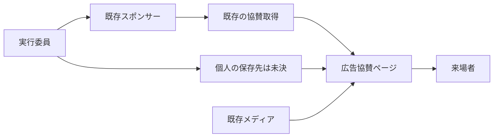

# 広告協賛ページ 技術設計案

> **レビュー用・未確定 / 実装 NO-GO**。Requirementsは未承認。個人協賛の保存先と既存レコードの検証方針が未決のため、設計レビューゲートは未通過。担当者の承認後に確定版 `design.md` を作成する。

## 概要

`/sponsors/ad` にFigmaに沿った広告協賛ページを追加する。企業は既存の `sponsors` と `media` を使い、個人は公開用表示名と表示順のみを登録する。Figma内の名前・ロゴは実データに使わない。CMSへの登録は公開と同義であり、登録前の確認を運用責任者が行う。

### 目的

- A〜Dの企業と個人協賛者を、確定した表示順で表示する。
- 既存の協賛取得、メディア配信、サイトのナビゲーションと権限を維持する。

### 対象外

金額や申込日時の保存・システム内での金額順ソート、公開状態、未公開メディアの新たな保護、取込機能の仕様化、アーカイブ。本作業は設計文書のみである。

## Boundary Commitments

- **本仕様が所有**: `/sponsors/ad` の画面、ページ向けの企業データ整形、決定後の個人協賛データの読み取り、ルートメタデータとサイトマップ対応。
- **Out of Boundary**: 公開前の情報と同意の管理、資金情報やその順位計算、ワンショット取込スクリプトの方式、他ページの表示変更。正式な登録順序を作る運用は担当者が所有する。
- **Allowed Dependencies**: 既存 `getSponsors`、Payload `sponsors`・`media`、公開CMSクライアント、既存レイアウトとメタデータ、Cloudflare Workers。個人の取得先は選定待ち。
- **Revalidation Triggers**: 個人の保存先・公開契約、企業必須項目や既存データ、公開状態、Media/S3のアクセス境界、ルーティング、Figmaの変更。

## Architecture

### 現行構造と統合方針

`sponsors` は `type` が複数選択で `orderable: true`、`tier` は `planA`〜`planD`、`logo` は `media` 参照である。`getSponsors` は未認証で全件を `_order` 昇順に取得し種別ごとに分ける。トップ等が同じ処理に依存するため、ページ固有のプラン処理は新しいページ側で行い、既存の取得結果や他利用者へのフィルタを変更しない。

### File Structure Plan

| 予定パス | 責務 |
| --- | --- |
| `frontend/src/app/(site)/sponsors/ad/page.tsx` | 通常レイアウト内のページとメタデータ。既存 `[kind]` の404より静的ルートが優先される。 |
| `frontend/src/components/advertising-sponsors.tsx` | プラン別カード、個人一覧、リンク、レスポンシブ表示。 |
| `frontend/src/lib/advertising-sponsors.ts` | 既存取得結果から広告協賛を検査し、A〜Dに安定して分類する。個人の取得は保存先決定後に追加。 |
| `frontend/src/lib/route-metadata.ts` | ページのタイトル、説明、正規URL用エントリを追加。 |
| `frontend/src/lib/crawl-targets.ts`、`frontend/src/app/sitemap.ts` | 2階層の実体ルートを対象とし、公開フェーズに従ってサイトマップへ追加。 |
| `cms/src/collections/sponsors.ts`、`cms/src/collections/sponsors.test.ts` | 広告協賛のプラン・A〜Cロゴ必須検証の候補。既存レコードへの適用方法は未決。 |
| `frontend/src/lib/advertising-sponsors.test.ts`、`frontend/src/components/advertising-sponsors.test.tsx`、`frontend/src/app/(site)/sponsors/ad/page.test.tsx`、`frontend/e2e/advertising-sponsors.spec.ts` | データ整形、表示、ルート、ブラウザー操作を検証。 |
| `frontend/src/lib/crawl-targets.test.ts`、`frontend/src/app/sitemap.test.ts`、`frontend/src/lib/route-metadata.test.ts` | 既存の `/sponsors/ad` 除外期待を実体追加後の期待に更新。 |

個人協賛のCMS・取得・型・テストの具体的なパスは保存先決定後に追加する。確定前にタスク化しない。

## Requirements Traceability

| 要件ID | 設計・検証 |
| --- | --- |
| 1.1, 1.2, 1.3, 1.4, 1.5, 1.6, 1.7 | ページとSEO、Figma、既存導線、一覧の全件表示 |
| 2.1, 2.2, 2.3, 2.4, 2.5, 2.6, 2.7 | 企業の取得・分類と条件付き検証、運用の表示順 |
| 3.1, 3.2, 3.3, 3.4, 3.5, 3.6, 3.7 | プランごとのグリッド・ロゴ・文字表示 |
| 4.1, 4.2, 4.3, 4.4 | URLの検査とリンク |
| 5.1, 5.2, 5.3, 5.4, 5.5, 5.6 | 個人表示とデータ境界。取得先は未決 |
| 6.1, 6.2, 6.3, 6.4, 6.5, 6.6 | CMSの公開境界・既存機能と権限の非回帰 |
| 7.1, 7.2, 7.3, 7.4, 7.5, 7.6 | 代替テキスト、フォーカス、幅と既存共通機能 |
| 8.1, 8.2, 8.3, 8.4 | 取得失敗、空、無効データの扱い |
| 12.1, 12.2, 12.3, 12.4, 12.5 | 表示・操作の自動検証とブラウザー確認 |

## Components and Interfaces

### 企業取得と順序

`getSponsors()` の結果の `value.ad` をページ専用整形に渡す。`type` は複数値を持ちうるため、他種別との兼用レコードを維持する。`tier` がA〜D以外、名前が空、A〜Cでロゴ参照がないレコードはページから除外し、識別に必要な既存IDと理由のみをサーバーログに記録する。Dはロゴ不要。各グループへの振り分けは元の `_order` 順を保持し、A、B、C、Dの順に描画する。上限は設けない。順序が同値・未設定の場合の扱いは担当者確認事項とし、順序が確定するまで登録内容を点検する。

既存の `tier` と `logo` は現状任意である。`type` に `ad` がある場合の条件付き検証を `beforeValidate` またはフィールド検証で追加する候補とする。DB上の一律NOT NULLにはせず、他種別を壊さない。既存の不備を持つ複合種別レコードの更新まで拒否しうるため、適用条件と修正運用は承認前に確認する。追加フィールドやmigrationが必ず必要だとは決めない。

### 個人協賛と公開境界

公開表示名と `_order` 相当の表示順のみを公開可能なデータとして扱う。`sponsors` の `type` 追加と別コレクションのどちらにするか未決。前者は既存 `getSponsors` の型と分類、トップ・サイネージ等への影響、後者は追加スキーマ・migration・型生成・読み取り権限の影響を比較し、担当者が決める。順序は担当者が確定して登録する。金額、申込日時、未公開本名、連絡先、同意情報をCMSや公開APIに入れないため、このシステム内で金額ソートをしない。

`sponsors` の公開readは全件であり、実行委員アップロードのMediaは `used_in_published = null` として公開対象になる。`media/serve/:id/:size` はread権限を評価してからURLへリダイレクトするが、S3直URLやキャッシュも含む非公開保証はこの案では提供しない。**未公開のスポンサー・ロゴや非公開情報はアップロード・登録前の別管理場所で保持する**。現行APIとMediaアクセス規則を変更しない。登録時に表示内容と同意を運用上確認する。公開後の削除・キャッシュ反映には既存の配信挙動があるため即時秘匿を保証しない。

### 画面・URL・失敗

PCはA 2列、B 3列、C 4列、D 3列、個人3列。モバイルはA 1列、B・C・D・個人2列。A枠は7:3、B・C枠は2:1、画像は `object-fit: contain` で切らずに収める。320px幅まで折り返しを許可し、ロゴに企業名の代替テキストを付ける。Figmaの余白・色・文字を既存トークンに合わせ、サンプル値は使わない。個人表示名の末尾の「様」は重複しないよう一度だけ付ける。

URLは `URL` とプロトコルの `http:` / `https:` で検査し、有効時のみ `<a target="_blank" rel="noopener noreferrer">` を使用する。A〜Cはカード全体、Dは文字のみをリンクとする。無効URLは非リンクのまま表示する。Figmaにない空状態の文言や再試行UIを新設しない。取得失敗と空件数を内部で区別し、失敗時にfixtureを代用せず運用者が確認できるログを残す。失敗時の利用者向け表示は既存のエラー処理に従い、詳細は実装前に確認する。壊れた画像や未取得データの扱いでFigmaにない画面が必要になれば、担当者へ確認する。

## Data Models and Contracts

| データ | 格納・公開 | 補足 |
| --- | --- | --- |
| 企業 | 既存 `name`, `type`, `tier`, `logo`, `url`, `_order` | `_order` は申込順を運用で設定。表示日時は持たない。 |
| 個人 | 公開用表示名と表示順 | 保存先と公開APIの形式は未決。金額等は保存しない。 |
| ロゴ | 既存 `media`、S3互換ストレージ | 公開可能なものだけアップロード。既存の変換・配信を利用。 |

企業の既存CMS応答はページ固有の公開DTOとして新たに変更しない。個人の契約は保存先の決定後に定める。アクセス制御は既存方針を維持し、非公開情報を公開先へ保存しないことが前提である。

## データ準備・運用

正式な一覧と順序、企業プラン、ロゴ、個人表示名と掲載可否を登録前に担当者が確認する。一括登録が必要なら担当者方針のワンショット作業として別途実施し、本仕様ではCSV・Excelの形式、識別子、dry-run、apply、冪等性、補償処理を新たな製品要件やCMS項目にしない。既存のMediaアップロードはWebPと派生サイズを生成し、S3互換ストレージに保存する。実データや本番CMSへの書き込みは今回行わない。

## 検証方針

- 単体: A〜Dの順序と `_order` の保持、複数種別、欠損、URL検証、個人名の敬称、ロゴ・D文字表示。既存のトップと地域協賛のテストを維持する。
- CMS: 条件付き必須検証を選ぶ場合、広告以外・複数種別・既存不備レコードの読み書きへの影響を検証する。個人の保存先を選択後にAPI・権限・生成型の影響を検証する。
- ブラウザー: 1440、390、320pxで列数、折り返し、画像全体、横スクロール、キーボード、外部タブ、空・失敗・不正URLを確認する。Figmaにない状態を勝手に追加しない。
- 既存CI: 現行の型検査・lint・テスト・build、schema check、OpenNextおよびCloudflare previewの既存運用を維持する。previewでの表示確認とCI成功は区別する。新たな必須ゲートとして隔離DBのup/down/再upや実CMS E2Eを要求しない。
- migrationが実際に必要な選択となった場合、最新dev上の既存migration・snapshotと衝突しないこと、既存データと戻し方を設計し、既存の運用に従って検証する。

## 未解決事項とレビュー判定

1. **P0 個人協賛の保存先**: 既存 `sponsors` の種別追加か別コレクションか。契約・ファイル構成・migration・既存消費者への影響が変わるため実装不可。
2. **P0 既存データと必須検証**: 不備のある既存広告協賛や複数種別レコードの更新をどう扱うか。既存データの点検と修正の責任者・方法を確認する。
3. **P0 RequirementsとFigma**: 改訂要件への承認と、Figmaの最終承認状態を担当者に確認する。失敗表示の具体形も既存パターンに照らして確認する。

レビュー結果は **NO-GO**。既存の取得と公開境界を尊重し、Figmaと画面要件を整理したが、個人の保存・配信契約が定まらないため完全な設計や実装タスクに進めない。
