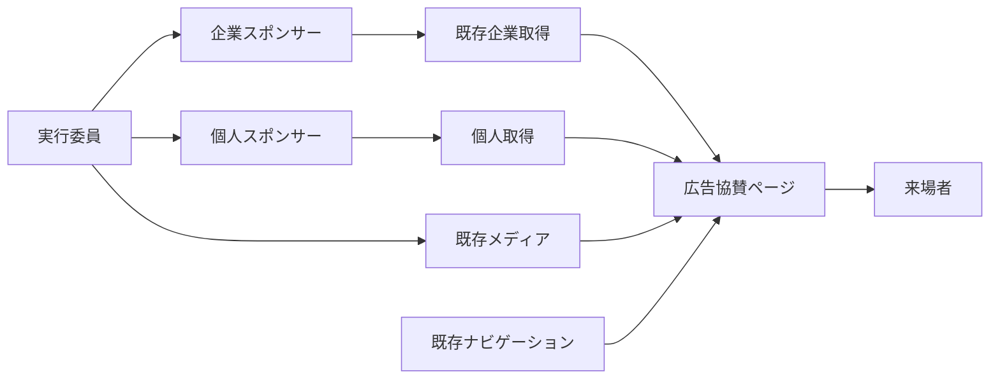

# 広告協賛ページ 技術設計書

## Overview

`/sponsors/ad` に広告協賛企業と個人協賛者を掲載する。企業は既存 `sponsors` と `media` を再利用し、個人は表示名と表示順だけを持つ別コレクションで管理する。表示は承認済み Requirements とFigmaを基準にし、企業・個人の実データをコードへ埋め込まない。

### Goals

- A〜Dと個人の順序、Figmaに沿った配置、リンク操作を提供する。
- 企業の入力を検証し、参照中ロゴの削除を防ぐ。既存の利用先と権限を保つ。

### Non-Goals

申込日時・金額・公開状態・未公開個人情報の管理、一括取込の製品化、公開後のアーカイブ、トップページの表示選択や種別間の表示順の統合。本設計作業では実装、migration、実データ投入を行わない。

## Boundary Commitments

### This Spec Owns

- 広告協賛ページ、ページ専用の企業・個人一覧変換、個人協賛コレクション、広告協賛入力検証と参照中ロゴ削除防止。
- 広告協賛への必要なナビゲーション導線、canonical、クロールとサイトマップの追加。

### Out of Boundary

- 担当者が別管理する同意情報や金額、公開前データ、公開対象の決定。登録済みデータと実行委員が登録するロゴは公開可能であることが前提。
- 既存のトップ・地域協賛・構内マップ・サイネージの内容変更。ナビゲーションへの指定された導線追加だけを例外とする。

### Allowed Dependencies

Payload `sponsors`・`media`・`navigation`、既存の access policy、PostgreSQL、Next.js App Router、CMS公開REST、Workers Cache API、既存のUIとFigma。個人コレクションの権限は登録口の既存ポリシーを通す。

### Revalidation Triggers

CMSの公開・認可方針、Payloadの削除処理やDBアダプター、ナビゲーション形式・既存利用者、Figma、`_order` やキャッシュの契約が変わる場合は再検証する。

## Architecture



企業一覧は既存 `getSponsors()` の `ad` をページ内で分類し、共通取得・トップ・サイネージには個人を混入させない。個人は独立した `personal_sponsors` にし、`sponsors.type` 追加による不要な入力欄や既存利用者への影響を避ける。新規依存は不要。`_order` は各コレクション内で独立し、両者を相互に並べ替えない。

## File Structure Plan

| パス | 変更・責務 |
| --- | --- |
| `frontend/src/app/(site)/sponsors/ad/page.tsx`、同 `page.test.tsx` | 通常サイトレイアウトのルート、企業・個人取得、メタデータ、ページテスト。 |
| `frontend/src/lib/advertising-sponsors.ts`、同 `.test.ts` | `getSponsors` 結果の検証・プラン分類と個人一覧取得。既存共通取得は変更しない。 |
| `frontend/src/components/advertising-sponsors.tsx`、同 `.test.tsx` | 画面本文、グリッド、リンク・ロゴ・個人表示。画像エラー処理のみ必要な範囲をクライアント化。 |
| `frontend/src/lib/navigation.ts`、`frontend/src/lib/get-navigation.ts`、各 `.test.ts` | liveの既定項目とCMS・保持済み値の導線を整合。既存項目を保持。 |
| `frontend/src/lib/route-metadata.ts`、`frontend/src/lib/crawl-targets.ts`、`frontend/src/app/sitemap.ts`、各 `.test.ts` | 正規URL・クロール・サイトマップ。既存 `/sponsors/ad` 除外期待を更新。 |
| `frontend/e2e/advertising-sponsors.spec.ts` | 画面幅・リンク・フォーカス・タッチ・失敗ケースのブラウザー検証。 |
| `cms/src/collections/personal-sponsors.ts`、`cms/src/collections/index.ts`、`cms/src/nav-groups.ts` | 個人の公開表示名と手動表示順を管理する独立コレクションを登録。 |
| `cms/src/collections/sponsors.ts`、`cms/src/hooks/advertising-sponsor.ts`、同 `.test.ts`、`cms/src/collections/sponsors.test.ts` | `ad` を含むレコードの条件付き入力検証。既存フィールドとフックを維持。 |
| `cms/src/collections/media.ts`、`cms/src/hooks/sponsor-logo-guard.ts`、同 `.test.ts`・`.int.test.ts` | 削除前にスポンサーのロゴ参照を保護。既存Mediaフックを維持。 |
| `cms/src/collections/personal-sponsors.test.ts`、`cms/src/access/access.int.test.ts` | 個人コレクションのフィールド・権限・既存権限の確認。 |
| `cms/src/migrations/`、`cms/src/payload-types.ts`、`frontend/src/cms-types.ts` | 実装時に個人コレクション用migration・snapshotと型を既存手順で生成・同期。既存migrationは変更しない。 |

## Requirements Traceability

| 要件ID | 担当する設計 |
| --- | --- |
| 1.1, 1.2, 1.3 | ページ構成と固定文言 |
| 1.4, 1.9, 1.10 | ナビゲーションと既存リダイレクト |
| 1.5 | SEO・canonical・クロール・サイトマップ |
| 1.6, 1.7, 1.8 | 共通レイアウト、本文、全件表示 |
| 2.1, 2.2, 2.4, 2.5 | 企業取得、A〜D分類、`_order`、行優先 |
| 2.3 | CMS入力検証 |
| 3.1, 3.2, 3.3, 3.4, 3.5, 3.6, 3.7 | レスポンシブグリッドとロゴ・企業名 |
| 4.1, 4.2, 4.3, 4.4, 4.5, 4.6, 4.7 | URL検証、リンク、Hover、支援技術 |
| 5.1, 5.2, 5.3, 5.4, 5.5, 5.7 | 個人表示と敬称・行優先 |
| 5.6 | 個人コレクションの入力項目 |
| 6.1, 6.2, 6.3 | 公開契約、RBAC、既存データの互換性 |
| 6.4, 6.5 | 既存利用者の非回帰、個人データ分離 |
| 6.6 | ロゴ参照保護と同時操作 |
| 7.1, 7.2, 7.3, 7.4, 7.5, 7.6 | 画像代替、フォーカス、入力方法、表示幅、共通機能 |
| 8.1, 8.2 | 不正データ・取得失敗・空データ・キャッシュ |

## Components and Interfaces

### CMS: 企業の入力検証

`sponsors` の既存 `beforeValidate` に追加する。`data` と `originalDoc` をマージした最終値で判定し、部分更新時に未送信項目を誤って空扱いしない。`type` に `ad` が含まれる場合のみ、空白を除いた `name`、`planA`〜`planD` の `tier`、A〜Cの `logo` を必須とする。Dはロゴ不要。他の種別のみのデータには広告用の新条件を適用しない。既存フィールドをDBレベルで必須にしない。

URLは任意。`null`・未入力・空白のみは空欄として受理し、非空文字列は `new URL` で解釈でき、プロトコルが `http:` / `https:` のときのみ受理する。失敗時は既存の `ValidationError` と項目別メッセージを用いる。これは 2.3 の形式検証と 4.5 のURL未登録許容を両立する。既存不正データは保存時に修正を促し、読取時はページ側で防御する。

### CMS: 個人協賛と公開契約

`personal_sponsors` を `orderable: true` とし、編集可能な業務入力は必須の `name` のみ。`_order` はPayloadのドラッグ操作で管理する。Payloadが自動生成するID・日時等はシステム項目であり、金額、申込日時、連絡先、同意、企業用URLやロゴの入力欄を設けない。公開APIは登録済み表示名・表示順を公開し、技術ID等の標準メタデータを含みうる。公開に同意した表示名のみを登録する運用である。

登録口の `withAccess` と `accessFor` に従い、未認証readを許可、create/update/deleteはexecutiveのみ。学生団体の管理画面に出さない。独立コレクションのため、既存の `getSponsors`、`mergeSponsorLogos`、サイネージのロゴ・名前リストには含まれない。新コレクションのmigration・生成型の更新は実装時に必要で、既存データは更新しない。

### CMS: 参照中ロゴの削除防止

既存DBの `sponsors.logo_id` は `ON DELETE SET NULL` であり、現在のMediaガードは学生団体の公開企画用で、executiveやスポンサー参照を保護しない。`media` の `beforeDelete` に全スポンサー種別を対象とするガードを追加し、単体・一括・管理画面・REST・Local APIの `overrideAccess` にかかわらず実行する。参照が1件でもあれば公開可能なエラーで拒否し、対象Media・元画像・派生画像を残す。未参照のMediaは既存どおり削除できる。

同時に新しい参照が設定される競合を防ぐため、削除中の `req.transactionID` を解決し `req.payload.db.sessions[transactionID].db` に紐づくPostgreSQL主DBトランザクションで対象Media行を `SELECT ... FOR UPDATE` し、その後に同じトランザクションの新しいSQL文で `sponsors.logo_id = 対象ID` を照会する。ロック待ち後の新しいコミットを参照確認で見られるよう、トランザクション分離レベルは `READ COMMITTED` を前提とし、それ以外は削除を拒否する。これは既存統合テストが使うアダプターのセッションに従う。IDはパラメータ化し、ロックはコミットまたはロールバックまで保持する。FKの参照側書込が競合して待機し、削除確定後の参照作成はFKで失敗する。トランザクションや主DBセッションが得られない場合は削除を拒否する。DB直操作やS3直削除はCMS外の運用であり、このガードの対象外。

Payload 3.88.0の単体・一括削除は `beforeDelete` 後にファイル削除を行うため、拒否はファイル削除前に発生する。既存の学生団体向け `beforeOperation` とpurge hookは維持する。一括削除はPayloadの部分成功形式を維持し、参照中の画像を個別に失敗として返す。実装時の統合テストで同時参照作成・単体・一括・Local API・拒否後のオブジェクト残存を検証する。Payloadアダプターのトランザクションセッション取得方法はバージョン依存のため、型安全な接続を実装時に確認し、利用できなければ完了扱いにしない。

### Frontend: 取得とデータ境界

企業は `getSponsors()` の `value.ad` を取得し、既存 `_order` を維持してA、B、C、Dへ安定分類する。広告以外や無効なプラン、空白名、A〜Cのロゴ参照なしは掲載しない。画像読込失敗時も当該カードを除外する。Dはロゴを使用しない。URLの空欄・不正値は `null` とし、企業自体は維持する。既存の地域協賛にあるHTTP(S)判定と同等の規則を使う。

個人は `cms.findMany('personal_sponsors', { sort: ['_order'], limit: 0, depth: 0 })` で取得し、空白のみの名前は除外して配列順に並べる。公開型はCMS生成型から導出し、画面に必要な形は次の境界に絞る。

```typescript
type AdTier = 'planA' | 'planB' | 'planC' | 'planD';
type AdSponsor = Readonly<{ id: number; name: string; tier: AdTier; logoId: string | null; url: string | null }>;
type PersonalSponsor = Readonly<{ id: number; name: string }>;
type ListResult<T> = { readonly ok: true; readonly items: readonly T[] } | { readonly ok: false };
```

両取得は独立し、一方が失敗しても他方の実データは表示する。失敗した一覧は空として扱い、架空のデータ・架空のロゴ・URLを作らない。取得失敗と空結果はサーバーログとテストでは区別するが、Figmaにない新規の空状態文言や再試行UIは追加しない。

`cms.findMany` は既定のWorkers Cache APIの成功レスポンスを60秒保持する。キャッシュヒット中は直近の正常レスポンスを返し、期限後に取得失敗すればエラーとなる。`findMany` は `retained` と `timeoutMs` を `request` に転送しないため、長期保持や自動のstale fallbackがあると仮定しない。両一覧とも同じ既定方式を使い、キャッシュがない環境では直接取得する。Next.js・CDN・ブラウザーの別キャッシュが独立に重ならないよう、ページはリクエスト時に描画しCMS取得に60秒キャッシュを任せ、previewで更新反映を実測する。失敗時の長期保持を新たに保証しない。

### Frontend: 画面と操作

共通 `(site)` レイアウトのヘッダー、フッター、背景図形を再利用し、本文にタイトル「広告協賛」、Requirements 1.2の企業感謝文、A〜D、区切り線、見出し「個人協賛者様」、1.3の個人感謝文、個人一覧を順に配置する。プラン見出し・区切り線・空カード・匿名注記は設けない。各配列のDOM順をCSS Gridの行優先にし、件数上限やページネーションは設けない。

既存 `lg` の1024pxで切り替える。PCは A 2列、B 3列、C 4列、D 3列、個人3列。1023px以下は A 1列、B・C・D・個人2列。Aのカード比は7:3、B・Cは2:1。Desktopの本文最大幅1120px、横余白とカード間隔はFigmaを基準にし、320pxでも列が縮み文字が折り返せる `minmax(0, 1fr)` を使用する。実ロゴにはFigma内のサンプル画像を使わず `toAssetUrl` でMediaを参照し、Figmaのロゴ領域（Desktop A 460×170、B 300×120、C 220×86、Mobile A 300×110、B 145×60、C 135×54を上限）へ `object-fit: contain` で拡大・縮小する。小画面では領域自体を縮める。企業名を `alt` とし、Dと個人名は文字サイズを変えず省略せず折り返す。個人名に末尾 `様` がなければ1つ付ける。

有効なHTTP(S) URLのみA〜Cのカード全体、Dの文字を `<a target="_blank" rel="noopener noreferrer">` にする。無効・空欄は同じ内容の非リンクとし、アイコンを追加しない。リンクに視覚的には非表示の「新しいタブで開きます」を付け、フォーカスリングを既存トークンで表示する。A〜CはFigma `1409:38` の既定枠 `#e6e6e6` からHover枠 `#d3d3d3` に変化。Dは既存 `HoverLine` の下線表現を用い、`TextLink` の矢印は使わない。非リンクにはHover・focusを付けない。タッチ主体ではHoverに頼らず、リンク付きカードの枠とDの下線を常時表示し、タップを1回でリンク操作にする。既存のモーション停止設定に従う。通常文字4.5:1、大きな文字・フォーカス3:1以上を実測する。

### ナビゲーション・SEO

既存の `/2025/sponsors` リダイレクトを維持する。`navigationItemsByPhase.live` の「お知らせ」子項目へ `/sponsors/ad` を追加し、フッターへも出す。`pre_event` の既存「協賛」配下を維持する。CMSの `navigation` globalが正常・長期キャッシュ利用の場合にも同じ導線が必要なため、`getNavigation` の取得・変換後に両フェーズを検査し、既存の `live`「お知らせ」グループにパスがなければ子として追加する。既存の子の同じパスは重複させず `hideInFooter` を解除し、その他の子・順番・親を保持する。`pre_event` は既存の協賛グループ内に同様に追加または表示する。対応するグループが存在しないCMS設定は勝手に最上位項目を追加せず運用エラーとし、公開前に担当者が両グループを確認・設定する。既存globalの編集内容をmigrationで上書きしない。

`ROUTE_METADATA` と `buildPageMetadata` に `/sponsors/ad` を追加し、タイトル「広告協賛」とcanonicalを生成する。`crawl-targets.ts` の実体ルート一覧に追加し、`sitemap.ts` では `OWN_HANDLING_ROUTES` と明示エントリを追加して重複や固定ページ扱いを避ける。既存の `phase.ts` とrobots公開判定を維持する。

## Testing Strategy

- **CMS単体・統合**: `ad` 単独・複数種別、他種別、空白名、プラン・ロゴ欠落、URL空欄・HTTP(S)・不正値、部分更新を検証する。個人の入力欄・`_order`・匿名read・executive書込・学生書込拒否を検証する。
- **Media統合**: executive・学生・未認証、単体・一括・Local API、複数スポンサー参照、参照解除後の削除、S3/派生ファイルが拒否時に残ること、参照作成と削除の並行操作を確認する。トランザクション無効時は拒否を確認する。
- **Frontend単体**: A〜D分類と行順・上限なし、URL空欄/不正、画像欠損、敬称、独立失敗、空結果を検証。トップとサイネージに個人が出ないこと、他種別や既存URLへの影響がないことを確認する。
- **ブラウザー**: 1440・1023・390・320pxで列・比率・画像全体・折返し・横スクロールを確認。ポインターHover、キーボードFocus、支援技術向け新規タブ通知、coarse pointerの識別と1回のタップ、両フェーズの導線、旧URL、canonical・sitemapを確認する。Figma Desktop・Mobileと比較する。
- **既存CI**: 実装時は既存frontendの型検査・lint・format・unit・build・Playwright・OpenNext成果物検査、CMSの型・生成物同期・test・build・schema checkと既存previewを使う。fixtureと実CMSの結果を区別する。今回の文書作成では実行しない。
- **migration**: 新コレクション追加のみを最新devを基準に生成し、既存schema・migrationを再生成・重複変更しない。隔離DBで適用後に既存スポンサーとMediaの保持、生成型とread/write権限を確認する。実データ投入・本番反映は別途承認を受ける。

## 運用上の確認事項

- 個人・企業の公開可能な名前、順序、最終ロゴは登録前に担当者が確認する。登録後は公開される。
- 両フェーズのCMS navigationで必要な親グループが存在すること、previewの接続先と動作を公開前に確認する。現時点でCMS本番データを変更・確認していない。
- Media削除の同時実行とストレージへの影響は、実装時に実DB・ストレージを用いた統合検証が必須。設計承認は別途必要。
