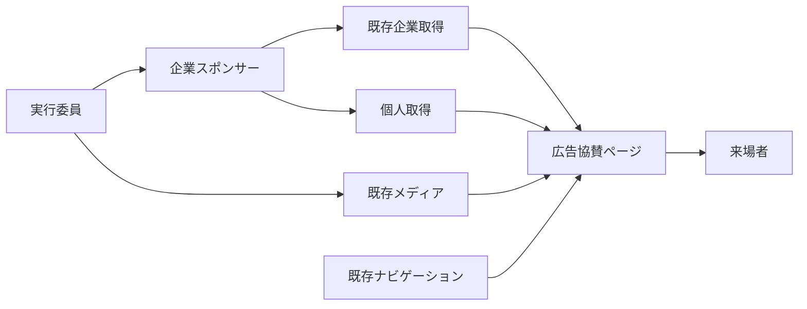

# 広告協賛ページ 技術設計書

## Overview

`/sponsors/ad` に広告協賛企業と個人協賛者を掲載する。企業は既存 `sponsors` と `media` を再利用し、個人は同じ `sponsors` に種別 `personal` を加えて管理し、登録は名称だけで足りる。表示は承認済み Requirements とFigmaを基準にし、企業・個人の実データをコードへ埋め込まない。

### Goals

- A〜Dと個人の順序、Figmaに沿った配置、リンク操作を提供する。
- 企業の入力を検証する。既存の利用先と権限を保つ。

### Non-Goals

申込日時・金額・公開状態・未公開個人情報の管理、一括取込の製品化、公開後のアーカイブ、トップページの表示選択や種別間の表示順の統合。

## Boundary Commitments

### This Spec Owns

- 広告協賛ページ、ページ専用の企業・個人一覧変換、`sponsors` の種別 `personal` の追加、広告協賛入力検証。
- 広告協賛への必要なナビゲーション導線、canonical、クロールとサイトマップの追加。

### Out of Boundary

- 担当者が別管理する同意情報や金額、公開前データ、公開対象の決定。登録済みデータと実行委員が登録するロゴは公開可能であることが前提。
- 既存のトップ・地域協賛・構内マップ・サイネージの内容変更。ナビゲーションへの指定された導線追加だけを例外とする。

### Allowed Dependencies

Payload `sponsors`・`media`・`navigation`、既存の access policy、Next.js App Router (ISR)、CMS公開REST、既存のUIとFigma。`sponsors` の権限は既存のまま使う。

### Revalidation Triggers

CMSの公開・認可方針、ナビゲーション形式・既存利用者、Figma、`_order` やキャッシュの契約が変わる場合は再検証する。

## Architecture



企業一覧は既存 `getSponsors()` の `ad` をページ内で分類し、共通取得・トップ・サイネージには個人を混入させない。個人は同じ `sponsors` の種別 `personal` として登録し、サイネージ・トップと同じデータに揃える。トップ・サイネージが使う `mergeSponsorLogos` は走査する種別に `personal` を含めず、個人を混入させない。新規依存は不要。

## File Structure Plan

| パス | 変更・責務 |
| --- | --- |
| `frontend/src/app/(site)/sponsors/ad/page.tsx`、同 `page.test.tsx` | 通常サイトレイアウトのルート、`revalidate = 60` と `loadForIsr` による企業・個人取得、メタデータ、ページテスト。 |
| `frontend/src/lib/advertising-sponsors.ts`、同 `.test.ts` | `getSponsors` 結果の検証・プラン分類と個人一覧取得。既存共通取得は変更しない。取得失敗のケースもこの単体テストで確認する。 |
| `frontend/src/components/advertising-sponsors.tsx`、同 `.test.tsx` | 画面本文、グリッド、リンク・ロゴ・個人表示。 |
| `frontend/src/lib/navigation.ts`、同 `.test.ts` | `navigationItemsByPhase.live` の「お知らせ」子項目に「広告協賛」を追加 (CMS不達時の既定値)。既存項目を保持。 |
| `frontend/src/lib/route-metadata.ts`、`frontend/src/lib/crawl-targets.ts`、`frontend/src/lib/route-classification.test.ts`、`frontend/src/app/sitemap.ts`、各 `.test.ts` | 正規URL・クロール・サイトマップ。既存 `/sponsors/ad` 除外期待を更新。`crawl-targets.ts` の「2 セグメント以上 (例: /sponsors/ad) はトップページ内アンカー」のコメントと、`route-classification.test.ts` の `/sponsors/[kind]` が `/sponsors/ad` を解決する旨のコメントを実態に合わせて更新。 |
| `frontend/src/app/(site)/sponsors/[kind]/page.tsx` | 準備中ページとして残す。コメント「協賛ページは未実装。静的な sponsors/ad 等ができればそちらが優先される。」を、`ad` 以外の種別が準備中である旨に更新。 |
| `frontend/e2e/advertising-sponsors.spec.ts` | 画面幅・リンク・フォーカスのブラウザー検証。 |
| `frontend/src/lib/sponsors.ts` | 変更しない。`mergeSponsorLogos` (トップ・サイネージ) が走査する `SPONSOR_TYPES` に `personal` を含めない。 |
| `cms/src/collections/sponsors.ts`、`cms/src/hooks/advertising-sponsor.ts`、同 `.test.ts`、`cms/src/collections/sponsors.test.ts`、`cms/src/hooks/local-sponsor-map.ts` | 種別の選択肢に `{ label: '個人協賛', value: 'personal' }` を追加。`ad` を含むレコードの条件付き入力検証。既存フィールドとフックを維持。HTTP(S) URL判定を `local-sponsor-map.ts` から関数として切り出し共用する。 |
| `cms/src/migrations/`、`cms/src/payload-types.ts`、`frontend/src/cms-types.ts` | 種別の選択肢追加はDBのenum型に値を1つ足すため、`pnpm migrate:create` でmigration 1本 (とsnapshot) を生成し、`pnpm generate:types` で型を同期する。個人協賛コレクション用に作成済みの2組 (`20261030_041936_personal_sponsors` と `20261031_035550_combined_schema_snapshot` の各 `.ts`/`.json`) と `index.ts` の登録は削除する。 |

## Requirements Traceability

| 要件ID | 担当する設計 |
| --- | --- |
| 1.1, 1.2, 1.3 | ページ構成と固定文言 |
| 1.4, 1.9 | ナビゲーション |
| 1.5 | SEO・canonical・クロール・サイトマップ |
| 1.6, 1.7, 1.8 | 共通レイアウト、本文、全件表示 |
| 2.1, 2.2, 2.4, 2.5 | 企業取得、A〜D分類、`_order`、行優先 |
| 2.3 | CMS入力検証 |
| 3.1, 3.2, 3.3, 3.4, 3.5, 3.6, 3.7 | レスポンシブグリッドとロゴ・企業名 |
| 4.1, 4.2, 4.3, 4.4, 4.5, 4.6 | URL検証、リンク、Hover |
| 5.1, 5.2, 5.3, 5.4, 5.5, 5.7 | 個人表示と敬称・行優先 |
| 5.6 | 種別 `personal` の追加と名称のみの登録 |
| 6.1, 6.2, 6.3 | 公開契約、RBAC、既存データの互換性 |
| 6.4, 6.5 | 既存利用者の非回帰、`mergeSponsorLogos` の走査種別 |
| 7.1, 7.2, 7.3, 7.4, 7.5 | 画像代替、フォーカス、コントラスト、表示幅、共通機能 |
| 8.1, 8.2 | 不正データ・取得失敗・空データ・ISR |

## Components and Interfaces

### CMS: 企業の入力検証

`sponsors` の既存 `beforeValidate` に追加する。`data` と `originalDoc` をマージした最終値で判定し、部分更新時に未送信項目を誤って空扱いしない。`type` に `ad` が含まれる場合のみ、空白を除いた `name`、`planA`〜`planD` の `tier` を必須とする。ロゴは必須にしない。他の種別のみのデータには広告用の新条件を適用しない。既存フィールドをDBレベルで必須にしない。

URLは任意。`null`・未入力・空白のみは空欄として受理し、非空文字列は `new URL` で解釈でき、プロトコルが `http:` / `https:` のときのみ受理する。判定は `cms/src/hooks/local-sponsor-map.ts` の `validateLocalSponsorMap` 内にある既存のインライン判定を関数として切り出し、広告協賛のhookと共用する。失敗時は既存の `ValidationError` と項目別メッセージを用いる。これは 2.3 の形式検証と 4.5 のURL未登録許容を両立する。既存不正データは保存時に修正を促し、読取時はページ側で防御する。

### CMS: 個人協賛と公開契約

個人協賛は `sponsors` の `type` に `personal` を指定したレコードで表し、登録に必要なのは名称 (`name`) だけである。表示順は既存の `_order` (ドラッグ操作) に従う。他のフィールドを隠す仕組みや個人協賛専用の検証は追加しない。公開に同意した名称のみを登録する運用である。

権限は `sponsors` の既存設定のままで、個人協賛専用の権限は設けない。トップ・サイネージのロゴ・名前リストは `frontend/src/lib/sponsors.ts` の `mergeSponsorLogos` が `SPONSOR_TYPES` を走査して作るため、そこに `personal` を含めなければ個人は混入しない。定義は「Data Models」を参照。

### Frontend: 取得とデータ境界

企業は `getSponsors()` の `value.ad` を取得し、既存 `_order` を維持してA、B、C、Dへ安定分類する。広告以外や無効なプラン、空白名は掲載しない。Dはロゴを使用しない。A〜Cでロゴ参照のない企業は掲載から外さず、そのプランのカード内でロゴの代わりに企業名を表示する。見え方はFigmaに状態を追加して確定する。URLの空欄・不正値は `null` とし、企業自体は維持する。既存の地域協賛にあるHTTP(S)判定と同等の規則を使う。

個人は `cms.findMany('sponsors', ...)` で `type` に `personal` を含むレコードを `_order` 順・全件・`depth: 0` で取得し、空白のみの名前は除外して配列順に並べる。公開型はCMS生成型から導出し、画面に必要な形は次の境界に絞る。

```typescript
type AdTier = 'planA' | 'planB' | 'planC' | 'planD';
type AdSponsor = Readonly<{ id: number; name: string; tier: AdTier; logoId: string | null; url: string | null }>;
type PersonalSponsor = Readonly<{ id: number; name: string }>;
```

ページは既存の一覧ページと同じ `export const revalidate = 60` とし、企業一覧と個人一覧の取得をそれぞれ `loadForIsr` (`frontend/src/lib/isr.ts`) で行う。`loadForIsr` はビルド中の失敗だけを空値に置き換え、実行時の失敗は例外を投げ直す。再検証が失敗するため、直前の正常なページが保たれる。架空のデータ・架空のロゴ・URLは作らず、Figmaにない新規の空状態文言や再試行UIは追加しない。

### Frontend: 画面と操作

共通 `(site)` レイアウトのヘッダー、フッター、背景図形を再利用し、本文にタイトル「広告協賛」、Requirements 1.2の企業感謝文、A〜D、区切り線、見出し「個人協賛者様」、1.3の個人感謝文、個人一覧を順に配置する。プラン見出し・区切り線・空カード・匿名注記は設けない。各配列のDOM順をCSS Gridの行優先にし、件数上限やページネーションは設けない。

既存 `lg` の1024pxで切り替える。PCは A 2列、B 3列、C 4列、D 3列、個人3列。1023px以下は A 1列、B・C・D・個人2列。Aのカード比は7:3、B・Cは2:1。Desktopの本文最大幅は1120px。320pxでも列が縮み文字が折り返せる `minmax(0, 1fr)` を使用する。実ロゴにはFigma内のサンプル画像を使わず `toAssetUrl` でMediaを参照し、`object-fit: contain` で拡大・縮小する。ロゴ領域は、カードに対するロゴ領域の比率を保って縮める。幅の比率はFigmaの値 (Desktop A 460/548、B 300/357、C 220/268、Mobile A 300/358、B 145/173、C 135/173) による。高さの比率 (ロゴ領域高さ/カード高さ) もFigmaの実測値で、Desktop A 170/234.857 (node `1409:3`)、B 120/178.667 (`1409:9`)、C 86/134 (`1409:15`)、Mobile A 110/153.429 (`1409:21`)、B 60/86.5 (`1409:27`)、C 54/86.5 (`1409:33`) とする。1024px未満でカードは幅に合わせて広がるが、PC表示の寸法を上限にする。上限はカードがA 548×234.86・B 357.33×178.67・C 268×134、ロゴ領域がA 460×170・B 300×120・C 220×86 (Figma 1408:2 のPC実測値)。各プランのカード行のまとまりを本文幅の中で左右中央に置く。端数のカードはまとまりの中で左から並べる (PCと同じ)。例として1023px (本文幅991) では、A 1列の548は左右221.5ずつ、B 2列の726.67は132.17ずつ、C 2列の548は221.5ずつ空く。1024px未満では、Dと個人の名前一覧をBプランのカード行と同じ幅 (最大726.67 = 357.33×2 + 列gap12) に収め、本文の中で左右中央に置く。名前は各列の中で左揃えのままとし、列数・gapは変えない。本文幅がこれより狭い場合は本文幅いっぱいとする。企業名を `alt` とし、Dと個人名は文字サイズを変えず省略せず折り返す。個人名に末尾 `様` がなければ1つ付ける。

間隔と角丸はFigma (fileKey `0kWDqHsLr6xE8b4FFgR1Zx`、Desktop `1410:26`、Mobile `1410:27`) のノード座標から実測した次の値を使う。単位はpx。

| 項目 | Desktop (1440幅) | Mobile (390幅) |
| --- | --- | --- |
| 本文の幅・左右余白 | 幅1120、左右160 | 幅358、左右16 |
| カード間隔 A (横/縦) | 24 / 24 | 縦 12 (1列) |
| カード間隔 B (横/縦) | 24 / 24 | 12 / 12 |
| カード間隔 C (横/縦) | 16 / 16 | 12 / 12 |
| D の列間/行間 | 24 / 16 | 16 / 12 |
| 個人の列間/行間 | 24 / 16 | 16 / 12 |
| プラン間の余白 A→B、B→C、C→D | 48 | 32 |
| D→区切り線 | 48 | 32 |
| 区切り線→個人見出し | 48 | 32 |
| 個人見出し→感謝文→一覧 | 24 | 20 |
| カード角丸 | 8 | 8 |

有効なHTTP(S) URLのみA〜Cのカード全体、Dの文字を `<a target="_blank" rel="noopener noreferrer">` にする。無効・空欄は同じ内容の非リンクとし、アイコンを追加しない。リンクのフォーカスリングを既存トークンで表示する。A〜Cのロゴカードは枠線を変化させず、トップの協賛表示 (`frontend/src/components/ad-sponsor-marquee.tsx` の `SponsorItem`) と同じく既存ユーティリティ `hover-card-shadow` (ホバーで `shadow-card` の影) を付ける (Figma `1409:38` の既定枠 `#e6e6e6` のまま)。ロゴ未登録のA〜Cカード (企業名表示) は影を付けず、トップのロゴ未登録表示と同じく企業名の下に `HoverLine` 系の下線を出す。Dの企業名の下線は既存の `HoverLineText` (`frontend/src/components/hover-line.tsx`) を用い、`TextLink` の矢印は使わない。非リンクにはHover・focusを付けない。既存のモーション停止設定に従う。通常文字4.5:1、大きな文字・フォーカス3:1以上を実測する。

### ナビゲーション・SEO

- live: `frontend/src/lib/navigation.ts` の `navigationItemsByPhase.live` の「お知らせ」children の末尾に `{ label: '広告協賛', href: '/sponsors/ad' }` を追加する (CMS不達時の既定値)。本番CMSの `navigation` global「開催中」タブの「お知らせ」子項目の末尾にも、同じ項目 (ラベル「広告協賛」、パス `/sponsors/ad`) を実行委員が登録する。フッターは navigation から導出される (`frontend/src/components/footer-phased-links.tsx:35-45`) ため、live の navigation に項目を登録する。登録は公開前の運用手順とし、既存globalをmigrationで上書きしない。
- pre_event: 既存の「協賛」グループ (「広告協賛」「地域協賛」) のまま変更しない。

`ROUTE_METADATA` と `buildPageMetadata` に `/sponsors/ad` を追加し、タイトル「広告協賛」、description「荒牧祭2026にご協賛いただいた企業・団体と個人の皆様をご紹介します。」とcanonicalを生成する。`crawl-targets.ts` の実体ルート一覧に追加し、`sitemap.ts` では `OWN_HANDLING_ROUTES` と明示エントリを追加して重複や固定ページ扱いを避ける。既存の `phase.ts` とrobots公開判定を維持する。

## Data Models

### `sponsors` の種別 `personal`

| 項目 | 値 |
| --- | --- |
| 対象 | 既存 `sponsors` コレクションの `type` (select、hasMany) |
| 追加する選択肢 | `{ label: '個人協賛', value: 'personal' }` |
| 個人協賛の登録内容 | `name` だけ。表示順は既存の `_order` |
| migration | `pnpm migrate:create` で生成する1本。DBのenum型に値 `personal` を1つ足すだけで、テーブルは増えない |

`cms-schema-check` については、選択肢の追加とhookの追加のみで破壊的変更に当たらず、`breaking-change-acknowledged` ラベルは不要。

## Testing Strategy

- **CMS単体・統合**: `ad` 単独・複数種別、他種別、空白名、プラン欠落、ロゴ未登録の表示、URL空欄・HTTP(S)・不正値、部分更新を検証する。種別 `personal` のみのレコードが名称だけで保存でき、広告用の必須条件 (プラン) を要求されないことを検証する。
- **Frontend単体**: A〜D分類と行順・上限なし、URL空欄/不正、敬称、取得失敗 (`advertising-sponsors.test.ts`)、空結果を検証。個人の取得が `type` に `personal` を含む `sponsors` に限られること、`mergeSponsorLogos` の結果に個人が出ないこと (トップとサイネージ)、他種別や既存URLへの影響がないことを確認する。
- **ブラウザー**: 1440・1023・390・320pxで列・比率・画像全体・折返し・横スクロールを確認。ポインターHover、キーボードFocus、両フェーズの導線、canonical・sitemapを確認する。Figma Desktop・Mobileと比較する。
- **既存CI**: frontendの型検査・lint・format・unit・build・Playwright・OpenNext成果物検査、CMSの型・生成物同期・test・build・schema checkと既存previewを使う。
- **migration**: 種別の選択肢追加のみのmigration 1本を最新devを基準に生成し、既存schema・migrationを再生成・重複変更しない。

## 運用上の確認事項

- 個人・企業の公開可能な名前、順序、最終ロゴは登録前に担当者が確認する。登録後は公開される。
- 本番CMSの `navigation` global「開催中」タブの「お知らせ」子項目に「広告協賛」(`/sponsors/ad`) を登録する。

