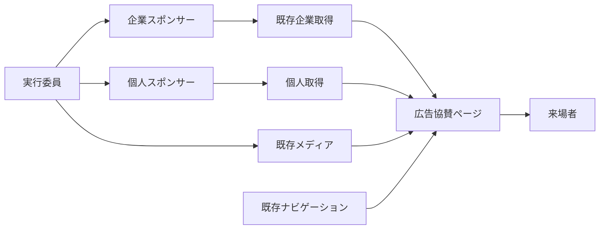

# 広告協賛ページ 技術設計書

## Overview

`/sponsors/ad` に広告協賛企業と個人協賛者を掲載する。企業は既存 `sponsors` と `media` を再利用し、個人は表示名と表示順だけを持つ別コレクションで管理する。表示は承認済み Requirements とFigmaを基準にし、企業・個人の実データをコードへ埋め込まない。

### Goals

- A〜Dと個人の順序、Figmaに沿った配置、リンク操作を提供する。
- 企業の入力を検証し、参照中ロゴの削除を防ぐ。既存の利用先と権限を保つ。

### Non-Goals

申込日時・金額・公開状態・未公開個人情報の管理、一括取込の製品化、公開後のアーカイブ、トップページの表示選択や種別間の表示順の統合。

## Boundary Commitments

### This Spec Owns

- 広告協賛ページ、ページ専用の企業・個人一覧変換、個人協賛コレクション、広告協賛入力検証と参照中ロゴ削除防止。
- 広告協賛への必要なナビゲーション導線、canonical、クロールとサイトマップの追加。

### Out of Boundary

- 担当者が別管理する同意情報や金額、公開前データ、公開対象の決定。登録済みデータと実行委員が登録するロゴは公開可能であることが前提。
- 既存のトップ・地域協賛・構内マップ・サイネージの内容変更。ナビゲーションへの指定された導線追加だけを例外とする。

### Allowed Dependencies

Payload `sponsors`・`media`・`navigation`、既存の access policy、Next.js App Router (ISR)、CMS公開REST、既存のUIとFigma。個人コレクションの権限は登録口の既存ポリシーを通す。

### Revalidation Triggers

CMSの公開・認可方針、Payloadの削除処理、ナビゲーション形式・既存利用者、Figma、`_order` やキャッシュの契約が変わる場合は再検証する。

## Architecture



企業一覧は既存 `getSponsors()` の `ad` をページ内で分類し、共通取得・トップ・サイネージには個人を混入させない。個人は独立した `personal_sponsors` にし、`sponsors.type` 追加による不要な入力欄や既存利用者への影響を避ける。新規依存は不要。`_order` は各コレクション内で独立し、両者を相互に並べ替えない。

## File Structure Plan

| パス | 変更・責務 |
| --- | --- |
| `frontend/src/app/(site)/sponsors/ad/page.tsx`、同 `page.test.tsx` | 通常サイトレイアウトのルート、`revalidate = 60` と `loadForIsr` による企業・個人取得、メタデータ、ページテスト。 |
| `frontend/src/lib/advertising-sponsors.ts`、同 `.test.ts` | `getSponsors` 結果の検証・プラン分類と個人一覧取得。既存共通取得は変更しない。取得失敗のケースもこの単体テストで確認する。 |
| `frontend/src/components/advertising-sponsors.tsx`、同 `.test.tsx` | 画面本文、グリッド、リンク・ロゴ・個人表示。 |
| `frontend/src/lib/navigation.ts`、同 `.test.ts` | `navigationItemsByPhase.live` の「お知らせ」子項目に「広告協賛」を追加 (CMS不達時の既定値)。既存項目を保持。 |
| `frontend/src/lib/route-metadata.ts`、`frontend/src/lib/crawl-targets.ts`、`frontend/src/lib/route-classification.test.ts`、`frontend/src/app/sitemap.ts`、各 `.test.ts` | 正規URL・クロール・サイトマップ。既存 `/sponsors/ad` 除外期待を更新。`crawl-targets.ts` の「2 セグメント以上 (例: /sponsors/ad) はトップページ内アンカー」のコメントと、`route-classification.test.ts` の `/sponsors/[kind]` が `/sponsors/ad` を解決する旨のコメントを実態に合わせて更新。 |
| `frontend/src/app/(site)/sponsors/[kind]/page.tsx` | 準備中ページとして残す。コメント「協賛ページは未実装。静的な sponsors/ad 等ができればそちらが優先される。」を、`ad` 以外の種別が準備中である旨に更新。 |
| `frontend/e2e/advertising-sponsors.spec.ts` | 画面幅・リンク・フォーカスのブラウザー検証。 |
| `cms/src/collections/personal-sponsors.ts`、`cms/src/collections/index.ts`、`cms/src/nav-groups.ts` | 個人の公開表示名と手動表示順を管理する独立コレクションを登録。 |
| `cms/src/collections/sponsors.ts`、`cms/src/hooks/advertising-sponsor.ts`、同 `.test.ts`、`cms/src/collections/sponsors.test.ts`、`cms/src/hooks/local-sponsor-map.ts` | `ad` を含むレコードの条件付き入力検証。既存フィールドとフックを維持。HTTP(S) URL判定を `local-sponsor-map.ts` から関数として切り出し共用する。 |
| `cms/src/collections/media.ts`、`cms/src/hooks/sponsor-logo-guard.ts`、同 `.test.ts`・`.int.test.ts` | 削除前にスポンサーのロゴ参照を保護 (`beforeDelete`)。既存Mediaフックを維持。 |
| `cms/src/collections/personal-sponsors.test.ts`、`cms/src/collections/orderable.test.ts`、`cms/src/access/access.int.test.ts` | 個人コレクションのフィールド・権限・並べ替え設定・既存権限の確認。 |
| `cms/src/migrations/`、`cms/src/payload-types.ts`、`frontend/src/cms-types.ts` | `pnpm migrate:create` で個人コレクション用migration・snapshotを生成し、`pnpm generate:types` で型を同期する。既存migrationは変更しない。 |

## Requirements Traceability

| 要件ID | 担当する設計 |
| --- | --- |
| 1.1, 1.2, 1.3 | ページ構成と固定文言 |
| 1.4, 1.9, 1.10 | ナビゲーションと既存リダイレクト |
| 1.5 | SEO・canonical・クロール・サイトマップ |
| 1.6, 1.7, 1.8 | 共通レイアウト、本文、全件表示 |
| 2.1, 2.2, 2.4, 2.5 | 企業取得、A〜D分類、`_order`、行優先 |
| 2.3 | CMS入力検証 |
| 3.1, 3.2, 3.3, 3.4, 3.5, 3.6, 3.7 | レスポンシブグリッドとロゴ・企業名 |
| 4.1, 4.2, 4.3, 4.4, 4.5, 4.6, 4.7 | URL検証、リンク、Hover、支援技術 |
| 5.1, 5.2, 5.3, 5.4, 5.5, 5.7 | 個人表示と敬称・行優先 |
| 5.6 | 個人コレクションの入力項目 |
| 6.1, 6.2, 6.3 | 公開契約、RBAC、既存データの互換性 |
| 6.4, 6.5 | 既存利用者の非回帰、個人データ分離 |
| 6.6 | ロゴ参照保護 |
| 7.1, 7.2, 7.3, 7.4, 7.5, 7.6 | 画像代替、フォーカス、入力方法、表示幅、共通機能 |
| 8.1, 8.2 | 不正データ・取得失敗・空データ・ISR |

## Components and Interfaces

### CMS: 企業の入力検証

`sponsors` の既存 `beforeValidate` に追加する。`data` と `originalDoc` をマージした最終値で判定し、部分更新時に未送信項目を誤って空扱いしない。`type` に `ad` が含まれる場合のみ、空白を除いた `name`、`planA`〜`planD` の `tier`、A〜Cの `logo` を必須とする。Dはロゴ不要。他の種別のみのデータには広告用の新条件を適用しない。既存フィールドをDBレベルで必須にしない。

URLは任意。`null`・未入力・空白のみは空欄として受理し、非空文字列は `new URL` で解釈でき、プロトコルが `http:` / `https:` のときのみ受理する。判定は `cms/src/hooks/local-sponsor-map.ts` の `validateLocalSponsorMap` 内にある既存のインライン判定を関数として切り出し、広告協賛のhookと共用する。失敗時は既存の `ValidationError` と項目別メッセージを用いる。これは 2.3 の形式検証と 4.5 のURL未登録許容を両立する。既存不正データは保存時に修正を促し、読取時はページ側で防御する。

### CMS: 個人協賛と公開契約

編集可能な業務入力は表示名のみ。`_order` はPayloadのドラッグ操作で管理する。Payloadが自動生成するID・日時等はシステム項目であり、金額、申込日時、連絡先、同意、企業用URLやロゴの入力欄を設けない。公開APIは登録済み表示名・表示順を公開し、技術ID等の標準メタデータを含みうる。公開に同意した表示名のみを登録する運用である。

登録口の `withAccess` と `accessFor` に従い、未認証readを許可、create/update/deleteはexecutiveのみ。学生団体の管理画面に出さない。独立コレクションのため、既存の `getSponsors`、`mergeSponsorLogos`、サイネージのロゴ・名前リストには含まれない。定義は「Data Models」を参照。

### CMS: 参照中ロゴの削除防止

既存DBの `sponsors.logo_id` は `ON DELETE SET NULL` であり、現在のMediaガードは学生団体の公開企画用で、executiveやスポンサー参照を保護しない。`media` の `beforeDelete` に全スポンサー種別を対象とするガードを追加する。`req.payload.count({ collection: 'sponsors', where: { logo: { equals: id } }, req, overrideAccess: true })` を呼び、1件以上なら公開可能なエラーで拒否する。`overrideAccess: true` により、呼び出し側の権限にかかわらず全スポンサーを対象に数える。

Payload 3.88.0 は `beforeDelete` をファイル削除 (`deleteAssociatedFiles`) より前に呼ぶ (`deleteByID.js` / `delete.js`)。そのため拒否時は元画像・派生画像も残る。未参照のMediaは既存どおり削除できる。既存の学生団体向け `beforeOperation` とpurge hookは維持する。一括削除はPayloadの部分成功形式で、参照中の画像を個別の失敗として返す。DB直操作やS3直削除はCMS外の運用であり、このガードの対象外。


### Frontend: 取得とデータ境界

企業は `getSponsors()` の `value.ad` を取得し、既存 `_order` を維持してA、B、C、Dへ安定分類する。広告以外や無効なプラン、空白名、A〜Cのロゴ参照なしは掲載しない。Dはロゴを使用しない。URLの空欄・不正値は `null` とし、企業自体は維持する。既存の地域協賛にあるHTTP(S)判定と同等の規則を使う。

個人は `cms.findMany('personal_sponsors', { sort: ['_order'], limit: 0, depth: 0 })` で取得し、空白のみの名前は除外して配列順に並べる。公開型はCMS生成型から導出し、画面に必要な形は次の境界に絞る。

```typescript
type AdTier = 'planA' | 'planB' | 'planC' | 'planD';
type AdSponsor = Readonly<{ id: number; name: string; tier: AdTier; logoId: string | null; url: string | null }>;
type PersonalSponsor = Readonly<{ id: number; name: string }>;
```

ページは既存の一覧ページと同じ `export const revalidate = 60` とし、企業一覧と個人一覧の取得をそれぞれ `loadForIsr` (`frontend/src/lib/isr.ts`) で行う。`loadForIsr` はビルド中の失敗だけを空値に置き換え、実行時の失敗は例外を投げ直す。再検証が失敗するため、直前の正常なページが保たれる。架空のデータ・架空のロゴ・URLは作らず、Figmaにない新規の空状態文言や再試行UIは追加しない。

### Frontend: 画面と操作

共通 `(site)` レイアウトのヘッダー、フッター、背景図形を再利用し、本文にタイトル「広告協賛」、Requirements 1.2の企業感謝文、A〜D、区切り線、見出し「個人協賛者様」、1.3の個人感謝文、個人一覧を順に配置する。プラン見出し・区切り線・空カード・匿名注記は設けない。各配列のDOM順をCSS Gridの行優先にし、件数上限やページネーションは設けない。

既存 `lg` の1024pxで切り替える。PCは A 2列、B 3列、C 4列、D 3列、個人3列。1023px以下は A 1列、B・C・D・個人2列。Aのカード比は7:3、B・Cは2:1。Desktopの本文最大幅は1120px。320pxでも列が縮み文字が折り返せる `minmax(0, 1fr)` を使用する。実ロゴにはFigma内のサンプル画像を使わず `toAssetUrl` でMediaを参照し、`object-fit: contain` で拡大・縮小する。ロゴ領域は、カードに対するロゴ領域の比率を保って縮める。比率はFigmaの値 (Desktop A 460/548、B 300/357、C 220/268、Mobile A 300/358、B 145/173、C 135/173) による。企業名を `alt` とし、Dと個人名は文字サイズを変えず省略せず折り返す。個人名に末尾 `様` がなければ1つ付ける。

間隔と角丸はFigma (fileKey `0kWDqHsLr6xE8b4FFgR1Zx`、Desktop `1410:26`、Mobile `1410:27`) のノード座標から実測した次の値を使う。単位はpx。

| 項目 | Desktop (1440幅) | Mobile (390幅) |
| --- | --- | --- |
| 本文の幅・左右余白 | 幅1120、左右160 | 幅358、左右16 |
| カード間隔 A (横/縦) | 24 / 24 | 縦 12 (1列) |
| カード間隔 B (横/縦) | 24 / 24 | 12 / 12 |
| カード間隔 C (横/縦) | 16 / 16 | 12 / 12 |
| D の列間/行間 | 24 / 16 | 16 / 12 |
| 個人の列間/行間 | 24 / 16 | 16 / 12 |
| プラン間の余白 A→B、B→C、C→D | 48 | 32 |
| D→区切り線 | 48 | 32 |
| 区切り線→個人見出し | 48 | 32 |
| 個人見出し→感謝文→一覧 | 24 | 20 |
| カード角丸 | 8 | 8 |

有効なHTTP(S) URLのみA〜Cのカード全体、Dの文字を `<a target="_blank" rel="noopener noreferrer">` にする。無効・空欄は同じ内容の非リンクとし、アイコンを追加しない。リンクに視覚的には非表示の「新しいタブで開きます」を付け、フォーカスリングを既存トークンで表示する。A〜CはFigma `1409:38` の既定枠 `#e6e6e6` からHover枠 `#d3d3d3` に変化。Dの企業名の下線は既存の `HoverLineText` (`frontend/src/components/hover-line.tsx`) を用い、`TextLink` の矢印は使わない。非リンクにはHover・focusを付けない。既存のモーション停止設定に従う。通常文字4.5:1、大きな文字・フォーカス3:1以上を実測する。

### ナビゲーション・SEO

既存の `/2025/sponsors` リダイレクトを維持する。

- live: `frontend/src/lib/navigation.ts` の `navigationItemsByPhase.live` の「お知らせ」children の末尾に `{ label: '広告協賛', href: '/sponsors/ad' }` を追加する (CMS不達時の既定値)。本番CMSの `navigation` global「開催中」タブの「お知らせ」子項目の末尾にも、同じ項目 (ラベル「広告協賛」、パス `/sponsors/ad`) を実行委員が登録する。登録は公開前の運用手順とし、既存globalをmigrationで上書きしない。
- pre_event: 既存の「協賛」グループ (「広告協賛」「地域協賛」) のまま変更しない。

`ROUTE_METADATA` と `buildPageMetadata` に `/sponsors/ad` を追加し、タイトル「広告協賛」、description「荒牧祭2026にご協賛いただいた企業・団体と個人の皆様をご紹介します。」とcanonicalを生成する。`crawl-targets.ts` の実体ルート一覧に追加し、`sitemap.ts` では `OWN_HANDLING_ROUTES` と明示エントリを追加して重複や固定ページ扱いを避ける。既存の `phase.ts` とrobots公開判定を維持する。

## Data Models

### `personal_sponsors` コレクション

| 項目 | 値 |
| --- | --- |
| slug | `personal_sponsors` |
| labels | singular・plural とも「個人協賛」 |
| フィールド | `name` (text、label「公開用表示名」、required、maxLength 255) |
| `admin.useAsTitle` | `name` |
| `orderable` | `true` |
| 管理画面のグループ | `cms/src/nav-groups.ts` で `sponsors` と同じ「サイト掲載」 |
| 並べ替えテスト | `cms/src/collections/orderable.test.ts` の `describe.each` に追加 |
| migration | `pnpm migrate:create` で生成し、`personal_sponsors` テーブルを追加する |

`cms-schema-check` については、新規コレクションの追加と既存コレクションへのhook追加のみで破壊的変更に当たらず、`breaking-change-acknowledged` ラベルは不要。

## Testing Strategy

- **CMS単体・統合**: `ad` 単独・複数種別、他種別、空白名、プラン・ロゴ欠落、URL空欄・HTTP(S)・不正値、部分更新を検証する。個人の入力欄・`_order`・匿名read・executive書込・学生書込拒否を検証する。
- **Media統合**: 参照中のMediaは単体・一括・Local APIで拒否され、未参照は削除できることを統合テストで確認する。
- **Frontend単体**: A〜D分類と行順・上限なし、URL空欄/不正、敬称、取得失敗 (`advertising-sponsors.test.ts`)、空結果を検証。トップとサイネージに個人が出ないこと、他種別や既存URLへの影響がないことを確認する。
- **ブラウザー**: 1440・1023・390・320pxで列・比率・画像全体・折返し・横スクロールを確認。ポインターHover、キーボードFocus、支援技術向け新規タブ通知、両フェーズの導線、旧URL、canonical・sitemapを確認する。Figma Desktop・Mobileと比較する。
- **既存CI**: frontendの型検査・lint・format・unit・build・Playwright・OpenNext成果物検査、CMSの型・生成物同期・test・build・schema checkと既存previewを使う。
- **migration**: 新コレクション追加のみを最新devを基準に生成し、既存schema・migrationを再生成・重複変更しない。

## リリース順

CMSとfrontendを別のPRに分ける。

1. CMSのPR: HTTP(S) URL判定の共通化、`personal_sponsors` コレクションとmigration、企業の入力検証、参照中ロゴの削除防止、権限の統合テスト、`pnpm generate:types` による `frontend/src/cms-types.ts` の同期を含める。devへマージしてdev→mainで本番へ反映し、ArgoCDのPreSync migration完了と、本番の公開RESTで `personal_sponsors` が未認証で読めることを確認する。
2. frontendのPR: ナビゲーション・SEO、データの取得と変換、ページ本文、ページの結線、ブラウザー検証を含める。1の本番反映を確認してからdevへマージし、dev→mainで本番へ反映する。PRごとのプレビューは本番CMSを参照するため、1の反映後に実データで確認できる。

## 運用上の確認事項

- 個人・企業の公開可能な名前、順序、最終ロゴは登録前に担当者が確認する。登録後は公開される。
- 本番CMSの `navigation` global「開催中」タブの「お知らせ」子項目に「広告協賛」(`/sponsors/ad`) を登録する。

