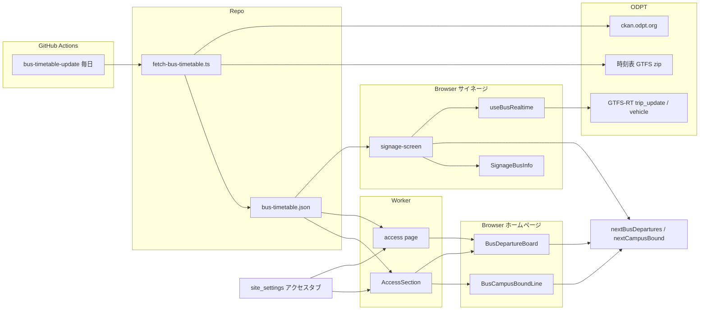
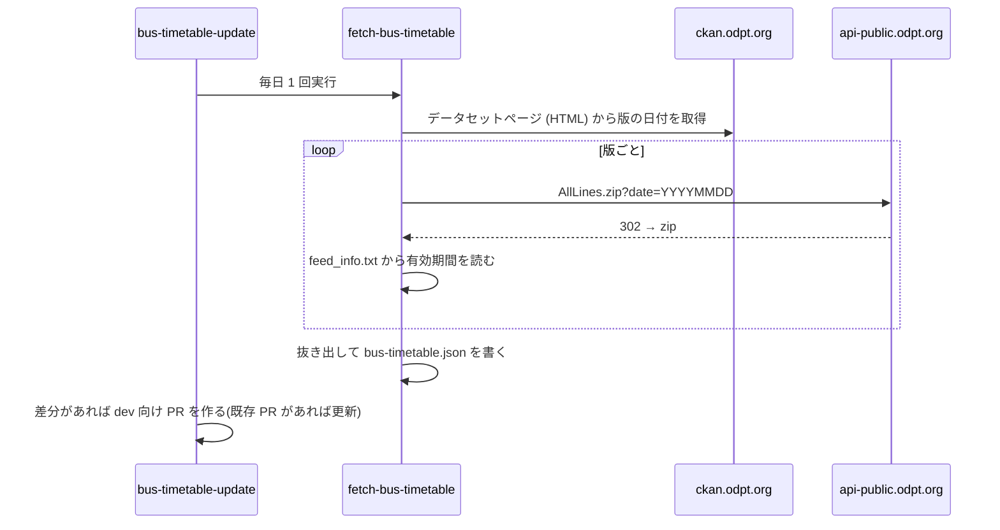
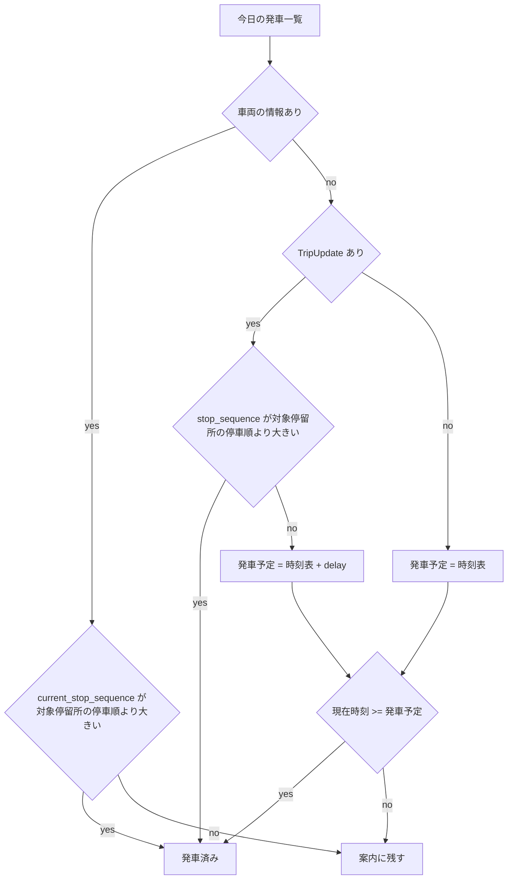
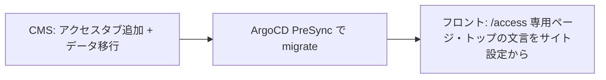

# Design Document

## Overview

**Purpose**: 会場最寄りのバス停(群馬大学荒牧・前橋自動車教習所前)を発車する関越交通バスの時刻を、来場者がサイネージ・アクセスページ・トップページで確認できるようにする。遅れを反映するのはサイネージだけとし、ホームページ(トップページ・アクセスページ)は時刻表だけで表示する。あわせて、前橋駅から会場へ向かう群馬大学方面の便を案内する。

**Users**: 来場者は会場のサイネージとトップページで次の便を、来場予定者はアクセスページで時刻表(前橋駅行・前橋駅発 群馬大学方面)を、トップページで前橋駅から次に発車する群馬大学方面の便を見る。実行委員はアクセスの文言を CMS のサイト設定で編集する。

**Impact**:
- サイネージの発車案内のデータ源を、同梱の時刻表(2024-06-01 改正・土日祝)から ODPT の時刻表 GTFS とリアルタイム情報に切り替える
- `/access` を CMS の固定ページから専用ページに置き換える
- トップページの案内文(`ACCESS_SUMMARY`)とアクセスページの本文を、サイト設定の「アクセス」タブにまとめる

### Goals
- ODPT の時刻表から、対象停留所を発車する便を運行日どおりに取り出す。行先が群馬大学荒牧の便は取り出さない(1.1〜1.3、1.6)
- 前橋駅 2番のりばから群馬大学荒牧・前橋自動車教習所前へ向かう便を、降車停留所とともに取り出す(7.1)
- 閲覧のたびに Cloudflare Workers を起動しない(1.4、2.1)
- リアルタイム情報を取得・使用するのはサイネージだけにする(2.1、2.8)
- サイネージでは、遅れている便は発車するまで案内に残す(2.2、3.2)
- 出典の全文はアクセスページに、トップページ・サイネージには 1 行の短い出典を出す(要件 6)

### Non-Goals
- 関越交通以外の事業者、高速バス、乗換案内、車両位置の地図表示
- 運行情報(Alert フィード)の表示
- 本番での開催前フェーズのトップページへの表示(`AccessSection` は開催中だけ描画される現行の構成を変えない)。PR のプレビュー URL とローカルでは、既存のフェーズ上書き(`NEXT_PUBLIC_ENABLE_PHASE_OVERRIDE`、`phase-toggle.tsx`)で開催中にすれば開催前でも表示・確認できる。発車案内はその日の実際の便を使うため、開催日以外でも実データで確認できる

## Boundary Commitments

### This Spec Owns
- 時刻表の抜き出しスクリプトと、その生成物(`frontend/src/data/bus-timetable.json`)
- 時刻表の定期更新ワークフロー
- 運行日の判定、次の便の計算、GTFS-RT のデコード、リアルタイム情報の取得(サイネージ用)
- 発車案内の表示部品(サイネージ・トップページ共通)、時刻表の表示部品(前橋駅行・前橋駅発 群馬大学方面)、群馬大学方面の次の便の 1 行表示、出典表示の部品
- `/access` の専用ページ
- `site_settings` の「アクセス」タブと、`pages` の `access` からの移行

### Out of Boundary
- サイネージの画面全体の配置・同期(`digital-signage` / `signage-sync-transport` の範囲)。本 spec は `SignageBusInfo` の中身だけを変える
- フェーズ切替の仕組み(`frontend/src/lib/phase.ts` の公開パス一覧は変更しない)
- 関越交通への掲載許可の取得(運用作業)

### Allowed Dependencies
- ODPT の公開エンドポイント(`api-public.odpt.org`、`ckan.odpt.org`)
- 既存の `lib/use-polling.ts`、`lib/signage-time.ts`、`lib/use-now.ts`、`lib/cms.ts`、`lib/event-day.ts`(JST の日付計算)
- 新しい devDependencies: `fflate`(zip 展開)、`csv-parse`(CSV)。スクリプトだけが使い、クライアントには載せない

### Revalidation Triggers
- `bus-timetable.json` の形の変更 → サイネージ・トップページ・アクセスページの全部を確かめる
- ODPT のエンドポイントやフィードの形の変更 → 抜き出しスクリプトと GTFS-RT のデコーダを確かめる
- `site_settings` の「アクセス」タブの項目の変更 → トップページとアクセスページを確かめる

## Architecture

### Existing Architecture Analysis
- サイネージは `signage-screen.tsx`(クライアント)が補正済み時刻で毎秒 `nextDepartures(BUS_TIMETABLE, now, 1|2)` を計算する。`BUS_TIMETABLE` は手で書き起こした TS の定数
- `/access` は `(site)/[slug]/page.tsx` が CMS の `pages` を描画している
- トップページの `AccessSection` はサーバーコンポーネントで、`lib/venue.ts` の定数を表示する
- 定期取得は `use-polling.ts` が、画面が隠れている間の停止を持つ

### Architecture Pattern & Boundary Map



**Architecture Integration**:
- Selected pattern: 時刻表は「抜き出して JSON をコミット」、リアルタイム情報は「サイネージのブラウザから直接取得」。理由は research.md の比較表。ホームページ(`BusDepartureBoard`・`BusCampusBoundLine`)は `useBusRealtime` を呼ばず、時刻表だけで次の便を決める(2.8)
- 既存パターンの踏襲: 定期取得は `use-polling.ts`、時刻は `useCorrectedNow`(サイネージ)と `useNow`(トップページ)、CMS の取得は `cms.findGlobal`、スクリプトは `pnpm exec tsx scripts/...`
- New components rationale: 下記 Components 表

### Technology Stack

| Layer | Choice / Version | Role in Feature | Notes |
|-------|------------------|-----------------|-------|
| Frontend | Next.js(既存)、React クライアントコンポーネント | 発車案内・時刻表・群馬大学方面の次の便・出典 | 新しい実行時依存は無し |
| Script | tsx(既存)、`fflate`、`csv-parse`(devDependencies に追加) | GTFS zip の展開と CSV の読み取り | クライアントには載らない |
| CMS | Payload(既存) | `site_settings` にアクセスタブ、データ移行 | `lexicalHTMLField` に `richTextHTMLConverters` を渡す |
| CI | GitHub Actions、既存の GitHub App のトークン | 毎日の時刻表更新 PR | App のトークンで作った PR は `frontend-ci` を起動する |
| External | ODPT `api-public.odpt.org` | 時刻表・リアルタイム情報(サイネージだけが取得) | 登録不要、CORS `*` |

## File Structure Plan

### Directory Structure
```
frontend/
├── scripts/
│   ├── fetch-bus-timetable.ts        # ODPT から全版の GTFS を取得し、対象の発車を抜き出して JSON を書く
│   └── fetch-bus-timetable.test.ts   # 抜き出し規則(停留所・乗車可否・行先・経由・方面・運行日・群馬大学方面)のテスト
├── src/
│   ├── data/
│   │   └── bus-timetable.json        # 生成物。コミットする
│   ├── lib/
│   │   ├── bus-timetable.ts          # JSON の型、版の選択、運行日の判定、日付の発車一覧・群馬大学方面の便の一覧
│   │   ├── bus-next-departures.ts    # 次の便の計算(既存の bus-departures.ts を置き換え)、群馬大学方面の次の便
│   │   ├── gtfs-realtime.ts          # 使う項目だけを読む GTFS-RT デコーダ
│   │   ├── use-bus-realtime.ts       # リアルタイム情報の定期取得フック(サイネージだけが使う)
│   │   └── access-settings.ts        # site_settings のアクセスタブの取得
│   └── components/
│       ├── bus/
│       │   ├── bus-departure-board.tsx   # トップページ・アクセスページの次の便(クライアント、時刻表だけ)
│       │   ├── bus-campus-bound-line.tsx # トップページの前橋駅発 群馬大学方面の次の便の 1 行(クライアント)
│       │   ├── bus-timetable-table.tsx   # アクセスページの時刻表(前橋駅行・前橋駅発 群馬大学方面、サーバー)
│       │   └── bus-data-notice.tsx       # 出典(全文・短い出典)・免責・問い合わせ先・取得日時
│       └── signage/
│           └── signage-bus-info.tsx      # 遅れ表示と出典を追加(既存)
│   └── app/(site)/access/page.tsx        # /access の専用ページ
.github/workflows/bus-timetable-update.yml # 毎日の更新 PR
cms/src/globals/site-settings.ts          # アクセスタブを追加(既存)
cms/src/migrations/<日時>_site_settings_access.ts        # A: 列の追加と pages からのコピー
cms/src/migrations/<日時>_drop_access_page.ts            # B: ナビゲーションの書き換えと pages の access の削除(フロントのデプロイ後)
```

### Modified Files
- `frontend/src/lib/bus-departures.ts` — 削除し、リアルタイム情報を受け取る `nextBusDepartures` を持つ `frontend/src/lib/bus-next-departures.ts` に置き換える
- `frontend/src/lib/bus-timetable-data.ts` — 削除する
- `frontend/src/components/signage/signage-screen.tsx` — `useBusRealtime` を呼び、`nextBusDepartures` に補正済み時刻とリアルタイム情報を渡す
- `frontend/src/components/signage/signage-bus-info.tsx` — 遅れの表示と `BusDataNotice`(短い出典)を足す
- `frontend/src/components/access-section.tsx` — `ACCESS_SUMMARY` をサイト設定の値に置き換え、`BusDepartureBoard`(短い出典)と `BusCampusBoundLine` を置く
- `frontend/src/app/(site)/page.tsx` — `AccessSection` にサイト設定の値と、JST の今日の発車一覧・群馬大学方面の便の一覧を渡す
- `frontend/src/lib/venue.ts` — `ACCESS_SUMMARY` を削除する
- `frontend/src/app/sitemap.ts`(`OWN_HANDLING_ROUTES`)、`frontend/src/lib/crawl-targets.ts`(`SITEMAP_CODE_ROUTES`) — `/access` を専用ルートとして登録する
- `frontend/src/cms-types.ts` — 型の再生成
- `cms/src/globals/site-settings.test.ts` — タブと項目の一覧を更新する
- `frontend/package.json` — devDependencies に `fflate`、`csv-parse`、scripts に `bus:timetable`

UI の見た目(遅れの表示、出典の配置、時刻表の表組み、トップページの発車案内、前橋駅発 群馬大学方面の時刻表と次の便の 1 行表示)は、実装の前に Figma で確定させる。

## System Flows

### 時刻表の更新



- 有効期間が今日より前に終わった版は書き出さない
- 取得に失敗したらワークフローを失敗させ、JSON は書き換えない

### 次の便の決定



- 車両の情報がある便は、時刻を過ぎていても車両が対象停留所を出るまで残す(サイネージ、2.2・3.2)
- リアルタイム情報の生成時刻が現在から 5 分より前なら、そのフィード全体を使わない(ガイドラインの「古い動的データを出さない」)
- ホームページ(`BusDepartureBoard`)はリアルタイム情報に null を渡すため、常に「TripUpdate なし → 発車予定 = 時刻表」の枝を通る(2.8、5.2)

### 群馬大学方面の次の便の決定

- その日の群馬大学方面の便(`campusBoundOn`)のうち、前橋駅の発車時刻が現在時刻より後の最初の便を出す。発車時刻を過ぎた便は発車済みとして次の便へ進める(7.3)
- 該当する便が無ければ「本日の運行は終了しました」を出す(`BusDepartureBoard` の運行終了と同じ規則)
- リアルタイム情報は使わない(2.8)

## Requirements Traceability

| Requirement | Summary | Components | Interfaces | Flows |
|-------------|---------|------------|------------|-------|
| 1.1 | 対象停留所の便の抜き出し | fetch-bus-timetable | BusTimetableFile | 時刻表の更新 |
| 1.2 | 有効期間の版を使う | bus-timetable | `selectVersion` | — |
| 1.3 | 運行日区分 | fetch-bus-timetable、bus-timetable | `activeServiceIds` | — |
| 1.4 | Worker を起動せず配る | bus-timetable.json(クライアントの JS に同梱/サーバー描画で使用) | — | — |
| 1.5 | 1 週間以内の反映 | bus-timetable-update | Batch | 時刻表の更新 |
| 1.6 | 行先が群馬大学荒牧の便を取り出さない | fetch-bus-timetable | BusTimetableFile | 時刻表の更新 |
| 2.1 | サイネージのブラウザから直接取得 | use-bus-realtime、signage-screen | `useBusRealtime` | — |
| 2.2〜2.5 | 遅れの反映・無いとき・失敗時・区別 | bus-departures | `nextBusDepartures` | 次の便の決定 |
| 2.6 | 非表示中は取得しない | use-bus-realtime(use-polling) | — | — |
| 2.7 | 取得間隔の下限 | use-bus-realtime | `BUS_REALTIME_INTERVAL_MS = 30_000` | — |
| 2.8 | ホームページは時刻表だけ | BusDepartureBoard、BusCampusBoundLine | `nextBusDepartures`(realtime = null)、`nextCampusBound` | 次の便の決定 |
| 3.1〜3.4 | サイネージの発車案内 | SignageBusInfo、signage-screen | `DirectionBoard` | 次の便の決定 |
| 4.1 | `/access` 専用ページ | access page | — | — |
| 4.2〜4.4 | 時刻表・記号と凡例・開催日の区分 | BusTimetableTable | `timetableForDate` | — |
| 4.5 | 関越交通へのリンク | access page | — | — |
| 4.6〜4.8 | サイト設定のアクセスタブ | site_settings、access-settings、AccessSection | `AccessSettings` | — |
| 4.9 | アクセスページの次の便 | access page、BusDepartureBoard | `DirectionBoard` | 次の便の決定 |
| 5.1〜5.3 | トップページの次の便 | BusDepartureBoard | `DirectionBoard` | 次の便の決定 |
| 6.1〜6.4 | 出典の全文・提供者名・免責と問い合わせ先・取得日時 | BusDataNotice(`page`)、access page | `BusDataNoticeProps` | — |
| 6.5 | 短い出典 | BusDataNotice(`short`)、SignageBusInfo、BusDepartureBoard(トップページ) | `BusDataNoticeProps` | — |
| 7.1 | 群馬大学方面の便の抜き出し | fetch-bus-timetable | `BusCampusBoundDeparture` | 時刻表の更新 |
| 7.2 | 前橋駅発 群馬大学方面の時刻表 | BusTimetableTable | `campusBoundOn` | — |
| 7.3 | 群馬大学方面の次の便の 1 行表示 | BusCampusBoundLine、AccessSection | `nextCampusBound` | 群馬大学方面の次の便の決定 |

## Components and Interfaces

| Component | Domain/Layer | Intent | Req Coverage | Key Dependencies | Contracts |
|-----------|--------------|--------|--------------|------------------|-----------|
| fetch-bus-timetable | Script | ODPT から抜き出して JSON を書く | 1.1, 1.3, 1.5, 1.6, 7.1 | ODPT (P0), fflate, csv-parse | Batch |
| bus-timetable-update | CI | 毎日スクリプトを実行し PR を作る | 1.5 | GitHub App トークン (P0) | Batch |
| bus-timetable | Lib | 版の選択・運行日・日付の発車一覧・群馬大学方面の便の一覧 | 1.2, 1.3, 4.4, 7.2, 7.3 | bus-timetable.json (P0), event-day | Service |
| gtfs-realtime | Lib | GTFS-RT の必要項目のデコード | 2.2 | — | Service |
| use-bus-realtime | Hook | サイネージのリアルタイム情報の定期取得 | 2.1, 2.4, 2.6, 2.7 | use-polling (P0), gtfs-realtime | State |
| bus-departures | Lib | 方面ごとの次の便、群馬大学方面の次の便 | 2.2〜2.5, 2.8, 3.1, 3.2, 3.4, 4.9, 5.1〜5.3, 7.3 | bus-timetable (P0) | Service |
| SignageBusInfo | UI | サイネージの発車案内 | 3.1〜3.4, 6.5 | bus-departures | — |
| BusDepartureBoard | UI(client) | トップページ・アクセスページの次の便(時刻表だけ) | 2.8, 4.9, 5.1〜5.3, 6.1〜6.5 | bus-departures, useNow | — |
| BusCampusBoundLine | UI(client) | トップページの前橋駅発 群馬大学方面の次の便 | 2.8, 7.3 | bus-departures, useNow | — |
| BusTimetableTable | UI(server) | アクセスページの時刻表(前橋駅行・前橋駅発 群馬大学方面) | 4.2〜4.4, 7.2 | bus-timetable | — |
| BusDataNotice | UI | 出典の全文・免責・問い合わせ先・取得日時、短い出典 | 6.1〜6.5 | — | — |
| access page | Route | `/access` | 4.1, 4.5, 4.6, 4.7, 4.9, 6.1〜6.4, 7.2 | access-settings, BusDepartureBoard, BusTimetableTable | — |
| site_settings アクセスタブ + migration | CMS | 文言の編集と移行 | 4.6〜4.8 | pages, navigation | Batch |

### Script / CI

#### fetch-bus-timetable

| Field | Detail |
|-------|--------|
| Intent | ODPT の全版の時刻表から対象の発車を抜き出して `bus-timetable.json` を書く |
| Requirements | 1.1, 1.3, 1.5, 1.6, 7.1 |

**Responsibilities & Constraints**
- 版の日付は `https://ckan.odpt.org/dataset/kan_etsu_transportation_all_lines` の HTML にあるリソース名 `関越交通バス-YYYYMMDD` から得る。ckan.odpt.org の API (`/api/3/action/package_show` 等) は 301 で `/dataset` へ転送され JSON を返さないため
- zip は `https://api-public.odpt.org/api/v4/files/odpt/Kan_etsuTransportation/AllLines.zip?date=YYYYMMDD` から取得する
- 版の有効期間は zip 内の `feed_info.txt` の `feed_start_date`・`feed_end_date` を使う
- HTML から版を 1 つも読み取れない、`feed_info.txt` に有効期間が無いときは失敗して JSON を書かない(ページの書式変更を黙って見逃さないため)
- 抜き出し規則:
  - 停留所 `200273_01`(群馬大学荒牧)、`200722_01`・`200722_02`(前橋自動車教習所前)
  - `pickup_type` が `1` の停車を除く
  - 行先は `stop_headsign`、空なら `trip_headsign`。全角括弧の中を経由として分ける
  - 行先(経由を分けた後)が「群馬大学荒牧」の停車を除く。前橋自動車教習所前を発車し、次の群馬大学荒牧で終点になる便で、会場付近から帰る来場者は乗らないため(1.6。実データでは 2 版とも 48 便)
  - 方面は `direction_id` 1 = `maebashi`、0 = `shibukawa`
  - 系統は `route_long_name` の先頭の空白までの文字列(例: `22A`)
- 群馬大学方面の便の抜き出し規則(7.1。`campusBound` に書く):
  - 前橋駅 2番のりば(`200718_02`、stop_desc「南橘・群大・渋川方面」)の停車のうち、`pickup_type` が `1` でないもの
  - 同じ便の、前橋駅より後(`stop_sequence` が大きい)の停車に、`drop_off_type` が `1` でない群馬大学荒牧(`200273_01`)または前橋自動車教習所前(`200722_01`・`200722_02`)があるものだけを採る
  - 降車停留所は、群馬大学荒牧に降車できる便は `gunma_univ_aramaki`、それ以外は `driving_school`
  - 時刻は前橋駅の `departure_time`、系統は上と同じ規則
  - 実データ(20261116 版)では土曜・日祝とも 39 便で、うち 16 便が群馬大学荒牧に停まる
- 対象の発車または群馬大学方面の便を持つ `service_id` についてだけ、`calendar.txt` の曜日・期間と `calendar_dates.txt` の例外を書き出す
- 停留所 ID・方面の対応が想定と違う(対象停留所・前橋駅 2番のりばが見つからない、`direction_id` が 0/1 以外)ときは失敗して JSON を書かない
- 出力は決定的にする(並び順を固定し、取得日時は版の内容が変わったときだけ更新する)。毎日の実行で差分が出ないようにするため

**Contracts**: Batch [x]

##### Batch / Job Contract
- Trigger: `pnpm --filter frontend bus:timetable`(手動)、`bus-timetable-update.yml`(毎日 05:00 JST と `workflow_dispatch`)
- Input / validation: CKAN のデータセットページ (HTML)、各版の zip
- Output / destination: `frontend/src/data/bus-timetable.json`
- Idempotency & recovery: 同じ入力から同じ出力を作る。失敗時は既存の JSON を変えない

#### bus-timetable-update

- 毎日実行し、`bus-timetable.json` に差分があれば `chore/bus-timetable-update` ブランチに commit して dev 向けの PR を作る。同じブランチの PR が開いていれば push で更新する
- PR の作成には `cms-ci.yml` の `release` ジョブと同じ GitHub App のトークンを使う。`GITHUB_TOKEN` で作った PR では `frontend-ci` が起動しないため
- PR 本文には、追加・削除された版と有効期間を書く

### Lib

#### bus-timetable

| Field | Detail |
|-------|--------|
| Intent | 日付から版と運行日を決め、その日の発車一覧と群馬大学方面の便の一覧を返す |
| Requirements | 1.2, 1.3, 4.4, 7.2, 7.3 |

**Contracts**: Service [x]

##### Service Interface
```typescript
type BusStop = 'gunma_univ_aramaki' | 'driving_school';
type BusDirection = 'maebashi' | 'shibukawa';

interface BusTimetableFile {
  fetchedAt: string;              // ISO 8601。版の内容が変わったときの取得日時
  versions: BusTimetableVersion[];
}

interface BusTimetableVersion {
  version: string;                // 例: '20260919'
  validFrom: string;              // 'YYYY-MM-DD'
  validTo: string;                // 'YYYY-MM-DD'
  services: BusService[];
  departures: BusScheduledDeparture[];
  campusBound: BusCampusBoundDeparture[]; // 前橋駅発 群馬大学方面
}

interface BusService {
  id: string;                     // 例: '土曜'
  weekdays: readonly [boolean, boolean, boolean, boolean, boolean, boolean, boolean]; // 月〜日
  startDate: string;
  endDate: string;
  added: readonly string[];       // 'YYYY-MM-DD'
  removed: readonly string[];
}

interface BusScheduledDeparture {
  tripId: string;
  serviceId: string;
  route: string;                  // '22A'
  destination: string;            // '前橋駅'
  via: string | null;             // '群馬大学荒牧'
  direction: BusDirection;
  stop: BusStop;
  stopSequence: number;
  time: string;                   // 'HH:MM'
}

interface BusCampusBoundDeparture {
  tripId: string;
  serviceId: string;
  route: string;                  // '22B'
  time: string;                   // 'HH:MM'。前橋駅 2番のりばの発車時刻
  alightStop: BusStop;            // 群馬大学荒牧に停まる便は 'gunma_univ_aramaki'、それ以外は 'driving_school'
}

function selectVersion(file: BusTimetableFile, date: string): BusTimetableVersion | null;
function activeServiceIds(version: BusTimetableVersion, date: string): ReadonlySet<string>;
function departuresOn(file: BusTimetableFile, date: string): readonly BusScheduledDeparture[];
function campusBoundOn(file: BusTimetableFile, date: string): readonly BusCampusBoundDeparture[];
```
- Preconditions: `date` は JST の 'YYYY-MM-DD'
- Postconditions: `selectVersion` は `validFrom <= date <= validTo` の版のうち `validFrom` が最も新しいものを返す。無ければ null で、`departuresOn`・`campusBoundOn` は空配列
- `campusBoundOn` は `departuresOn` と同じ版・運行日で `campusBound` を絞り、前橋駅の発車時刻順に返す
- 群馬大学方面の便は `departures`(対象停留所を発車する便)とは別の配列に持つ。方面(`BusDirection`)・発車停留所(`BusStop` を発車停留所として使う `departures`)の既存の型を変えないため
- Invariants: `activeServiceIds` は「曜日と期間で有効」に `added` を足し `removed` を引いた集合

#### gtfs-realtime

| Field | Detail |
|-------|--------|
| Intent | GTFS-RT の FeedMessage から使う項目だけを読む |
| Requirements | 2.2 |

**Contracts**: Service [x]

##### Service Interface
```typescript
interface RealtimeTripUpdate {
  tripId: string;
  stopSequence: number;
  delaySeconds: number;           // arrival.delay、無ければ departure.delay、どちらも無ければ 0
}

interface RealtimeVehicle {
  tripId: string;
  currentStopSequence: number;
  status: 'incoming_at' | 'stopped_at' | 'in_transit_to';
}

interface RealtimeFeed<T> {
  generatedAt: number;            // header.timestamp(epoch 秒)
  entities: readonly T[];
}

function decodeTripUpdates(bytes: Uint8Array): RealtimeFeed<RealtimeTripUpdate>;
function decodeVehicles(bytes: Uint8Array): RealtimeFeed<RealtimeVehicle>;
```
- 読む項目: FeedMessage.header(1).timestamp(3)、entity(2).trip_update(3).trip(1).trip_id(1)、stop_time_update(2).stop_sequence(1)/arrival(2).delay(1)/departure(3).delay(1)、entity.vehicle(4).trip(1).trip_id(1)、current_stop_sequence(3)、current_status(4)
- 知らない項目は読み飛ばす。`delay` は int32 で負の値(10 バイトの varint)を正しく読む
- 壊れた入力では例外を投げる(呼び出し側で取得失敗と同じ扱いにする)

#### use-bus-realtime

| Field | Detail |
|-------|--------|
| Intent | 2 つのフィードを定期取得してデコード結果を返す。呼ぶのはサイネージ(`signage-screen`)だけ |
| Requirements | 2.1, 2.4, 2.6, 2.7 |

**Contracts**: State [x]

##### State Management
```typescript
const BUS_REALTIME_INTERVAL_MS = 30_000;

interface BusRealtime {
  tripUpdates: ReadonlyMap<string, RealtimeTripUpdate>;
  vehicles: ReadonlyMap<string, RealtimeVehicle>;
  generatedAt: number | null;     // 2 フィードの古い方。どちらも無ければ null
}

function useBusRealtime(): BusRealtime | null; // 一度も取得できていなければ null
```
- `use-polling.ts` で 30 秒ごとに `trip_update` と `vehicle` を並行して取得する。画面が隠れている間は取得しない
- 取得・デコードに失敗したフィードは、前回の値を捨てて空として扱う(古い動的データを出さない)
- 30 秒より短い間隔を指定できる引数は持たない

#### bus-departures

| Field | Detail |
|-------|--------|
| Intent | 発車一覧・リアルタイム情報・現在時刻から、方面ごとの次の便を返す。群馬大学方面の便の一覧と現在時刻から、次の便を返す |
| Requirements | 2.2〜2.5, 2.8, 3.1, 3.2, 3.4, 4.9, 5.1〜5.3, 7.3 |

**Contracts**: Service [x]

##### Service Interface
```typescript
interface NextDeparture {
  route: string;
  destination: string;
  via: string | null;
  stopName: string;               // '群馬大学荒牧' | '前橋自動車教習所前'
  scheduledAt: string;            // 'HH:MM'
  expectedAt: string;             // 'HH:MM'。遅れが無ければ scheduledAt と同じ
  delayMinutes: number;           // 0 以上。早着の負の値は 0 にする
  source: 'realtime' | 'schedule';
  minutesLeft: number;            // expectedAt までの分(切り上げ、0 以上)
}

interface DirectionBoard {
  direction: BusDirection;
  departures: readonly NextDeparture[];
}

function nextBusDepartures(
  departures: readonly BusScheduledDeparture[],
  realtime: BusRealtime | null,
  now: Date,
  perDirection: number,
): readonly DirectionBoard[];

function nextCampusBound(
  campusBound: readonly BusCampusBoundDeparture[],
  now: Date,
): BusCampusBoundDeparture | null; // その日の便がすべて発車済みなら null
```
- 発車済みの判定は「次の便の決定」のフローどおり
- 同じ便が 2 停留所に停まるときは、発車済みでない最初の停車を採る(現行の挙動を引き継ぐ)
- `realtime.generatedAt` が `now` より 5 分以上前なら、`realtime` を null として扱う
- 方面の順は前橋駅方面、渋川駅方面(現行どおり)
- `minutesLeft` は、遅れて発車予定を過ぎた便では 0 になる。表示側(サイネージ)は 0 を「まもなく」と出す。ホームページは `realtime` に null を渡すため、発車時刻を過ぎた便は発車済みになり、`minutesLeft` は常に 1 以上になる
- `nextCampusBound` は「群馬大学方面の次の便の決定」どおり、前橋駅の発車時刻が `now`(JST)より後の最初の便を返す

### UI

- **発車案内の表組み(SignageBusInfo・BusDepartureBoard 共通)**: 駅の発車標と同じ表にする。見出し → 列見出し「発車時刻」「系統」「行先・のりば」「発車まで」(「発車まで」はサイネージだけ) → 便の行 → 出典
  - 便は 2 段。1 段目(同じ文字サイズ)は 発車時刻(Bold・左揃え)・系統チップ(中央揃え)・行先(Bold・左揃え)・発車まで(サイネージだけ。Bold・警告色・右揃え。「N分」「まもなく」)。2 段目(小さいサイズ、灰色)は行先の列から のりばの正式名称「群馬大学荒牧 発」「前橋自動車教習所前 発」、サイネージだけ発車までの列の右端に遅れのときだけ「約N分遅れ」(警告色)
  - 発車時刻は定刻のまま出す。サイネージでは発車までを遅れ込みの発車予定から数え、発車予定を過ぎて未発車の便(`minutesLeft === 0`)は「まもなく」と出す。ボードはリアルタイムの表示を持たず、発車まで・「まもなく」・遅れの表示を出さない(2.8)
  - 表全体(列見出し・便の行・運行終了の行)を 1 つの CSS グリッドにし、全行で列の位置を揃える。列の幅は 発車時刻・系統・発車まで(サイネージ)が中身の幅(`max-content`)、行先・のりば が残りの幅(`minmax(0, 1fr)`)。px の決め打ちの列幅は持たない。系統チップは列の幅いっぱいに広げ、全便で同じ幅にする
  - 行先が列に入りきらないときは省略せず 2 行に折り返す
  - 数字は `font-variant-numeric: tabular-nums` で桁を揃える
  - 発車時刻と系統チップは、行先・のりばの欄(2 段を合わせた高さ)に対して上下中央に揃える
  - 見出しのアイコン・列見出し「発車時刻」・全便の発車時刻・出典の左端を一致させる(枠の内側の左端。Figma の実測は横型 17、縦型 25、ボード 17)
  - 列の間隔: 横型 8、縦型 12、ボード `幅=PC` 8・`幅=SP` 4(SP の 326 幅に 1 段目を収めるため)
  - 配置先: トップページ PC `619:1408` のアクセスの節にボード `1648:2004`(`幅=PC`)、SP `619:1503` に `1648:2035`(`幅=SP`)。アクセスページは後述
  - 方面の便がすべて発車済みの行(運行終了)は、系統の列から最後の列までをまたいで、系統の列の左端から「本日の運行は終了しました」(1 段目のサイズ、Regular、灰色、2 段目なし)
  - 文字サイズ(見出し/列見出し/1 段目/2 段目): 横型 18/12/20/14、縦型 24/18/32/22、ボード 14/12/16/12
  - Figma: `Signage/BusInfo`(`1647:5484`)・`Signage/Portrait/BusInfo`(`1647:5591`)の `状態`(定刻・遅れ・まもなく)× `行先`(標準・長い)、`BusDepartureBoard`(`1648:1995`)の `状態`(定刻・運行終了)× `行先` × `幅`(PC・SP。列の間隔だけが違う)。ボードは遅れの状態を使わない
- **SignageBusInfo**: 枠の下端に `BusDataNotice`(`short`)の短い出典を 1 行で出す(6.5)。全文はアクセスページの `BusDataNotice`(`page`)が持つ。サイネージの既存の QR から公式サイトへ誘導する
- **BusDepartureBoard**(クライアント): props は `{ departures: readonly BusScheduledDeparture[]; fetchedAt: string; renderedAt: string; notice: 'page' | 'short' }`。`useNow` から `nextBusDepartures(departures, null, now, 1)` を計算して方面ごとに出す。`useBusRealtime` は呼ばない(2.8)。`AccessSection`(サーバー)とアクセスページが JST の今日の `departuresOn` を渡す。全データをクライアントに送らないため
  - 枠の下端に `BusDataNotice` を `notice` の形で出す。トップページは `short`(6.5)、アクセスページは `page`(6.1〜6.4)
- **BusCampusBoundLine**(クライアント): トップページのアクセスの節に、前橋駅から次に発車する群馬大学方面の便を 1 行で出す(7.3)。props は `{ campusBound: readonly BusCampusBoundDeparture[]; renderedAt: string }`。`AccessSection` が JST の今日の `campusBoundOn` を渡す
  - 表示項目は 前橋駅の発車時刻・系統・降車停留所。`useNow` から `nextCampusBound` で決め、時刻表だけを使う(2.8)
  - その日の便がすべて発車済みなら「本日の運行は終了しました」を出す(`BusDepartureBoard` の運行終了と同じ規則)
  - 見た目と節の中の配置は Figma で確定させる。Figma のノードはまだ無く、新しく作る
- **BusTimetableTable**(サーバー): 開催日(`site_settings.event_days`)ごとに、前橋方面の発車を 10〜18 時の行に「時 → 分の並び」で出す(2025 年のご案内ページの時刻表と同じ作り)
  - 1 便は 1 回だけ載せる。群馬大学荒牧で乗れる便は荒牧の時刻を下線・太字で出し、それ以外は前橋自動車教習所前の時刻を出す
  - 経由の記号: 経由から「前橋駅」「群馬大学荒牧」を除いた残りが「南橘団地・群大病院」なら ◯、「群大病院」なら ☆、「南橘団地」なら △、空なら無印。行先がけやきウォーク前橋の便も前橋駅を通るため、行先では記号を付けない。上記以外の経由が現れたら、抜き出しスクリプトを失敗させて記号の追加を促す
  - 表の下に凡例「下線太字は群馬大学荒牧発」「◯ 南橘団地・群大病院経由」「☆ 群大病院経由」「△ 南橘団地経由」を出す
  - 開催日どうしで発車が同じなら 1 つの表にまとめ、見出しに両日を書く
  - 開催日のいずれにも合う版が無ければ表を出さない
- **前橋駅発 群馬大学方面の時刻表**(`BusTimetableTable` と同じファイル、サーバー): 開催日ごとに、`campusBoundOn` の便を前橋駅の発車時刻で「時 → 分の並び」の表に出す(7.2)。組み方と規則は前橋駅行の表に揃える
  - 行は 9〜16 時。開場(10:00)前に着く便から、閉場の 1 時間ほど前に着く便までを載せる
  - 1 便は 1 回だけ載せ、前橋駅の発車時刻を出す
  - 降車停留所は、前橋駅行の表が乗車停留所を区別するのと同じ流儀で表す。群馬大学荒牧に停まる便の時刻を下線・太字で出し、それ以外(前橋自動車教習所前で降車)は通常の太さで出す。表の下に凡例を出す
  - 開催日どうしで便が同じなら 1 つの表にまとめ、見出しに両日を書く。開催日のいずれにも合う版が無ければ表を出さない
  - 見出し・凡例の文言、前橋駅行の表との並び順を含む見た目は Figma で確定させる。Figma のノードはまだ無く、アクセスページのフレームに新しく作る
- **BusDataNotice**: props は `{ timetableFetchedAt: string; variant: 'page' | 'short' }`。Figma `BusDataNotice / Page`(`1648:1904`)
  - `page`(アクセスページの `BusDepartureBoard` の中、6.1〜6.4): 次の固定文
    - 「このサービスは、以下の著作物を改変して利用しています。関越交通株式会社、関越交通バス・【リアルタイム情報】関越交通バス、クリエイティブ・コモンズ・ライセンス　表示4.0国際(https://creativecommons.org/licenses/by/4.0/deed.ja)」
    - 「公共交通オープンデータセンターのデータを利用しています。データの正確性は保証されません。内容に関するお問い合わせは関越交通ではなく、お問い合わせページ(`/contact`)へお願いします。」
    - 「時刻表の取得日時: …」
  - `short`(トップページの `BusDepartureBoard`・`SignageBusInfo` の中、6.5): 1 行の「データ: 関越交通(CC BY 4.0)・公共交通オープンデータセンター」。トップページはアクセスの節の既存のリンク「アクセス詳細へ」からアクセスページの全文へ誘導する

### Route / CMS

#### access page(`frontend/src/app/(site)/access/page.tsx`)
- サーバーコンポーネント。`getAccessSettings()` の本文(HTML)・地図埋め込みを、現行の `StaticPageView` と同じ見た目で出し、その下に `BusDepartureBoard`(トップページと同じ部品。JST の今日の `departuresOn` を渡し、`notice` は `page`、4.9)、`BusTimetableTable`(前橋駅行と前橋駅発 群馬大学方面、7.2)、関越交通の路線バスページ(https://kan-etsu.net/pages/23/)へのリンクを出す。出典の全文(6.1〜6.4)は `BusDepartureBoard` の `BusDataNotice`(`page`)に含まれるため、ページ単独の `BusDataNotice` は置かない
- Figma: ページ「アクセスページ」(`1649:2`)の `アクセス / PC (1440)`(`1649:3`)・`アクセス / SP (390)`(`1649:140`)。時刻表(`BusTimetableTable`)はこのフレーム内の「時刻表」で、単独のコンポーネントは無い。見た目は `globals.css` の `.rich-text-body .rt-table` の規則に合わせ、分は 3 列(1 時間あたりの便数の最大)。前橋駅発 群馬大学方面の時刻表は、このフレームに新しく作って確定させる
- 時刻表の計算はサーバーで行い、時刻表の JSON をクライアントに送らない
- `revalidate` は layout の 60 秒に従う。サイト設定の変更は再デプロイなしで反映される(4.7)

#### access-settings

```typescript
interface AccessSettings {
  summary: string;                // トップページの案内文
  contentHtml: string;            // アクセスページの本文
  embedUrl: string | null;
  embedHeight: number | null;
}

function getAccessSettings(): Promise<AccessSettings>;
```
- `cms.findGlobal('site_settings')` を既定の 60 秒キャッシュで使う

#### site_settings アクセスタブとマイグレーション

**Contracts**: Batch [x]

- 追加する項目(タブ「アクセス」、`site-settings.ts` の既存タブの後ろ):
  - `access_summary`(textarea、必須でない)
  - `access_content`(richText)と `access_content_html`(`lexicalHTMLField`、`storeInDB: true`、`converters: richTextHTMLConverters`)
  - `access_embed_url`(text、maxLength 500)、`access_embed_height`(number)
- マイグレーション A(フロントのデプロイ前):
  1. 列を追加する
  2. `pages` の slug `access` の `content`・`content_html`・`embed_url`・`embed_height` を `site_settings` にコピーする。`access_summary` には現行の `ACCESS_SUMMARY` の文字列を入れる
  - `down` は列を削除する
- マイグレーション B(フロントのデプロイ後、別 PR):
  1. `navigation` の項目のうち `pages` の `access` を参照しているものを、`link_type = 'path'`、`path = '/access'` に書き換える
  2. `pages` の `access` を削除する
  - `down` は `site_settings` の値から `pages` の `access` を作り直し、ナビゲーションを `page` 参照に戻す
- `cms-schema-check` は `site_settings` の変更を検出しないため、レビューでは移行の SQL を直接確かめる

## Error Handling

| 状況 | 振る舞い |
|------|----------|
| リアルタイム情報の取得・デコードに失敗(サイネージ) | そのフィードを空として扱い、時刻表どおりの時刻で案内を続ける(2.3, 2.4) |
| リアルタイム情報が 5 分以上古い(サイネージ) | 使わない |
| 今日の日付に合う版が無い | 発車一覧・群馬大学方面の便の一覧を空にし、各方面と群馬大学方面の 1 行に「本日の運行は終了しました」を出す |
| 開催日に合う版が無い | アクセスページは前橋駅行・前橋駅発 群馬大学方面の時刻表を出さず、関越交通のページへのリンクだけを出す |
| 時刻表の更新スクリプトの失敗 | ワークフローを失敗させ、JSON を変えない。既存の版で表示を続ける |
| サイト設定の取得に失敗 | 既存の `cms.ts` の挙動(直近の正常値の保持)に従う |

## Testing Strategy

- **Unit**
  - `fetch-bus-timetable`: 小さな GTFS(CSV の断片)から、乗車不可の除外、`stop_headsign` の優先、経由の分離、行先が群馬大学荒牧の停車の除外、方面の対応、運行日の書き出しを確かめる。群馬大学方面の便では、前橋駅 2番のりばで乗車不可の便・その後に降車できる対象停留所が無い便(`drop_off_type` が `1` の停車だけの便を含む)の除外と、降車停留所の決定(荒牧に降車できる便は荒牧、それ以外は教習所前)を確かめる
  - `bus-timetable`: 版の選択(期間の境界、2 版が重なる日)、`activeServiceIds`(祝日の例外、年末年始)、2026-11-14 が「土曜」・11-15 が「日祝」になること、`campusBoundOn` が同じ版・運行日で絞られること
  - `gtfs-realtime`: 2026-10-30 に取得した実データ(`trip_update`・`vehicle`)を fixture にし、`trip_id`・停車順・遅れ・生成時刻を読めること。負の `delay` を読めること
  - `bus-departures`: 車両が対象停留所を過ぎたら発車済み、過ぎていなければ時刻を過ぎても残る、TripUpdate だけのとき、リアルタイム情報なし(時刻表の発車時刻を過ぎたら次の便へ進む)、5 分以上古いとき、全便発車済み。`nextCampusBound` が発車時刻を過ぎた便を飛ばすこと、全便発車済みで null を返すこと
- **Component**
  - `BusTimetableTable`: 時ごとの分の並び、記号と凡例、両日が同じときにまとまること。前橋駅発 群馬大学方面の表で、群馬大学荒牧に停まる便が下線太字になること
  - `BusDepartureBoard`: リアルタイム情報を取得しない(`fetch` を呼ばない)こと、発車まで・遅れ・「まもなく」を出さないこと、`notice` に応じて全文と短い出典が切り替わること
  - `BusCampusBoundLine`: 発車時刻・系統・降車停留所の 1 行、全便発車済みのときの「本日の運行は終了しました」
  - `BusDataNotice`: `page` の出典の固定文と取得日時、`short` の 1 行
  - `SignageBusInfo`: 遅れの表示
- **E2E / 実ブラウザ**
  - `/access` の表示と、サイト設定の変更が反映されること
  - トップページ(プレビュー URL またはローカルで、フェーズ切替を開催中にした状態)とアクセスページで、発車案内・群馬大学方面の 1 行が出て、ODPT へのリクエストが無いこと(ネットワークログで確認)
  - サイネージで ODPT の取得がブラウザから直接行われ、Worker へのリクエストが増えないこと(ネットワークログで確認)。タブを裏にしている間に取得が止まること
  - 発車案内の表(トップページの PC・SP、サイネージの横型・縦型)で、列見出し・全便・運行終了の行の列位置が揃うこと、長い行先が省略されずに 2 行に折り返すこと

## Migration Strategy


- CMS のマイグレーション A を先にデプロイし、次にフロントをデプロイし、最後にマイグレーション B をデプロイする
- 1 本にまとめると、フロントのデプロイ前に `pages` の `access` が消え、`/access` が 404 になる時間ができる。そのため 2 本に分ける
