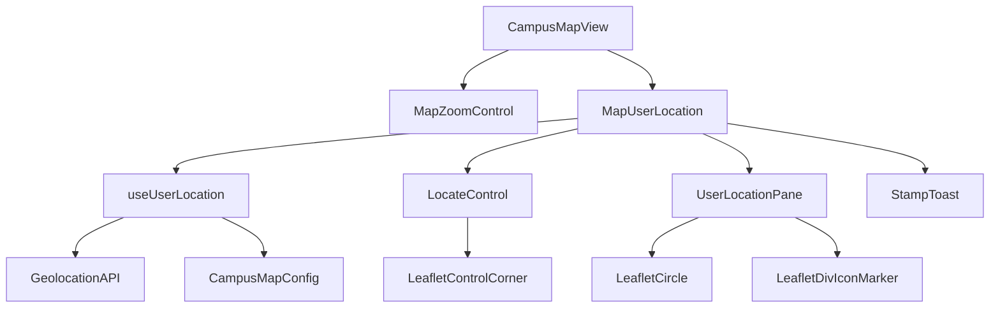
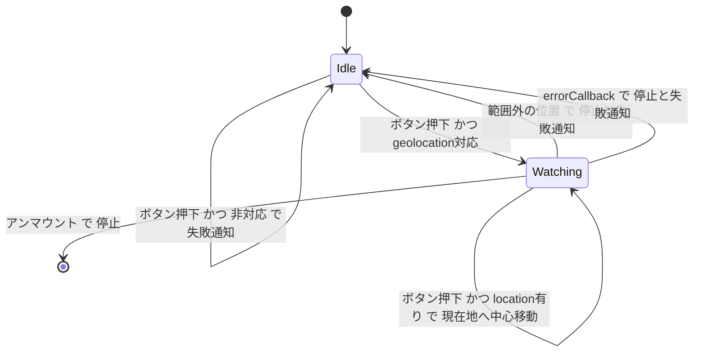

# Technical Design: campus-map-geolocation

## Overview

**Purpose**: 構内マップ(`/map`)に、閲覧者の端末が測位した現在地を青い点と精度円で表示する。来場者は自分がキャンパスのどのあたりにいるかを、誤差の大きさを含めて地図上で確かめられる。

**Users**: 会場にいる来場者がスマートフォンで構内マップを開き、右下の現在地ボタンを押して使う。

**Impact**: 既存の`CampusMapView`に現在地のレイヤーとボタンを1つ足す。地図の描画・ズーム・表示範囲・ボトムシートの挙動は変えない。`StampToast`に任意propsを2つ足すが、既存の呼び出し(`StampCollector`)の見た目と挙動は変わらない。

### Goals
- ボタンを押したときだけ位置の取得を始め、取得中にもう一度押すと縮尺を変えずに現在地へ地図を移す
- 構内の範囲内の位置を点(16px)と精度円(メートル半径)で描き、取得を始めて最初の1回だけ縮尺を変えずに中心へ移す
- 範囲外・拒否・失敗・非対応のいずれでも、既存のトーストで「現在地を取得できませんでした」を出して止める

### Non-Goals
- 進行方向の表示、経路案内、位置の履歴
- 構内マップ以外のページ(企画詳細の埋め込み地図を含む)
- 取得した位置のサーバー送信・保存・計測イベント送信

## Boundary Commitments

### This Spec Owns
- 現在地ボタン(`MapLocateButton`相当)の配置・見た目・状態・支援技術向けの名前と状態
- Geolocation APIの監視の開始・停止・後始末と、構内の範囲内外の判定
- 現在地マーカー(点と精度円)と、その描画Pane
- 取得できなかった旨のトーストを構内マップで出すこと
- 色トークン`location` / `location-accuracy`

### Out of Boundary
- 地図の初期表示・ズーム範囲・表示範囲の上限(`CAMPUS_MAP_CONFIG`の値は読むだけで変えない)
- `StampToast`の見た目・位置・表示時間(任意propsの追加だけを行う)
- ズームコントロールと出典表記の配置規則(本specはその上に1つ積むだけ)
- 位置情報の許可を取り消す・再要求する導線(ブラウザの設定に委ねる)

### Allowed Dependencies
- `leaflet` 1.9.4(`Control`, `DomEvent`, `divIcon`)、`react-leaflet` 5.0.0(`useMap`, `Pane`, `Circle`, `Marker`)
- `CAMPUS_MAP_CONFIG.campusBounds`(`frontend/src/lib/campus-map-config.ts`)
- `StampToast`(`frontend/src/components/stamp-toast.tsx`)、`MaterialIcon`(`frontend/src/components/icons.tsx`)
- ブラウザの`navigator.geolocation`。fetchやanalyticsへの依存は持たない

### Revalidation Triggers
- `CampusMapView`内のコントロールのマウント順や`position`の変更(ボタンの縦の並びが変わる)
- `StampToast`のprops・位置・`z-40`の変更
- ボトムシート・検索欄・メニューのz-indexの変更(トーストの重なり順に影響する)
- `campusBounds`の変更(範囲内外の判定が変わる)

## Architecture

### Existing Architecture Analysis
- `CampusMapScreen`(Client)が`next/dynamic`(ssr:false)で`CampusMapView`を読み込み、`CampusMapView`が`MapContainer`の中にタイル・ポリゴン・ラベル・地点マーカー・出典表記・ズームを並べる
- コントロールの縦の並びはaddTo順で決まる。Leafletは下側の角では後からaddToしたものを角から遠い側(上)に挿入する。react-leafletはコントロールを`useEffect`でaddToし、Reactは兄弟のeffectを前から順に実行する
- エリア名ラベルと地点マーカーはmarkerPane(z-index 600)、ポリゴンはoverlayPane(400)にある
- 構内マップ画面のz-index: Leafletの各Pane 400〜700、コントロール角1000、ボトムシート1050(全画面・ドラッグ中1100)、検索欄1080、メニューのオーバーレイ1090、メニューボタン1100

### Architecture Pattern & Boundary Map



**Architecture Integration**:
- Selected pattern: 状態を持つフック1つと、それを描くだけのコンポーネント1つ。Geolocation APIとの境界をフックに閉じ込める
- Domain boundaries: 位置の取得と判定は`useUserLocation`、地図への描画と通知は`MapUserLocation`。`CampusMapScreen`と`CampusMapView`の既存のstate(フィルタ・選択エリア・シート高さ)には触れない
- Existing patterns preserved: Leafletのコントロール角とaddTo順による配置、divIconを`renderToStaticMarkup`で作るマーカー(`MapPointMarker`と同じ)、色値は`tailwind.config`から読む(`lib/campus-map.ts`と同じ)、Material Symbolsのフォント字形
- New components rationale: ボタンをLeafletのコントロール角に入れることで、ズームと同じ右余白とSPのボトムシート追従(`max-md:[&_.leaflet-bottom]:mb-4`と地図コンテナの縮小)にそのまま乗る
- Dependency direction: `campus-map-config` → `use-user-location` → `map-user-location` → `campus-map-view`。逆向きのimportは持たない

### Technology Stack

| Layer | Choice / Version | Role in Feature | Notes |
|-------|------------------|-----------------|-------|
| Frontend | React 19 / Next.js 15 (Client Component) | ボタン・状態・トースト | 新規依存なし |
| Frontend | leaflet 1.9.4 / react-leaflet 5.0.0 | コントロール角、独自Pane、`Circle`(メートル半径)、divIconの`Marker`、`panTo` | 既存依存 |
| Browser API | Geolocation API(`watchPosition` / `clearWatch`) | 位置の継続取得 | セキュアコンテキストのみ。Permissions-Policyヘッダーは未設定で既定の`self`で使える |
| Styling | Tailwind v4(`tailwind.config.ts`経由)+ `globals.css` | ボタン・点のクラス、コントロール容器の余白 | トークン2つを追加 |

## File Structure Plan

### Directory Structure
```
frontend/src/components/campus-map/
├── use-user-location.ts          # Geolocation の監視・状態・構内の範囲判定 (isWithinCampus)
├── use-user-location.test.ts
├── map-user-location.tsx         # 現在地ボタン (L.Control + portal)・マーカー (独自 Pane)・失敗トースト
└── map-user-location.test.tsx
```

### Modified Files
- `frontend/src/components/campus-map/campus-map-view.tsx` — `<MapZoomControl />`の直後に`<MapUserLocation />`を置く
- `frontend/src/components/campus-map/campus-map-view.test.tsx` — `./map-user-location`のモックを足し、`MapZoomControl`より後にマウントされることを検証する
- `frontend/src/components/stamp-toast.tsx` — 任意props `message` / `showLink`を追加する
- `frontend/src/components/stamp-toast.test.tsx` — 文言の上書きとリンク非表示を検証する
- `frontend/tailwind.config.ts` — `theme.extend.colors`に`location` / `location-accuracy`を追加する
- `frontend/src/app/globals.css` — ボタンのコントロール容器`.map-locate-control`の右余白24px・下余白8px
- `frontend/src/app/layout.tsx` — `MATERIAL_SYMBOLS_ICON_NAMES`に`my_location`を追加する(未登録の名前は字形にならない)
- `frontend/e2e/campus-map.spec.ts` — 現在地の表示と取得失敗のシナリオを追加する

## System Flows



- 停止は失敗とアンマウントのときだけ起き、必ず`clearWatch`とマーカーの消去を伴う(R2.6、R4.5)
- Watchingでlocationがまだ無い(許可待ち・初回測位待ち)ときのボタン押下は何もしない
- 中心移動はWatchingに入ってから最初の範囲内の位置でだけ行う。Idleに戻ると次の開始で再び1回だけ行う(R2.4)
- 許可待ちの間はWatching(ボタンはactive、マーカーなし)。Figmaの2状態に収まり、新しい見た目を作らない

## Requirements Traceability

| Requirement | Summary | Components | Interfaces | Flows |
|-------------|---------|------------|------------|-------|
| 1.1 | ズームの真上8px | LocateControl | `.map-locate-control`の`margin-bottom: 8px`、addTo順 | — |
| 1.2, 1.6 | 常に表示・ペインとシートに重ならない | LocateControl | bottomrightのコントロール角 | — |
| 1.3, 1.4, 1.5 | アイコンとdefault/active | LocateButton | `active: boolean` | 状態図 |
| 1.7, 1.8 | 名前・状態・キーボード | LocateButton | `<button aria-label aria-pressed>` | — |
| 2.1, 2.2 | 押すまで取得しない・押すと開始 | useUserLocation | `start()` | 状態図 |
| 2.3 | 位置の更新 | useUserLocation, UserLocationMarker | `UserLocation` | 状態図 |
| 2.4 | 初回だけ中心移動 | MapUserLocation | `onFirstLocation` → `map.panTo` | 状態図 |
| 2.5 | 取得中の押下で現在地へ移動 | MapUserLocation | `map.panTo` | 状態図 |
| 2.6 | 離脱時の停止 | useUserLocation | effectの後始末 | 状態図 |
| 2.7 | サーバーへ送らない | useUserLocation | 外部送信を持たない | — |
| 3.1 | 範囲内で表示 | useUserLocation, UserLocationMarker | `isWithinCampus` | 状態図 |
| 3.2, 3.3, 3.4 | 点16px・精度円(メートル) | UserLocationMarker | `Circle radius=accuracy`、divIcon 16px | — |
| 3.5 | ポリゴン・ラベルより手前 | UserLocationMarker | Pane z-index 625 | — |
| 3.6 | 他の操作を妨げない | UserLocationMarker | `interactive: false` | — |
| 4.1〜4.5 | 失敗時の通知と停止 | useUserLocation, MapUserLocation | `failureCount` | 状態図 |
| 4.6, 4.7, 4.8 | 既存トーストで出す | MapUserLocation, StampToast | `message` / `showLink` | — |
| 5.1, 5.2 | プライバシーポリシーへの記載 | CMS `pages`(slug `privacy`) | 本文と最終更新日の編集 | — |

## Components and Interfaces

| Component | Domain/Layer | Intent | Req Coverage | Key Dependencies | Contracts |
|-----------|--------------|--------|--------------|------------------|-----------|
| useUserLocation | Hook | 位置の監視・範囲判定・失敗の計数 | 2, 3.1, 4.1〜4.5 | navigator.geolocation (P0), CAMPUS_MAP_CONFIG (P0) | Service, State |
| MapUserLocation | UI (MapContainer内) | ボタン・マーカー・トーストを組み立て、初回の中心移動をする | 1, 2.4, 3, 4.6〜4.8 | useUserLocation (P0), react-leaflet (P0), StampToast (P1) | State |
| LocateControl / LocateButton | UI(MapUserLocation内) | Leafletのコントロール角にボタンを置く | 1 | leaflet Control (P0), MaterialIcon (P2) | — |
| UserLocationMarker | UI(MapUserLocation内) | 独自Paneに精度円と点を描く | 3 | react-leaflet Pane/Circle/Marker (P0) | — |
| StampToast(変更) | UI共有 | 文言とリンクの有無を上書きできるようにする | 4.6〜4.8 | — | — |

### Hook

#### useUserLocation

| Field | Detail |
|-------|--------|
| Intent | Geolocation APIの監視を開始・停止し、範囲内の位置だけを返す |
| Requirements | 2.1, 2.2, 2.3, 2.5, 2.6, 2.7, 3.1, 4.1, 4.2, 4.3, 4.4, 4.5 |

**Responsibilities & Constraints**
- マウント時には何もしない。`start()`が呼ばれるまで`navigator.geolocation`に触れない(R2.1)
- 開始時に`'geolocation' in navigator`が偽なら、監視を始めずに失敗として扱う(R4.4)
- 位置を受け取るたびに`isWithinCampus`で判定する。範囲外なら失敗として扱う(R4.1)
- errorCallbackは`code`(1〜3)を区別せず失敗として扱う。非セキュアコンテキストも`PERMISSION_DENIED`でここに来る(R4.2、R4.3)
- 失敗時は`clearWatch`し、状態をidleに戻し、`failureCount`を1増やす(R4.5)
- 監視ごとにセッションIDを振り、現在のセッションでないコールバックは捨てる。`clearWatch`前にキューへ積まれたコールバックが抑止されるかは仕様に明記がないため
- アンマウント時に`clearWatch`する(R2.6)
- 位置はReactのstateにだけ持ち、送信・保存しない(R2.7)

**Dependencies**
- External: `navigator.geolocation.watchPosition` / `clearWatch` (P0)
- Outbound: `CAMPUS_MAP_CONFIG.campusBounds` (P0)

**Contracts**: Service [x] / State [x]

##### Service Interface
```typescript
export interface UserLocation {
  readonly latitude: number;
  readonly longitude: number;
  /** 95%信頼の半径(メートル)。GeolocationCoordinates.accuracyをそのまま使う */
  readonly accuracy: number;
}

export type UserLocationState =
  | { readonly kind: 'idle' }
  | { readonly kind: 'watching'; readonly location: UserLocation | null };

export interface UseUserLocationOptions {
  /** 監視を始めてから最初の範囲内の位置で1回だけ呼ぶ */
  readonly onFirstLocation: (location: UserLocation) => void;
}

export interface UseUserLocationResult {
  readonly state: UserLocationState;
  /** 取得できなかった回数。トーストの再表示(key)に使う */
  readonly failureCount: number;
  /** idleなら開始する。watchingでは何もしない(現在地への移動はMapUserLocationが行う) */
  readonly start: () => void;
}

export function useUserLocation(
  options: UseUserLocationOptions,
): UseUserLocationResult;

/** campusBoundsの南西・北東を含む閉区間で判定する */
export function isWithinCampus(
  latitude: number,
  longitude: number,
): boolean;
```
- `watchPosition`のoptions: `{ enableHighAccuracy: true, timeout: 15000, maximumAge: 0 }`
- Preconditions: Client Componentからのみ呼ぶ(`CampusMapView`はssr:false)
- Postconditions: `state.kind === 'idle'`のとき有効なwatch IDを持たない
- Invariants: `state.location`がnullでないとき、その位置は`isWithinCampus`を満たす

**Implementation Notes**
- Integration: `onFirstLocation`は最新の関数をrefで読み、`start`の参照を安定させる
- Validation: `use-user-location.test.ts`で`navigator.geolocation`をモックして状態遷移を確かめる
- Risks: `timeout`の15000msは実測の根拠がない値(開始直後のGPSの初回測位に十数秒かかる場合を見込んだ)。watchでは位置の有意な変化を検出してから数え始めるため、静止中にTIMEOUTにはならない(W3C Geolocation)

### UI

#### MapUserLocation

| Field | Detail |
|-------|--------|
| Intent | `MapContainer`の子として、ボタン・マーカー・失敗トーストを描き、初回の中心移動を行う |
| Requirements | 1.1〜1.8, 2.4, 3.1〜3.6, 4.6, 4.7, 4.8 |

**Responsibilities & Constraints**
- `useMap()`で地図を得て、`onFirstLocation`で`map.panTo([lat, lng], { animate: false })`を呼ぶ。ズームは変えない(R2.4)。`maxBounds`の補正で端の近くでは完全な中央にならないことがある
- ボタン押下の振り分け: idleなら`start()`、watchingでlocationがあれば同じ`map.panTo([lat, lng], { animate: false })`で現在地へ移す(R2.5)、watchingでlocationがnullなら何もしない
- `<CampusMapView>`の中で`<MapZoomControl />`の直後にマウントする。これでズームより後にaddToされ、ズームの真上に積まれる
- `failureCount > 0`のとき、`document.body`へportalした`<div className="relative z-[1060]">`の中に`<StampToast key={failureCount} kind="added" message="現在地を取得できませんでした" showLink={false} />`を描く
  - `key`の変更で再マウントし、2回目以降の失敗でも出し直す(StampToastのタイマーはマウント時の1回だけ)
  - `z-[1060]`はボトムシート(1050)より手前、検索欄(1080)・メニュー(1090/1100)より奥。Figma `1170:1294`のとおりシートの上に重なる
  - bodyへportalするのは、地図コンテナ内に置くとLeafletのドラッグ(mousedown/touchstart)とclickの処理がトースト上でも走るため
  - 位置はStampToastのクラスのまま(SP下端から80px・右16px、lg以上は下端16px)(R4.7)
- `role="status"`はStampToastがそのまま持つ(R4.8)

**Contracts**: State [x]
- State model: `useUserLocation`の結果だけを使う。自身はstateを持たない(コントロール容器のDOM参照を除く)

#### LocateControl / LocateButton(map-user-location.tsx内)

**Responsibilities & Constraints**
- `Control.extend({ onAdd })`で`position: 'bottomright'`のコントロールを作り、`onAdd`で`div.map-locate-control`を返す。容器に`DomEvent.disableClickPropagation`と`disableScrollPropagation`を掛ける(clickは止まらずReactのonClickは届く)
- effectで`addTo(map)`、後始末で`remove()`。容器をstateに入れて`createPortal`でボタンを描く
- ボタン(Figma `1170:753` / `1170:755`):
  - `<button type="button" aria-label="現在地を表示" aria-pressed={active}>`(R1.7、R1.8)
  - クラス: `flex size-[42px] items-center justify-center rounded-lg border border-gray-200 bg-white shadow-card`、文字色はdefaultが`text-text`、activeが`text-primary`(R1.4、R1.5)
  - 中身: `<MaterialIcon name="my_location" size={24} />`(Sharp、weight 300、FILL 0は既存の`.material-symbols-sharp`と`MaterialIcon`が与える)(R1.3)
  - フォーカス時は`MapMenuButton`と同じ`focus-visible:outline-2 focus-visible:outline-offset-2 focus-visible:outline-primary`。Figmaにフォーカスの状態は無く、キーボード操作の可視化として既存の地図ボタンの規則に従う
- globals.css: `.leaflet-bottom.leaflet-right .map-locate-control { margin-right: 24px; margin-bottom: 8px; }`。右余白はズームと同じ値で左右の端を揃え、下余白がズームとの間隔8pxになる(R1.1)。Leafletのfloatは縦マージンを相殺しないため、間隔は上側の下余白だけで決まる
- 配置はズームと同じ角なので、PCの左ペイン・SPのボトムシートとはズームと同じ関係になる(R1.2、R1.6)

#### UserLocationMarker(map-user-location.tsx内)

**Responsibilities & Constraints**
- `state.kind === 'watching'`かつ`location`がnullでないときだけ描く(R3.1)
- `<Pane name="userLocationPane" style={{ zIndex: 625 }}>`の中に置く。markerPane(600、エリア名ラベルと地点マーカー)より手前、tooltipPane(650、地点の吹き出し)より奥(R3.5)
- 精度円(Figma `1170:759`): `<Circle center radius={accuracy} pathOptions={...} />`。pathOptionsは`{ color: location, weight: 1, opacity: 1, fillColor: location-accuracy, fillOpacity: 1, interactive: false }`。色値は`tailwind.config`から読む。`radius`はメートルなので縮尺に追従する(R3.3、R3.4)
- 点(Figma `1170:760`): `<Marker position icon interactive={false} keyboard={false} />`。iconはモジュールで1回だけ作るdivIcon(`iconSize: [16, 16]`、`iconAnchor: [8, 8]`、`className: ''`)。中身は`renderToStaticMarkup`した`<span className="block size-4 rounded-full border-2 border-white bg-location shadow-[0_1px_3px_rgba(0,0,0,0.3)]" />`。大きさは縮尺によらない(R3.2、R3.4)
- `interactive: false`の層はLeafletのCSSで`pointer-events: none`になり、PaneのSVGルートも`pointer-events="none"`なので、ポリゴン選択・地図操作を妨げない(R3.6)

#### StampToast(変更)

```typescript
export interface StampToastProps {
  readonly kind: StampToastKind;
  /** 指定時はkindの既定文言の代わりに出す */
  readonly message?: string;
  /** 既定はtrue。falseで「マイページ」リンクを描かない */
  readonly showLink?: boolean;
}
```
- 既定値は従来の挙動と同じで、`StampCollector`は変更しない
- Figmaの`StampToast` `989:1084`の取得失敗インスタンス(`1170:1378`: Kind=added、文言上書き、リンク非表示)と1対1に対応する

## Data Models

### Design Tokens
`frontend/tailwind.config.ts`の`theme.extend.colors`に追加する。

| Token | Value | Figma variable | 用途 |
|-------|-------|----------------|------|
| `location` | `#1a73e8` | `color/location` | 点の塗り、精度円の線 |
| `location-accuracy` | `#1a73e826` | `color/location-accuracy`(alpha 0.15) | 精度円の塗り |

このリポジトリでは`--color-*`のCSS変数が生成されないため、`Circle`のpathOptionsは`lib/campus-map.ts`と同じく`tailwind.config`をimportして値を読む。hexを二重に持たない。

## Content Changes

### プライバシーポリシー(R5)
- 対象はCMSの`pages`コレクションのslug`privacy`(`frontend/src/lib/static-page.ts`の`getPageBySlug`が読む)。コードは変更しない
- 「1. 取得する情報」の末尾に次の段落を足す: 「構内マップの現在地表示で使用する位置情報は、端末内でのみ処理し、当実行委員会へ送信しません。」
- 「制定・最終更新」の日付を、記載を反映した日に更新する
- 反映は本番CMSの管理画面で行う。本番への書き込みなので、実施の前にユーザーの確認を取る
- 反映の時期は本機能の本番デプロイと同じ日にする。先に書くと機能の無い期間に記載だけがあり、後にすると記載の無いまま許可を求める期間ができる

## Error Handling

### Error Strategy
失敗の種類を利用者に区別して見せない。いずれも同じ文言のトーストを出し、監視を止め、ボタンをdefaultに戻す。

| 事象 | 検出 | 応答 | Req |
|------|------|------|-----|
| 範囲外 | `isWithinCampus`が偽 | 停止・マーカー非表示・トースト | 4.1, 4.5 |
| 許可拒否・非セキュアコンテキスト | errorCallback `code` 1 | 同上 | 4.2, 4.5 |
| 取得失敗・タイムアウト | errorCallback `code` 2・3 | 同上 | 4.3, 4.5 |
| 非対応 | `'geolocation' in navigator`が偽 | 監視を始めずトースト | 4.4 |

### Monitoring
位置もエラーも送信しない(R2.7)。ログやGAイベントは追加しない。

## Testing Strategy

### Unit Tests(vitest + Testing Library)
- `use-user-location.test.ts`: マウントだけでは`watchPosition`を呼ばない / `start`で開始し範囲内の位置で`location`が入り`onFirstLocation`が1回だけ呼ばれる / 2回目の位置で更新され`onFirstLocation`は呼ばれない / 範囲外・error code 1〜3・非対応で`clearWatch`・idle・`failureCount`+1 / watching中の`start`では`watchPosition`を再度呼ばない / アンマウントで`clearWatch` / 停止後に古いセッションのコールバックが来ても状態が変わらない
- `isWithinCampus`: campusBoundsの内側・境界上・外側
- `stamp-toast.test.tsx`: `message`の上書き、`showLink={false}`でリンクが無い、既定では従来の文言とリンク、`role="status"`

### Integration Tests
- `map-user-location.test.tsx`(react-leafletと`useUserLocation`をモック): ボタンの名前と`aria-pressed`がstateに追従する / idleでEnterとクリックすると`start`が呼ばれる / watching+locationで押すと`map.panTo`が縮尺を変えずに呼ばれ`start`は呼ばれない / watchingでlocationがnullのとき押しても何も起きない / 失敗時に「現在地を取得できませんでした」の`role="status"`がbody直下に出てリンクが無い / `failureCount`が増えると出し直す / watching+locationでCircleの`radius`がaccuracy、Paneのz-indexが625
- `campus-map-view.test.tsx`: `MapUserLocation`が`MapZoomControl`より後にマウントされる

### E2E(Playwright、`e2e/campus-map.spec.ts`)
- `context.grantPermissions(['geolocation'])`と`setGeolocation`(構内の座標)でボタンを押す → `aria-pressed="true"`、点が表示され、点が画面中央付近に来る。地図をドラッグして現在地を画面外へ動かし、もう一度押すと点が画面中央付近に戻り縮尺は変わらない
- ボタンの下端とズームの上端の差が8px、右端が一致することを`boundingBox`で実測する(SP 390x844とPC 1440x900)
- 構外の座標と、許可を与えない場合で、トーストの文言・リンク無し・SPで下端から80pxの位置を確かめる

## Security Considerations
- 位置は端末内のReact stateにだけ置き、送信・保存・URLへの反映をしない(R2.7)
- 許可の要求はボタン押下のときだけ行う(R2.1)
