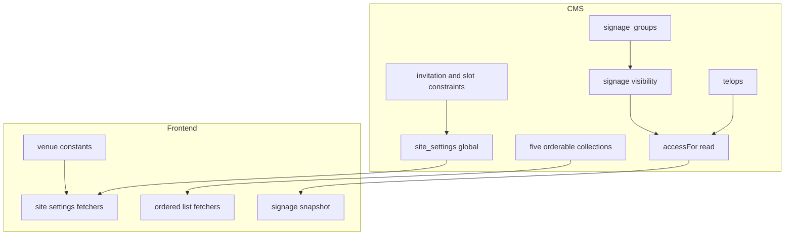
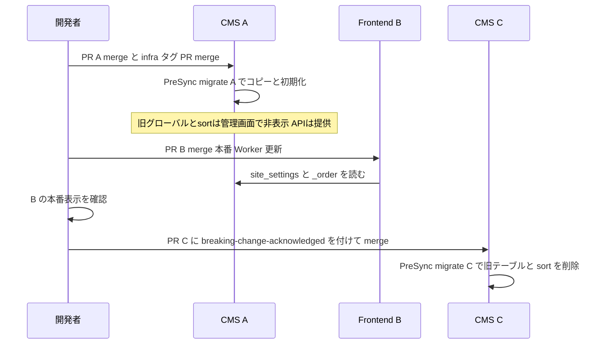
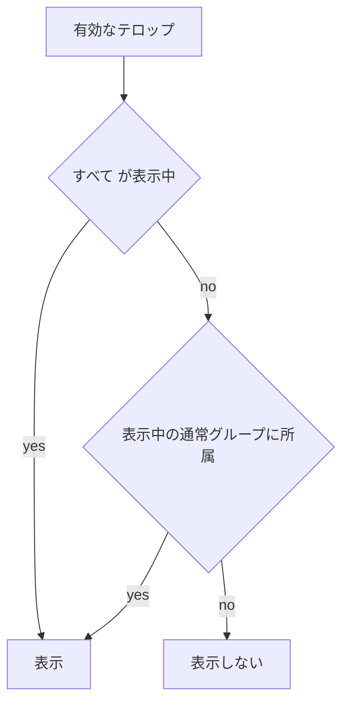
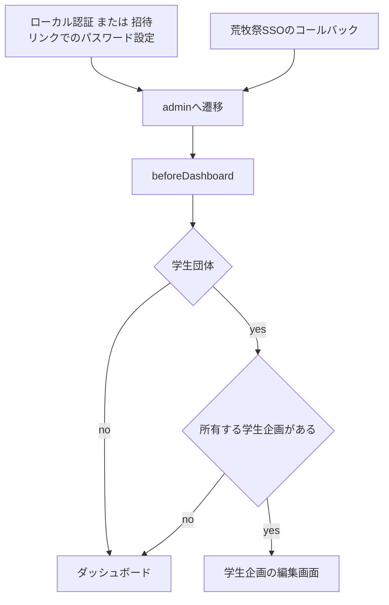
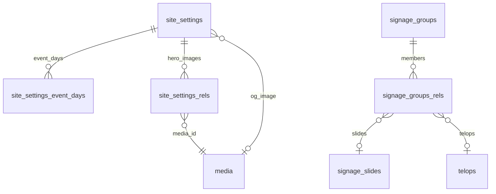
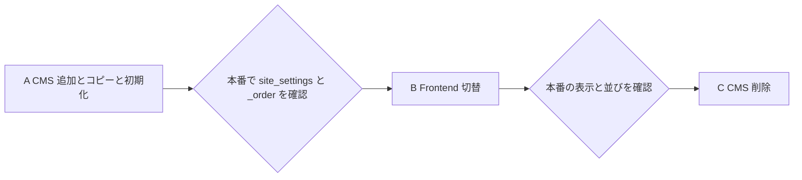

# Design Document

## Overview
**Purpose**: CMS管理画面の整理として、祭基本情報(`festival_meta`)とトップページ(`page_home`)を1つのグローバル「サイト設定」(`site_settings`)へ統合し、項目をタブで分け、使われない項目と固定情報を取り除く。あわせてサイドバーを用途別に分類し、ブース番号を文字列にし、サイネージのテロップをグループ単位で出し分け、表示順を持つ5コレクションをドラッグ並べ替えに切り替え(固定ページ・トピックは未使用の表示順を削除するだけ)、模擬店メニューの価格を整数にする。学生団体がログインしたら、自団体の学生企画の編集画面を直接開く。

**Users**: 実行委員がCMS管理画面で設定・コンテンツを編集する。来場者は従来どおりサイトとサイネージを閲覧する。

**Impact**: CMSのグローバル構成・ブース番号と価格の列の型・サイネージの公開判定・5コレクションの並びの持ち方が変わり、フロントエンドの参照先が`site_settings`と`_order`へ移る。本番を壊さないよう、CMS先行の追加(A)→フロントエンド切替(B)→CMSの削除(C)の3回に分けて反映する。

### Goals
- 祭全体の設定を`site_settings`の5タブで編集でき、移行前の値がすべて保持される
- 削除する項目を参照しないフロントエンドが、削除の反映前に本番稼働している
- テロップの表示が、スライドと同じグループの表示状態で切り替わる
- 5コレクションの並びが管理画面のドラッグで決まり、移行直後の並びが移行前と同じになる
- 模擬店メニューの価格が0以上の整数で保存され、サイトでは「円」を付けて表示される
- 学生団体がログイン後に一覧を経ず自団体の学生企画を編集でき、実行委員の遷移は変わらない

### Non-Goals
- 既存コレクション・グローバルの表示名の変更
- `signage_settings`の項目変更、テロップの固定表示
- ブース番号のフロントエンドでの表示
- ロール・権限の新設、学生団体の表示範囲の変更

## Boundary Commitments

### This Spec Owns
- `site_settings`グローバルの定義(項目・タブ・保存時のサイネージ通知)と、`festival_meta`・`page_home`からの値の移行、両グローバルの廃止
- 会場名・会場住所・Google Maps埋め込みURL・アクセス文言のフロントエンド内の固定値
- サイドバー分類(`admin.group`)の割り当て
- `booth_number`(`sponsors`、`student_exhibitions`のカテゴリ別グループ)の型と未設定の扱い
- テロップのグループ所属(`signage_groups.telops`)と、テロップの公開判定
- 5コレクションの`orderable`化と`_order`の初期化、7コレクションの`sort`の廃止、フロントエンドの並びの切替
- 模擬店メニューの`price`の型と、フロントエンドの価格表記
- A・B・Cのデプロイ順序と、各段階のマイグレーション
- 学生団体のログイン後の遷移先(ダッシュボード表示時の自団体の学生企画への遷移)

### Out of Boundary
- サイネージ端末・ハブ(`frontend/workers/`)の配信方式。テロップは既存のスナップショット経路で届く
- `cms-schema-check`の検出ロジックの改修(グループ内`booth_number`を検出しない点は運用で扱う)
- 各コレクションの`meta_description`

### Allowed Dependencies
- 既存のアクセス結線(`cms/src/access/payload-access.ts`の`accessFor`、`policy.ts`の`isHiddenInAdmin`、`globals/index.ts`・`collections/index.ts`の`withAccess`)
- 既存のサイネージ表示判定(`cms/src/lib/signage-visibility.ts`)と通知(`signage-notify.ts`)
- Payload 3.88の`orderable`・`admin.group`・名前なし`tabs`
- `cms-ci`のPreSync migrate、`frontend-ci`の本番デプロイ
- Payload 3.88の`admin.components.beforeDashboard`(サーバーコンポーネント)と、`student_exhibitions`の既存の読み取り条件(`policy.ts`の`ownerFilter`)

### Revalidation Triggers
- `site_settings`の項目名・階層の変更(フロントエンドの`cms-types.ts`と取得関数が追随する)
- テロップの公開判定の変更(サイネージのスナップショットの中身が変わる)
- `_order`の並び規則の変更(フロントエンドの並べ替え箇所)
- `price`の型・表記の変更(`exhibition-menu.tsx`)

## Architecture

### Existing Architecture Analysis
- グローバル・コレクションは`globals/index.ts`・`collections/index.ts`の`withAccess`で`accessFor(slug)`と`admin.hidden`(`isHiddenInAdmin`)を一括結線する。新グローバルも同じ登録口に載せる
- サイネージのスライドは`accessFor`の`read`で、公開判定が条件を返すとき(未認証・学生団体)だけ`visibleSlideFilter`を重ねる。「すべて」グループは所属行を持たず、全件が属するものとして計算する
- フロントエンドは`frontend/src/lib/cms.ts`の`findGlobal`・`findMany`で取得し、取得失敗は呼び出し側ごとに既定値・例外へ写す
- dev pushは無効で、スキーマ変更は`cms/src/migrations/`の適用でのみ反映される

### Architecture Pattern & Boundary Map



**Architecture Integration**:
- Selected pattern: 既存の登録口・公開判定への載せ替え。新しい層は作らない
- Domain/feature boundaries: CMSが値と公開判定を持ち、フロントエンドは取得と固定値の表示だけを持つ。テロップの出し分けはCMSの公開判定で完結し、フロントエンドのサイネージは変更しない
- Existing patterns preserved: `withAccess`による結線、「すべて」の所属行を持たない規則、`orderable`の`_order`、手書き追記つきのマイグレーション
- New components rationale: `site-settings.ts`(統合先)、`nav-groups.ts`(分類の一覧を1か所に置き、6.xを1つのテストで検証する)、`venue.ts`(CMSから外す固定値の置き場)。価格の表記は既存の`exhibition-menu.tsx`内で行い、新しい部品を作らない
- Steering compliance: 型は`generate:types`で生成し手書きしない。access controlは`policy.ts`・`payload-access.ts`経由

**Dependency direction**: CMSの型定義 → コレクション・グローバル定義 → 登録口(`index.ts`) → マイグレーション。フロントエンドは`cms-types.ts` → `lib/` → `components/`・`app/`

### Technology Stack

| Layer | Choice / Version | Role in Feature | Notes |
|-------|------------------|-----------------|-------|
| Backend / Services | Payload 3.88.0、`@payloadcms/richtext-lexical` | グローバル・タブ・`orderable`・`admin.group` | 新しい依存なし |
| Data / Storage | Postgres 16、`@payloadcms/db-postgres` | 新テーブル・列型変更(USING式含む)・`_rels`列追加・`_order`列 | 手書きSQLを生成差分に追記 |
| Frontend | Next.js 15、`frontend/src/lib/cms.ts` | 参照先の切替、固定値、並びの切替 | 新しい依存なし |
| Infrastructure / Runtime | `cms-ci`(ArgoCD PreSync migrate)、`frontend-ci` | A・B・Cの順の反映 | 各段階は別PR |

## File Structure Plan

### Directory Structure
```
cms/src/
├── globals/
│   ├── site-settings.ts            # 新規: サイト設定。5タブ、保存時にサイネージへsnapshot通知
│   ├── festival-meta.ts            # A: admin.hidden。C: 削除
│   └── page-home.ts                # A: admin.hidden。C: 削除
├── nav-groups.ts                   # 新規: slug→サイドバー分類名の一覧
└── components/
    ├── SignageGroupMembersField.tsx  # SignageGroupSlidesField.tsxを改名・一般化
    ├── StudentExhibitorRedirect.tsx  # 新規: ダッシュボードの前に置き、学生団体を自団体の企画へ遷移させる
    └── student-exhibitor-landing.ts  # 新規: 学生団体の遷移先(自団体の企画の編集画面のパス)を求める
frontend/src/lib/
└── venue.ts                        # 新規: 会場名・会場住所・埋め込みURL・アクセス文言の固定値
```

### Modified Files
CMS(Aで変更、Cで旧定義を削除):
- `cms/src/globals/index.ts` — `SiteSettings`を登録し、`withAccess`で`admin.group`を付ける。Cで`FestivalMeta`・`PageHome`を外す
- `cms/src/collections/index.ts` — `withAccess`で`admin.group`を付ける
- `cms/src/collections/sponsors.ts`・`student-exhibitions.ts` — `booth_number`を`text`・`maxLength: 20`にし、`''`を`null`にする`beforeChange`を付ける
- `cms/src/hooks/payload-constraints.ts` — ブース番号の重複判定で`''`を未設定として扱う。開催日程の参照先を`site_settings`へ
- `cms/src/collections/signage-groups.ts` — `telops`(relationship hasMany)を追加。`afterChange`の差分判定はスライドのみのまま
- `cms/src/collections/telops.ts` — 一覧に所属グループの列は足さない(要件外)。変更なし
- `cms/src/lib/signage-visibility.ts` — スライド・テロップ共通の表示判定に一般化
- `cms/src/access/payload-access.ts` — `telops`の`read`に表示対象の条件を重ねる
- `cms/src/components/signage-group-slides.ts`・`signage-groups.ts` — 取得・追加関数を対象コレクションと項目名の引数で一般化
- `cms/src/collections/{faq-items,map-areas,parking-lots,sponsors,stages}.ts` — `orderable: true`、`defaultSort: 'sort'`と`defaultColumns`の`sort`を外す。Aでは`sort`を`admin.hidden`で残し、Cで削除
- `cms/src/collections/{pages,topics}.ts` — `sort`と`defaultSort: 'sort'`・`defaultColumns`の`sort`をCで削除する。`orderable`にしない
- `cms/src/collections/student-exhibitions.ts` — `MENU_FIELD`の`price`を`type: 'number'`・`min: 0`・整数の検証にする(A)
- `cms/src/auth/invitation.ts`・`cms/src/components/useEventDays.ts` — 参照先を`site_settings`へ
- `cms/scripts/seed-dev-content.ts`・`seed-dev-exhibitions.ts` — `site_settings`へ投入。`sort`の投入を外す(C)。`seed-migration.ts`は旧CMSからの移行専用で、Cで`site_settings`へ書く形にそろえる
- `cms/src/migrations/` — A・Cのマイグレーション(Data Models参照)
- `cms/src/lib/rich-text-editor.ts` — コメント中の適用先を`site_settings`へ
- `docs/cms-operations.md` — 「祭基本情報」を「サイト設定」に、`booth_number`の例を文字列に
- `.kiro/steering/product.md` — ドメインモデルの`festival_meta`/`page_home`を`site_settings`に(C)
- `cms/src/payload.config.ts` — `admin.components`に`beforeDashboard: ['./components/StudentExhibitorRedirect.tsx']`を常に置き、`afterLogin`だけを`AUTHENTIK_ISSUER_URL`の有無で足す(A)
- `cms/src/app/(payload)/admin/importMap.js` — `pnpm generate:importmap`で`StudentExhibitorRedirect`を登録する(A)

フロントエンド(B):
- `frontend/src/lib/festival-meta.ts`・`home-page.ts`・`parking-data.ts`・`signage-data.ts`・`sns-links.ts`・`timetable.ts`・`frontend/src/app/sitemap.ts` — `findGlobal('festival_meta')`・`findGlobal('page_home')`を`findGlobal('site_settings')`へ。`home-page.ts`は1回の取得で両方の値を得る
- `frontend/src/lib/home-page-types.ts` — 削除項目(`siteTitle`・`metaDescription`・`venueName`・`venueAddress`・`heroImageId`・`heroMessageHtml`・`theme.imageId`・`campusMapUrl`・`accessSummary`)を型から外す
- `frontend/src/lib/site-metadata.ts` — タイトルは`name`、説明文は祭概要だけから作る
- `frontend/src/lib/structured-data.ts` — 会場を`venue.ts`から出力
- `frontend/src/app/(site)/page.tsx`・`components/hero-section.tsx`・`components/access-section.tsx` — 会場名・アクセス文言・埋め込みURLを`venue.ts`から渡す
- `frontend/src/lib/faq.ts`・`sponsors.ts`・`exhibitions.ts`・`campus-map.ts`・`parking-data.ts`・`timetable.ts` — 並びを`_order`へ
- `frontend/src/lib/exhibitions.ts`・`frontend/src/components/exhibition-menu.tsx` — `price`を数値で受け、「円」を付けて表示する(A。`cms-types.ts`の更新と同じPRに入れないとフロントエンドの型検査が通らないため)
- `frontend/e2e/_template.cms.spec.ts`・`frontend/e2e/README.md` — 依存グローバルの例を`site_settings`へ
- 対応する`*.test.ts(x)`

## System Flows

### デプロイ順序



- A・B・Cは別PRで、前段の本番反映を確認してから次をmainへ入れる。フロントエンドとCMSを1つのPRにすると、フロントエンドが先に反映され、CMS未反映の間`site_settings`が404になる
- Aは`sponsors.booth_number`の型変更だけが`cms-schema-check`に検出される。フロントエンドは`booth_number`を参照しないため、Aの時点でラベルを付けてよい
- Cは`festival_meta`・`page_home`の削除と7件の`sort`削除が検出される。Bの本番稼働(トップ・About・アクセス・タイムテーブル・駐車場・サイネージ・サイトマップ・メタデータ、5コレクションの並び)を確認した後にラベルを付ける(3.9)
- `price`の型変更はAに置き、同じPRで`exhibitions.ts`・`exhibition-menu.tsx`を数値の表示にする。本番の`price`は未入力のため、フロントエンドが先に反映されてもCMSの反映までは価格つきの行が無く(10.4で非表示)、移行期間の両対応は要らない。`cms-schema-check`はグループ内の配列項目の型変更を検出しない
- Aのマージまでに管理画面で価格を入力しないことを運用で守る。入力された文字列が数値でなければAのマイグレーションは失敗し、Deploymentは更新されない
- Aのデプロイ中(PreSyncのコピーから新Podへの切替まで)は祭基本情報・トップページ・5コレクションの表示順を編集しない。古いPodで保存した値はコピー後のため移らない
- AとBの間に編集したサイト設定・ドラッグした並びは、Bの反映までサイトに出ない

### テロップの表示判定



- 判定はスライドと同じ関数で行い、未認証・学生団体の読み取りに条件として重ねる(8.7)。実行委員は全件を読む
- グループの保存は既存の`signageNotifyHook(['pin', 'snapshot'])`で通知され、テロップもスライドと同じスナップショットで切り替わる(8.6)

### 学生団体のログイン後の遷移



- ログイン後の到着先はどの経路でも`/admin`(ダッシュボード)である。ローカル認証のフォームは`redirect`クエリが無ければ`/admin`へ、招待リンクのパスワード設定は成功後に`/admin`へ遷移し、荒牧祭SSOのコールバックは`Location: /admin`を返す。このためダッシュボードの表示時に判定すれば全経路を1か所で満たせる
- 荒牧祭SSOは学生団体のセッションを作らない(グループ写像に学生団体が無く、学生団体のレコードでのログインは実行委員へ切り替わる)。学生団体の経路は招待リンクとローカル認証の2つ

## Requirements Traceability

| Requirement | Summary | Components | Interfaces | Flows |
|-------------|---------|------------|------------|-------|
| 1.1 | サイト設定として提供 | SiteSettings、globals/index | GlobalConfig | — |
| 1.2 | 値の移行 | MigrationA | INSERT…SELECT | デプロイ順序 |
| 1.3 | 旧グローバルを出さない | globals/index、MigrationC | admin.hidden、DROP | デプロイ順序 |
| 1.4 | 保存時のサイネージ通知 | SiteSettings | signageNotifyGlobalHook | — |
| 2.1–2.7 | タブ分類 | SiteSettings | 名前なしtabs | — |
| 3.1–3.3、3.5 | 項目を持たない | SiteSettings、MigrationA | — | — |
| 3.4 | 説明文は祭概要から | site-metadata | getSiteMetadata | — |
| 3.6–3.8 | 固定値 | venue、structured-data、page | VENUE定数 | — |
| 3.9 | 削除前にフロントエンド反映 | デプロイ手順 | — | デプロイ順序 |
| 4.1–4.3 | フロントエンドの追随 | FE取得関数 | findGlobal('site_settings') | デプロイ順序 |
| 5.1、5.2 | タイトルは祭名 | site-metadata、page-metadata | SiteMetadata.siteTitle | — |
| 6.1–6.7 | サイドバー分類 | nav-groups、withAccess | admin.group | — |
| 7.1–7.5 | ブース番号 | sponsors、student-exhibitions、payload-constraints、MigrationA | text maxLength 20 | — |
| 8.1、8.2 | グループにテロップ所属 | signage-groups、SignageGroupMembersField | relationship hasMany | — |
| 8.3–8.7 | 表示判定 | signage-visibility、payload-access | visibleMemberIds | テロップの表示判定 |
| 8.8 | 既存テロップの所属付与 | MigrationA | INSERT…SELECT | — |
| 8.9 | 並び順の維持 | telops(orderable)、signage-data | sort `_order` | — |
| 9.1、9.2 | ドラッグ並べ替え・sort削除 | 5コレクション、pages・topics、MigrationC | orderable | — |
| 9.3 | 並びの初期化 | MigrationA | `_order`初期化SQL | — |
| 9.4 | フロントエンドの並び | FE並び替え箇所 | sort `_order` | デプロイ順序 |
| 10.1 | 価格は0以上の整数 | MenuPrice | number min 0 | — |
| 10.2 | 「円」を付けて表示 | ExhibitionMenu | formatPrice | — |
| 10.3 | 既存の価格の保持 | MigrationA | `USING price::numeric` | デプロイ順序 |
| 10.4 | 空の価格の行を出さない | exhibitions.ts | menu写像 | — |
| 11.1–11.3 | 学生団体のログイン後の遷移 | StudentExhibitorRedirect | beforeDashboard、findOwnExhibitionPath | 学生団体のログイン後の遷移 |

## Components and Interfaces

| Component | Domain/Layer | Intent | Req Coverage | Key Dependencies (P0/P1) | Contracts |
|-----------|--------------|--------|--------------|--------------------------|-----------|
| SiteSettings | CMS global | 統合先のグローバル | 1.1、1.4、2.x、3.1–3.3、3.5 | signage-notify (P1) | State |
| NavGroups | CMS config | サイドバー分類の一覧 | 6.x | withAccess (P0) | Service |
| BoothNumber | CMS field | ブース番号の型と未設定 | 7.x | payload-constraints (P0) | State |
| SignageVisibility | CMS lib | スライド・テロップ共通の表示判定 | 8.3–8.7 | signage_groups (P0) | Service |
| SignageGroupMembersField | CMS admin UI | 所属の編集欄 | 8.1、8.2 | REST (P1) | State |
| MigrationA | CMS migration | 追加・コピー・初期化・型変更 | 1.2、7.3、8.8、9.3、10.3 | Postgres (P0) | Batch |
| MigrationC | CMS migration | 旧テーブル・sortの削除 | 1.3、9.2 | B稼働 (P0) | Batch |
| MenuPrice | CMS field | 価格を0以上の整数で持つ | 10.1、10.4 | — | State |
| StudentExhibitorRedirect | CMS admin UI | 学生団体を自団体の企画の編集画面へ遷移させる | 11.1–11.3 | student_exhibitionsの読み取り条件 (P0) | Service |
| SiteFetchers | Frontend lib | `site_settings`の取得と写像 | 4.x、5.x、3.4 | cms.ts (P0) | Service |
| Venue | Frontend lib | 会場の固定値 | 3.6–3.8 | — | State |
| OrderedLists | Frontend lib | `_order`での並び | 9.4、8.9 | cms.ts (P0) | Service |
| ExhibitionMenu | Frontend UI | 価格に「円」を付けて表示 | 10.2、10.4 | exhibitions.ts (P0) | Service |

### CMS

#### SiteSettings

| Field | Detail |
|-------|--------|
| Intent | 祭全体の設定を1つのグローバルで提供する |
| Requirements | 1.1、1.4、2.1–2.7、3.1–3.3、3.5 |

**Responsibilities & Constraints**
- slug`site_settings`、label「サイト設定」。`hooks.afterChange`に`signageNotifyGlobalHook(['snapshot'])`
- 項目は名前なしの`tabs`1つに置き、APIの項目名・階層は旧グローバルと同じ平坦な形にする(2.7)。項目の型・ラベル・検証・説明は旧定義のまま写す

| タブ | 項目(この順) |
|------|---------------|
| 基本 | `name`、`event_days`(`start_at`・`end_at`・`label`)、`theme_word`、`theme_description`+`theme_description_html` |
| トップページ | `hero_images`(media、hasMany) |
| About | `overview`+`overview_html` |
| 連絡先 | `contact_form_url`、`exhibitor_contact_url`、`sns_links` |
| SEO | `og_image` |

- 持たない項目: `parking_map`・`hero_image`・`theme_image`・`hero_message`・`hero_message_html`・`site_title`・`meta_description`・`venue_name`・`venue_address`・`campus_map_url`・`access_summary`
- アクセスは`withAccess`の既定(読み取り公開、更新は実行委員)

**Contracts**: State [x]

##### State Management
- 生成型`SiteSetting`(`cms/src/payload-types.ts`・`frontend/src/cms-types.ts`)を正とする。手書きの型は作らない

**Implementation Notes**
- Integration: CMS内の`festival_meta`参照(`invitation.ts`の問い合わせ先、`payload-constraints.ts`の開催日程、`useEventDays.ts`の`/api/globals/festival_meta`)はAで`site_settings`へ切り替える
- Validation: 項目一覧・タブ順をユニットテストで固定する
- Risks: Aの間、旧グローバルはAPIで読めるが管理画面に出ない(`admin.hidden: true`)。`withAccess`は`global.admin?.hidden === true`を尊重する

#### NavGroups

| Field | Detail |
|-------|--------|
| Intent | slugごとのサイドバー分類名を1か所で定義する |
| Requirements | 6.1–6.7 |

**Contracts**: Service [x]

##### Service Interface
```typescript
type NavGroup = 'サイト掲載' | '企画・ステージ' | '会場・マップ' | '当日運営' | 'サイネージ' | '管理';

/** admin.hiddenの定義を除き、登録されたコレクション・グローバルのslugを網羅する */
export const NAV_GROUPS: Readonly<Record<string, NavGroup>>;
```

| 分類 | slug |
|------|------|
| サイト掲載 | `announcements`、`topics`、`pages`、`faq_items`、`sponsors` |
| 企画・ステージ | `student_exhibitions`、`stages`、`performance_slots` |
| 会場・マップ | `map_areas`、`map_points`、`parking_lots` |
| 当日運営 | `parking_statuses`、`lost_items` |
| サイネージ | `signage_slides`、`signage_groups`、`telops` |
| 管理 | `site_settings`、`users`、`media` |

- Postconditions: `withAccess`が`admin.group = NAV_GROUPS[slug]`を付ける。表示名(`label`・`labels`)は変えない(6.7)
- Invariants: `admin.hidden: true`の定義(`signage_settings`、Aの間の`festival_meta`・`page_home`)を除く登録口の全slugが`NAV_GROUPS`に含まれる(テストで検証)
- `signage_settings`は6.5に従い現行どおり`admin.hidden: true`のまま分類しない
- 学生団体には`isHiddenInAdmin`により従来どおり`student_exhibitions`・`media`だけが見える

#### BoothNumber

| Field | Detail |
|-------|--------|
| Intent | ブース番号を最大20文字の文字列で受け付け、未設定を`null`で持つ |
| Requirements | 7.1–7.5 |

**Responsibilities & Constraints**
- `sponsors.booth_number`、`student_exhibitions`の`exhibit`・`vendor`・`other`グループの`booth_number`を`type: 'text'`、`maxLength: 20`にする。20文字超はPayloadの検証で入力エラー(7.2)
- フィールドの`hooks.beforeChange`で、前後の空白を除いて空の値を`null`にする。テキスト入力は消去時に`''`を保存し、部分UNIQUEインデックスは`''`を対象にするため
- 重複判定(`sponsorBoothPlacementConstraint`・`exhibitionBoothPlacementConstraint`)は`== null`ではなく空文字も未設定として扱う。比較は文字列の完全一致(7.5)で、既存の`equals`と部分UNIQUEインデックスがそのまま担う
- 既存のアクセス(`executiveOnlyField`)・表示条件・説明文は変えない

**Contracts**: State [x]

**Implementation Notes**
- Validation: `''`→`null`、21文字の拒否、`'GB155'`の受付、同一エリアの`'5'`同士の拒否と`'5'`・`'05'`の共存をテストする
- Risks: `cms-schema-check`は`student_exhibitions`のグループ内の型変更を検出しない。Aのラベル判断で同時に扱う

#### SignageVisibility

| Field | Detail |
|-------|--------|
| Intent | 有効なスライド・テロップのうち表示対象のIDを、グループの表示状態から計算する |
| Requirements | 8.3–8.7 |

**Contracts**: Service [x]

##### Service Interface
```typescript
type MemberKey = 'slides' | 'telops';
type MemberCollection = 'signage_slides' | 'telops';

export type VisibilityGroup = {
  is_all?: boolean | null;
  visible?: boolean | null;
  slides: number[];
  telops: number[];
};

/** 「すべて」が表示中なら有効な全件、そうでなければ表示中の通常グループの所属だけを、元の並びのまま返す */
export function visibleMemberIds(enabledIds: number[], groups: VisibilityGroup[], key: MemberKey): number[];

export function loadVisibleIds(payload: Pick<Payload, 'find'>, collection: MemberCollection, req?: Partial<PayloadRequest>): Promise<number[]>;

/** 一致なしは存在しない列の条件で表す(falseは読み取りを403にする) */
export function visibleFilter(payload: Pick<Payload, 'find'>, collection: MemberCollection, req?: Partial<PayloadRequest>): Promise<Where>;
```
- Preconditions: 有効件は`enabled = true`を`_order`昇順で取る
- Postconditions: 既存の`visibleSlideIds`・`loadVisibleSlideIds`・`visibleSlideFilter`の結果はスライドについて変わらない(既存の呼び出し元`signage-settings.ts`の`filterOptions`・`signage-pin-release.ts`はスライド指定で呼ぶ)
- `payload-access.ts`の`read`は、`collection`が`signage_slides`または`telops`で公開判定が条件を返すとき、`{ and: [result, await visibleFilter(...)] }`を返す。実行委員は従来どおり`true`

#### SignageGroupMembersField

| Field | Detail |
|-------|--------|
| Intent | グループの編集画面で、スライド・テロップの所属を同じ操作で編集する |
| Requirements | 8.1、8.2 |

**Contracts**: State [x]

##### State Management
```typescript
type MembersFieldProps = {
  collection: 'signage_slides' | 'telops';
  titleField: 'title' | 'body';
  groupField: 'slides' | 'telops';
};
```
- `signage_groups`の`slides`・`telops`の両フィールドが`admin.components.Field`に`{ path: './components/SignageGroupMembersField.tsx', clientProps }`を指定する
- 取得(`fetchAllMembers`)は`/api/<collection>?limit=0&depth=0&sort=_order&select[<titleField>]=true&select[enabled]=true`、新規作成後の追加(`addMemberToGroup`)は`groupField`を更新する。左右2列・絞り込み・一括移動・新規作成の操作はスライドと同一
- `telops`フィールドは`slides`と同じく`access.update: ({ doc }) => !doc?.is_all`、`admin.condition: (data) => !data?.is_all`で、「すべて」には所属欄を出さない
- `importMap`は`pnpm generate:importmap`で更新する

#### MigrationA

| Field | Detail |
|-------|--------|
| Intent | 追加系のスキーマ変更と値の移行を1つの適用単位で行う |
| Requirements | 1.2、7.3、8.8、9.3 |

**Contracts**: Batch [x]

##### Batch / Job Contract
- Trigger: AのイメージのPreSync`payload migrate`
- 生成手順: 旧グローバルと`sort`を残したまま、`site_settings`の追加・`booth_number`と`price`の型変更・`telops`の追加・5コレクションの`orderable: true`を`pnpm migrate:create`する(非対話で生成される)
- 生成差分に追記するもの(順に):
  1. `site_settings`へ`festival_meta`の`id`・保持項目・`updated_at`・`created_at`をINSERT…SELECTし、`id`シーケンスを`COALESCE(max(id), 0) + 1`(`is_called = false`)へ進める
  2. `site_settings_event_days`へ`festival_meta_event_days`の全列をINSERT…SELECT
  3. `site_settings_rels`へ`page_home_rels`の`path = 'hero_images'`の行を`site_settings`の`id`へ付け替えてINSERT…SELECT
  4. `signage_groups_rels`へ、`is_all IS NOT TRUE`の全グループ×全テロップを、グループごとに`telops._order`順の`order`でINSERT(「すべて」は所属行を持たない規則のため対象外)
  5. 5テーブル(`faq_items`・`map_areas`・`parking_lots`・`sponsors`・`stages`)の`_order`を、行番号`r`(0始まり)から`r < 36`なら`'a' || 桁(r)`、それ以外は`'b' || 桁(r / 36) || 桁(r % 36)`(桁は`0-9a-z`)で更新する。並びは`stages`が`COALESCE(sort, 0)`昇順→`id`昇順、ほかが`sort`昇順(null末尾)→`created_at`降順→`id`降順
  6. `student_exhibitions_vendor_menu.price`の`SET DATA TYPE numeric`に`USING "price"::numeric`を付ける。生成差分のままでは`cannot be cast automatically`で失敗する(実測)。本番は未入力のため値の変換は起きず、10.3は既存値なしで満たされる
  7. downの`booth_number`4列の`SET DATA TYPE numeric`に`USING <列>::numeric`を付ける。downの`price`(`numeric`→`varchar`)は生成差分のままでよい
- 生成差分そのもの: `site_settings`・`site_settings_event_days`・`site_settings_rels`のCREATE、`booth_number`4列の`SET DATA TYPE varchar`、`signage_groups_rels.telops_id`の追加とFK・インデックス、5テーブルの`_order`列とインデックス、`price`の`SET DATA TYPE numeric`
- Idempotency & recovery: Payloadのマイグレーション管理で1回だけ適用される。空DB(CI)ではINSERT…SELECT・UPDATEが0件で成功する
- Validation: `cms-ci`の`migrate`(空DB)に加え、移行前後の値の一致を統合テストで検証する(Testing Strategy)

#### MigrationC

| Field | Detail |
|-------|--------|
| Intent | 旧グローバルのテーブルと`sort`列を削除する |
| Requirements | 1.3、9.2 |

**Contracts**: Batch [x]

##### Batch / Job Contract
- Trigger: CのイメージのPreSync`payload migrate`。Bの本番稼働を確認してから適用する
- 生成手順: `FestivalMeta`・`PageHome`の登録と7コレクションの`sort`を外して`pnpm migrate:create`する(非対話)
- 差分: `festival_meta_event_days`・`festival_meta`・`page_home`・`page_home_rels`の`DROP TABLE … CASCADE`、7テーブルの`DROP COLUMN "sort"`。追記なし
- 削除される値: `parking_map`・`hero_image`・`theme_image`・`site_title`・`meta_description`・`venue_*`・`campus_map_url`・`access_summary`・`hero_message*`・`sort`。いずれもB以降のフロントエンドは参照しない

#### MenuPrice

| Field | Detail |
|-------|--------|
| Intent | 模擬店メニューの価格を0以上の整数で持つ |
| Requirements | 10.1、10.4 |

**Responsibilities & Constraints**
- `MENU_FIELD`の`price`を`type: 'number'`、`min: 0`、`Number.isInteger`で整数以外を拒否する`validate`にする(Payloadの`number`に整数指定の設定は無い)。必須にはしない
- 空値を`null`にする既存の`beforeValidate`は、APIから`''`が来た場合のために残す
- 管理画面の説明「価格が空の行はサイトに表示されません。」はそのまま

#### StudentExhibitorRedirect

| Field | Detail |
|-------|--------|
| Intent | ダッシュボードの表示時に、学生団体を自団体の学生企画の編集画面へ遷移させる |
| Requirements | 11.1–11.3 |

**Contracts**: Service [x]

##### Service Interface
```typescript
/** 学生団体が所有する学生企画の編集画面のパス。学生団体でない、または所有する企画が無ければnull */
export function findOwnExhibitionPath(
  payload: Pick<Payload, 'find' | 'config'>,
  user: TypedUser | null,
): Promise<string | null>;
```
- `admin.components.beforeDashboard`のサーバーコンポーネント`StudentExhibitorRedirect.tsx`が`findOwnExhibitionPath`を呼び、パスがあれば`next/navigation`の`redirect()`で遷移する。無ければ何も描画しない
- 企画の特定: `isStudentExhibitor(toCmsUser(user))`のときだけ、`payload.find({ collection: 'student_exhibitions', user, overrideAccess: false, depth: 0, limit: 1 })`で引く。学生団体の読み取り条件は`ownerFilter`(`owner = ログインユーザー`)なので、結果は自団体の企画だけになる。`owner`は学生団体に読めない項目で`where`に使えないため、条件を書き足さず既存の読み取り条件に委ねる。`owner`のunique制約により最大1件
- パスは`${payload.config.routes.admin}/collections/student_exhibitions/${id}`
- 実行委員・未所属の学生団体は`find`を呼ばずに、または0件でnullを返し、ダッシュボードがそのまま出る(11.2、11.3)
- 権限・表示範囲は変えない

**Implementation Notes**
- `payload.config.ts`の`admin.components`は、`components: undefined`を渡すと管理画面が落ちるため、`beforeDashboard`を常に持つオブジェクトにし、`afterLogin`だけを`AUTHENTIK_ISSUER_URL`の有無で足す
- `pnpm generate:importmap`は`DATABASE_URL`を要求するため、`infisical run --env=prod`と`DATABASE_URL`(ローカルDB)を与えて実行する。ローカル起動で`importMap.js`からZitadel・S3のエントリが消えた差分はコミットしない
- 遷移はダッシュボードを開くたびに起きる。所有する企画がある学生団体は、ログイン後に限らずダッシュボードを開くと企画の編集画面へ移る

### Frontend

#### SiteFetchers

| Field | Detail |
|-------|--------|
| Intent | `site_settings`から、従来の祭基本情報・トップページ由来の値を同じ形で返す |
| Requirements | 3.4、4.1–4.3、5.1、5.2 |

**Contracts**: Service [x]

##### Service Interface
```typescript
export interface FestivalMeta extends FestivalOverview {
  ogImageId: string | null;
  snsLinks: SnsLink[];
}
export interface FestivalOverview {
  name: string;
  eventDays: EventDay[];
  overviewHtml: string | null;
}
export interface FestivalTheme {
  word: string | null;
  descriptionHtml: string | null;
}
export interface HomePageContent {
  heroImages: Attachment[];
  snsLinks: SnsLink[];
  festival: FestivalOverview | null;
  theme: FestivalTheme | null;
  contactFormUrl: string | null;
  announcements: AnnouncementSummary[];
  topics: TopicSummary[];
}
```
- `getFestivalMeta`・`getContactFormUrl`・`getHomePage`・`getSnsLinks`・`getParkingResponse`・`getSignageSnapshot`・タイムテーブルの3関数・`sitemap`は、`findGlobal('site_settings')`へ置き換え、取得失敗時の扱い(例外・null・既定値)は各関数の現状のまま(4.3)。`getHomePage`は`findGlobal('site_settings', { depth: 1 })`の1回で、祭情報・テーマ・ヒーロー画像を得る
- `getSiteMetadata`: `siteTitle`は`festival?.name || FALLBACK_SITE_TITLE`、説明文は`toMetaDescription([festival?.overviewHtml], FALLBACK_SITE_DESCRIPTION)`(3.4、5.1)。`SiteMetadata`の形は変えず、`<title>`のテンプレート・OGのサイト名は既存の`page-metadata.ts`が`siteTitle`から作る
- `sitemap`の`/`の更新日時は`site_settings.updatedAt`。Aのコピーで`updated_at`を写すため、切替直後も同じ値になる

#### Venue

| Field | Detail |
|-------|--------|
| Intent | CMSから外す会場の固定情報を持つ |
| Requirements | 3.6–3.8 |

**Contracts**: State [x]

##### State Management
```typescript
export const VENUE_NAME = '群馬大学 荒牧キャンパス';
export const VENUE_ADDRESS = '371-8510 群馬県前橋市荒牧町4-2';
/** 移行時点の本番festival_meta.campus_map_url */
export const CAMPUS_MAP_EMBED_URL: string;
export const ACCESS_SUMMARY: string; // requirements 3.8の文言
```
- `CAMPUS_MAP_EMBED_URL`は本番の値`https://www.google.com/maps/embed?origin=mfe&pb=!1m2!2m1!1z576k6aas5aSn5a2mIOiNkueJp-OCreODo-ODs-ODkeOCuSDjgJIzNzEtODUxMCDnvqTppqznnIzliY3mqYvluILojZLniafnlLo05LiB55uuMg`(2026-10-14時点の公開APIで確認)。Bの実装時に公開APIで同値であることを確かめて書く
- 利用箇所: トップの`HeroSection`(会場名)、`AccessSection`(会場名・アクセス文言・埋め込みURL)、`buildEventJsonLd`(会場名・住所)。いずれも固定値のため、CMSの取得失敗時も表示する
- 本番の`access_summary`は`'a'`のため、Bの後はアクセス文言の表示が3.8の文言に変わる

#### OrderedLists

| Field | Detail |
|-------|--------|
| Intent | 5コレクションを`_order`の並びで表示する |
| Requirements | 9.4、8.9 |

**Responsibilities & Constraints**

| 箇所 | 現在 | B以降 |
|------|------|-------|
| `faq.ts`・`sponsors.ts`・`exhibitions.ts`・`campus-map.ts`の`findMany` | `sort: ['sort']` | `sort: ['_order']` |
| `campus-map.ts`の`sortCampusMapAreas`・`CampusMapArea.sort` | `sort`昇順・null末尾 | 取得順をそのまま使い、`sort`を型から外す |
| `parking-data.ts`の並べ替え | `lot.sort`昇順・null末尾 | `lot._order`の文字列昇順・null末尾 |
| `timetable.ts`の`toTimetable` | `(sort ?? 0)`昇順→`id` | `_order`の文字列昇順・null末尾→`id` |
| `home-page.ts`・`topics.ts`の`topics` | `-published_at` | 変更なし(9.2) |
| `pages` | 並びを使う表示なし | 変更なし |
| `signage-data.ts`の`telops` | `_order` | 変更なし(8.9) |

- `_order`の比較は`localeCompare`ではなく文字列の大小比較(`<`)で行う。キーは`0-9a-z`の小文字だけで、PostgresとJavaScriptで同じ順になる

#### ExhibitionMenu

| Field | Detail |
|-------|--------|
| Intent | 模擬店メニューの価格を「円」付きで表示する |
| Requirements | 10.2、10.4 |

**Contracts**: Service [x]

##### Service Interface
```typescript
export interface ExhibitionMenuItem {
  readonly name: string;
  readonly price: number;
}

/** 桁区切りなしで「円」を付ける(300→"300円") */
export function formatPrice(price: number): string;
```
- `exhibitions.ts`の`menu`写像は、従来どおり`price == null`の行を除く(10.4)。数値の0は表示する(`0円`)
- 桁区切りは付けない。サイト内の既存の価格表記(本番トピックの`1200円`・`900円`)が桁区切りなしのため

## Data Models

### Logical Data Model



### Physical Data Model

| 対象 | 変更 | 段階 |
|------|------|------|
| `site_settings` | 新規。`name`(not null)・`theme_word`・`theme_description`(jsonb)・`theme_description_html`・`overview`(jsonb)・`overview_html`・`contact_form_url`・`exhibitor_contact_url`・`sns_links`(jsonb)・`og_image_id`(FK media、set null)・`updated_at`・`created_at` | A |
| `site_settings_event_days` | 新規。`_order`・`_parent_id`(FK cascade)・`id varchar`主キー・`start_at`・`end_at`・`label` | A |
| `site_settings_rels` | 新規。`order`・`parent_id`(FK cascade)・`path`・`media_id`(FK cascade) | A |
| `sponsors.booth_number`、`student_exhibitions.{exhibit,vendor,other}_booth_number` | `numeric`→`varchar`。部分UNIQUEインデックスは同じ定義で残る | A |
| `signage_groups_rels` | `telops_id integer`(FK telops cascade)とインデックスを追加 | A |
| 5テーブル | `_order varchar`とインデックスを追加し初期化 | A |
| `festival_meta`・`festival_meta_event_days`・`page_home`・`page_home_rels` | 削除 | C |
| 7テーブルの`sort` | 削除 | C |
| `student_exhibitions_vendor_menu.price` | `varchar`→`numeric`(`USING price::numeric`、本番は未入力) | A |

**Consistency & Integrity**
- Payloadは各マイグレーションを1トランザクションで適用する(`@payloadcms/drizzle`の`migrate`)ため、コピー・所属付与・初期化が途中で止まった状態は残らない
- `booth_number`の`numeric`→`varchar`は格納値の表記をそのまま写す(`101`→`'101'`、NULLはNULL)
- 「すべて」グループは所属行を持たない。新規テロップはどの通常グループにも属さず作られる(8.5の対象)

## Error Handling

### Error Strategy
- 入力エラー: 21文字以上のブース番号はPayloadの`maxLength`検証、同一エリアの重複は既存の制約フックが項目単位のエラーを返す
- 取得失敗: フロントエンドの各取得関数は現状と同じ扱い(`getSiteMetadata`は既定値、`getHomePage`は領域ごとにnull、サイネージは`CmsResult`の失敗を返す)
- マイグレーション失敗: PreSync Jobが失敗し、Deploymentは更新されない。Aのdownは`booth_number`に英字を含む値があると失敗する(数値へ戻せないため)
- 表示対象のテロップが0件: `{ id: { exists: false } }`の条件で空配列を返し、403にしない

### Monitoring
- 既存のPreSync Jobのログと`payload migrate`の完了ログ(`cms-ci`の`Done.`確認)を使う。新しい監視は足さない

## Testing Strategy

### Unit Tests
- `site-settings.test.ts`: タブのラベル・順序と各タブの項目名・順序、削除項目が無いこと、`afterChange`にsnapshot通知があること
- `nav-groups.test.ts`: 非表示の定義を除く登録口の全slugが分類され、6.1–6.6の表どおりであること。`signage_settings`が非表示のままであること
- `signage-visibility.test.ts`: `visibleMemberIds`の「すべて」表示中・非表示・未所属・非表示グループのみ所属の各場合を、`slides`・`telops`の両方で
- `sponsors.test.ts`・`student-exhibitions.test.ts`・`constraints.test.ts`: `booth_number`の型・`maxLength`・`''`→`null`、空文字を未設定とする重複判定、`price`の`min: 0`と整数の検証
- `exhibition-menu.test.tsx`・`exhibitions.test.ts`: `300`→`300円`、`price`がnullの行を出さない、`0`は`0円`
- `student-exhibitor-landing.test.ts`: 所有する企画がある学生団体は編集画面のパス、所有する企画が無い学生団体はnull、実行委員は`find`を呼ばずnull
- フロントエンド: `site-metadata.test.ts`(祭名のタイトル、祭概要のみの説明文)、`structured-data.test.ts`(固定の会場)、`home-page.test.ts`(`site_settings`1回の取得)、`timetable`・`parking-data`・`campus-map`の`_order`並び

### Integration Tests (`*.int.test.ts`、実DB)
- マイグレーションAの移行: 旧2グローバルに値を入れた状態でAを適用し、`findGlobal('site_settings', { depth: 0 })`の保持項目と`hero_images`の順が移行前と一致すること
- テロップの公開判定(`access.int.test.ts`): 未認証で、「すべて」表示中は有効な全件、非表示時は表示中グループ所属のみ、実行委員は全件
- `_order`の初期化: 同値・nullを混ぜた`sort`で、初期化後の`_order`順が`sort`指定の並びと一致すること、初期化後に作った文書が末尾に入ること
- ブース番号: `'GB155'`の保存、同一エリアの重複拒否、2件の番号消去が両方成功すること

### E2E/UI Tests
- ローカルで`make cms-worktree`と`make dev CMS=worktree`を使い、サイト設定の5タブ、グループ編集画面のテロップ所属欄、5コレクションのドラッグ並べ替え、トップ・アクセス・タイムテーブル・駐車場・サイネージの表示をブラウザで確認する
- 学生団体のログイン後の遷移: 検証専用DBに実行委員1人と学生団体2人(1人だけ企画を所有)を作り、招待リンクでのパスワード設定とローカル認証の両方で、所有ありは企画の編集画面、所有なしと実行委員はダッシュボードに着くことをブラウザで確認する

## Migration Strategy



- Aの確認: 公開APIの`/api/globals/site_settings`が旧2グローバルの保持項目と同じ値を返し、5コレクションの`sort=_order`の並びが`sort=sort`の並びと一致する(`stages`は`id`昇順)
- Bの確認: 4.2の各ページ・メタデータが切替前と同じ(アクセス文言は3.8の文言)で、5コレクションの並びが変わっていない
- ロールバック: Aの後に問題があればAのイメージを戻す(旧グローバルと`sort`は残っているため、Aより前のフロントエンドはそのまま動く。`booth_number`の列は`varchar`のまま残るため、戻した管理画面では既存の番号を数値として保存し直さない)。Bの後はフロントエンドの前のバージョンへ戻す。Cの後は旧テーブルが無いため、BとCは戻さず修正を前に進める
