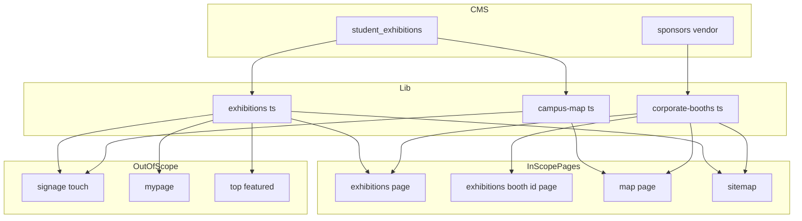
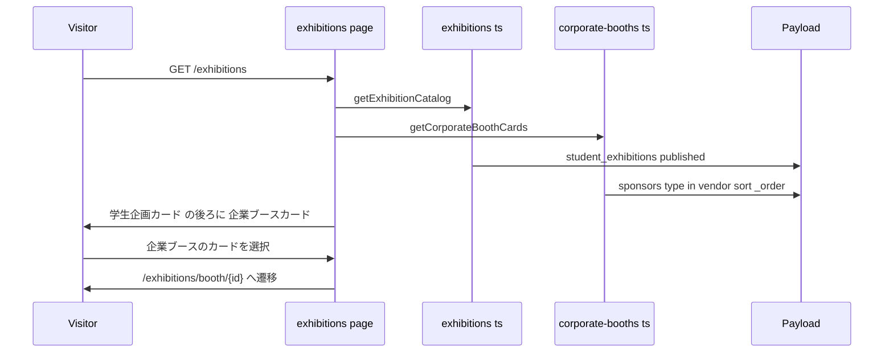

# Design Document

## Overview

協賛・出店コレクション (`sponsors`) のうち種別に「出店協賛」を含み企画名が入っているレコードを「企業ブース」として、学生企画の既存部品で企画一覧・企画詳細・構内マップ・sitemap に載せる。

**Purpose**: 来場者が学生企画と同じ導線 (一覧・ファセット検索・構内マップ) で企業の出店を見つけ、詳細を確認できるようにする。
**Users**: 来場者 (閲覧)、実行委員 (CMS で協賛レコードの「出店の企画内容」を入力)。
**Impact**: 一覧系の部品が受け付けるカード・カテゴリの型を、学生企画と企業ブースの両方を表す上位型へ広げる。学生企画だけを扱う既存の型・取得関数・対象外画面は変えない。

### Goals
- 企業ブースを学生企画と同じカード・詳細本体・エリア別リストで表示する
- ファセット検索・構内マップの検索にカテゴリ「企業ブース」を足す
- 学生企画の URL と衝突しない企業ブース詳細ページの URL を提供する

### Non-Goals
- サイネージのタッチ画面・マイページ (ブックマーク・スタンプ)・トップの注目企画への掲載
- 企業ブースのメニュー表示、新しい画面部品の作成
- CMS のスキーマ変更 (`sponsors.vendor` グループは feat/sponsor-vendor-shape で実装済み)

## Boundary Commitments

### This Spec Owns
- 企業ブースの取得と表示モデルへの変換 (`lib/corporate-booths.ts`)
- 一覧・マップ用の上位カテゴリ型とその表示名・並び (`ListingCategory`)
- 企業ブース詳細ページのルート (`/exhibitions/booth/[id]`)
- 一覧ページ・`/map` ページでの学生企画カードと企業ブースカードの結合
- sitemap への企業ブース詳細 URL と最終更新日時の反映

### Out of Boundary
- `ExhibitionCategory` / `CATEGORY_VALUES` / `CATEGORY_LABELS` の値と、それを使う対象外画面 (サイネージのタッチ画面・マイページ・注目企画・GA イベント)
- `getExhibitionCatalog` / `getExhibitionListData` / `getCampusMapData` / `getSponsors` の返す内容
- ブックマーク・スタンプの保存形式 (`lib/mypage-storage.ts`、`lib/stamp-signature.ts`)

### Allowed Dependencies
- `cms` クライアント (`lib/cms.ts`) の `findMany` / `findById`
- 既存の結合・整形関数 (`lib/exhibitions.ts` の場所文字列の規則、`lib/timetable.ts` の `getEventDayList` / `formatOpenDays`、`lib/page-metadata.ts`、`lib/meta-description.ts`、`lib/structured-data.ts` のパンくず)
- 生成型 `Sponsor` (`cms-types.ts`、`vendor` グループを含む)

### Revalidation Triggers
- `sponsors.vendor` グループの項目名・型の変更
- 学生企画の詳細 URL 規則・カードの表示項目の変更
- 対象外画面が一覧・マップの上位型を使い始める変更

## Architecture

### Existing Architecture Analysis
- 一覧 (`app/(site)/exhibitions/page.tsx`) は `getExhibitionCatalog` の全カードを `ExhibitionList` に渡し、絞り込み・ページ送りはクライアントで行う
- 構内マップ (`app/(fullscreen)/map/page.tsx`) は `getCampusMapData` を `CampusMapScreen` に渡す。エリア別リスト部品 `AreaExhibitionList` はサイネージのタッチマップと共有
- 詳細 (`app/(site)/exhibitions/[id]/[category]/page.tsx`) は `loadExhibitionDetailPage` の結果を `ExhibitionDetailBody` に渡す。`[id]` が整数でなければ 404
- 対象外画面は `getExhibitionCatalog` / `getExhibitionListData` / `getCampusMapData` / `toCards` の出力を直接使う。これらに企業ブースを混ぜると波及するため、混ぜない (research.md「Architecture Pattern Evaluation」)

### Architecture Pattern & Boundary Map



- 企業ブースは `corporate-booths.ts` だけが取得し、結合は対象範囲のページ (一覧・`/map`・sitemap) の呼び出し側で行う
- 一覧系部品 (`ExhibitionList`・`ExhibitionCard`・`ExhibitionFilters`・`AreaExhibitionList`・`CampusMapScreen` と検索 UI・`ExhibitionDetailBody`・`ExhibitionLocationSection`) は上位型 `ListingCard` / `ListingDetail` を受け付ける。上位型は既存型の上位集合のため、対象外画面からの既存の呼び出しはそのまま通る

### Technology Stack

| Layer | Choice / Version | Role in Feature | Notes |
|-------|------------------|-----------------|-------|
| Frontend | Next.js App Router (既存) | 企業ブース詳細ルートの追加、一覧・マップの結合 | 静的セグメント `booth` が動的セグメント `[id]` より優先される |
| Data | Payload REST (既存 `lib/cms.ts`) | `sponsors` の取得 | Workers Cache API 既定 60 秒 (学生企画と同じ) |

## File Structure Plan

### New Files
```
frontend/src/
├── lib/corporate-booths.ts                         # 企業ブースの取得・表示モデル変換・sitemap 用エントリ
├── lib/corporate-booths.test.ts
├── app/(site)/exhibitions/booth/[id]/page.tsx      # 企業ブース詳細ページ
└── app/(site)/exhibitions/booth/[id]/page.test.tsx
```

### Modified Files
- `frontend/src/lib/exhibitions.ts` — `ListingCategory` / `LISTING_CATEGORY_VALUES` / `LISTING_CATEGORY_LABELS` / `ListingCard` / `ListingDetail` / `listingHref` を追加。`ExhibitionQuery.categories` を `ListingCategory` に広げ、`parseExhibitionQuery` が `booth` を受け付ける。`filterExhibitions` を `ListingCard` の部分型に対する総称関数にする。場所文字列の組み立て (エリア名 + ラベル + 番号) を `formatPlacementLocation` として公開し、学生企画側もこれを使う
- `frontend/src/lib/campus-map.ts` — `CampusMapFilters.categories` を `ListingCategory` に広げる。`getCampusMapLastModified` に企業ブースの更新日時を含める
- `frontend/src/components/exhibition-card.tsx` — リンク先を `listingHref` で決める。企業ブースではブックマークボタンを出さない
- `frontend/src/components/exhibition-filters.tsx` — カテゴリ選択肢を `LISTING_CATEGORY_VALUES` / `LISTING_CATEGORY_LABELS` にする
- `frontend/src/components/exhibition-list.tsx` — `cards` を `ListingCard` にする
- `frontend/src/components/exhibition-detail-body.tsx` — `exhibition` を `ListingDetail` にする。バッジを `ListingCategory` 対応にし、企業ブースの色を足す。共有 URL を `listingHref` で決める。企業ブースではブックマークボタンを出さない
- `frontend/src/components/exhibition-location-map/exhibition-location-section.tsx` — `exhibition` を `ListingDetail` にする
- `frontend/src/components/campus-map/{campus-map-screen,area-exhibition-list,map-search-panel,map-search-overlay,use-map-filters}.tsx|ts` — カード・カテゴリの型を上位型に広げ、カテゴリ選択肢を `LISTING_CATEGORY_VALUES` にする。`CampusMapScreen` は追加の props `booths` を受け取り、学生企画カードの後ろに結合する
- `frontend/src/app/(site)/exhibitions/page.tsx` — 企業ブースのカードを取得し、学生企画カードの後ろに結合して `ExhibitionList` に渡す
- `frontend/src/app/(fullscreen)/map/page.tsx` — 企業ブースのカードを取得し `CampusMapScreen` に渡す
- `frontend/src/app/sitemap.ts` — 企業ブース詳細 URL を列挙し、`/exhibitions` の最終更新日時に企業ブースを含める
- 上記の既存テスト (`*.test.ts(x)`) — 企業ブースのケースを追加

## System Flows



## Requirements Traceability

| Requirement | Summary | Components | Interfaces |
|-------------|---------|------------|------------|
| 1.1, 1.2, 1.3 | 掲載対象 | CorporateBooths | `isCorporateBooth`, `getCorporateBoothCards` |
| 1.4 | 更新反映の間隔 | CorporateBooths, 各ページ | `revalidate = 60`, Cache API 既定 TTL |
| 1.5 | 公開フェーズ | 既存 `isPublicPath` / middleware | 変更なし (`/exhibitions` 配下として扱われる) |
| 2.1 | 同じカード | ExhibitionCard | `ListingCard` |
| 2.2, 2.3, 2.4, 2.7 | カテゴリ「企業ブース」の選択と URL 保持 | ExhibitionFilters, Exhibitions query | `LISTING_CATEGORY_VALUES`, `parseExhibitionQuery` |
| 2.5, 2.6 | キーワード・エリア | Exhibitions filter | `filterExhibitions` |
| 2.8 | 並び | ExhibitionsPage | 結合順 |
| 2.9 | ブックマーク非表示 | ExhibitionCard | `category !== 'booth'` |
| 2.10, 4.5 | 詳細への遷移 | ExhibitionCard | `listingHref` |
| 3.1, 3.9, 3.10 | 一意 URL・404・既存 URL の維持 | CorporateBoothPage | `/exhibitions/booth/[id]`, `getCorporateBoothDetail` |
| 3.2, 3.3, 3.4, 3.5, 3.7 | 詳細の構成 | ExhibitionDetailBody, CorporateBooths | `ListingDetail` |
| 3.6, 4.6 | 構内マップへの導線 | ExhibitionLocationSection | 既存 `buildAreaMapHref` |
| 3.8 | メタデータ・構造化データ | CorporateBoothPage | `buildPageMetadata`, `buildBreadcrumbJsonLd` |
| 4.1, 4.2, 4.3, 4.4 | 構内マップ | MapPage, CampusMapScreen, AreaExhibitionList, 検索 UI | `booths` props, `ListingCategory` |
| 5.1, 5.2, 5.3 | sitemap | Sitemap, CampusMap | `getCorporateBoothSitemapEntries`, `getCampusMapLastModified` |
| 6.1, 6.2, 6.3, 6.5 | 対象外画面の不変 | (結合を対象ページに限定) | 既存取得関数・`ExhibitionCategory` を変更しない |
| 6.4 | 既存 URL・クエリ・保存データ | Exhibitions query, ルート | `booth` 以外の値の解釈は不変 |

## Components and Interfaces

### Lib

#### Exhibitions (`lib/exhibitions.ts` への追加)

| Field | Detail |
|-------|--------|
| Intent | 一覧・マップ・詳細が共有する上位型とカテゴリ定義 |
| Requirements | 2.2, 2.3, 2.4, 2.5, 2.6, 2.7, 6.4 |

**Contracts**: State [x]

```typescript
type ListingCategory = ExhibitionCategory | 'booth';

/** 一覧・マップの選択肢順。既存 4 カテゴリの後ろに企業ブース */
const LISTING_CATEGORY_VALUES: readonly ListingCategory[];
const LISTING_CATEGORY_LABELS: Readonly<Record<ListingCategory, string>>; // booth: '企業ブース'

interface CorporateBoothCard extends Omit<ExhibitionCardSummary, 'category'> {
  readonly category: 'booth';
}
type ListingCard = ExhibitionCardSummary | CorporateBoothCard;

interface CorporateBoothDetail extends CorporateBoothCard {
  readonly description: string | null;
  readonly images: readonly ExhibitionImage[];
  readonly links: readonly ExhibitionLink[]; // url があれば [{ platform: 'website', url }]
  readonly categories: readonly ['booth'];
  readonly openDayKeys: readonly string[];
}
type ListingDetail = ExhibitionDetail | CorporateBoothDetail;

/** 学生企画は /exhibitions/{id}/{category}、企業ブースは /exhibitions/booth/{id} */
function listingHref(card: Pick<ListingCard, 'id' | 'category'>): string;

/** エリア名・マップ表示ラベル・ブース番号を空白区切りで連結。エリア未解決なら null */
function formatPlacementLocation(
  areaName: string | undefined,
  boothLabel: string | null | undefined,
  boothNumber: string | null | undefined,
): string | null;

function filterExhibitions<T extends ListingCard>(
  items: readonly T[],
  query: ExhibitionQuery,
): readonly T[];
```
- `ExhibitionQuery.categories` は `readonly ListingCategory[]`。`parseExhibitionQuery` は `LISTING_CATEGORY_VALUES` に含まれる値を受け付け、その順でソートする。既存 4 値の解釈と URL 文字列は変わらない (6.4)
- `CorporateBoothDetail` は `menu` を持たない。詳細本体のメニュー描画条件 (`category === 'vendor'`) は変えない (3.7)

#### CorporateBooths (`lib/corporate-booths.ts`)

| Field | Detail |
|-------|--------|
| Intent | 協賛レコードから企業ブースを取得し、カード・詳細・sitemap 用の形へ変換する |
| Requirements | 1.1, 1.2, 1.3, 1.4, 2.1, 2.5, 2.6, 3.2, 3.4, 3.5, 3.9, 5.1, 5.2 |

**Dependencies**
- Outbound: `cms.findMany('sponsors', …)` / `cms.findById('sponsors', …)` (P0)、`map_areas` の取得 (場所文字列の解決、P1)

**Contracts**: Service [x]

```typescript
/** type に 'vendor' を含み、vendor.name が空白以外の文字を含む */
function isCorporateBooth(sponsor: Sponsor): boolean;

/** sponsors を where type in ['vendor'], sort _order, limit 0, depth 0 で取得。取得失敗時は例外 */
function getCorporateBoothCards(): Promise<readonly CorporateBoothCard[]>;

type CorporateBoothDetailResult =
  | { readonly kind: 'found'; readonly value: CorporateBoothDetail }
  | { readonly kind: 'missing' }
  | { readonly kind: 'error'; readonly error: CmsFetchError };

/** id が整数でない・not_found・isCorporateBooth が偽なら missing */
function getCorporateBoothDetail(id: string): Promise<CorporateBoothDetailResult>;

interface CorporateBoothSitemapEntry {
  readonly id: number;
  readonly updatedAt: string;
}
function getCorporateBoothSitemapEntries(): Promise<readonly CorporateBoothSitemapEntry[]>;
```
- 変換規則
  - `displayName` ← `vendor.name` (前後空白除去)
  - `organizationName` ← `name` (3.4)
  - `thumbnail` / `images` ← `vendor.images` (alt は企画名。学生企画の depth 0 と同じ扱い)
  - `areaIds` ← `vendor.area_id` があれば `[area_id]`
  - `location` ← `formatPlacementLocation(エリア名, vendor.booth_label, vendor.booth_number)`
  - `description` ← `vendor.description`
  - `links` ← `url` があれば `[{ platform: 'website', url }]` (3.5)
  - `openDayKeys` ← `vendor.open_days` を学生企画と同じ JST 暦日キー変換で
- トップレベルの `description` (応援メッセージ)・`logo` は使わない

### Pages

#### CorporateBoothPage (`app/(site)/exhibitions/booth/[id]/page.tsx`)

| Field | Detail |
|-------|--------|
| Intent | 企業ブース詳細ページ |
| Requirements | 3.1, 3.2, 3.3, 3.7, 3.8, 3.9, 3.10 |

- 取得: `getCorporateBoothDetail(id)`・`getCampusMapAreas()`・`getEventDayList()` を並行取得。出店日は学生企画の非ステージと同じ `formatOpenDays` で整形する
- `missing` は `notFound()`。`error`・エリア取得失敗・開催日程取得失敗は例外にして古いページを保つ (学生企画詳細と同じ方針)
- 描画: `JsonLd` (トップ → 企画一覧 → 企画名、パスは `listingHref`)、`BackLink href="/exhibitions"`、`ExhibitionDetailBody` (`performances = null`)。`StampCollector` は置かない (3.7)
- メタデータ: `buildPageMetadata` に title=企画名、description=`toMetaDescription([description], site.description)`、path=`/exhibitions/booth/{正規化 id}`、ogType=`article`、imageCandidates=`[thumbnail?.id]` (3.8)
- `generateStaticParams` は `[]`、`revalidate` は学生企画詳細と同じ値

#### ExhibitionsPage / MapPage (既存の変更)

| Field | Detail |
|-------|--------|
| Intent | 学生企画カードの後ろに企業ブースカードを結合する |
| Requirements | 2.1, 2.8, 4.1, 4.4, 6.1, 6.3 |

- 一覧: `loadForIsr` で `getExhibitionCatalog` と `getCorporateBoothCards` を取得し、`[...cards, ...booths]` を `ExhibitionList` に渡す
- マップ: `getCorporateBoothCards` を取得し、`CampusMapScreen` の新しい props `booths: readonly CorporateBoothCard[]` に渡す。取得失敗は学生企画の取得失敗と同じく例外にする (ビルド時は空配列)
- `CampusMapScreen` は `data.exhibitions.value` の後ろに `booths` を結合して検索・エリア別リストに使う。サイネージのタッチマップは `CampusMapScreen` を使わないため影響しない (6.1)

### Components

| Component | Requirements | 変更 |
|-----------|--------------|------|
| ExhibitionCard | 2.1, 2.9, 2.10, 4.5 | `exhibition: ListingCard`。リンク先 `listingHref`。`bookmarkable && category !== 'booth'` のときだけブックマーク |
| ExhibitionFilters | 2.2, 2.7 | 選択肢 `LISTING_CATEGORY_VALUES`、表示名 `LISTING_CATEGORY_LABELS` |
| ExhibitionList | 2.1–2.8 | `cards: readonly ListingCard[]` |
| ExhibitionDetailBody | 3.2, 3.3, 3.4, 3.5, 3.7 | `exhibition: ListingDetail`。バッジは `ListingCategory`、共有 URL は `listingHref`、`category !== 'booth'` のときだけブックマーク |
| ExhibitionLocationSection | 3.6 | `exhibition: ListingDetail` |
| AreaExhibitionList | 4.1, 4.5 | `items: readonly ListingCard[]`、`categories: readonly ListingCategory[]` |
| MapSearchPanel / MapSearchOverlay / useMapFilters | 4.2, 4.3 | 選択肢・状態を `ListingCategory` に |

**カテゴリバッジの色**: 既存 4 カテゴリは stage=`bg-accent`、exhibit=`bg-info`、vendor=`bg-warning`、other=`bg-accent-alt`。booth=`bg-secondary` (#7fc8ad) を追加する。

## Data Models

### Data Contracts & Integration
- 入力: `Sponsor` (生成型)。使う項目は `id`・`name`・`url`・`type`・`updatedAt`・`vendor.{name, description, images, open_days, area_id, booth_number, booth_label}`
- 取得条件: `where: { type: { in: ['vendor'] } }`、`sort: ['_order']`、`limit: 0`、`depth: 0`。`vendor.name` の空判定は取得後に行う
- スキーマ変更なし

## Error Handling

### Error Strategy
- 一覧・マップ: 企業ブースの取得失敗は学生企画の取得失敗と同じく例外とし、ISR の再検証を失敗させて古いページを保つ。ビルド時は `loadForIsr` / `isBuildPhase` の既存の扱いで空にする
- 詳細: `missing` は 404、それ以外の失敗は例外 (古いページを保つ)
- sitemap: 既存のセクションと同じく取得失敗時はそのセクションを省く

## Testing Strategy

### Unit Tests
- `corporate-booths`: `isCorporateBooth` (vendor 無し・企画名空白・正常)、カード変換 (場所文字列・areaIds・thumbnail・organizationName)、詳細変換 (links・openDayKeys・menu 無し)、`getCorporateBoothDetail` の missing 条件 (非整数 id・not_found・非出店協賛)
- `exhibitions`: `parseExhibitionQuery` が `booth` を受け付け既存値の正規化が不変、`listingHref`、`filterExhibitions` が企業ブースをキーワード (企画名・企業名)・カテゴリ・エリアで絞る
- `ExhibitionCard`: 企業ブースのリンク先、`bookmarkable` でもブックマークを出さない
- `ExhibitionDetailBody`: 企業ブースでバッジ「企業ブース」、企業名、Web サイトリンク、メニュー・ブックマーク非表示

### Integration Tests
- 企業ブース詳細ページ: 正常描画・メタデータ (canonical `/exhibitions/booth/{id}`)・404 (非整数・非出店協賛・企画名空)
- 一覧ページ・マップ: 学生企画の後ろに企業ブースが並ぶ、カテゴリ「企業ブース」で絞り込める
- sitemap: 企業ブース URL と `updatedAt`、`/exhibitions` と `/map` の最終更新日時に企業ブースが反映される
- 回帰: サイネージのタッチ画面・マイページ・トップの注目企画の既存テストが無変更で通る

### E2E / UI Tests
- ローカル (`make dev` + worktree の CMS) で、出店協賛を登録して一覧・ファセット・詳細・構内マップを実ブラウザで確認する。SP / PC 幅の両方
