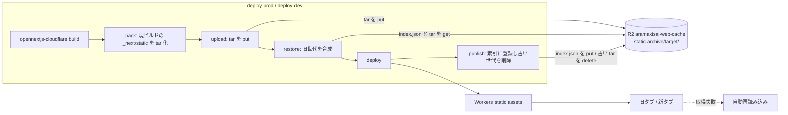
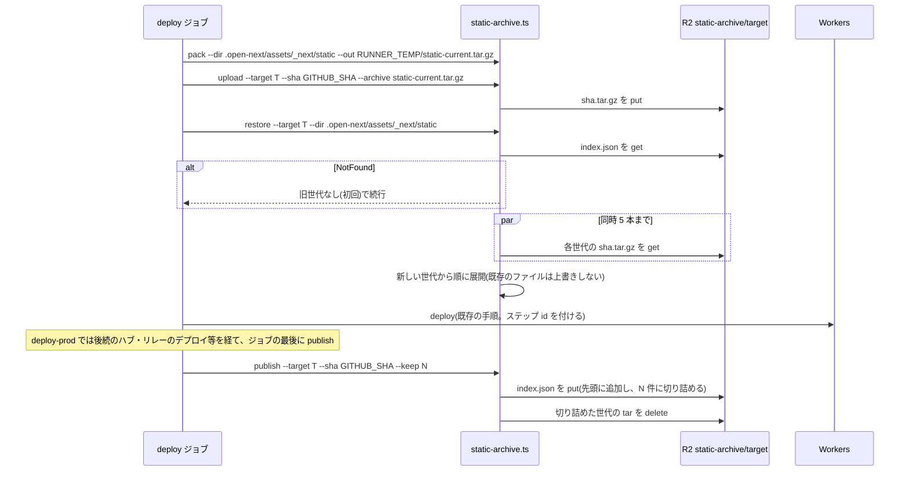

# Design Document

## Overview
**Purpose**: デプロイ後も、旧ビルドを開いたままのタブが必要とする `/_next/static/` 配下のアセットを配信し続ける。保持範囲を超えたタブは、自動で最新ビルドへ読み込み直す。

**Users**: 公開サイトの来場者、dev サイトを見る実行委員、長時間表示し続けるサイネージ端末。

**Impact**:
- 本番と dev のデプロイジョブで、ビルドの後・deploy の前に旧世代のアセットを合成する手順が加わる。
- ルートレイアウトにインラインスクリプトが 1 つ加わる。
- Worker の実行経路、Cloudflare Access、PR プレビュー、PR の CI、ローカル開発は変更しない。

### Goals
- 旧タブの遅延チャンクと CSS の取得が 404 にならない(直近 20 世代)
- 旧タブのページ遷移は、Next.js 標準の buildId 不一致検知で最新ビルドへフルリロードされる(新たな実装はしない)
- 保持範囲外のタブはエラーを出し続けず、1 回だけ読み込み直す
- 閲覧時の通信量とレスポンスタイムを増やさない

### Non-Goals
- 旧ビルドの画面のままページ遷移を続けること(旧版の Worker への中継)
- `public/` 由来のファイル(画像・地図タイル等)の旧版保持
- PR プレビュー URL での旧ビルド対応
- OpenNext skew protection の導入と `next.config` の `deploymentId` の設定

## Boundary Commitments

### This Spec Owns
- R2 `aramakisai-web-cache` の `static-archive/` プレフィックス配下(世代ごとの tar と索引)
- `frontend-ci.yml` の `deploy-prod`・`deploy-dev` ジョブで、ビルドと deploy の間に入る合成手順と、deploy の後に入る登録手順
- ルートレイアウトの、アセット取得に失敗したときの自動再読み込み

### Out of Boundary
- OpenNext の incremental cache が同じバケットに書くキー(`static-archive/` 以外)
- `deploy-preview`・`e2e` ほか PR で走るジョブ
- Cloudflare Access の構成(`aramakisai-infra`)

### Allowed Dependencies
- CI のデプロイが既に使っている Cloudflare API トークン(prod は Infisical `prod`、dev は `staging`)。どちらもこのバケットへの get / put / delete が通ることは実測で確認済み(`research.md`)
- wrangler CLI(`wrangler r2 object get/put/delete --remote`)と、ランナーの `tar`

### Revalidation Triggers
- `next.config` に `deploymentId` か `generateBuildId` を設定するとき(`_next/static/<buildId>/` の衝突条件が変わる)
- Next.js のメジャー更新(遷移時の buildId 不一致検知の挙動)
- バケット名、または OpenNext のキー設計の変更

## Architecture

### Existing Architecture Analysis
- `opennextjs-cloudflare build` が `.open-next/assets/` を作り、deploy がそれを Workers static assets として上げる。Workers は最新の版のアセットしか配信しない。
- `deploy-prod`(main への push)は `opennextjs-cloudflare deploy` を使う。`deploy-dev`(dev への push)は `wrangler deploy --env=dev` を使う。どちらも同じ `.open-next/assets` を上げる。CPU 上限のフォールバック(`deploy-with-cpu-limit-fallback.ts`)も同じディレクトリを使う。
- concurrency は `frontend-ci-${{ github.ref }}` で、push では実行中のジョブを中断しない。そのため、同じターゲットへのデプロイは直列に走る。

### Architecture Pattern & Boundary Map



- `target` は `prod` か `dev`。PR プレビューはどちらにも書き込まない(Requirement 4)。

### Technology Stack

| Layer | Choice / Version | Role in Feature | Notes |
|-------|------------------|-----------------|-------|
| CI スクリプト | TypeScript + `tsx`(既存の `frontend/scripts/*.ts` の流儀) | 合成と登録 | Node ランタイムで実行する。Edge の制約は受けない |
| 保管 | Cloudflare R2(既存のバケット `aramakisai-web-cache`) | 世代の保管 | 新しいバケットやシークレットは作らない |
| CLI | wrangler 4.151.3 の `r2 object get/put/delete --remote`、GNU tar | R2 の操作と展開 | |
| クライアント | ルートレイアウトのインラインスクリプト | 自動再読み込み | 既存の `MOTION_INIT_SCRIPT` と同じ形 |

## File Structure Plan

### Directory Structure
```
frontend/
├── scripts/
│   ├── static-archive.ts          # pack / restore / publish の 3 つのサブコマンド。索引の更新と剪定は純関数に分ける
│   └── static-archive.test.ts     # 索引の更新・剪定・合成の順序・NotFound の判定
└── src/lib/
    ├── chunk-recovery-script.ts       # 自動再読み込みのインラインスクリプトの文字列
    └── chunk-recovery-script.test.ts  # jsdom で失敗イベントを発火し、再読み込みの有無を確かめる
```

### Modified Files
- `.github/workflows/frontend-ci.yml`
  - workflow の `env` に `STATIC_ARCHIVE_KEEP: 20`(保持する旧世代数。Requirement 2.1 の設定箇所)と `STATIC_ARCHIVE_BUCKET: aramakisai-web-cache` を加える
  - `deploy-prod` と `deploy-dev` に、pack・restore・publish の各ステップを加える
- `frontend/frontend-ci-deploy.workflow.test.ts` — 上記のステップがあること、その順序、`deploy-preview` には無いことを確かめる
- `frontend/src/app/layout.tsx` — `<head>` 内の `MOTION_INIT_SCRIPT` と同じ位置に、自動再読み込みのスクリプトを置く
- `.kiro/steering/tech.md` — CI/CD の節に、旧アセット同梱の説明と `STATIC_ARCHIVE_KEEP` の場所を書く(Requirement 6.5)。あわせて、コア技術の frontend のバージョンを実態(Next.js 16)に直す

## System Flows



- pack は restore より前に実行する。こうすると、tar には現ビルドのファイルだけが入る。
- tar の put(upload)は deploy より前に行う。deploy が成功して配信されたビルドは、必ず保管済みになる。publish の失敗で保管されないまま配信されるビルドは生じない。
- 索引への登録(publish)は、サイトの deploy が成功したときだけ行う(Requirement 6.4)。ステップの条件は `if: ${{ always() && steps.<deploy の id>.outcome == 'success' }}` とし、ジョブの最後に置く。deploy の成功後にジョブが取り消されても、配信中のビルドは登録される。こうすると publish が失敗しても、deploy-prod の後続ステップ(地震速報リレーのデプロイ)が飛ばされない。後続のステップが失敗しても、サイトの世代は登録される。
- deploy が失敗したときの tar は、索引に載らずに R2 に残る。同じ sha で再実行すると上書きされる。それ以外の場合は残り続けるが、まれな事象で 1 件約 20MB(試算上)にすぎないので、掃除の仕組みは作らない。
- index.json を更新してから tar を削除する。削除に失敗しても、その時点で索引は既に整合している。

## Requirements Traceability

| Requirement | Summary | Components |
|-------------|---------|------------|
| 1.1, 1.3 | 旧タブに静的アセットを配信 | StaticArchive の restore、frontend-ci |
| 1.2, 1.3 | 遷移は最新ビルドで表示 | Next.js 標準(buildId の不一致でフルリロード) |
| 1.4 | 新しく開いた人には最新ビルド | restore(現ビルドを優先して合成) |
| 2.1 | 世代数の設定 | `STATIC_ARCHIVE_KEEP` |
| 2.2, 2.3 | 失敗時に 1 回だけ読み込み直す | ChunkRecoveryScript |
| 3.1, 3.2, 3.3 | Access の維持 | 構成は変えない。旧アセットは同じ Worker の assets として配信する |
| 4.1, 4.2, 4.3 | PR のビルドを含めない | target 別のプレフィックス。deploy-preview には触れない |
| 5.1 | 閲覧の経路・量を変えない | 実行時の変更はインラインスクリプトだけ。アセットは従来どおり static assets から配信する |
| 5.2, 5.3 | PR の CI とローカル開発を変えない | 変更は deploy-prod / deploy-dev とルートレイアウトだけ |
| 6.1, 6.2 | デプロイごとに合成と登録 | frontend-ci の deploy-prod / deploy-dev |
| 6.3 | 保管先の失敗でデプロイを止める | StaticArchive のエラー処理 |
| 6.4 | 失敗したデプロイは登録しない | publish のステップの条件 |
| 6.5 | ドキュメント | tech.md |

## Components and Interfaces

### CI

#### StaticArchive(`frontend/scripts/static-archive.ts`)

| Field | Detail |
|-------|--------|
| Intent | 現ビルドの `_next/static` を世代として R2 に保管し、デプロイの前に旧世代を合成する |
| Requirements | 1.1, 1.3, 1.4, 2.1, 4.1-4.3, 6.1-6.4 |

**Responsibilities & Constraints**
- `static-archive/<target>/` の外のキーは読み書きしない
- 合成では既存のファイルを上書きしない(`tar --skip-old-files`)。こうすれば現ビルドの成果物は変わらない
- 秘密として扱う入力は無い。wrangler の認証は、呼び出し元の `infisical run` が環境変数で渡す
- restore での世代の取得は、同時 5 本までの並列で行う

##### Batch / Job Contract
```
tsx scripts/static-archive.ts pack    --dir <staticDir> --out <tarPath>
tsx scripts/static-archive.ts upload  --bucket <name> --target <prod|dev> --sha <gitSha> --archive <tarPath>
tsx scripts/static-archive.ts restore --bucket <name> --target <prod|dev> --dir <staticDir>
tsx scripts/static-archive.ts publish --bucket <name> --target <prod|dev> --sha <gitSha> --keep <N>
```
- `--target` は `prod` と `dev` 以外を受け付けない(終了コード 2)
- `--keep` は 1 以上の整数
- 成功したら終了コード 0。失敗したら、失敗した操作(get/put/delete とキー、または tar)を `::error::` で出して終了コード 1

**純関数(テストの対象)**
```typescript
type Target = 'prod' | 'dev';

interface ArchiveIndex {
  readonly version: 1;
  readonly generations: readonly ArchiveGeneration[]; // 新しい順
}

interface ArchiveGeneration {
  readonly sha: string;        // GITHUB_SHA
  readonly deployedAt: string; // ISO 8601
}

type R2GetResult =
  | { readonly kind: 'ok'; readonly path: string }
  | { readonly kind: 'not-found' }
  | { readonly kind: 'error'; readonly message: string };

function archiveKey(target: Target, sha: string): string;   // static-archive/<target>/<sha>.tar.gz
function indexKey(target: Target): string;                 // static-archive/<target>/index.json
function addGeneration(
  index: ArchiveIndex,
  generation: ArchiveGeneration,
  keep: number,
): { readonly next: ArchiveIndex; readonly pruned: readonly ArchiveGeneration[] };
// 同じ sha が既にあれば取り除いてから先頭に加える(再実行しても結果が変わらないように)。keep 件を超えた末尾を pruned として返す
function classifyR2GetFailure(stderr: string): 'not-found' | 'error';
// 'The specified key does not exist.' を含むときだけ not-found とする
```

**restore の振る舞い**
- index.json が not-found → 旧世代なしとして成功する(初回)
- index.json が error、または JSON として不正 → 失敗する(Requirement 6.3)
- 世代の tar が not-found → `::warning::` を出してその世代を飛ばす(索引からは次の publish で外す)
- 世代の tar が error、または展開に失敗 → 失敗する

**upload の振る舞い**
- tar を `archiveKey(target, sha)` に put する。失敗したら失敗する(Requirement 6.3)。deploy はまだ行われていない

**publish の振る舞い**
- index.json の put → pruned の tar の delete、の順に行う
- index.json の読み込みは restore と同じ規則に従う(not-found なら空の索引から始める)
- 索引に載っているのに tar が無い世代は、publish では確認しない。restore が warning を出して飛ばし続け、keep 件を超えた時点で索引から落ちる(確認のために tar を取得し直す転送を避ける)
- pruned の delete に失敗しても `::warning::` に留める。索引は既に整合していて、残るのは参照されない tar だけのため

### Workflow(`.github/workflows/frontend-ci.yml`)

`deploy-prod` と `deploy-dev` に同じ形でステップを加える。`<T>` は prod か dev、`<E>` は Infisical の環境(prod か staging)を表す。

| 位置 | ステップ名 | 実行内容 |
|------|-----------|----------|
| Build の直後 | `Pack current static assets` | `pnpm exec tsx scripts/static-archive.ts pack --dir .open-next/assets/_next/static --out "$RUNNER_TEMP/static-current.tar.gz"` |
| その直後 | `Upload current static assets (<T>)` | `infisical run ... --env=<E> -- pnpm exec tsx scripts/static-archive.ts upload --bucket "$STATIC_ARCHIVE_BUCKET" --target <T> --sha "$GITHUB_SHA" --archive "$RUNNER_TEMP/static-current.tar.gz"` |
| その直後 | `Restore previous static assets (<T>)` | `infisical run ... --env=<E> -- pnpm exec tsx scripts/static-archive.ts restore --bucket "$STATIC_ARCHIVE_BUCKET" --target <T> --dir .open-next/assets/_next/static` |
| ジョブの最後 | `Publish static assets generation (<T>)` | 条件 `if: ${{ always() && steps.deploy_site.outcome == 'success' }}`。`infisical run ... --env=<E> -- pnpm exec tsx scripts/static-archive.ts publish --bucket "$STATIC_ARCHIVE_BUCKET" --target <T> --sha "$GITHUB_SHA" --keep "$STATIC_ARCHIVE_KEEP"` |

- サイトの deploy ステップ(deploy-prod の「Deploy to Cloudflare Workers (prod)」、deploy-dev の「Deploy to Cloudflare Workers (dev)」)に `id: deploy_site` を付ける
- deploy-prod では、publish を地震速報リレーのデプロイ(`Detect signage relay changes` 以降)より後に置く。publish の失敗で、リレーのデプロイが飛ばされないようにするため。リレーの差分は `github.event.before..GITHUB_SHA` で判定しているので、一度飛ばされると次の push では検出できない
- `deploy-preview` と PR で走るほかのジョブには加えない(Requirement 4、5.2)
- ジョブの `permissions` は変えない(R2 は Cloudflare のトークンで操作する)

### Client

#### ChunkRecoveryScript(`frontend/src/lib/chunk-recovery-script.ts`)

| Field | Detail |
|-------|--------|
| Intent | 静的アセットの取得に失敗したタブを、1 回だけ最新ビルドへ読み込み直す |
| Requirements | 2.2, 2.3, 5.1 |

**Responsibilities & Constraints**
- 検知する対象は次の 2 つ:
  - `window` の capture フェーズの `error` イベントのうち、対象が `<script>` か `<link rel="stylesheet">` で、URL のパスが `/_next/static/` で始まるもの
  - `unhandledrejection` のうち、`reason.name` が `ChunkLoadError` のもの、またはメッセージが `Loading CSS chunk` で始まるもの
- 検知したら `location.reload()` する。再読み込みは、読み込んでいるビルドごとに 1 回だけにする(Requirement 2.3)
  - ビルドの識別には、文書内の webpack ランタイムの script の URL(`/_next/static/chunks/webpack-<hash>.js`)を使う。ランタイムにはチャンクのハッシュ表が埋め込まれているので、チャンクが変われば URL も変わる
  - 再読み込みの前に、sessionStorage のキー `aramakisai_chunk_reload_build` にこの URL を保存する。保存済みの値と同じなら再読み込みしない。こうすると、読み込み直した後も取得に失敗し続ける状態(壊れたデプロイ、Access のセッション切れ等)で、再読み込みが繰り返されない。サイネージ端末も含む
  - 新しいデプロイの後は URL が変わるので、もう一度だけ救える
  - ランタイムの script が見つからない場合は、同じセッション内で 1 回だけにする。sessionStorage が使えない環境では再読み込みしない
- `/_next/static/` 以外の取得失敗(画像・地図タイル・外部スクリプト)では再読み込みしない
- `navigator.onLine === false` のときは再読み込みしない。オフラインや電波の弱い環境での取得失敗は旧ビルドが原因ではなく、読み込み直すとオフラインのエラー画面へ遷移して入力中の内容が失われるため
- 置き場所は、`src/app/layout.tsx` の `<head>` 内の `MOTION_INIT_SCRIPT` と同じ位置にする。layout に書いた要素は、Next が出力するスタイルシートと async の script より後ろに並ぶ(本番の HTML で実測)。そのため、登録より前に起きる初期読み込みの失敗は検知できない。対象は、hydrate 後の遅延チャンクと CSS の取得失敗とする。旧タブで起きる失敗はこちらに当たる
- 外部への要求は発生させない(Requirement 5.1)

```typescript
export const CHUNK_RECOVERY_SCRIPT: string; // dangerouslySetInnerHTML でそのまま埋め込む、ES5 相当のスクリプト
export const CHUNK_RELOAD_STORAGE_KEY = 'aramakisai_chunk_reload_build';
```

## Data Models

### Physical Data Model(R2)
| キー | 内容 | 書き込むジョブ |
|------|------|----------|
| `static-archive/prod/index.json` | `ArchiveIndex`(本番の世代。最大 `STATIC_ARCHIVE_KEEP` 件) | deploy-prod |
| `static-archive/prod/<sha>.tar.gz` | その本番ビルドの `.open-next/assets/_next/static` の中身(ディレクトリ直下からの相対パス) | deploy-prod |
| `static-archive/dev/index.json` | dev の世代 | deploy-dev |
| `static-archive/dev/<sha>.tar.gz` | その dev ビルドの `_next/static` | deploy-dev |

- 1 世代の tar は約 20MB(試算上。大半はフォントのサブセット)。保存量は target ごとに約 20MB × 20 = 400MB(試算上)
- 1 版あたりの static assets のファイル数は約 3,700(試算上)で、Free の上限 20,000 に収まる

## Error Handling

### Error Strategy
- R2 の読み書きと展開の失敗では、デプロイを止める(Requirement 6.3)。旧世代を欠いたまま deploy すると、旧タブが黙って壊れるため
- 初回(index.json が無い)と、索引にあって tar が無い世代は、止めずに続ける
- 古い tar の削除の失敗は warning に留める

### Error Categories and Responses
| 事象 | 応答 |
|------|------|
| index.json が無い | 旧世代なしとして続ける |
| index.json の取得エラー・JSON の不正 | `::error::` を出してジョブを失敗させる |
| 世代の tar が無い | `::warning::` を出して飛ばす。次の publish で索引から外す |
| tar の取得エラー・展開エラー | `::error::` を出してジョブを失敗させる |
| tar の put の失敗(upload) | `::error::` を出してジョブを失敗させる。deploy の前なので、保管されないビルドが配信されることはない |
| index.json の put の失敗(publish) | `::error::` を出してジョブを失敗させる。tar は保管済みで、配信中のビルドは次回の restore に含まれない。ジョブを再実行すると再ビルドになるので、この世代は戻らない(再実行のビルドが新しい世代として登録される) |
| 古い tar の delete の失敗 | `::warning::` |
| 同じ sha でジョブを再実行した | 再ビルドで buildId が変わるが、tar は同じキーに上書きされる。前回配信したビルドの `_next/static/<buildId>/` はどの世代にも残らない。チャンク本体は contenthash が同じなので影響は小さく、既知の制約として受け入れる |
| Cloudflare のダッシュボードか `wrangler rollback` で旧版 X に戻した | X の static assets には、X より新しいビルドのチャンクが無い。新しいビルドを開いていたタブは 404 になり、自動再読み込みで X に移る。index.json は新しい sha が先頭のまま残るが、次の deploy で整合する |

### Monitoring
- 各サブコマンドは、扱った世代数と、展開・追加したファイル数を、標準出力と `$GITHUB_STEP_SUMMARY` に書く

## Testing Strategy

### Unit Tests
- `static-archive.test.ts`
  - `addGeneration`: 先頭への追加、keep 件での切り詰めと pruned、同じ sha の再登録
  - `classifyR2GetFailure`: not-found の文言と、それ以外のエラー
  - restore: 一時ディレクトリで確かめる。現ビルドと同名の旧ファイルを上書きしないこと、旧世代にだけあるファイルが追加されること(wrangler の呼び出しは差し替える)
- `chunk-recovery-script.test.ts`(jsdom)
  - `/_next/static/chunks/x.js` の script で error → reload が 1 回呼ばれる
  - 同じランタイム URL で読み込み直した後の失敗 → reload されない
  - ランタイム URL が変わった後の失敗 → もう一度 reload される
  - `/images/x.webp` の img で error → reload されない
  - `ChunkLoadError` の unhandledrejection → reload される
  - `navigator.onLine === false` のときの失敗 → reload されない
- `frontend-ci-deploy.workflow.test.ts`
  - deploy-prod と deploy-dev で、Build < pack < upload < restore < deploy_site の順に並ぶこと。publish はジョブの最後のステップで、deploy-prod ではリレーのデプロイより後にあること
  - publish の条件が `always() && steps.deploy_site.outcome == 'success'` であること
  - target と Infisical の環境の組み合わせ(prod と prod、dev と staging)
  - deploy-preview に static-archive の呼び出しが無いこと

### 実環境での確認
- dev へのマージ後、dev.aramakisai.com を実ブラウザで開いたままにして、dev へ 2 回目のデプロイを行う。1 回目のタブで次を確かめる:
  - 遅延読み込みするチャンク(例: 構内マップ)に触れると、200 で取得できる
  - ページを遷移するとフルリロードして新ビルドになる
- 導入の前後で、同じページを開いたときの要求の数と転送量を実ブラウザで比べる。増えるのはインラインスクリプトの分だけであることを確かめる(Requirement 5.1)
- ローカルの実ブラウザで、hydrate の後に遅延読み込みされるチャンクの取得を遮断して 404 にし、自動再読み込みが 1 回だけ起きることを確かめる(遮断を続けても 2 回目は起きないこと)
- dev と main のデプロイジョブの所要時間を、導入の前後で比べて報告する

## Security Considerations
- 新しい認証経路や公開 URL は作らない。旧アセットは、そのビルドをデプロイした Worker の custom domain からだけ、既存の Access 保護の下で配信する(Requirement 3)
- prod の世代には prod のビルドしか入らない。dev と PR プレビューのビルド(開発用のフェーズ切替 UI を含む)が prod に混ざることはない
