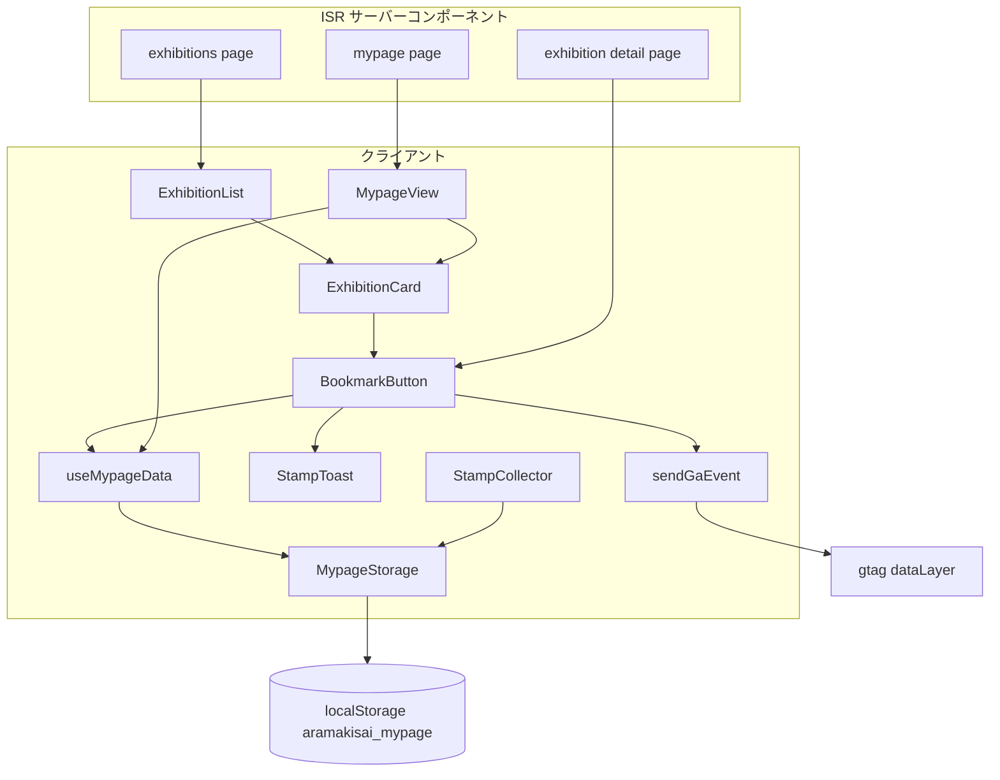
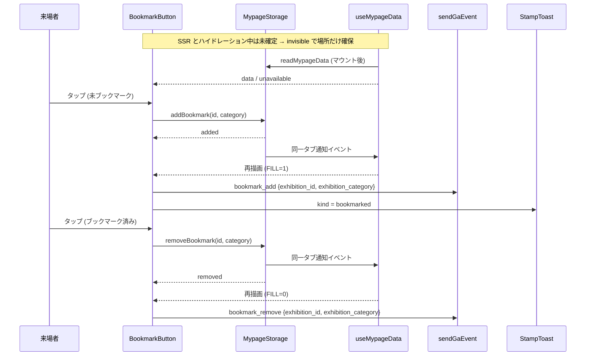

# Design Document

## Overview
**Purpose**: 来場者が企画とカテゴリの組を端末内にブックマークし、マイページから後で開けるようにする。あわせてブックマークの追加・解除を GA4 に送り、実行委員が人気企画を把握できるようにする。
**Users**: スマートフォンで企画一覧・企画詳細ページを見る来場者、GA4 を見る実行委員。
**Impact**: 既存のマイページ端末内保存(`aramakisai_mypage`)に`bookmarks`リストを足し、スタンプ記録時に他のリストを捨てて書き戻している現行の不具合を合わせて直す。企画カードはリンクとボタンを兄弟に分けた構造に変える。

### Goals
- 企画詳細ページと企画一覧のカードからブックマークを追加・解除できる
- マイページを「スタンプ」「ブックマーク」のタブで切り替え、ブックマークを新しい順に一覧し、そこから解除できる
- スタンプとブックマークが互いの保存を消さない
- `bookmark_add`・`bookmark_remove`を`qr_stamp`と同じ条件・同じパラメータ名で送る

### Non-Goals
- 保存データのエクスポート・インポート
- サーバー保存・端末間の引き継ぎ・ランキング表示
- トップページの注目企画・マップのエリア一覧のカードへのボタン設置
- 新規の色・部品・Figma デザイン

## Boundary Commitments

### This Spec Owns
- `aramakisai_mypage`の`lists.bookmarks`の形式・検証・読み書き
- 端末内保存の読み書きでリスト同士を保持する振る舞い(スタンプ側の書き込みを含む)
- ブックマークボタン(詳細ページ用・カード用)とマイページのタブ(スタンプ・ブックマーク)
- GA4 イベント`bookmark_add`・`bookmark_remove`

### Out of Boundary
- スタンプの記録条件・検証値・取得率の計算(既存の挙動を変えない)
- フェーズ判定(`frontend/src/lib/phase.ts`)・下部ナビゲーション・ヘッダー
- GA4 管理画面の設定

### Allowed Dependencies
- `frontend/src/lib/mypage-storage.ts`、`frontend/src/lib/analytics.ts`、`frontend/src/components/icons.tsx`、`frontend/src/components/stamp-toast.tsx`
- `frontend/src/lib/exhibitions.ts`からは**型だけ**を import する(実行時 import は CMS クライアントをクライアントバンドルへ引き込むため。`stamp-signature.ts`と同じ制約)

### Revalidation Triggers
- `aramakisai_mypage`の形式(`version`・リスト名・要素の形)を変えるとき
- `sendGaEvent`のパラメータ名を変えるとき(GA4 のカスタムディメンションと対応している)
- `ExhibitionCard`の DOM 構造を変えるとき

## Architecture

### Existing Architecture Analysis
- 企画一覧(`app/(site)/exhibitions/page.tsx`)・企画詳細(`app/(site)/exhibitions/[id]/[category]/page.tsx`)・マイページ(`app/(site)/mypage/page.tsx`)は ISR のサーバーコンポーネントで、端末依存の表示はクライアントコンポーネント(`ExhibitionList`、`StampCollector`、`MypageView`)が担う
- PC判別は CSS バリアント`pc-input`(`app/globals.css`)。マイページ本体も`pc-input:hidden`で隠している
- スタンプ取得の通知は`StampToast`(固定位置・3秒で退場・マイページへのリンク)

### Architecture Pattern & Boundary Map


**Architecture Integration**:
- Selected pattern: 既存の「ISR ページ + 端末依存部分だけクライアント」を踏襲し、localStorage の購読を1つのフックに集める
- Existing patterns preserved: `pc-input`による PC 非表示、`StampToast`の通知、`renderIcon`による FILL 指定、`sendGaEvent`の送信条件、`stamp-signature.ts`と同じ「型だけ共有しリテラルで持つ」カテゴリ定義
- New components rationale: `useMypageData`(購読と同期を1か所にする)、`BookmarkButton`(詳細とカードで共通の状態・GA・トースト)
- Steering compliance: Edge Runtime 制約に触れない(ブラウザ API のみ)、`process.env`直参照は既存`analytics.ts`の`NODE_ENV`判定のみ

### Technology Stack

| Layer | Choice / Version | Role in Feature | Notes |
|-------|------------------|-----------------|-------|
| Frontend | Next.js 15 App Router / React 19 | ボタン・マイページのタブ | `useSyncExternalStore`で localStorage を購読 |
| Data / Storage | localStorage `aramakisai_mypage` | `lists.bookmarks` | `version: 1`のまま |
| Messaging / Events | GA4 gtag(既存読み込み) | `bookmark_add`・`bookmark_remove` | 既存カスタムディメンションを流用 |
| Icon | Material Symbols Sharp(既存 Google Fonts 読み込み) | `bookmark`グリフ | `icon_names`に追加、FILL 0..1 は読み込み済み |

## File Structure Plan

### New Files
```
frontend/src/
├── lib/use-mypage-data.ts           # localStorage を useSyncExternalStore で購読し、MypageData | null(未確定) | 'unavailable' を返す
├── lib/use-mypage-data.test.ts      # 同一タブ通知・storage イベント・メモ化
├── components/bookmark-button.tsx   # 詳細ページ用(枠付き・ラベルあり)とカード用(丸・アイコンのみ)の2見た目を variant で切り替える
└── components/bookmark-button.test.tsx
```

### Modified Files
- `frontend/src/lib/mypage-storage.ts` — `bookmarks`リストの型・検証・`addBookmark`/`removeBookmark`を追加。`parse`が両リストを保持し、全書き込みが他のリストを保持するよう直す。書き込み後に同一タブ通知イベントを発火する
- `frontend/src/lib/analytics.ts` — イベント名に`bookmark_add`・`bookmark_remove`を足し、カテゴリ型を`ExhibitionCategory`に広げる
- `frontend/src/components/icons.tsx` — `BookmarkIcon({ filled })`を追加
- `frontend/src/app/layout.tsx` — `MATERIAL_SYMBOLS_ICON_NAMES`に`'bookmark'`(ボタン・ブックマークのタブ)と`'approval'`(スタンプのタブ)を追加
- `frontend/src/components/stamp-toast.tsx` — 通知の種類に`'bookmarked'`(文言「ブックマークしました」)を足し、リンク先を種類ごとに持つ(スタンプは従来どおり`/mypage`、ブックマークは`/mypage#bookmarks`)
- `frontend/src/components/exhibition-card.tsx` — 外枠を非リンクの箱にし、Link とボタンを兄弟にする。ボタンは`bookmarkable`が真のときだけ出す
- `frontend/src/components/exhibition-list.tsx` — `ExhibitionCard`に`bookmarkable`を渡す
- `frontend/src/app/(site)/exhibitions/[id]/[category]/page.tsx` — `ShareButton`の`leading`に`BookmarkButton`を渡す。`ExhibitionLinks`は現行どおり children(SP は次の行、PC は共有の右)
- `frontend/src/components/share-button.tsx` — ボタンを枠なし・アイコン上/ラベル下に変え、`leading`(共有の前のアクション)を追加し、children の箱を SP で折り返す。共有の機能(Web Share API・クリップボード・手動コピー欄)は変えない
- `frontend/src/components/mypage-view.tsx` — 読み込みを`useMypageData`に置き換え、「スタンプ」「ブックマーク」のタブ(ARIA tabs)を追加し、既存のスタンプ表示をスタンプのタブパネルへ移す。カテゴリラベル・バッジ色を`stage`まで広げる
- `frontend/src/app/(site)/mypage/page.tsx` — `stage`を含む全カードからブックマーク表示用の対象(id・カテゴリ・企画名)を作って渡す
- `frontend/src/lib/route-metadata.ts` — `/mypage`の description を「QRコードで集めたスタンプとブックマークした企画を確認できます。スマートフォンでご利用ください。」にする
- 各対応テスト(`mypage-storage.test.ts`、`analytics.test.ts`、`icons.test.tsx`、`exhibition-card.test.tsx`、`mypage-view.test.tsx`、企画詳細`page.test.tsx`、`stamp-toast`のテストがあればそれ)
- `frontend/src/components/share-button.test.tsx` — `leading`と枠なしのテストを追加(既存5件は変更不要。下記 ShareButton 節)

## System Flows



- `addBookmark`が`'exists'`・`'unavailable'`を返したときは GA もトーストも出さない(5.3)
- `removeBookmark`が`'removed'`を返したときだけ`bookmark_remove`を送る。`'absent'`・`'unavailable'`(書き込み失敗を含む)では送らない(5.6)。トーストは出さず、状態の変化はアイコンの塗りで示す

## Requirements Traceability

| Requirement | Summary | Components | Interfaces | Flows |
|-------------|---------|------------|------------|-------|
| 1.1 | stage を含む全カテゴリ | MypageStorage, BookmarkButton | `BOOKMARK_CATEGORIES` | — |
| 1.2 | ブックマークアイコン FILL 1/0 | BookmarkIcon, layout | `BookmarkIcon({ filled })` | — |
| 1.3, 1.4 | 追加・解除と塗りの切替 | BookmarkButton, MypageStorage, useMypageData | `addBookmark`/`removeBookmark` | 上図 |
| 1.5 | 保存状態に応じた初期表示 | useMypageData, BookmarkButton | `useMypageData()` | 上図 |
| 1.6 | 重複しない | MypageStorage | `addBookmark` → `'exists'` | — |
| 1.7 | トースト(ブックマークのタブへ) | StampToast, BookmarkButton | `StampToastKind = 'bookmarked'`、`/mypage#bookmarks` | 上図 |
| 1.8 | 保存不可では出さない | useMypageData, BookmarkButton | `'unavailable'` → `null`を返す | — |
| 1.9 | PC では出さない | BookmarkButton | `pc-input:hidden` | — |
| 1.10 | 名前と状態 | BookmarkButton | `aria-pressed`、`aria-label` | — |
| 1.11 | 既存部品・トークンで Figma を再現 | BookmarkButton, MypageView, ShareButton | 下記「見た目の正と Figma の参照」 | — |
| 2.1 | 詳細ページに配置 | detail page, ShareButton | `variant="detail"`、アクション行 | — |
| 2.7 | ブックマーク表示の有無で決まる2つの形 | ShareButton, BookmarkButton | `leading`・ShareButton 内の`useMypageData()`、`data-[form=inline]:`/`pc-input:`の1行の形 | — |
| 2.2 | 一覧カードに配置 | ExhibitionList, ExhibitionCard | `bookmarkable` | — |
| 2.3 | 非入れ子 | ExhibitionCard | DOM 構造 | — |
| 2.4, 2.5 | ボタンは遷移しない・他は遷移 | ExhibitionCard | 兄弟配置 | — |
| 2.6 | カードと詳細で一致 | useMypageData | 単一の保存値を購読 | — |
| 3.1 | ブックマークのタブで新しい順・エリア分けなし | MypageView | `resolveBookmarks` | — |
| 3.2 | 項目から詳細へ | MypageView, ExhibitionCard | カードの Link | — |
| 3.3 | 一覧から解除 | MypageView, BookmarkButton | カードのブックマークボタン(`removeBookmark`) | — |
| 3.4 | 0件表示 | MypageView | — | — |
| 3.5 | 非公開は出さない | MypageView, mypage page | `resolveBookmarks`でカタログのカードと突き合わせ | — |
| 3.6 | 読み込み前は0件表示を出さない | MypageView, useMypageData | 未確定 `null` | — |
| 3.7 | タブで切替 | MypageView | `role="tablist"`、スタンプ/ブックマークの2タブ | — |
| 3.8 | 支援技術・矢印キー | MypageView | `aria-selected`・`aria-controls`・roving tabIndex・矢印/Home/End | — |
| 3.9 | 指定リンクでブックマークのタブ、既定はスタンプ | MypageView, StampToast | `#bookmarks` | — |
| 3.10 | 再読み込み・戻るで維持 | MypageView | `history.replaceState`でハッシュ更新 | — |
| 4.1, 4.2 | 端末内・`lists.bookmarks` | MypageStorage | `MypageData` | — |
| 4.3, 4.4 | カテゴリ検証の分離 | MypageStorage | `isSavedStamp`/`isSavedBookmark` | — |
| 4.5, 4.6 | 互いを変更しない | MypageStorage | 書き込みは`{ ...data.lists, X }` | — |
| 4.7 | 壊れた値への耐性 | MypageStorage | `parse` | — |
| 4.8 | 旧形式の扱い | MypageStorage | `bookmarks`欠落 → 空 | — |
| 5.1, 5.2 | `bookmark_add`とパラメータ | BookmarkButton, Analytics | `sendGaEvent('bookmark_add', …)` | 上図 |
| 5.3 | 追加で送らない条件 | BookmarkButton | `AddResult`で分岐 | 上図 |
| 5.4, 5.5 | `bookmark_remove`とパラメータ(詳細・カード・マイページの一覧で共通) | BookmarkButton, Analytics | `sendGaEvent('bookmark_remove', …)`。マイページの一覧のカードも同じ BookmarkButton | 上図 |
| 5.6 | 解除で送らない条件 | BookmarkButton | `RemoveResult`が`'removed'`のときだけ送る | 上図 |
| 5.7 | 本番のみ | Analytics | 既存の判定 | — |
| 5.8 | 個人情報を含めない | Analytics | パラメータ型を2項目に固定 | — |
| 6.1 | エクスポートなし | — | 作らない | — |
| 6.2 | live のページのみ | ExhibitionCard(`bookmarkable`はトップ・マップで渡さない) | — | — |

## Components and Interfaces

| Component | Domain/Layer | Intent | Req Coverage | Key Dependencies | Contracts |
|-----------|--------------|--------|--------------|------------------|-----------|
| MypageStorage | lib | 保存形式・検証・読み書き | 1.1, 1.6, 4.x | localStorage (P0) | Service, State |
| useMypageData | lib(hook) | 保存値の購読と同期 | 1.5, 1.8, 2.6, 3.6 | MypageStorage (P0) | State |
| Analytics | lib | GA4 送信 | 5.x | gtag (P1) | Event |
| BookmarkIcon | UI | FILL 切替のアイコン | 1.2 | Material Symbols (P0) | — |
| BookmarkButton | UI | 追加・解除・GA・トースト | 1.x, 2.1, 5.1–5.6 | useMypageData, MypageStorage, Analytics, StampToast | State |
| ExhibitionCard | UI | 非入れ子のカード | 2.2–2.5, 6.2 | BookmarkButton | — |
| MypageView | UI | タブとブックマーク一覧 | 3.x | useMypageData, MypageStorage | — |

### lib

#### MypageStorage(`frontend/src/lib/mypage-storage.ts`)

| Field | Detail |
|-------|--------|
| Intent | `aramakisai_mypage`の形式・検証・読み書きを一手に持つ |
| Requirements | 1.1, 1.6, 4.1–4.8 |

**Responsibilities & Constraints**
- `parse`は`stamps`と`bookmarks`をそれぞれのカテゴリ検証で絞り込んで保持する。どちらかが欠けていれば空配列
- 書き込みはすべて「読む → 対象リストだけ差し替え → 全リストを書く」。`addStamp`も同じ経路を使うので、スタンプ記録でブックマークが消えない
- 書き込み成功後に`window.dispatchEvent(new Event(MYPAGE_CHANGE_EVENT))`で同一タブへ通知する(`storage`イベントは書き込んだタブでは発火しないため)
- `exhibitions.ts`の実行時 import は禁止。ブックマークのカテゴリはリテラル配列で持つ

**Contracts**: Service [x] / State [x]

##### Service Interface
```typescript
import type { ExhibitionCategory } from './exhibitions';
import type { StampCategory } from './stamp-signature';

export const MYPAGE_STORAGE_KEY = 'aramakisai_mypage';
export const MYPAGE_CHANGE_EVENT = 'aramakisai:mypage-change';

export const BOOKMARK_CATEGORIES: readonly ExhibitionCategory[]; // ['stage','exhibit','vendor','other']

export interface SavedExhibitionRef {          // 既存(スタンプ)。変えない
  readonly id: number;
  readonly category: StampCategory;
  readonly savedAt: string;
}
export interface SavedBookmarkRef {
  readonly id: number;
  readonly category: ExhibitionCategory;
  readonly savedAt: string;                    // ISO 8601
}
export type MypageListName = 'stamps' | 'bookmarks';
export interface MypageData {
  readonly version: 1;
  readonly lists: {
    readonly stamps: readonly SavedExhibitionRef[];
    readonly bookmarks: readonly SavedBookmarkRef[];
  };
}
export type AddResult = 'added' | 'exists' | 'unavailable';      // 既存
export type RemoveResult = 'removed' | 'absent' | 'unavailable';

export function readMypageData(): MypageData | null;             // 既存(null = 保存不可)
export function readMypageRaw(): string | null | 'unavailable';  // フックのスナップショット用
export function parseMypageData(raw: string | null): MypageData; // 既存 parse を公開
export function addStamp(id: number, category: StampCategory): AddResult;  // 既存
export function addBookmark(id: number, category: ExhibitionCategory): AddResult;
export function removeBookmark(id: number, category: ExhibitionCategory): RemoveResult;
```
- Invariants: 同じ`(id, category)`はリスト内に1件。`version`は1のまま。スタンプの検証は`isStampCategory`のまま(`stage`のスタンプは捨てる)

#### useMypageData(`frontend/src/lib/use-mypage-data.ts`)

| Field | Detail |
|-------|--------|
| Intent | localStorage の`aramakisai_mypage`を購読し、全利用箇所で同じ値を見せる |
| Requirements | 1.5, 1.8, 2.6, 3.6 |

**Contracts**: State [x]

##### State Management
```typescript
export type MypageSnapshot = MypageData | 'unavailable' | null; // null = 未確定(SSR・ハイドレーション中)
export function useMypageData(): MypageSnapshot;
```
- `useSyncExternalStore(subscribe, getSnapshot, getServerSnapshot)`
  - `subscribe`: `window`の`storage`(key が`aramakisai_mypage`または null のとき)と`MYPAGE_CHANGE_EVENT`を購読
  - `getSnapshot`: `readMypageRaw()`の生文字列を返す(文字列比較で安定)
  - `getServerSnapshot`: 未確定を表す固定値
- フック内で生文字列 → `MypageData`を`useMemo`で変換する(毎回新しいオブジェクトを返すと再描画が止まらない)
- ハイドレーション中は getServerSnapshot が使われ、直後に getSnapshot で再描画されるため、サーバー描画と不一致にならない
- 既存`MypageView`の useEffect 読み込みはこのフックに置き換える(スタンプ表示の挙動は同じ:未確定の間は「スタンプはありません」を出さない)

#### Analytics(`frontend/src/lib/analytics.ts`)

**Contracts**: Event [x]
```typescript
export interface ExhibitionEventParams {
  readonly exhibition_id: number;
  readonly exhibition_category: ExhibitionCategory;
}
export function sendGaEvent(
  name: 'qr_stamp' | 'bookmark_add' | 'bookmark_remove',
  params: ExhibitionEventParams,
): void;
```
- 送信条件は既存のまま(`NODE_ENV === 'production'`かつ`NEXT_PUBLIC_GA_MEASUREMENT_ID`あり)
- `QrStampParams`は`ExhibitionEventParams`に置き換える。`qr_stamp`の呼び出し側は`StampCategory`を渡すので型として互換
- GA4 側:`exhibition_id`・`exhibition_category`はプロパティ`properties/490255062`でイベントスコープのカスタムディメンション登録済み。`bookmark_add`・`bookmark_remove`用の追加登録は不要
- 解除の成否は既存の`RemoveResult`(`'removed'`)で判別できるため、`removeBookmark`の戻り値は変えない
- GA4 で測る内容と、新しいイベント・パラメータを足さない理由
  - 押した場所(詳細・企画一覧・マイページ)は、全イベントに自動で付くページの URL(`pagePath`)で分けて集計できるので、場所のパラメータは付けない
  - マイページから企画を開いたことは、遷移先の`page_view`の`pageReferrer`で測れる(本番 GA4 でサイト内のページ内遷移でも参照元が入ることを確認済み。例:`/announcements/1`の参照元`https://aramakisai.com/announcements`)。トーストのリンクも同様
  - マイページのタブ切替(`history.replaceState`でハッシュ`#bookmarks`だけを変える)は`page_view`を送らない(本番で実測:ハッシュだけの変更では送られず、`/?tabtest=1`のようなクエリ変更では送られた)。そのためタブ切替でマイページの閲覧数は水増しされない
  - GA4 推奨イベント`add_to_wishlist`は使わない(EC 用で`items`前提。`qr_stamp`と同じ独自イベントにして企画idの軸で並べる)

### UI

#### 見た目の正と Figma の参照

見た目の正は Figma ファイル`0kWDqHsLr6xE8b4FFgR1Zx`。以下の値はすべて Figma の実測値で、design とコードはこれに合わせる。

| 対象 | Figma node | 実測値 |
|------|-----------|--------|
| BookmarkButton(detail) | `1098:1355`(未保存`1098:1341`/保存済み`1098:1345`) | 96×48、縦積み・中央揃え、間隔2px、アイコン24px(FILL 0/1、`text`)、ラベル「ブックマーク」LINE Seed JP Regular 10px/行高1.6、`text`、枠・背景なし |
| BookmarkButton(card) | `1098:1355`(未保存`1098:1349`/保存済み`1098:1352`) | 48×48、アイコン24pxのみ中央、枠・背景・影なし |
| ShareButton | `2:112` | 96×48、縦積み・中央揃え、間隔2px、アイコン`share`24px、ラベル「共有」LINE Seed JP Regular 10px/1.6、枠・背景なし |
| ExhibitionCard | `2:139`/`2:152`/`22:66`/`22:74` | Body の余白 上16・左16・下16・**右56**。BookmarkButton(card)を Body の右8・下8に絶対配置 |
| MypageTabs | `1098:6985`(スタンプ選択`1098:6963`/ブックマーク選択`1098:6974`) | 列幅いっぱい×64、下に1px`gray-200`の線。各タブは等分・高さいっぱい・縦積み中央・間隔2px、アイコン24px(`approval`/`bookmark` FILL 0)、ラベル LINE Seed JP Regular 10px/1.6。インジケータはタブ下端・左右いっぱい・高さ2px・`accent-alt`、非選択は不透明度0 |
| マイページ(ブックマーク3件) | `1098:7043`(BookmarkList `1098:7080`、カード`1122:1456`/`1122:1476`/`1122:1496`) | 見出し・タブ・一覧の縦間隔24。一覧は ExhibitionCard `2:164` のバリアント`2:139`(Image=true, State=Default)・Bookmark=true を幅358×高さ349.5で縦に並べ、カード間24。一覧の上に線なし(タブの下線のみ) |
| マイページ(ブックマーク0件) | `1098:7113` | 「ブックマークはありません」16px/1.7、`gray-600` |
| マイページ(スタンプ選択) | `990:15`/`990:61`/`990:129` | タブの下にスタンプの区画。区画見出し「スタンプ」は無い |
| トースト | `1098:6996`、画面`1098:7149` | 358×48、`gray-800`地、角丸8、文言「ブックマークしました」14px/1.6、リンク「マイページ」Bold・下線。下部ナビの上16px |
| 企画詳細・ブックマークを出す形 | SP`2:531`、タブレット`1107:1516`(Info`1107:1533`)、トースト画面`1098:7149` | Actions 行=列幅いっぱい、BookmarkButton と ShareButton を等分(各48高)。その次の行に Links(間隔8、各38×38)。Actions と Links の縦間隔は Info 列の間隔(SP 12、タブレット16) |
| 企画詳細・ブックマークを出さない形 | PC`2:468`(Actions`803:714`)、出店PC`802:731`、SP保存不可`1106:756`(Actions`1106:785`) | 1行・高さ48。ShareButton 48×48(ラベル付き)を左に-12px はみ出して置き、アイコン左端を列の左端に揃える。Links はその右に間隔8、縦中央 |

**コードでの再現(共通)**
- ラベルの書体:Figma は LINE Seed JP Regular。`text-body-xs`(`tailwind.config.ts`で 10px/行高1.6/400)は書体を指定せず、`body`の`font-sans`(端末のフォント)で描画されるため、`font-display text-body-xs`と書く(`font-display`は LINE Seed JP。400 は`layout.tsx`で読み込み済み)
- アイコン:`BookmarkIcon`/`MaterialIcon`/`ShareIcon`の`size={24}`(`text-text`)
- 色:`text-text`・`border-gray-200`・`bg-accent-alt`・`text-gray-600`(既存トークン)

#### BookmarkIcon(`frontend/src/components/icons.tsx`)
```typescript
export function BookmarkIcon(props: IconProps & { readonly filled: boolean }): JSX.Element;
// renderIcon('bookmark', filled ? 1 : 0, 'icon-bookmark', props)
```
- `createIcon`は FILL 固定のため使わない。`app/layout.tsx`の`MATERIAL_SYMBOLS_ICON_NAMES`に`'bookmark'`を足す(足さないとグリフが配信されずリガチャ文字列がそのまま出る)
- スタンプのタブのアイコンは`approval`を`MaterialIcon`で使い、同じく`MATERIAL_SYMBOLS_ICON_NAMES`に足す。`approval`・`bookmark`は Material Symbols の公式 codepoints 一覧にあることを確認済み

#### BookmarkButton(`frontend/src/components/bookmark-button.tsx`)

| Field | Detail |
|-------|--------|
| Figma | `1098:1355`、トースト`1098:6996` |
| Intent | 1組のブックマーク状態の表示・切替と、追加時の GA・トースト |
| Requirements | 1.1–1.11, 2.1, 5.1–5.6 |

```typescript
export interface BookmarkButtonProps {
  readonly exhibitionId: number;
  readonly category: ExhibitionCategory;
  readonly displayName: string;          // aria-label 用
  readonly variant: 'detail' | 'card';
  readonly className?: string;          // 配置側の幅指定(アクション行の flex-1)
}
```
- クラス
  - detail:`flex h-12 w-24 flex-col items-center justify-center gap-0.5 text-text`、中身は`BookmarkIcon size={24}`と`<span class="font-display text-body-xs">ブックマーク</span>`。アクション行では`className="flex-1"`で`w-24`を上書きして等分にする
  - card:`flex size-12 items-center justify-center text-text`、中身は`BookmarkIcon size={24}`だけ
  - 共通:`pc-input:hidden`、フォーカス枠`focus-visible:outline-2 focus-visible:outline-offset-2 focus-visible:outline-primary`(`campus-map/map-menu-button.tsx`と同じ)
- 状態ごとの描画
  - 未確定(`null`):`invisible`で同じ大きさを描き、場所を確保する(支援技術にも出ない)
  - `'unavailable'`:何も描画しない(1.8)
  - データあり:`<button type="button" aria-pressed={saved}>`。名前は detail が表示ラベル「ブックマーク」(保存済みでも同じ表記)、card が`aria-label="{企画名}をブックマーク"`(1.10)
- 押下
  - 未保存 → `addBookmark`。`'added'`のときだけ`sendGaEvent('bookmark_add', …)`し、トーストを出す(5.3)
  - 保存済み → `removeBookmark`。`'removed'`のときだけ`sendGaEvent('bookmark_remove', …)`する。トーストは出さない(5.6)
- トーストは`StampToast kind="bookmarked"`を`key`付きで描画し、連続追加でも毎回表示し直す。文言「ブックマークしました」、リンク「マイページ」→`/mypage#bookmarks`(`1098:6996`)。位置・大きさ・色は既存の StampToast のまま(`1098:7149`と一致)
- 塗りの切替は`useMypageData`の再描画に任せ、ボタン自身は状態を持たない(2.6)

#### 企画詳細ページのアクション行と ShareButton(`frontend/src/components/share-button.tsx`)

| Field | Detail |
|-------|--------|
| Intent | ブックマークを出すかどうかで決まる2つの形でブックマーク・共有・リンク群を並べる。共有の機能は変えない |
| Requirements | 2.1, 2.7 |
| Figma | 出す形:SP`2:531`、タブレット`1107:1516`。出さない形:PC`2:468`、出店PC`802:731`、SP保存不可`1106:756`。ShareButton`2:112`、BookmarkButton`1098:1355` |

**形を決める規則**
- 形は「ブックマークを出すか」だけで決まる。画面幅では決めない
  - 出す(PC 判別に当たらず、端末内に保存できる)→ **積む形**
  - 出さない(PC 判別`pc-input`に当たる、または端末内に保存できない)→ **1行の形**
- 状態未確定(ハイドレーション前)
  - PC は CSS(`pc-input:`の付いたクラス)で最初から1行の形になる
  - それ以外は積む形で描き、ブックマークは`invisible`で場所を確保する。保存できないと分かったら1行の形に切り替える

**DOM と クラス**
```
<div>                                                      ← ShareButton
  <div data-form={inline ? 'inline' : 'stacked'}
       class="group flex flex-col gap-3 lg:gap-4
              data-[form=inline]:flex-row data-[form=inline]:items-center data-[form=inline]:gap-2 data-[form=inline]:-ml-3
              pc-input:flex-row pc-input:items-center pc-input:gap-2 pc-input:-ml-3">
    <div class="flex items-center">                        ← Actions 行
      {leading = <BookmarkButton variant="detail" className="flex-1"/>}
      <button class="flex h-12 flex-1 flex-col items-center justify-center gap-0.5 text-text
                     group-data-[form=inline]:w-12 group-data-[form=inline]:flex-none
                     pc-input:w-12 pc-input:flex-none">
        <ShareIcon size={24}/><span class="font-display text-body-xs">共有</span>
      </button>
    </div>
    {children && children}                                 ← ExhibitionLinks(現行の ul.flex.flex-wrap.items-center.gap-2、各 38×38)
  </div>
  {notice}                                                 ← 現行の通知・手動コピー欄(mt-2)。形にかかわらずこの塊の直下
</div>
```
- `inline`は ShareButton(クライアントコンポーネント)の内部で`useMypageData() === 'unavailable'`から求める。呼び出し側の`page.tsx`はサーバーコンポーネントでフックを使えないため、props では受けない。PC 判別は`pc-input:`のクラスが受け持つので JS では判定しない
- 積む形の縦間隔`gap-3 lg:gap-4`は情報列(`page.tsx`の`flex flex-col gap-3 lg:gap-4`)と同じ値で、Figma の Actions と Links の間隔(SP 12、タブレット16)に一致する
- 1行の形:共有は48×48、`-ml-3`(12px)で共有アイコンの左端を列の左端に揃え、リンク群は`gap-2`(8px)、`items-center`でリンク(38px)が縦中央(上5px)になる。Figma の Actions`803:714`/`1106:785`(共有 left -12、リンク left 44・top 5)と一致する
- 共有のラベル「共有」は1行の形でも表示する(Figma の 48×48 インスタンスにラベルがある)
- リンクが0件のとき`ExhibitionLinks`は何も描画しない

**ShareButton の変更**
- props に`leading?: ReactNode`(Actions 行で共有の前)を足す。1行の形の判定は上記のとおり内部で行う。`children`はリンク群を受ける
- ボタンのクラスを枠付き横並び(`inline-flex items-center gap-2 rounded-md border border-gray-200 bg-background px-4 py-2 text-sm …`)から上記に変える。アイコンは size 20 → 24。アクセシブルな名前「共有」は変えない
- `handleClick`・`copyToClipboard`・通知・手動コピー欄の中身は変えない
- 既存テストへの影響(`frontend/src/components/share-button.test.tsx`)
  - 共有シート・クリップボード・取りやめ・手動コピー欄の4件は、名前「共有」でボタンを取得しているので変更不要
  - 「children がボタンと同じ行の直後にあり、通知は行の外」(`link.parentElement === button.parentElement`)は成り立たなくなる。「children は Actions 行の次の兄弟、通知は形の塊の外」に書き換える
  - 追加:`leading`が Actions 行で共有の前にある、`useMypageData()`が`'unavailable'`のとき`data-form="inline"`になる、ボタンに枠のクラスが無い
  - 企画詳細`page.test.tsx`はリンクの href と名前`/共有/`での取得・並び順だけを見ており、影響しない

#### ExhibitionCard(`frontend/src/components/exhibition-card.tsx`)

**変更前の DOM**
```
<a class="flex flex-col overflow-clip rounded-xl transition-shadow hover:shadow-lg" href=…>
  <div 画像枠 relative aspect-[300/225]>…</div>
  <div class="exhibition-gradient-bg relative flex flex-col gap-1 p-4">…</div>   ← Body
</a>
```
**変更後の DOM**
```
<div class="relative flex flex-col overflow-clip rounded-xl transition-shadow hover:shadow-lg">
  <a class="flex flex-col focus-visible:outline-offset-[-2px]" href=…>
    <div 画像枠>…</div>   ← 変更なし
    <div class="exhibition-gradient-bg relative flex flex-col gap-1 p-4 {bookmarkable ? 'pr-14' : ''}">…</div>
  </a>
  {bookmarkable && <BookmarkButton variant="card" className="absolute right-2 bottom-2 z-20" …/>}
</div>
```
- Body の右余白は Figma の56px(`pr-14`)。ボタンは右8・下8(`right-2 bottom-2`)。Body はカードの最下部なので、外側の箱の右下基準でも Body の右下基準と同じ位置になる。Figma: ExhibitionCard `2:164` の BOOLEAN プロパティ `Bookmark`(既定 false、true で Body 右余白56・ボタン表示)が`bookmarkable`に対応し、true は企画一覧 2:374 / 2:217 のカードとマイページのブックマーク一覧のカードだけ
- 角丸・クリップ・ホバー影は外側の箱へ移す。Link は中身のレイアウトだけを持つ
- 外側の`overflow-clip`で Link の既定のフォーカス枠が切れるため、枠を内側に出す(`outline-offset`を負にする)
- ボタンは Link の兄弟なので、押しても遷移しない(2.4)。ボタン以外の領域はすべて Link(2.5)
- `z-20`は Body の文字(`z-10`)より上にするため
- `bookmarkable?: boolean`(既定 false)。`ExhibitionList`と`MypageView`のブックマーク一覧だけが`true`を渡す(2.2、6.2)

#### MypageView(`frontend/src/components/mypage-view.tsx`)と mypage page
- Figma:MypageTabs`1098:6985`、ExhibitionCard`2:164`/`2:139`、BookmarkList`1098:7080`、画面`990:15`/`990:61`/`990:129`/`1098:7043`/`1098:7113`
- Props に`cards: readonly ExhibitionCardSummary[]`を足し、`categoryLabels`の型を`Record<ExhibitionCategory, string>`に広げる(page は既に`CATEGORY_LABELS`全体を渡している)。ブックマーク専用のターゲット型は持たない
- `mypage/page.tsx`は`getExhibitionCatalog()`の`cards`(`stage`を含む全カテゴリ)をそのまま`cards`として渡す。既存の`targets`(スタンプ用、`stage`を除く)は変えない
- `resolveBookmarks(cards, saved)`: 保存済みの組(id とカテゴリ)に一致するカードだけを`savedAt`の新しい順に返す(3.1, 3.5)。カタログに無い組は表示しない。`MypageView`内の純関数として書き、コンポーネントテストで検証する
- 縦の並びは既存の`DetailColumn`(`gap-6`=24px)の中で「h1 → タブ → パネル」。Figma の縦間隔24と一致する
- タブ(3.7–3.10)
  - tablist:`<div role="tablist" aria-label="マイページの表示切替" class="flex h-16 border-b border-gray-200 pc-input:hidden">`(64px、下線1px込み)
  - tab:`<button role="tab" class="relative flex h-full flex-1 flex-col items-center justify-center gap-0.5 text-text">`、中身は`MaterialIcon name="approval" size={24}`/`BookmarkIcon filled={false} size={24}`と`<span class="font-display text-body-xs">スタンプ|ブックマーク</span>`、インジケータ`<span aria-hidden class="absolute inset-x-0 bottom-0 h-0.5 bg-accent-alt {selected ? 'opacity-100' : 'opacity-0'}">`
  - 属性:`aria-selected`・`aria-controls`、パネルは`role="tabpanel"`・`aria-labelledby`(パネルも既存どおり`pc-input:hidden`)
  - キーボード:選択中のタブだけ`tabIndex=0`、他は`-1`。左右矢印で隣のタブへ移って選択(自動選択)、Home/End で先頭/末尾。端では反対側へ回り込む
  - スタンプのパネルは既存のエリア一覧(`StampArea`)をそのまま置き、`h2`「スタンプ」は表示しない(`990:15`に無い)
  - 選択状態は URL のハッシュで持つ:`#bookmarks`ならブックマーク、それ以外(なし・`#stamps`・不明値)はスタンプ。タブを切り替えたら`history.replaceState`でハッシュを書き換える(履歴を増やさない。再読み込み・企画詳細からの戻るでも同じタブ)
  - ハッシュは`useSyncExternalStore`(`hashchange`を購読、サーバースナップショットはスタンプ)で読む。クエリではなくハッシュにするのは、`/mypage`は ISR で、サーバーで URL を読むと静的生成でなくなるため
  - トーストの「マイページ」リンクは、ブックマーク追加時は`/mypage#bookmarks`、スタンプ取得時は従来どおり`/mypage`
- ブックマークのパネル
  - 一覧:企画一覧の SP と同じ1列の`<ul class="grid grid-cols-1 items-start gap-6">`(カード間24)に、`resolveBookmarks`の結果を`ExhibitionCard`(`bookmarkable`=true)で並べる。企画一覧をブックマーク済みで絞り込んだ見た目で、エリアの区分けはしない。一覧の上に線は引かない(タブの下線だけ)。マイページは PC で非表示(`pc-input:hidden`)なので SP のみ
  - 解除:カードのブックマークボタン(塗り)を押すと`removeBookmark`で解除され、購読フックの再描画でカードが一覧から消える(3.2, 3.3)
  - 0件:`<p class="text-base leading-[1.7] text-gray-600">ブックマークはありません</p>`(`1098:7113`)。未確定(`null`)の間は出さない(3.6)

## Data Models

### Physical Data Model(localStorage)
- Key: `aramakisai_mypage`
- Value 例:
```json
{"version":1,"lists":{
  "stamps":[{"id":12,"category":"exhibit","savedAt":"2026-11-14T01:23:45.000Z"}],
  "bookmarks":[{"id":7,"category":"stage","savedAt":"2026-11-14T02:00:00.000Z"}]}}
```
- 検証:`id`は正の整数、`savedAt`は文字列、`category`はスタンプなら`exhibit`/`vendor`/`other`、ブックマークなら`stage`/`exhibit`/`vendor`/`other`。合わない要素は読み込み時に捨てる
- 互換:`bookmarks`キーの無い既存データはブックマーク空として読む。版番号は上げない(research.md「旧コードとの混在」)

## Error Handling
- localStorage 例外(プライベートモード・容量超過・無効化):読み込みは`'unavailable'`でボタンを描かない。書き込み失敗は`'unavailable'`を返し、GA・トーストを出さない
- 壊れた JSON・形式外の要素:捨てて空または絞り込み済みとして扱う(4.7)。壊れた値は次の書き込みで正しい形式に上書きされる
- 他タブでの同時書き込み:読む → 差し替え → 書くの間に他タブが書くと後勝ちになる。1端末で複数タブを同時に操作する場面は少なく、失われるのは直前の1操作に限られるため許容する

## Testing Strategy
既存方針に従い vitest(`*.test.tsx`は jsdom、`mypage-storage.test.ts`は`vitest.config.ts`の`environmentMatchGlobs`で jsdom)。新しい`use-mypage-data.test.ts`も同じ glob に追加する。

- **Unit**
  - `mypage-storage.test.ts`:`addBookmark`/`removeBookmark`の結果値、`stage`のブックマークは保持し`stage`のスタンプは捨てる、`addStamp`後もブックマークが残る、`addBookmark`/`removeBookmark`後もスタンプが残る、`bookmarks`欠落・壊れた要素・壊れた JSON、`setItem`例外で`'unavailable'`、書き込み時に変更イベントが発火する
  - `use-mypage-data.test.ts`:同一タブの変更イベントで再描画、`storage`イベントで再描画、同じ生文字列なら同じオブジェクトを返す、`getItem`例外で`'unavailable'`
  - `analytics.test.ts`:`bookmark_add`・`bookmark_remove`が`exhibition_id`・`exhibition_category`(`stage`含む)だけを積む、本番以外・測定ID なしで送らない
  - `icons.test.tsx`:`BookmarkIcon`の FILL が`filled`に応じて 1/0
- **Component**
  - `bookmark-button.test.tsx`:未確定の間は`invisible`、`'unavailable'`で描画なし、`aria-pressed`の切替、追加時だけ`bookmark_add`1回とトースト、`'exists'`では送らない、解除成功時だけ`bookmark_remove`1回(トーストなし)、`'absent'`・`'unavailable'`(書き込み失敗)では送らない、`pc-input:hidden`クラスを持つ
  - `exhibition-card.test.tsx`:ボタンが`<a>`の子孫でない、`bookmarkable`なしでボタンが無い、Link の href は従来どおり
  - `mypage-view.test.tsx`:タブの ARIA 属性、左右矢印・Home/End での移動と選択、`#bookmarks`で開くとブックマークのタブ・ハッシュ無しや不明値でスタンプのタブ、切替でハッシュが`replaceState`で変わる、保存済みブックマークが`ExhibitionCard`として新しい順に描画される、`cards`に無い組は出ない、カードのボタンで解除するとカードが消える、未確定の間は0件表示を出さない、スタンプ区画の既存テストが通る
  - 企画詳細`page.test.tsx`:`stage`を含む各カテゴリで`BookmarkButton`が描画される、ブックマークが共有の前にある
  - `share-button.test.tsx`:`leading`が共有の前の同じ行、ボタンに枠のクラスが無い(既存の children・通知のテストはそのまま)
- **実ブラウザ確認**(`make dev`、Playwright。確認後に browser_close)。各画面を Figma の同じ幅のフレームと並べ、寸法を実測して一致を確認する
  - SP 390(`2:531`):Actions 行が列幅を等分(各48高)、次の行にリンク群、縦間隔12
  - タブレット 1180・タッチ(`1107:1516`):同じく積む形、縦間隔16、Actions は Info 列幅を等分
  - PC 1440・マウス(`2:468`/`802:731`):ブックマーク無し、共有48×48がアイコン左端を列の左端に揃え、リンク群が右に間隔8・縦中央
  - SP 保存不可(localStorage を例外にした状態、`1106:756`):PC と同じ1行の形
  - 企画一覧のカード(`2:139`):Body の右余白56、ボタンが右8・下8。長い企画名でボタンと重ならない。押しても遷移せず塗りが変わる
  - マイページ(`990:15`/`1098:7043`/`1098:7113`):タブ64高・下線1px・インジケータ2px、ブックマーク一覧が幅358のカード1列・カード間24、0件の文言
  - トースト(`1098:7149`):文言とリンク先`/mypage#bookmarks`、ブックマークのタブが開く
  - ボタンの無いカード(トップの注目企画・マップ)の幅・高さ・角丸が変更前と一致する
  - ハイドレーション警告がコンソールに出ない
