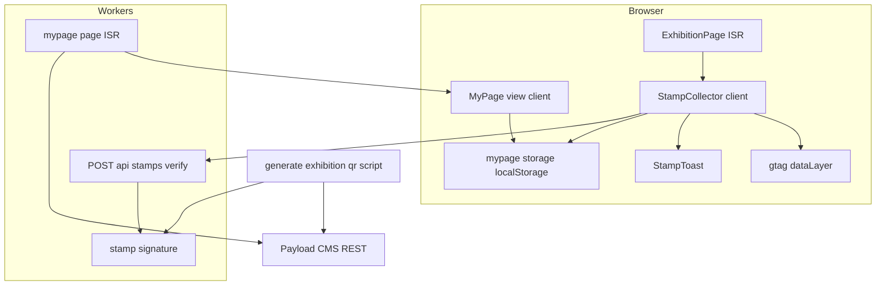
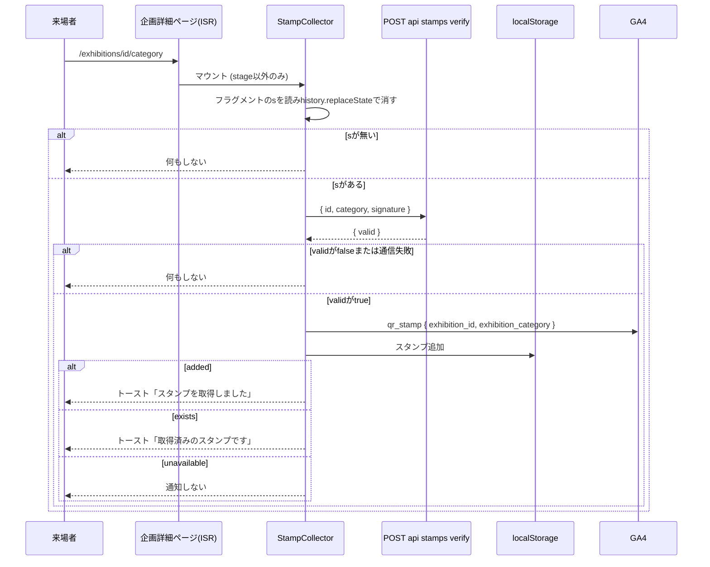

# Design Document

## Overview
**Purpose**: 企画とカテゴリの組(`stage`を除く)ごとのQRから企画詳細ページを開いた来場者に、端末内のデジタルスタンプを付与し、マイページで振り返れるようにする。あわせてQR経由の閲覧をGA4へ送る。
**Users**: 来場者はQRの読み取りとマイページの閲覧に、実行委員は印刷用QRの一括出力とGA4での移動分析に使う。
**Impact**: 既存の企画詳細ページ(ISR)は表示内容とキャッシュ方式を変えず、クライアント側の記録部品を1つ足す。検証用のRoute Handler、マイページ、QR出力スクリプトを新設し、ヘッダーと下部ナビゲーションの項目を変える。CI・デプロイ手順は変えない。

### Goals
- 検証値付きのQR用URLで開いたときだけスタンプを記録し、トーストで取得・取得済みを知らせる
- 秘密値をWorkersの外(クライアント・CMS)に出さず、企画詳細ページのISRを保つ
- マイページでスタンプ一覧とエリアごとの取得率を表示する

### Non-Goals
- サーバー側でのスタンプ記録、端末間の引き継ぎ、景品
- ブックマーク機能(保存形式は追加できる形にするだけ。将来実装する場合はエクスポート機能も含めたいという要望がある)
- マイページのPC版(PC専用のレイアウトとPCからの導線。PCでは`/mypage`に利用不可の案内を出すだけ)
- CMSのスキーマ変更、CMS管理画面へのQR出力機能
- 自前の分析画面

## Boundary Commitments

### This Spec Owns
- 検証値の算出規則(`HMAC-SHA256(secret, "<id>:<category>")`、base64url)と、それを受け付ける検証用Route Handler
- 端末内保存のキー`aramakisai_mypage`とその形式
- マイページ(`/mypage`)、スタンプ取得のトースト、GA4イベント`qr_stamp`
- QR出力スクリプト`frontend/scripts/generate-exhibition-qr.ts`
- ヘッダー(live、SPのハンバーガーメニューのみ)・下部ナビゲーションのマイページ項目

### Out of Boundary
- 企画詳細ページの表示内容、企画データの取得・公開判定(既存の`getExhibitionDetail`/`getExhibitionCatalog`に従う)
- GA4の読み込み方式(既存の`app/layout.tsx`のまま)
- 開催前フェーズのページ公開判定(既存の`middleware.ts`/`isPublicPath`のまま。`/mypage`と検証APIは開催前は非公開になる)

### Allowed Dependencies
- `@/lib/exhibitions`(`getExhibitionCatalog`、`CATEGORY_LABELS`、`CATEGORY_VALUES`、`ExhibitionCategory`)
- `@/lib/isr`(`loadForIsr`)、`@/lib/page-metadata`、`@/lib/route-metadata`
- `@opennextjs/cloudflare`の`getCloudflareContext`(実行時のWorkersの環境から`STAMP_SIGNING_SECRET`を読む。`lib/cms.ts`と同じく動的importとtry/catchで使う)
- WebCrypto(`globalThis.crypto.subtle`)。Node専用APIは`frontend/src`で使わない
- QR出力スクリプトのみ`qrcode`(devDependency)とNodeの`fs`

### Revalidation Triggers
- 検証値の算出規則・秘密値の変更(配布済みQRがすべて無効になる)
- 保存形式`aramakisai_mypage`の変更(既存端末のデータ互換)
- 企画詳細ページのURL形式の変更(QRの遷移先が変わる)
- `student_exhibitions`のカテゴリ・`area_id`の構造変更

## Architecture

### Existing Architecture Analysis
- 企画詳細ページは`generateStaticParams`が空のISRで、`params`のみを読む。`searchParams`や`cookies()`を読むと動的化しISRから外れる(`request-phase.ts`のコメント参照)
- フロントのサーバー側コードはWorkers上で動き、現在サーバー側シークレットを持たない
- 端末内保存は`use-motion-preference.ts`が`aramakisai_`接頭辞のキーとtry/catchの読み書きで行っている
- GA4は本番かつ測定ID設定時のみ`gtag`を`lazyOnload`で読み込む

### Architecture Pattern & Boundary Map



**Architecture Integration**:
- Selected pattern: ISRページはそのまま、検証だけを動的なRoute Handlerへ分離する
- 依存方向: `lib/stamp-signature` → `app/api/stamps/verify` / `scripts/generate-exhibition-qr`。`lib/mypage-storage`・`lib/analytics` → `components/stamp-collector` / `components/mypage-view` → `app/(site)/…/page.tsx`。逆向きのimportは禁止
- Existing patterns preserved: `loadForIsr`による取得失敗時の古いページ保持、`aramakisai_`接頭辞のlocalStorageとtry/catch、Route Handlerの`no-store`(`api/parking`)、公開変数は`env.ts`経由、Workersの実行時の値は`getCloudflareContext`経由(`lib/cms.ts`)
- Steering compliance: Edge RuntimeでNode専用APIを使わない、秘密値はInfisicalで管理し`.env`を使わない

### Technology Stack

| Layer | Choice / Version | Role in Feature | Notes |
|-------|------------------|-----------------|-------|
| Frontend | Next.js 15 / React 19 | マイページ、記録部品、トースト | 既存 |
| Backend | Next.js Route Handler on Workers | 検証値の検証 | WebCrypto HMAC-SHA256 |
| Data / Storage | localStorage | スタンプの保存 | キー`aramakisai_mypage` |
| Analytics | GA4 gtag | `qr_stamp`イベント | 既存の読み込みに相乗り |
| Script | tsx + `qrcode` ^1.5(devDependency追加) | 印刷用QRのSVG出力 | 実行時バンドルに入らない |
| Secrets | Workers secret(`wrangler secret put`)、正本はInfisical(`prod`と、テスト用の別値を置く`staging`) | `STAMP_SIGNING_SECRET`を検証APIが実行時に読む | 新規。デプロイをまたいで保持される |

## File Structure Plan

### Directory Structure
```
frontend/
├── src/
│   ├── lib/
│   │   ├── stamp-signature.ts       # 検証値の算出・検証 (WebCrypto)。Route Handlerとスクリプトが共有
│   │   ├── mypage-storage.ts        # aramakisai_mypageの読み書き・スタンプ追加
│   │   ├── stamp-progress.ts        # 取得済みの組のエリア別グループ化と取得率の算出 (純関数)
│   │   └── analytics.ts             # gtag互換でdataLayerへイベントを積む
│   ├── components/
│   │   ├── stamp-collector.tsx      # 企画詳細ページで検証値を読み、検証・記録・通知・GA4送信
│   │   ├── stamp-toast.tsx          # role=statusのトースト
│   │   └── mypage-view.tsx          # エリアごとの取得率と取得済みの組 (端末内データと結合)
│   └── app/
│       ├── api/stamps/verify/route.ts   # POSTで検証
│       └── (site)/mypage/page.tsx       # ISR、スタンプ対象の組とエリアを渡す
└── scripts/
    └── generate-exhibition-qr.ts    # 印刷用QRの一括出力
```
各ファイルの単体テストは同階層に`*.test.ts(x)`で置く。

### Modified Files
- `frontend/src/app/(site)/exhibitions/[id]/[category]/page.tsx` — `stage`以外のとき`<StampCollector exhibitionId category />`を描画する
- `frontend/src/lib/navigation.ts` — ヘッダーのハンバーガーメニュー専用に、liveのときだけ`{ label: 'マイページ', href: '/mypage' }`を末尾へ足す項目定義を追加(PCの横並びナビが読む`navigationItemsByPhase`は変えない)、`bottomNavigationItems`の「ホーム」を`{ label: 'マイページ', href: '/mypage', icon: 'person' }`に置換、`UNDERLINE_COLOR_CLASS`にマイページを追加
- `frontend/src/components/bottom-navigation.tsx` — `INDICATOR_COLOR_CLASS`の`'/'`を`'/mypage'`に置換(色は`bg-accent-alt`を引き継ぐ)
- `frontend/src/app/layout.tsx` — `MATERIAL_SYMBOLS_ICON_NAMES`に`person`を追加
- `frontend/src/lib/route-metadata.ts` — `/mypage`のタイトル・説明を追加
- `frontend/src/lib/route-classification.test.ts` — `/mypage`を`INTENTIONALLY_PRIVATE_ROUTES`に追加
- `frontend/public/images/qr-mypage.svg` — 新規。PC幅の案内に表示するマイページのQR(静的ファイル)
- `frontend/package.json` — devDependencies`qrcode`・`@types/qrcode`、スクリプト`qr:generate`
- `scripts/dev.sh` — `cmd_dev`の起動前に`infisical secrets get STAMP_SIGNING_SECRET --env=staging --plain`でこの1つだけを取得して`export`し、`export CLOUDFLARE_INCLUDE_PROCESS_ENV=true`を足す。取得に失敗しても起動は続ける(ローカルではスタンプが付かないだけ)。起動コマンド自体は`infisical run`で包まず、従来のままにする
- `.kiro/steering/tech.md` — Workers secret`STAMP_SIGNING_SECRET`の存在と登録方法(`wrangler secret put`、正本はInfisical`prod`・`staging`)、`make dev`が`staging`の値を1つだけ取得することを追記(値は含めない)

## System Flows

### QR読み取りからスタンプ記録まで



- 企画が存在しない・非公開(下書きを含む)・カテゴリを持たない場合は、ページが既存どおり`notFound()`になり`StampCollector`自体が描画されない(1.5)
- `stage`ページは`StampCollector`を描画しないため、検証値付きでも何もしない(1.6, 1.7)
- フラグメントは検証の成否に関わらず即座に消す。再読み込み・URL共有で再検証が走らない

## Requirements Traceability

| Requirement | Summary | Components | Interfaces | Flows |
|-------------|---------|------------|------------|-------|
| 1.1, 1.4 | 組ごとに一意のURLと検証値 | StampSignature, QR出力スクリプト | `signStamp` | — |
| 1.2 | QRで当該カテゴリの詳細ページ | 既存ExhibitionPage | URL形式 | QR読み取り |
| 1.3 | 長く複雑な検証値 | StampSignature | base64url 43文字 | — |
| 1.5 | 見つからない扱い | 既存ExhibitionPage | `notFound()` | QR読み取り |
| 1.6, 1.7, 1.8 | stageは対象外、全組が対象 | ExhibitionPage, StampSignature, QR出力スクリプト | `STAMP_CATEGORIES` | — |
| 2.1, 2.2, 2.3 | 正しい検証値のときだけ記録 | StampCollector, VerifyRoute | API契約 | QR読み取り |
| 2.4 | 重複しない、取得済みトースト | MypageStorage, StampToast | `addStamp`→`exists` | QR読み取り |
| 2.5, 2.6 | 端末内のみ、保存不可でも表示継続 | MypageStorage | `unavailable` | QR読み取り |
| 2.7 | 取得トースト | StampToast | — | QR読み取り |
| 3.1–3.5, 3.7 | スタンプ一覧・空表示・欠損許容 | MyPage, MypageView, StampProgress | `MypageStampTarget`, `groupStampsByArea` | — |
| 3.6 | 将来のリスト追加 | MypageStorage | `MypageData.lists` | — |
| 3.8 | 下部ナビのホーム置換 | navigation.ts, BottomNavigation | `bottomNavigationItems` | — |
| 3.9 | ハンバーガーメニュー(live)にマイページ、PC横並びナビには出さない | navigation.ts, Header | ハンバーガーメニュー専用の項目定義 | — |
| 3.10 | エリア別取得率 | StampProgress, MypageView | `groupStampsByArea` | — |
| 3.11 | PCでは利用不可の案内とスマートフォン用QR | MypageView | CSSメディアクエリ、`public/images/qr-mypage.svg` | — |
| 4.1–4.4, 4.6 | GA4イベント | Analytics, StampCollector | `qr_stamp` | QR読み取り |
| 4.5, 4.7 | 自前で記録・集計しない | VerifyRoute(ログを残さない) | — | — |
| 5.1–5.6 | 印刷用QR一括出力 | QR出力スクリプト | CLI契約 | — |

## Components and Interfaces

| Component | Layer | Intent | Req Coverage | Key Dependencies | Contracts |
|-----------|-------|--------|--------------|------------------|-----------|
| StampSignature | lib | 検証値の算出・検証 | 1.1, 1.3, 1.4, 1.8 | WebCrypto (P0) | Service |
| VerifyRoute | app/api | 検証値の検証 | 2.1, 2.3, 4.5 | StampSignature (P0), getCloudflareContext (P0) | API |
| MypageStorage | lib | 端末内保存 | 2.4–2.6, 3.6 | localStorage (P0) | State |
| Analytics | lib | GA4イベント送信 | 4.1–4.4, 4.6 | gtag (P1) | Event |
| StampCollector | components | 記録・通知・送信の結線 | 2.1–2.7, 4.1–4.3 | VerifyRoute, MypageStorage, Analytics, StampToast | — |
| StampToast | components | トースト表示 | 2.4, 2.7 | — | — |
| StampProgress | lib | エリア別グループ化と取得率 | 3.2, 3.5, 3.10 | — | Service |
| MyPage / MypageView | app / components | マイページ | 3.1–3.5, 3.7, 3.10, 3.11 | getExhibitionCatalog (P0), MypageStorage, StampProgress | — |
| QR出力スクリプト | scripts | 印刷用QR | 5.1–5.6 | CMS REST (P0), StampSignature (P0), qrcode (P0) | Batch |

### lib

#### StampSignature

| Field | Detail |
|-------|--------|
| Intent | 組に対する検証値の算出と検証 |
| Requirements | 1.1, 1.3, 1.4, 1.8 |

**Responsibilities & Constraints**
- 署名対象は`"<id>:<category>"`(`id`は正規化済みの整数の10進表記)。HMAC-SHA256の32バイトをパディング無しbase64urlにする
- `stage`は対象外。`STAMP_CATEGORIES = CATEGORY_VALUES`から`stage`を除いたもの
- 秘密値は引数で受け取り、自分では読まない(スクリプトはInfisical注入の`process.env`、Route HandlerはWorkersの実行時の環境と、読み元が異なるため)

##### Service Interface
```typescript
type StampCategory = Exclude<ExhibitionCategory, 'stage'>;
declare const STAMP_CATEGORIES: readonly StampCategory[];
function isStampCategory(value: string): value is StampCategory;
function signStamp(secret: string, id: number, category: StampCategory): Promise<string>;
function verifyStamp(secret: string, id: number, category: StampCategory, signature: string): Promise<boolean>;
```
- `verifyStamp`はbase64urlとして不正な値・長さ違いで`false`を返し、例外を投げない。比較は`crypto.subtle.verify`で行う

#### MypageStorage

| Field | Detail |
|-------|--------|
| Intent | `aramakisai_mypage`の読み書き |
| Requirements | 2.4, 2.5, 2.6, 3.6 |

##### State Management
```typescript
interface SavedExhibitionRef {
  readonly id: number;
  readonly category: StampCategory;
  readonly savedAt: string; // ISO 8601
}
type MypageListName = 'stamps';
interface MypageData {
  readonly version: 1;
  readonly lists: Readonly<Record<MypageListName, readonly SavedExhibitionRef[]>>;
}
type AddResult = 'added' | 'exists' | 'unavailable';

function readMypageData(): MypageData | null; // 保存不可はnull、未保存・壊れた値は空のリスト
function addStamp(id: number, category: StampCategory): AddResult;
```
- 将来のブックマーク等は`MypageListName`に名前を足し、同じ`SavedExhibitionRef`のリストとして持つ
- 読み込み時は形式を検証し、不正な要素は捨てる(壊れた値でページを落とさない)
- 一意性は`id`と`category`の組。書き込み失敗(容量超過・ブロック)は`unavailable`
- 複数タブでの同時書き込みは最後の書き込みが勝つ。同一端末の操作頻度では問題にならない

#### Analytics

##### Event Contract
- Published event: `qr_stamp`、パラメータ`{ exhibition_id: number; exhibition_category: StampCategory }`のみ
- `sendGaEvent(name, params)`は`process.env.NODE_ENV === 'production'`かつ`env.NEXT_PUBLIC_GA_MEASUREMENT_ID`があるときだけ、gtagと同じ形式で`window.dataLayer`へ積む。`gtag`は`lazyOnload`で後から読まれるため、積んだイベントは読み込み後に送られる
- それ以外の環境では何もしない(4.6)。自前の識別子・個人情報は含めない(4.4)
- 検証値はURLフラグメントで渡すため、GA4が自動送信する`page_view`の`page_location`にも含まれない
- `exhibition_id`・`exhibition_category`はGA4管理画面でイベントスコープのカスタムディメンションとして登録済み

#### StampProgress

##### Service Interface
```typescript
interface MypageStampTarget {
  readonly id: number;
  readonly category: StampCategory;
  readonly displayName: string;
  readonly areaId: number | null;
}
interface CollectedStamp {
  readonly id: number;
  readonly category: StampCategory;
  readonly displayName: string;
  readonly savedAt: string;
}
interface AreaStampGroup {
  readonly areaId: number;
  readonly areaName: string;
  readonly total: number;
  readonly collected: number;
  readonly percent: number; // 0–100の整数(切り捨て)
  readonly stamps: readonly CollectedStamp[];
}
interface GroupedStamps {
  readonly areas: readonly AreaStampGroup[];
  readonly others: readonly CollectedStamp[]; // エリアを持たない組
}
function groupStampsByArea(
  targets: readonly MypageStampTarget[],
  areas: readonly AreaOption[],
  stamps: readonly SavedExhibitionRef[],
): GroupedStamps;
```
- 分母はエリアに属する公開中の組の数(`targets`は公開中の`stage`以外の組のみ)、分子はそのうち`stamps`に含まれる組の数(3.10)
- `areas`の並び(`map_areas`の`sort`順)を保ち、分母が0のエリアは返さない。取得済みが0件のエリアも0%として返す
- エリアを持たない組(`areaId`が`null`)はどのエリアの分母・分子にも含めず、`others`に入れる
- `targets`に無い組(非公開・削除・カテゴリ解除)はどのグループにも入れない(3.5)
- 各グループの`stamps`は`savedAt`の新しい順
- 切り捨てにより、全取得前に100%と表示されない

### app/api

#### VerifyRoute

##### API Contract
| Method | Endpoint | Request | Response | Errors |
|--------|----------|---------|----------|--------|
| POST | /api/stamps/verify | `{ id: number; category: string; signature: string }` | `{ valid: boolean }` | 400(JSONとして不正) |

- `dynamic = 'force-dynamic'`、応答は`Cache-Control: no-store`
- `category`が`stage`・未知、`id`が正の整数でない、`signature`が長すぎる(64文字超)場合は`{ valid: false }`
- 企画の存在確認はしない(存在しない企画のページでは`StampCollector`が描画されないため)。CMSへアクセスしない
- 秘密値は`getCloudflareContext().env.STAMP_SIGNING_SECRET`から実行時に読む。取得できない・空の場合は検証できないため`{ valid: false }`を返す(ページは通常表示のまま、スタンプは付かない)。リクエスト内容をログに出さない(4.5)
- 開催前フェーズは`middleware`のゲートで`/gated`へrewriteされる(企画詳細ページも非公開のため問題ない)

### components

#### StampCollector
- `'use client'`。props`{ exhibitionId: number; category: StampCategory }`。企画詳細ページが`exhibition.category !== 'stage'`のときだけ描画する
- マウント時に`location.hash`から`s`を読み、あれば`history.replaceState`でフラグメントを消してから検証する。検証失敗・通信失敗は何も表示しない(2.3)
- `valid: true`でGA4イベントを送ってから`addStamp`を呼び、結果でトーストの文言を選ぶ(`added`:「スタンプを取得しました」、`exists`:「取得済みのスタンプです」、`unavailable`:表示しない)
- 描画するDOMはトーストのみで、ページのレイアウトに影響しない

#### StampToast
- `role="status"`の要素を画面下部中央に固定表示し、約3秒で消す。開催期間は下部ナビゲーション(高さ64px+セーフエリア)の上に出す
- マイページへのリンクを1つ添える。「スタンプを取得しました」「取得済みのスタンプです」の両方に付ける
- PC版のトーストは作らない
- 文言は「スタンプを取得しました」「取得済みのスタンプです」で確定。見た目・位置の詳細はFigmaで確定する(後述)

#### MyPage(`app/(site)/mypage/page.tsx`)とMypageView
- サーバー側: `revalidate = 60`。`loadForIsr(getExhibitionCatalog, EMPTY)`のカードから`stage`以外を`MypageStampTarget`(`areaId = areaIds[0] ?? null`)に変換し、`areas`と一緒に`MypageView`へ渡す。メタデータは`buildPageMetadata`で`/mypage`を使い、サイトマップには載せない
- クライアント側(`MypageView`): `readMypageData()`を`useSyncExternalStore`等でhydration後に読み、`groupStampsByArea`の結果を表示する
  - 企画カードは使わない(取得数が増えるとスクロール量が大きくなるため)。エリアごとにまとめる
  - エリアごとにネイティブの`<details>`/`<summary>`によるアコーディオンにして、画面の長さを抑える。既定は全エリア閉じた状態で、開閉状態は保存しない(再訪・再読み込みで閉じた状態に戻る)
  - `<summary>`(常に表示する見出し行): エリア名(`areaName`)と取得率(`percent`のパーセンテージと進捗バー)(3.10)
  - `<details>`の中身(開いたときだけ表示): そのエリアの取得済みの組を1行1件で並べる。行は企画名(`displayName`)とカテゴリ(`CATEGORY_LABELS`)で、行全体が`/exhibitions/<id>/<category>`へのリンク(3.2, 3.3)
  - 末尾の「その他」グループ: エリアと同じアコーディオンにし、中身に`others`を同じ行形式で並べる。見出し行に取得率・進捗バーは出さない。`others`が0件なら出さない
  - 表示できるスタンプが0件なら、スタンプが無いことを表示する(3.4)。保存不可の環境でも0件として扱う
- 画面は見出し「マイページ」の下に「スタンプ」セクションを1つ置く構成とし、将来のリストはセクションの追加で足す(3.6, 3.7)

#### PC幅の案内(3.11)
- PCの判別はCSSメディアクエリで行う。既存の`lg`ブレークポイント(1024px以上)かつ`(hover: hover) and (pointer: fine)`のときPCとみなし、案内を表示してマイページ本体(スタンプのセクション)を隠す。タッチ主体の大画面タブレットはPCとみなさない
- `MypageView`は案内とマイページ本体の両方をDOMに出し、Tailwindのクラスで一方だけを表示する(`pointer-fine:`相当のカスタムvariantで`@media (min-width: 1024px) and (hover: hover) and (pointer: fine)`を定義する)。JSによる判別は使わない
- User-Agentによるサーバー側判別は採らない。`/mypage`はISRで出しており、UAで分岐すると動的レンダリングとキャッシュ分割が必要になるため
- 案内は「見出し『マイページ』→1文『マイページはスマートフォンでご利用ください』→QR画像」の構成とし、共有ボタン等の他の要素は置かない
- QR画像は``。実行時には生成せず、`https://aramakisai.com/mypage`のQRをSVGで一度だけ生成して`frontend/public/images/qr-mypage.svg`に静的ファイルとして置く。生成にはdevDependencyの`qrcode`を使い、ランタイムの依存は増やさない: `cd frontend && pnpm exec qrcode -t svg -q 0 -o public/images/qr-mypage.svg https://aramakisai.com/mypage`
  quiet zone は周囲の余白で確保し、モジュールの左端を本文と揃えるため margin 0 (`-q 0`) で生成する。
- PRプレビュー・devでもQRは本番URLを指す。案内用であり、確認はスマートフォンで本番を開ければ足りるため許容する

#### 画面の確定(Figma)
UIの確定はFigmaで行い、実装前にワイヤーフレームを作る。designでは構成とデータの対応だけを決め、見た目はFigmaで詰める。
- Figmaで決める対象: マイページ全体(エリアの見出し行・進捗バー・開閉の表示・取得済みの行・「その他」グループ・空表示)、トースト、下部ナビゲーションとヘッダー(SPのハンバーガーメニュー)のマイページ項目、PC幅1440のマイページ案内(見出し・1文・QR画像の1画面)。PC版のマイページ本体は対象外
- 確定済みで変えないもの: 下部ナビゲーションのアイコン`person`、トースト文言「スタンプを取得しました」「取得済みのスタンプです」

### scripts

#### QR出力スクリプト(`frontend/scripts/generate-exhibition-qr.ts`)

##### Batch / Job Contract
- **Trigger**: 実行委員が手動で実行する
  `infisical run --env=prod -- env CMS_AUTH_TOKEN=<トークン> pnpm qr:generate --site-url https://aramakisai.com --out <出力先>`
  dev用のQRは`--env=staging`で実行し、`--site-url`にdevのURLを渡す。`STAMP_SIGNING_SECRET`はInfisical`staging`のテスト用の値が使われ、本番用の値で署名したQRとは混ざらない
- **Input**:
  - `--site-url`(必須、5.3)、`--out`(既定`qr-output/`、git管理外)
  - `STAMP_SIGNING_SECRET`(Infisicalの実行環境の値。本番用は`prod`、dev用は`staging`)、`NEXT_PUBLIC_CMS_URL`(Infisical)、`CMS_AUTH_TOKEN`(実行委員のCMSセッショントークン。シェルで渡し、ファイルに書かない)
- **処理**: `GET /api/student_exhibitions?limit=0&depth=0`を`Authorization: JWT <token>`で取得し、下書きを含む全企画の`categories`から`stage`を除いた組ごとに(5.6)、`<site-url>/exhibitions/<id>/<category>#s=<signStamp>`を`qrcode`でSVGにする(5.1)
- **Output**: `<out>/<id>-<category>.svg`と、`id`・カテゴリ・企画名・団体名・状態(公開/下書き)・URLを並べた`index.csv`(5.2)
- **失敗時**: CMS取得失敗・401/403・秘密値未設定は終了コード1で終わる。出力は一時ディレクトリに書き、全件成功後に`--out`へ移すため、不完全な出力が残らない(5.4)
- **Idempotency**: 同じ入力から同じSVGが得られる(HMACは決定的)
- CMS管理画面への変更は伴わない(5.5)

## Data Models

### 端末内保存(localStorage)
- キー: `aramakisai_mypage`
- 値: `MypageData`のJSON(上記)。`version`は形式を変えるときの判定に使う
- 例: `{"version":1,"lists":{"stamps":[{"id":12,"category":"exhibit","savedAt":"2026-11-03T10:00:00.000Z"}]}}`

### 検証値
- 入力: `"<id>:<category>"`(UTF-8)
- 鍵: `STAMP_SIGNING_SECRET`(32文字以上のランダム文字列)
- 出力: HMAC-SHA256 32バイトのbase64url(パディング無し、43文字)
- QR用URL: `<site-url>/exhibitions/<id>/<category>#s=<検証値>`

## Error Handling
- 検証API: 入力不正・秘密値未設定は`{ valid: false }`、JSONとして読めない場合のみ400。秘密値未設定でビルド・起動は失敗させない
- StampCollector: 通信失敗・応答不正は記録も通知もしない。ページ表示には影響しない
- localStorage: 読み込み失敗は`null`、書き込み失敗は`unavailable`。いずれも例外を外に出さない
- マイページ: 企画データ取得失敗は`loadForIsr`の規約どおり実行時は例外にして古いページを保つ
- QR出力スクリプト: 失敗時は終了コード1とエラーメッセージ、出力先を変更しない

## Security Considerations
- 秘密値の正本はInfisicalのシークレット`STAMP_SIGNING_SECRET`(パス`/`)に置く。`prod`に本番用、`staging`に本番とは別のテスト用ランダム値を置く(いずれも作成済み、`openssl rand -base64 48`による64文字)。本番用は本番Worker`aramakisai-web`に、dev用は`aramakisai-web-dev`にWorkers secretとして`wrangler secret put STAMP_SIGNING_SECRET`(devは`--env dev`付き)で一度だけ登録する。secretはデプロイをまたいで保持されるため、CI・デプロイ手順は変えない。ビルド時には読まず、クライアントバンドルにも入らない(`NEXT_PUBLIC_`を付けず、`env.ts`にも置かない)
- 登録時の注意: PRプレビューが`wrangler versions upload`で未デプロイのバージョンを積んでいる間は`wrangler secret put`が失敗する(wranglerが未デプロイ版の巻き込みデプロイを防ぐため)。mainへのデプロイ直後、最新バージョンがデプロイ済みの状態で登録する
- 環境ごとの扱い:
  - PRプレビュー: 本番Worker`aramakisai-web`のバージョンとしてアップロードされ、`versions upload`は直前のバージョンのsecretを引き継ぐ。本番と同じ値が使われ、本番用のQRでスタンプが付く。許容する(スタンプは端末内保存のみで、プレビューはCloudflare Access保護下のため実害がない)
  - dev(`aramakisai-web-dev`、別Worker): Infisical`staging`のテスト用の値を`wrangler secret put STAMP_SIGNING_SECRET --env dev`で登録する。本番用QRはdevでは通らない
  - ローカル(`make dev`): `scripts/dev.sh`が`infisical secrets get STAMP_SIGNING_SECRET --env=staging --plain`でこの1つだけを取得して`export`し、`CLOUDFLARE_INCLUDE_PROCESS_ENV=true`を付けて起動する。Infisical未ログイン等で取得に失敗しても起動は続け、その場合ローカルではスタンプが付かない。`next.config.ts`の`initOpenNextCloudflareForDev()`が使うwranglerの`getPlatformProxy`(4.105)は、この変数が真のとき`process.env`を`getCloudflareContext().env`に含める。`.dev.vars`・`.env`は置かない。dev用QRと同じ`staging`の値のため、ローカルでdev用QRが検証できる。この経路(`CLOUDFLARE_INCLUDE_PROCESS_ENV`で`getCloudflareContext().env`に載ること)は未検証で、実機での確認が実装の最初の作業
  - 未設定の環境では検証APIが`{ valid: false }`を返し、ページは通常表示のまま、スタンプは付かない
- 運用上の制約: `STAMP_SIGNING_SECRET`を変えると配布済みのQRがすべて無効になる。開催期間中は変更しない。漏えい時の変更は全QRの再印刷を伴う
- 検証値付きURLやQR画像の共有による取得は防がない(要件の対象外)。フラグメントを表示直後に消し、ブラウザのURL共有で広がりにくくする
- 検証APIは企画情報を返さず、真偽だけを返す。総当たりは256ビットの検証値に対して現実的でないため、レート制限は設けない

## Testing Strategy
- Unit
  - `stamp-signature`: 同じ組で同じ値、組が違えば異なる値、他の組の値・改変・長さ違いで`false`、`stage`を受け付けない
  - `mypage-storage`: 追加・重複(`exists`)・壊れたJSONの読み込み・`setItem`が投げる環境で`unavailable`
  - `stamp-progress`: 分母は公開中の`stage`以外の組、エリア無しは`others`へ、`targets`に無いスタンプを含めない、分母0のエリアを返さない、新しい順、切り捨て
  - `analytics`: 本番かつ測定ID有りのときだけ`dataLayer`に積む
- Component
  - `StampCollector`: フラグメント無しで検証APIを呼ばない、`valid: false`で記録しない、`added`/`exists`の文言とどちらもマイページへのリンクが付くこと、フラグメントを消す
  - `MypageView`: 空表示、エリア見出しの取得率、既定で閉じていること、行のリンク先、「その他」グループ(取得率なし、0件で非表示)、欠損スタンプを無視
  - `MypageView`のPC条件: PC条件(1024px以上かつ`hover: hover`・`pointer: fine`)で案内(見出し・1文・`alt`が「マイページのQRコード」のQR画像)が表示されマイページ本体が隠れること、それ以外では逆であること(実ブラウザでビューポートと入力デバイスを切り替えて確認)
  - `BottomNavigation`/`Header`: マイページ項目(ヘッダーはliveのハンバーガーメニューのみ、PC横並びナビには出ない)
- Route: `api/stamps/verify`の正・誤・`stage`・不正入力・秘密値未設定で`valid: false`
- Script: CMS応答をモックし、`stage`除外・下書き込み・失敗時に出力先が変わらないこと
