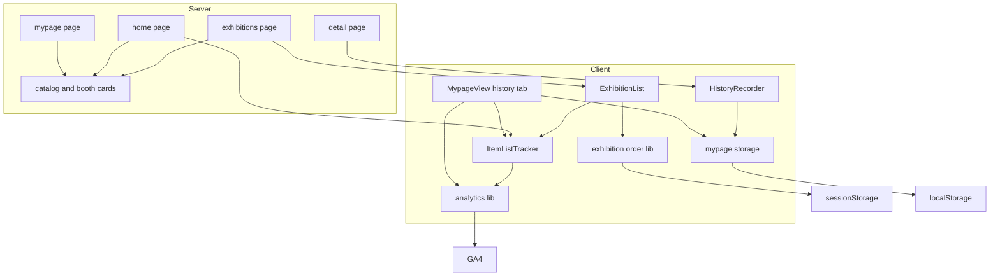
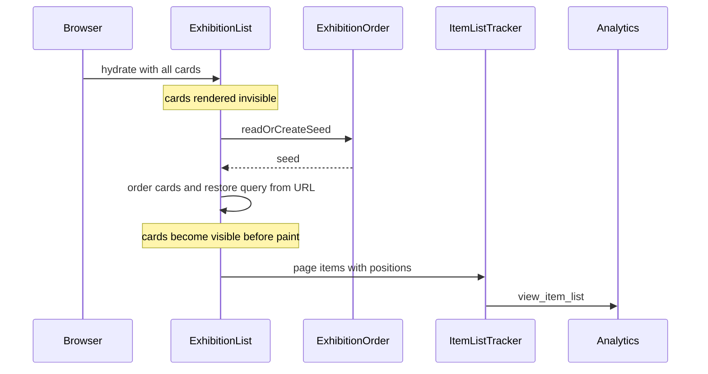
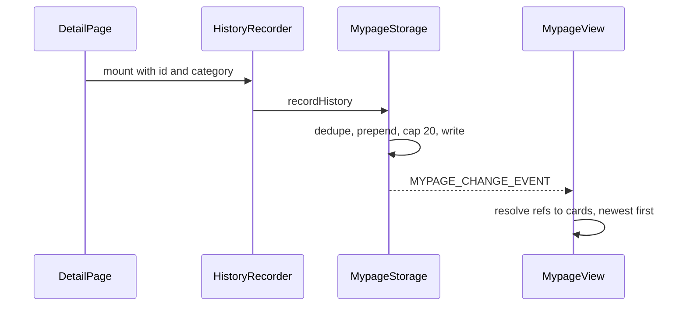

# Technical Design: exhibition-random-order-history

## Overview
**Purpose**: 企画一覧とトップページの注目企画で、掲載位置による企画詳細への露出の偏りを均す。並びが変わっても一度見た企画へ戻れるよう、企画詳細の閲覧履歴を端末内に残してマイページから開けるようにする。偏りが減ったかをGA4で評価できるよう、カードの掲載位置・選ばれた一覧・サイト内の参照元を記録する。

**Users**: 来場者は企画一覧・トップページ・マイページで企画を探して開く。実行委員はGA4で掲載位置ごとのクリック率と企画詳細への遷移元を見る。

**Impact**: 企画一覧の既定の並びが企画id順から、タブごとのランダム順に変わる。注目企画の候補が一覧1ページ目の24件から全カードに広がる。マイページに「履歴」タブが増える。全ページのページ閲覧にサイト内の参照元が付く。

### Goals
- 企画一覧の並びをタブ単位のランダム順にし、同じタブの中では変えない
- 注目企画を全カードから選ぶ
- 企画詳細の閲覧履歴を20件まで端末内に残し、マイページで一覧・消去できるようにする
- GA4の標準のアイテム一覧レポートで、一覧の種別ごと・掲載位置ごとの表示数とクリック数を集計できるようにする

### Non-Goals
- 会場サイネージの企画一覧の並び順
- 企業ブース詳細ページの閲覧履歴
- 並び順の切り替え操作(五十音順等)
- 閲覧履歴の個別削除・端末間の同期

## Boundary Commitments

### This Spec Owns
- 企画一覧(`ExhibitionList`)の並び順の決定と、タブ内での保持
- トップページの注目企画の候補集合
- マイページ端末内保存の `lists.history` の形式・記録・消去
- マイページの「履歴」タブ
- GA4イベント `view_item_list` / `select_item` / `history_clear` の定義と送信
- `page_view` への `page_referrer` の付与

### Out of Boundary
- `getExhibitionCatalog` / `getCorporateBoothCards` の取得内容と並び(id順のまま)。サイネージ・マイページ・スタッフ画面・スタンプAPIが共有している
- 企画一覧の検索・絞り込み・ページ送りの条件、ページあたり件数
- 既存GA4イベント・カスタム定義(`ga-technical-metrics`, `exhibition-bookmark`)の名前とパラメータ、ページ閲覧の計上条件
- ブックマーク・スタンプの保存形式と振る舞い

### Allowed Dependencies
- `lib/exhibitions.ts` の `filterExhibitions` / `paginate` / `listingHref` / `PAGE_SIZE` / 型定義
- `lib/mypage-storage.ts` の読み書き経路(`write`、`MYPAGE_CHANGE_EVENT`)と `lib/use-mypage-data.ts`
- `lib/analytics.ts` の `sendGaEvent` / `trackPageView` / `setPageLocation` と送信条件(`isGaEnabled`)
- ブラウザの `sessionStorage` / `localStorage`

### Revalidation Triggers
- `listingHref` のURL形式を変えたとき(一覧計測のカード照合キー)
- マイページ端末内保存の `version` や `lists` の構造を変えたとき
- `trackPageView` / `setPageLocation` の呼び出し箇所を変えたとき(参照元の値)
- 企画一覧の初期描画(サーバー描画で描くカードの範囲)を変えたとき

## Architecture

### Existing Architecture Analysis
- `exhibitions/page.tsx` は ISR(`revalidate = 60`)で、学生企画と企業ブースの全カードを企画id順で `ExhibitionList` に渡す。`ExhibitionList` はクライアントで絞り込み・ページ送りを行い、URLは `history.pushState` / `replaceState` で書き換える
- サーバー描画はURLを知らないため、初期HTMLには絞り込みなし・1ページ目のカードが入り、`useLayoutEffect` でURLの条件を復元する
- マイページの保存は localStorage キー `aramakisai_mypage` の1つのJSONで、`version: 1`、`lists.bookmarks` を持つ。読み書きは `mypage-storage.ts` に集約し、書き込みのたびに `MYPAGE_CHANGE_EVENT` を発火する
- GA4の送信は `analytics.ts` に集約し、`GaEventMap` で型付けしている。ページ閲覧は `GoogleAnalytics` コンポーネントがパス変化で `trackPageView`、クエリ変化で `setPageLocation` を呼ぶ

### Architecture Pattern & Boundary Map



**Architecture Integration**:
- 採用するパターン: 既存のクライアント側の絞り込みの前段に、並べ替えを純関数として挟む。端末内保存は既存の `mypage-storage` の経路に項目を足す
- 依存の向き: 型(`lib/exhibitions.ts`) → 純関数(`lib/exhibition-order.ts`, `lib/item-list.ts`) → 保存・送信(`lib/mypage-storage.ts`, `lib/analytics.ts`) → フック・コンポーネント。逆向きのimportは設けない
- 既存パターンの維持: 取得関数の並び(id順)、絞り込み・ページ送りのロジック、`ExhibitionCard` の描画、端末内保存の検証方式
- 新しいコンポーネントの理由: 並び順(`exhibition-order`)は一覧固有の状態で、他画面と共有しないため独立させる。一覧計測(`ItemListTracker`)はサーバーで描くトップページとクライアントで描く一覧・マイページの両方に置くため、カードの描画から切り離す

### Technology Stack

| Layer | Choice / Version | Role in Feature | Notes |
|-------|------------------|-----------------|-------|
| Frontend | Next.js App Router(既存)、React(既存) | 一覧の並び替え、履歴タブ、計測コンポーネント | 新しい依存なし |
| Data / Storage | sessionStorage(タブ単位のシード)、localStorage(既存キー `aramakisai_mypage`) | 並び順の保持、閲覧履歴の保存 | sessionStorage の新キー1つ |
| Messaging / Events | GA4 gtag.js(既存の `analytics.ts` 経由) | `view_item_list` / `select_item` / `history_clear`、`page_view` の `page_referrer` | GA4推奨イベントの標準項目を使う |

## File Structure Plan

### Directory Structure
```
frontend/src/
├── lib/
│   ├── exhibition-order.ts        # シードの取得・作成(sessionStorage)とカードの並べ替え(純関数)
│   ├── item-list.ts               # 一覧種別の定義と、カード→GA4アイテムの変換(純関数)
│   └── (既存ファイルの変更は Modified Files)
└── components/
    ├── item-list-tracker.tsx      # 'use client'。表示時の view_item_list、クリック時の select_item
    └── history-recorder.tsx       # 'use client'。企画詳細の表示時に閲覧履歴を記録する(描画なし)
```
各新規ファイルの隣に `*.test.ts(x)` を置く。`item-list-tracker` と `history-recorder` は jsdom、`exhibition-order` はシード部分を jsdom で検証するため `vitest.config.ts` のjsdom対象に加える。

### Modified Files
- `frontend/src/components/exhibition-list.tsx` — 並び順の確定、確定までの不可視化、`priority` の付与対象、`ItemListTracker` の配置
- `frontend/src/app/(site)/page.tsx` — 注目企画の候補を全カード(学生企画+企業ブース)に変更
- `frontend/src/components/featured-exhibitions.tsx` — `ItemListTracker`(`home_featured`)で包む
- `frontend/src/app/(site)/exhibitions/[id]/[category]/page.tsx` — `HistoryRecorder` を配置
- `frontend/src/lib/mypage-storage.ts` — `lists.history` の型・検証・記録・消去
- `frontend/src/components/mypage-view.tsx` — 「履歴」タブ、履歴一覧、消去操作、ブックマーク一覧と履歴一覧の `ItemListTracker`
- `frontend/src/lib/analytics.ts` — `GaEventMap` に3イベントを追加、`page_view` に `page_referrer` を付与
- `frontend/vitest.config.ts` — 新規テストのjsdom対象を追加

## System Flows

### 企画一覧の初期表示

- 並び順の確定とURL条件の復元は同じ `useLayoutEffect` で行い、描画前に1回だけ再レンダリングする
- ページ送り・絞り込み・戻る操作で表示中のカードが変わるたびに、`ItemListTracker` が1回 `view_item_list` を送る

### 閲覧履歴


## Requirements Traceability

| Requirement | Summary | Components | Interfaces | Flows |
|-------------|---------|------------|------------|-------|
| 1.1 | タブ初回にランダム順 | ExhibitionOrder, ExhibitionList | `readOrCreateSeed`, `orderCards` | 初期表示 |
| 1.2 | タブ内で順序保持 | ExhibitionOrder | sessionStorage のシード | 初期表示 |
| 1.3 | 新しいタブで新しい順 | ExhibitionOrder | sessionStorage のタブ単位性 | 初期表示 |
| 1.4 | 絞り込み後も相対順 | ExhibitionOrder, ExhibitionList | `orderCards` → `filterExhibitions` | — |
| 1.5 | 並べ替わりを見せない | ExhibitionList | 不可視化、`useLayoutEffect` | 初期表示 |
| 1.6 | 保存不可でもランダム | ExhibitionOrder | `readOrCreateSeed` のフォールバック | — |
| 1.7 | 件数・検索等を変えない | ExhibitionList | 既存関数をそのまま使用 | — |
| 2.1 | 注目企画を全カードから | HomePage | `getFeaturedExhibitions` | — |
| 2.2 | 件数・形を変えない | FeaturedExhibitions | `FEATURED_COUNT = 4` | — |
| 3.1-3.3 | 記録・重複更新・20件 | HistoryRecorder, MypageStorage | `recordHistory` | 閲覧履歴 |
| 3.4-3.7 | 端末内のみ・共存・検証 | MypageStorage | `parseMypageData`, `write` | — |
| 3.8 | 保存不可でも表示継続 | HistoryRecorder | `recordHistory` の `'unavailable'` | — |
| 4.1-4.8 | 履歴タブ | MypageView | `TABS`, `HistoryList`, `clearHistory` | 閲覧履歴 |
| 5.1, 5.4 | 一覧表示の計測 | ItemListTracker, ExhibitionList | `view_item_list` | 初期表示 |
| 5.2, 5.3 | 選択の計測・一覧種別 | ItemListTracker, ItemList | `select_item`, `ItemListId` | — |
| 5.5 | 消去の計測 | MypageView | `history_clear` | — |
| 5.6 | サイト内参照元 | Analytics | `trackPageView` の `page_referrer` | — |
| 5.7 | 集計できる定義 | ItemList, 運用作業 | GA4標準項目、`list_filtered` の登録 | — |
| 5.8 | 共通条件・乱数を送らない | Analytics, ItemListTracker | `sendGaEvent` | — |

## Components and Interfaces

| Component | Domain/Layer | Intent | Req Coverage | Key Dependencies | Contracts |
|-----------|--------------|--------|--------------|------------------|-----------|
| ExhibitionOrder | lib | シードの保持とカードの並べ替え | 1.1-1.4, 1.6 | sessionStorage (P0) | Service, State |
| ItemList | lib | 一覧種別とGA4アイテムの変換 | 5.1-5.3, 5.7 | `listingHref` (P0) | Service |
| ItemListTracker | UI(client) | 一覧の表示・選択をGA4へ送る | 5.1-5.4, 5.8 | Analytics (P0), ItemList (P0) | Event |
| HistoryRecorder | UI(client) | 企画詳細の表示を履歴に記録 | 3.1, 3.8 | MypageStorage (P0) | — |
| MypageStorage(変更) | lib | 履歴の検証・記録・消去 | 3.1-3.7 | localStorage (P0) | Service, State |
| ExhibitionList(変更) | UI(client) | 並び順の適用と不可視化 | 1.1-1.7, 5.1, 5.4 | ExhibitionOrder (P0), ItemListTracker (P1) | — |
| HomePage / FeaturedExhibitions(変更) | UI(server) | 全カードから注目企画を選ぶ | 2.1, 2.2, 5.3 | catalog (P0), ItemListTracker (P1) | — |
| MypageView(変更) | UI(client) | 履歴タブと消去 | 4.1-4.8, 5.3, 5.5 | MypageStorage (P0), ItemListTracker (P1) | — |
| Analytics(変更) | lib | イベント型の追加と参照元の付与 | 5.5, 5.6, 5.8 | gtag.js (P0) | Event, State |

### lib

#### ExhibitionOrder(`lib/exhibition-order.ts`)

| Field | Detail |
|-------|--------|
| Intent | タブ単位のシードを保持し、シードとカードキーからカードの並びを決める |
| Requirements | 1.1, 1.2, 1.3, 1.4, 1.6 |

**Responsibilities & Constraints**
- シードは符号なし32ビット整数。sessionStorage のキー `aramakisai_exhibition_order_seed` に10進文字列で保存する
- 並びは、カードごとに `${seed}:${id}:${category}` から32ビットのハッシュ値(FNV-1a)を求め、昇順に並べる。同値はキー文字列の昇順で決める
- カードが増減しても、残るカード同士の相対順は変わらない。絞り込みは並べ替え後の配列に対して行うため、絞り込み後も相対順が保たれる
- シードはGA4にも他のどこにも送らない

**Contracts**: Service [x] / State [x]

##### Service Interface
```typescript
type OrderSeed = number; // 0 以上 2^32 未満の整数

/** sessionStorage のシードを返す。無ければ crypto.getRandomValues で作って保存する。保存できなければ作ったシードをそのまま返す */
function readOrCreateSeed(): OrderSeed;

/** 入力配列を変更せず、シードによる順に並べた新しい配列を返す */
function orderCards<T extends { readonly id: number; readonly category: string }>(
  cards: readonly T[],
  seed: OrderSeed,
): readonly T[];
```
- Preconditions: `readOrCreateSeed` はブラウザでのみ呼ぶ(`useLayoutEffect` の中)
- Postconditions: 同じ `cards` と `seed` からは常に同じ順を返す
- Invariants: sessionStorage の値が整数として読めないときは新しいシードで上書きする

##### State Management
- 状態: タブ単位のシード1つ
- 永続化: sessionStorage(再読み込み・履歴移動で保持、新しいタブでは新しいシード。タブの複製ではシードも複製される)
- 保存に失敗した場合: そのページ表示の間だけ有効なシードで並べる(Req 1.6)

#### ItemList(`lib/item-list.ts`)

| Field | Detail |
|-------|--------|
| Intent | GA4へ送る一覧種別と、カード→アイテムの変換を一か所で定義する |
| Requirements | 5.1, 5.2, 5.3, 5.7 |

**Contracts**: Service [x]

##### Service Interface
```typescript
type ItemListId = 'exhibitions' | 'home_featured' | 'mypage_bookmarks' | 'mypage_history';

interface GaItem {
  readonly item_id: string;        // `${id}:${category}`(企業ブースは `${id}:booth`)
  readonly item_name: string;      // カードの表示名
  readonly item_category: ListingCategory;
  readonly index: number;          // 一覧内の1始まりの通し番号
}

interface ItemListEntry {
  readonly href: string;           // listingHref の値。クリック照合のキー
  readonly item: GaItem;
}

/** 表示順のカードと先頭の通し番号から掲載項目を作る */
function toItemListEntries(
  cards: readonly Pick<ExhibitionCardView, 'id' | 'category' | 'displayName'>[],
  firstIndex: number,
): readonly ItemListEntry[];
```
- `item_list_name` は `item_list_id` と同じ文字列を送る
- `index` は企画一覧では「絞り込み後の並びでの通し番号」(2ページ目の先頭は25)、他の一覧では1始まり

#### MypageStorage(`lib/mypage-storage.ts` の変更)

| Field | Detail |
|-------|--------|
| Intent | 閲覧履歴をブックマーク・スタンプと同じ保存に共存させる |
| Requirements | 3.1, 3.2, 3.3, 3.4, 3.5, 3.6, 3.7 |

**Responsibilities & Constraints**
- `MypageData.lists` に `history` を追加する。`version` は 1 のまま。項目が無い既存データは空配列として読む
- 検証はブックマークと同じ方式(要素単位で検証し、不正な要素だけを除く)。カテゴリの有効値は `BOOKMARK_CATEGORIES`(stage/exhibit/vendor/other)と同じ
- 記録・消去は既存の `write` を通し、`bookmarks` とスタンプの値はそのまま書き戻す
- 上限は20件(`HISTORY_LIMIT = 20`)。閲覧日時の新しい順に保持する

**Contracts**: Service [x] / State [x]

##### Service Interface
```typescript
interface SavedHistoryRef {
  readonly id: number;
  readonly category: ExhibitionCategory;
  readonly viewedAt: string; // ISO 8601
}

interface MypageData {
  readonly version: 1;
  readonly visitorId?: string;
  readonly lists: {
    readonly bookmarks: readonly SavedBookmarkRef[];
    readonly history: readonly SavedHistoryRef[];
  };
}

type RecordResult = 'recorded' | 'unavailable';
type ClearResult = { readonly kind: 'cleared'; readonly count: number } | { readonly kind: 'unavailable' };

/** 同じ組があれば取り除いてから先頭に入れ、20件を超えた分を末尾から捨てる */
function recordHistory(id: number, category: ExhibitionCategory, now?: Date): RecordResult;

/** 履歴を空にし、消去前の件数を返す */
function clearHistory(): ClearResult;
```
- Postconditions: 書き込みに成功したときだけ `MYPAGE_CHANGE_EVENT` を発火する(既存の `write` の振る舞い)

#### Analytics(`lib/analytics.ts` の変更)

| Field | Detail |
|-------|--------|
| Intent | 一覧計測・履歴消去のイベント型を加え、ページ閲覧にサイト内の参照元を付ける |
| Requirements | 5.5, 5.6, 5.8 |

**Contracts**: Event [x] / State [x]

##### Event Contract
`GaEventMap` に追加する。いずれも既存の `sendGaEvent` で送り、送信条件(`isGaEnabled`)と `page_location` の付与は既存どおり。

| イベント | パラメータ | 送る契機 |
|----------|-----------|----------|
| `view_item_list` | `item_list_id`, `item_list_name`(`ItemListId`)、`list_filtered`(`'true'`/`'false'`、企画一覧のみ)、`items: GaItem[]` | 一覧のカードが表示されたとき。企画一覧は表示中のページのカードが変わるたび |
| `select_item` | `item_list_id`, `item_list_name`、`list_filtered`(企画一覧のみ)、`items: [GaItem]` | 一覧のカードのリンクが押されたとき |
| `history_clear` | `item_count`(消去前の件数) | マイページで履歴を消去し、保存から削除できたとき |

- 検索キーワード、シード、`visitorId` は含めない(5.8)

##### State Management
- モジュール内に「直前に記録したページの位置」(`sanitizeLocation` 済みの文字列)を1つ持つ
- `setPageLocation` と `trackPageView` は送信後にこの値を更新する
- `trackPageView` は、この値があるとき(サイト内での2回目以降のページ閲覧)に `page_view` へ `page_referrer` として付ける。初回のページ閲覧には付けず、gtag.js の既定(`document.referrer`)に任せる
- ページ閲覧の計上の有無(どの操作で `trackPageView` を呼ぶか)は変えない

### UI

#### ItemListTracker(`components/item-list-tracker.tsx`)

| Field | Detail |
|-------|--------|
| Intent | 包んだ一覧の表示と、カードの選択をGA4へ送る |
| Requirements | 5.1, 5.2, 5.3, 5.4, 5.8 |

**Contracts**: Event [x]

```typescript
interface ItemListTrackerProps {
  readonly listId: ItemListId;
  readonly entries: readonly ItemListEntry[];
  /** 企画一覧のときだけ渡す */
  readonly filtered?: boolean;
  readonly children: React.ReactNode;
}
```
- 表示: `entries` の `item_id` の並びが前回の送信と異なるとき、`view_item_list` を1回送る。`entries` が空なら送らない
- 選択: 包んだ要素でクリックを捕捉し、押された `a` 要素のパス(`href` 属性)を `entries[].href` と照合して一致したときに `select_item` を送る。照合しないリンク(ブックマークボタン等)では送らない
- 描画への影響: 余分な要素を作らない(`display: contents` の要素で包む)

#### HistoryRecorder(`components/history-recorder.tsx`)
- 'use client'。props は `{ exhibitionId: number; category: ExhibitionCategory }`。マウント時と props 変化時に `recordHistory` を1回呼び、何も描画しない
- `recordHistory` が `'unavailable'` を返しても何もしない(3.8)
- 企画詳細ページ(`exhibitions/[id]/[category]/page.tsx`)で、企画が見つかった場合にだけ置く。企業ブース詳細には置かない

#### ExhibitionList(変更)
- 状態にシード(未確定は `null`)を加える。既存の `useLayoutEffect`(URL条件の復元)の中で `readOrCreateSeed` を呼び、シードと条件を同時に確定する
- 並びは `orderCards(cards, seed)` を `useMemo` で求め、既存の `filterExhibitions` → `paginate` に渡す
- シード未確定の間はカード領域を不可視にする(領域の高さは保つ)。`noscript` 内のスタイルで可視化し、JavaScriptが動かない環境では企画id順で表示する
- `priority` はシード確定後の表示中の先頭4件にだけ付け、未確定の間は付けない
- 表示中のページのカードを `toItemListEntries(items, rangeStart)` に変換し、`ItemListTracker`(`exhibitions`、`filtered` は検索語・カテゴリ・エリアのいずれかが指定されているか)で包む

#### HomePage / FeaturedExhibitions(変更)
- `getFeaturedExhibitions` は `exhibitions/page.tsx` と同じく `getExhibitionCatalog` と `getCorporateBoothCards` の全カードを返す。片方の取得に失敗したときは取れた方だけを候補にし、両方失敗したら空にする(既存の「取得失敗時は空扱い」を保つ)
- 選出は既存の `pickRandom(…, 4)` のまま。選んだ4件を `ItemListTracker`(`home_featured`)で包む

#### MypageView(変更)
- `TABS` に `{ id: 'history', label: '履歴' }` を「ブックマーク」の後ろに加える。タブの選択・保持・キーボード操作は既存のタブの仕組みをそのまま使う(URLハッシュ `#history`)
- `HistoryList`: ブックマーク一覧と同じく、サーバーから渡された `cards` を `id:category` で照合し、閲覧日時の新しい順に並べる。照合できない項目は表示しない(4.7)。読み込み中は描画せず(4.6)、空なら「履歴はありません」と表示する(4.5)
- 一覧の下に「履歴を消去」ボタンを置く。履歴が1件以上あるときだけ表示し、押すと確認なしで `clearHistory` を呼び、`kind: 'cleared'` のとき `history_clear` を送る
- ブックマーク一覧と履歴一覧をそれぞれ `ItemListTracker`(`mypage_bookmarks` / `mypage_history`)で包む。見た目(カード・余白・空表示)はブックマーク一覧と同じ構成にする
- Figma(ファイル `0kWDqHsLr6xE8b4FFgR1Zx`、ページ「マイページ」`990:14`)が見た目の正:
  - MypageTabs `1098:6985`: タブ3等分(各119.33)、右端に「履歴」(アイコン `history` FILL 0)。バリアント `Selected=stamps` `1098:6963` / `Selected=bookmarks` `1098:6974` / `Selected=history` `1787:890`
  - 履歴3件 `1787:1277`: `Section/履歴` は縦並び・間隔24で `HistoryList`(カード1列・カード間24)の下に `ClearButton` `1787:1318`(`ReloadButton` `1235:8497` のインスタンス、文言「履歴を消去」、左揃え、104×35)
  - 履歴0件 `1787:1320`: 「履歴はありません」(ブックマーク0件 `1098:7113` と同じ文字設定)、消去ボタンなし

## Data Models

### Logical Data Model
- sessionStorage `aramakisai_exhibition_order_seed`: 10進の整数文字列
- localStorage `aramakisai_mypage`(既存のキー): `lists.history` を追加
```json
{
  "version": 1,
  "visitorId": "…",
  "lists": {
    "bookmarks": [{ "id": 14, "category": "stage", "savedAt": "2026-11-14T10:00:00.000Z" }],
    "history": [{ "id": 81, "category": "vendor", "viewedAt": "2026-11-14T10:05:00.000Z" }]
  }
}
```
- 整合性: `history` は同じ `id:category` を1件までとし、`viewedAt` の降順で最大20件。旧バージョンのJavaScriptが書き込むと `history` が失われるが、再び閲覧すれば記録されるため移行処理は設けない

## Error Handling
- sessionStorage が使えない: その表示の間だけのシードで並べる(1.6)。エラー表示はしない
- localStorage が使えない・値が壊れている: 履歴を記録せず、詳細ページの表示を続ける(3.8)。読み込みは形式に合う要素だけを使う(3.7)
- GA4の送信に失敗した、または無効な環境: 既存の `sendGaEvent` の方針どおり、何も表示せず機能を続ける

## Testing Strategy
- Unit
  - `orderCards`: 同じシードで同じ順、シードが違えば順が変わる、カードを1枚除いても残りの相対順が変わらない、入力配列を変更しない
  - `readOrCreateSeed`: 保存済みのシードを再利用する、不正な値を上書きする、sessionStorage が例外を投げても数値を返す
  - `recordHistory` / `clearHistory`: 先頭追加、重複の移動、21件目で最古を捨てる、ブックマーク・スタンプ・`visitorId` を変えない、保存不可で `'unavailable'`、消去件数
  - `parseMypageData`: `history` の欠落を空として読む、不正要素だけを除く
  - `trackPageView`: 初回は `page_referrer` なし、2回目は直前の位置が入る、`setPageLocation` の後は更新された位置が入る
- Component
  - `ExhibitionList`: シード確定前は不可視、確定後に並べ替えた順で表示、絞り込み後の相対順、ページ送りで `view_item_list` の `index` が25から始まる
  - `ItemListTracker`: 同じ項目で再描画しても1回だけ送る、カードのリンクで `select_item`、ブックマークボタンでは送らない
  - `MypageView`: 履歴タブ、新しい順、非公開の除外、空表示、消去で一覧が空になり `history_clear` を送る、`#history` で開く
- E2E(`e2e/exhibitions.spec.ts` ほか)
  - 同じタブで再読み込み・ページ送り・戻る操作をしても並びが変わらず、新しいブラウザコンテキストでは並びが変わる
  - 企画詳細を開いた後、マイページの履歴タブに表示される
  - GA4のdataLayerに `view_item_list` / `select_item` / `page_referrer` が積まれる(`e2e/ga-datalayer.spec.ts` の方式)

## Optional Sections

### Security Considerations
- 閲覧履歴は端末内にだけ保存し、GA4へは企画idとカテゴリ以外を送らない。履歴の内容そのもの(一覧)はGA4へ送らない

### Migration Strategy
- データ移行は無い。GA4のカスタムディメンション `list_filtered`(イベントスコープ)を本番プロパティ 490255062 の管理画面で登録する。掲載位置・一覧種別・アイテムidは標準項目のため登録は要らない
