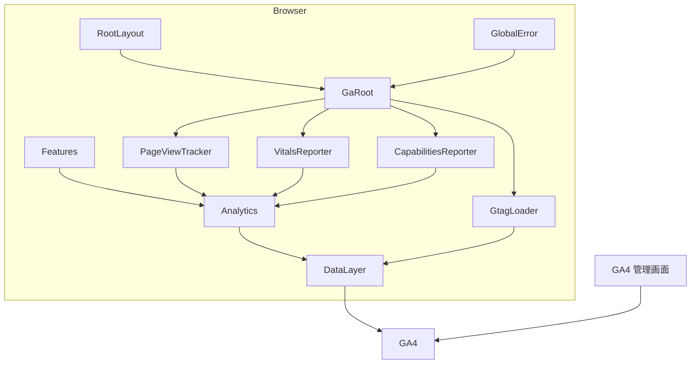
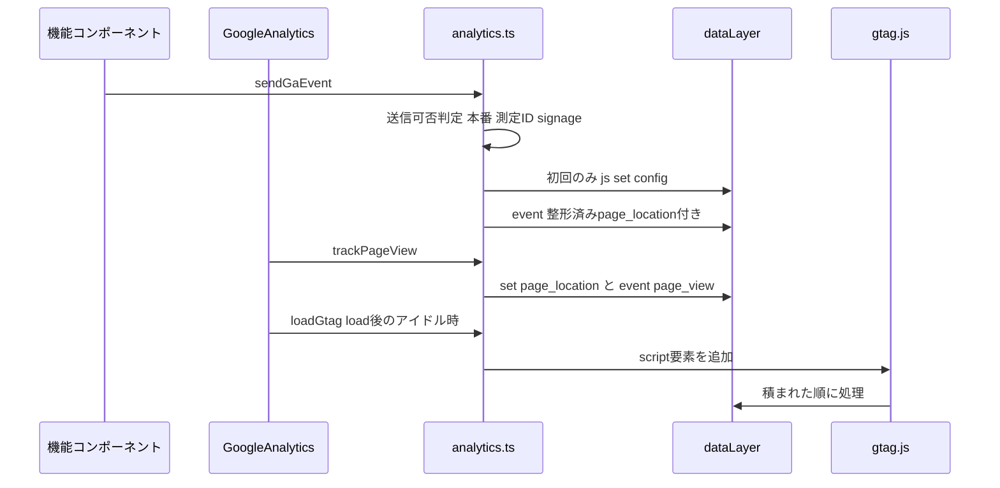
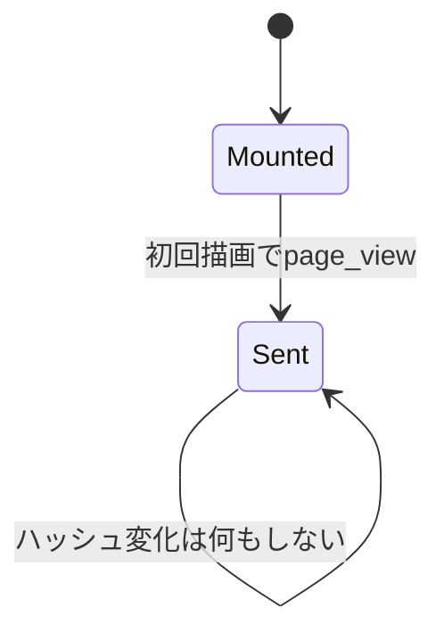
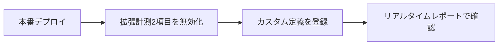

# Design Document

## Overview
**Purpose**: 公式サイトの各機能で採用した技術(端末内保存、Web Share、位置情報、地図ライブラリと自前タイル、定期取得、ISRのフォールバック等)が来場者の端末で使われ、意図どおり機能しているかを、開発者がGA4の画面で評価できるようにする。

**Users**: 開発者が開催前後にGA4の探索・リアルタイムレポートで、機能別の利用・成功・失敗の内訳と表示性能を確認する。

**Impact**: 既存の`frontend/src/lib/analytics.ts`を、全計測の唯一の送信経路にする。GA4の読み込みはルートレイアウトの`<Script>`からクライアントコンポーネントへ移す。page_viewの送信元は、GA4拡張計測の履歴イベントからアプリへ移す。GA4管理画面では、拡張計測の2項目を無効にし、カスタム定義を登録する。

### Goals
- 独自イベントがGA4の読み込み時刻に関係なく記録される
- 絞り込みによるURL書き換えでpage_viewが増えず、検索キーワードがGA4へ送られない
- Requirement 3〜18の各機能の内訳が、イベント名×`result`の集計で読める

### Non-Goals
- 自前の集計画面、自前サーバーへの記録、Measurement Protocolによるサーバー送信
- GA4プロパティの既存のイベント作成ルール(`click`)と、ユーザー提供データの自動収集設定の変更(Out of Boundary参照)
- サイネージの稼働監視

## Boundary Commitments

### This Spec Owns
- `frontend/src/lib/analytics.ts`の送信契約。イベント名とパラメータの型、初期化順、/signage除外、URL整形
- GA4の読み込みとpage_view・Web Vitals・端末対応状況の送信(`frontend/src/components/google-analytics.tsx`)
- 各機能コンポーネントの計測呼び出しと、計測に必要な最小限の分岐の追加(現在地取得の失敗理由の区別、地図の読み込み完了・タイル失敗の検知、エラー境界での検知)
- GA4管理画面で行う設定変更の内容と手順(拡張計測2項目の無効化、カスタム定義の登録)
- エラー画面の再試行を`reset`から`retry`へ替えること(18.6)と、その検証用ページ・e2e・PRプレビューのビルドに渡すダミーの測定ID(18.8)

### Out of Boundary
- 各機能の来場者向け表示・挙動の変更(エラー画面の再試行を除く)。現在地取得の失敗通知は理由によらず同じ表示のまま(11.9)
- GA4プロパティの既存イベント作成ルール。page_viewから`click`を作るルールで、既存の`click`件数を実クリック数と誤認させている。見直しは別途判断する
- 拡張計測の他の項目(スクロール、離脱クリック、ファイルのダウンロード、フォーム操作、動画)と、ユーザー提供データの自動収集(`vtp_isAutoCollectPiiEnabledFlag:true`)の設定
- エラーの詳細な追跡(メッセージ・スタック)。エラー監視の領域

### Allowed Dependencies
- `next` 16.4.2のエラー画面の`retry`(v16.3.0で安定化)、`next/web-vitals`(`useReportWebVitals`)、`next/navigation`(`usePathname`、`useSearchParams`)
- 既存の`@/env`(`NEXT_PUBLIC_GA_MEASUREMENT_ID`)。新しい環境変数は追加しない
- react-leaflet 5 / leaflet 1.9.4の`whenReady`と`tileerror`
- 構内マップの現在地表示(`frontend/src/components/campus-map/use-user-location.ts`、`frontend/src/components/campus-map/map-user-location.tsx`)。Requirement 11はこれに計測を足す
- 依存の向き: `analytics.ts` → (各機能コンポーネント、`google-analytics.tsx`)。`analytics.ts`は機能コンポーネントをimportしない

### Revalidation Triggers
- イベント名・パラメータ名の変更(GA4のカスタム定義と探索の再設定が要る)
- URLクエリ名(`q`/`page`)の変更。URL整形とpage_view判定が依存する
- ルートレイアウト、`global-error.tsx`、エラー画面の構成変更
- GA4の読み込み方式・測定IDの変更

## Architecture

### Existing Architecture Analysis
- `layout.tsx:128-138`は、本番かつ測定IDありのときに、gtag.jsとinitスクリプトを`lazyOnload`で読む。initより前に`sendGaEvent`が積んだイベントは送られない(research.md A3の実験)
- `sendGaEvent`(`analytics.ts`)は`qr_stamp`/`bookmark_add`/`bookmark_remove`を送る。本番・測定IDの判定を持つ
- 拡張計測(実プロパティ):
  - 履歴イベントが有効なので、絞り込みの`pushState`/`replaceState`がpage_viewになる。対象は`use-map-filters.ts:58`と`exhibition-list.tsx:65`
  - サイト内検索が有効で、`?q=`の文字列が`search_term`として送られる
  - ハッシュだけの書き換えはpage_viewにならない。対象は`mypage-view.tsx:208`と`stamp-collector.tsx:26`
- `global-error.tsx`はルートレイアウトを通らないため、GA4が読み込まれない

### Architecture Pattern & Boundary Map



- **Selected pattern**: 単一の送信モジュール(`analytics.ts`)と、ルートに1つ置く読み込みコンポーネント(`GoogleAnalytics`)。各機能は型付きの送信関数を呼ぶだけ
- **New components rationale**:
  - `GoogleAnalytics`: gtag.jsの遅延読み込み、page_view、Web Vitals、端末対応状況を1か所で持つ
  - `client-capabilities.ts`: 端末判定を純粋関数にしてテストするため
- **Steering compliance**:
  - 環境変数は`@/env`経由で参照する
  - Edge Runtimeの制約は受けない(すべてクライアント側)
  - テストは同階層の`*.test.ts(x)`に置く
- **Dependency direction**: `analytics.ts`(型・送信) → `client-capabilities.ts` → `google-analytics.tsx` / 各機能コンポーネント

### Technology Stack

| Layer | Choice / Version | Role in Feature | Notes |
|-------|------------------|-----------------|-------|
| Frontend | Next.js 16.4.2 / React 19.2.7 | `useReportWebVitals`、`usePathname`/`useSearchParams`、`next/script`は不使用 | 追加依存なし |
| Frontend | gtag.js(Google tag) | dataLayerのコマンドを処理しGA4へ送る | 読み込みは`load`後のアイドル時(現行の遅延方針を維持) |
| External | GA4プロパティ`aramakisai.com`(properties/490255062、`G-4PN34461HS`) | 集計 | 管理画面で設定を変更する |

## File Structure Plan

### Directory Structure
```
frontend/src/
├── lib/
│   ├── analytics.ts                 # 送信契約: イベント型、初期化、/signage除外、URL整形、gtag.js読み込み
│   ├── analytics.test.ts
│   ├── client-capabilities.ts       # 端末対応状況の判定(純粋関数)
│   └── client-capabilities.test.ts
└── components/
    ├── google-analytics.tsx         # GA4読み込み・page_view・Web Vitals・端末対応状況の送信
    └── google-analytics.test.tsx
```

### Modified Files
- `frontend/src/app/layout.tsx` — gtag.js/initの`<Script>`2つを`<GoogleAnalytics />`(`<Suspense fallback={null}>`で包む)に置き換える
- `frontend/src/app/global-error.tsx` — `<GoogleAnalytics />`を置き、`ErrorPageContent`に`digest`と`scope: 'global'`を渡す
- `frontend/src/app/(site)/error.tsx`、`frontend/src/app/(fullscreen)/error.tsx` — `error.digest`を`ErrorPageContent`へ渡す。再試行ボタンに渡す関数を`reset`から`retry`に替える(`global-error.tsx`も同じ)
- `frontend/src/components/error-page-content.tsx` — 表示時に`error_page`を送る。再試行の結果を判定する。propsの`onReset`を`onRetry`に改める
- 既存テスト`frontend/src/app/(site)/error.test.tsx`、`frontend/src/app/(fullscreen)/error.test.tsx`(`reset`の呼び出しを検証している)を`retry`に合わせる
- `frontend/src/app/(site)/e2e-error-trigger/page.tsx` — Cookie`e2e_retry_ok`があるときは例外を出さずに回復後の本文を返す(18.8)。同じディレクトリの`page.test.tsx`に、Cookieの有無での分岐と本番ビルドでのnot foundを足す
- `frontend/e2e/error-pages.spec.ts` — `(site)`の再試行が失敗し続けるケースと、Cookieを付けてから再試行して回復するケースを検証する
- `.github/workflows/frontend-ci.yml` — `deploy-preview`のビルドにだけ`NEXT_PUBLIC_GA_MEASUREMENT_ID=G-PREVIEW000`を渡す。`deploy-dev`と`deploy-prod`は変更しない
- `frontend/src/components/stamp-collector.tsx` — `qr_stamp`に`result`を付け、失敗系も送る
- `frontend/src/components/share-button.tsx` — `share`を送る
- `frontend/src/components/campus-map/campus-map-view.tsx` — `whenReady`で`campus_map/ready`を送る。`tileerror`の件数を集計して送る
- `frontend/src/components/campus-map/campus-map-screen.tsx` — 絞り込み結果の確定時に`campus_map/filter`を送り、エリア選択時に`campus_map/area_select`を送る
- `frontend/src/components/campus-map/use-user-location.ts` — 失敗理由を区別して返す
- `frontend/src/components/campus-map/map-user-location.tsx` — `user_location`を送る
- `frontend/src/components/exhibition-list.tsx` — 絞り込み結果の確定時に`exhibition_search`を送る
- `frontend/src/components/exhibition-location-map/map-error-boundary.tsx` — `componentDidCatch`で`location_map/fallback`を送る
- `frontend/src/components/exhibition-location-map/recenter-button.tsx` — `location_map/recenter`を送る
- `frontend/src/components/parking-list.tsx` — `parking`の3種を送る
- `frontend/src/components/timetable-view.tsx` — 日付補正時に`timetable/date_corrected`を送る
- `frontend/src/components/motion-toggle.tsx` — `motion`を送る
- `frontend/src/components/rich-text-image-viewer.tsx` — 拡大表示時に`image_viewer/open`を送る
- 上記各ファイルの`*.test.tsx` — 送信内容を`sendGaEvent`のモックで検証する

## System Flows

### 初期化とイベント送信の順序



- 子のeffectは親より先に走る。そのため、初期化はどの送信関数から呼ばれても最初の1回で積む(`ensureInit`)。research.md A3の実験で、`config`後に積んだイベントは、gtag.jsの読み込みが後でも送られることを確認した
- `config`には`send_page_view: false`を指定する。page_viewは常に`GoogleAnalytics`が送る

### page_viewの判定



## Requirements Traceability

| Requirement | Summary | Components | Interfaces | Flows |
|-------------|---------|------------|------------|-------|
| 1.1 | 未読み込み環境では送らない | Analytics | `isGaEnabled` | 初期化 |
| 1.2 | 送信失敗を表示しない | Analytics | `sendGaEvent`(例外を投げない) | — |
| 1.3 | 座標・キーワード・個人情報・自前IDを送らない | Analytics, 管理画面設定 | `GaEventMap`、`sanitizeLocation` | page_view |
| 1.4 | 共通の項目名 | Analytics | `result`/`method`/`duration_ms`/`item_count` | — |
| 1.5 | 自前サーバーに記録しない | Analytics | 送信先はdataLayerのみ | — |
| 2.1, 2.2 | /signage除外 | Analytics, GoogleAnalytics | `isGaEnabled` | 初期化 |
| 3.1, 3.2 | Web Vitals | GoogleAnalytics | `web_vitals` | — |
| 4.1, 4.2 | 端末対応状況 | ClientCapabilities, GoogleAnalytics | `client_capabilities` | — |
| 5.1, 5.2 | 取りこぼし防止 | Analytics | `ensureInit` | 初期化 |
| 6.1, 6.2, 6.3, 6.4, 6.5, 6.6 | page_viewの過大計上防止 | GoogleAnalytics, 管理画面設定 | `trackPageView` | page_view |
| 7.1, 7.2, 7.3, 7.4, 7.5, 7.6, 7.7 | QRスタンプ | StampCollector | `qr_stamp` | — |
| 8.1, 8.2 | ブックマーク | BookmarkButton(変更なし), ClientCapabilities | `bookmark_add`/`bookmark_remove`、`cap_storage` | — |
| 9.1, 9.2, 9.3, 9.4, 9.5 | 共有 | ShareButton | `share` | — |
| 10.1, 10.2, 10.3, 10.4, 10.5 | 構内マップ | CampusMapView, CampusMapScreen | `campus_map` | — |
| 11.1, 11.2, 11.3, 11.4, 11.5, 11.6, 11.7, 11.8, 11.9 | 現在地表示 | UseUserLocation, MapUserLocation | `user_location` | — |
| 12.1, 12.2 | 企画一覧の検索 | ExhibitionList | `exhibition_search` | — |
| 13.1, 13.2 | 企画詳細の位置地図 | MapErrorBoundary, RecenterButton | `location_map` | — |
| 14.1, 14.2, 14.3, 14.4 | 駐車場 | ParkingList | `parking` | — |
| 15.1 | タイムテーブル | TimetableView | `timetable` | — |
| 16.1, 16.2 | モーション切替 | MotionToggle, ClientCapabilities | `motion`、`cap_reduced_motion` | — |
| 17.1 | 本文画像の拡大表示 | RichTextImageViewer | `image_viewer` | — |
| 18.1, 18.2, 18.3, 18.4, 18.5, 18.6, 18.7 | エラー・not found | ErrorPageContent, GlobalError | `error_page` | 初期化 |
| 18.8 | 再試行の検証用ページ | E2EErrorTriggerPage | — | — |
| 19.1, 19.2, 19.3 | カスタム定義 | 管理画面設定 | カスタム定義一覧 | — |

## Components and Interfaces

| Component | Domain/Layer | Intent | Req Coverage | Key Dependencies | Contracts |
|-----------|--------------|--------|--------------|------------------|-----------|
| Analytics(`analytics.ts`) | lib | 送信契約と初期化 | 1, 2, 5, 6 | `@/env` (P0) | Service, Event |
| ClientCapabilities(`client-capabilities.ts`) | lib | 端末対応状況の判定 | 4, 8.2, 16.2 | なし | Service |
| GoogleAnalytics(`google-analytics.tsx`) | UI(ルート) | 読み込み・page_view・Web Vitals・端末対応状況 | 2, 3, 4, 6 | Analytics (P0)、`next/web-vitals` (P1) | State |
| 機能コンポーネント群 | UI | 各機能の計測呼び出し | 7〜18 | Analytics (P0) | Event |
| 管理画面設定 | GA4 | 拡張計測2項目の無効化、カスタム定義 | 1.3, 6, 19 | GA4プロパティ (P0) | — |

### lib

#### Analytics

| Field | Detail |
|-------|--------|
| Intent | 全計測の唯一の送信経路。初期化順・除外・URL整形を保証する |
| Requirements | 1.1, 1.2, 1.3, 1.4, 1.5, 2.1, 2.2, 5.1, 6.1, 6.4, 6.5 |

**Responsibilities & Constraints**
- 送信可否: `NODE_ENV === 'production'`、測定IDあり、`location.pathname`が`/signage`で始まらない。この3つがすべて真のときだけ送る
- 初期化(`ensureInit`): モジュール内のフラグで1回だけ、dataLayerへ`js`→`set {page_location}`→`config(測定ID, {send_page_view: false})`を積む
- URL整形(`sanitizeLocation`): `origin + pathname + search`から`q`を除く。ハッシュは含めない。スタンプの検証値もハッシュにあるため、これで落ちる
- すべての独自イベントに、整形済みの`page_location`をイベントパラメータとして付ける。子のeffectがpage_view(`set`)より先に走っても、そのページのURLになる
- 例外は内部で握りつぶし、呼び出し元へ伝えない(1.2)

**Contracts**: Service [x] / Event [x]

##### Service Interface
```typescript
type GaResult<T extends string> = { readonly result: T };

interface GaEventMap {
  qr_stamp: ExhibitionEventParams &
    GaResult<'added' | 'exists' | 'unavailable' | 'invalid' | 'network_error'>;
  bookmark_add: ExhibitionEventParams;
  bookmark_remove: ExhibitionEventParams;
  share:
    | { readonly method: 'web_share'; readonly result: 'success' | 'cancel' | 'fail' }
    | { readonly method: 'clipboard'; readonly result: 'success' }
    | { readonly method: 'manual'; readonly result: 'fail' };
  campus_map:
    | { readonly result: 'ready'; readonly method: 'hard' | 'soft'; readonly duration_ms?: number }
    | { readonly result: 'tile_error'; readonly item_count: number }
    | { readonly result: 'area_select' }
    | { readonly result: 'filter'; readonly item_count: number };
  user_location:
    | GaResult<'start' | 'out_of_campus' | 'denied' | 'unavailable' | 'timeout' | 'unsupported'>
    | {
        readonly result: 'located';
        readonly accuracy_bucket: 'lt20' | '20to50' | '50to100' | 'ge100';
        readonly duration_ms: number;
      };
  exhibition_search: { readonly item_count: number };
  location_map: GaResult<'fallback' | 'recenter'>;
  parking:
    | GaResult<'initial_missing' | 'poll_fail'>
    | { readonly result: 'stale'; readonly item_count: number };
  timetable: GaResult<'date_corrected'>;
  motion: GaResult<'reduce' | 'full'>;
  image_viewer: GaResult<'open'>;
  error_page:
    | { readonly result: 'error' | 'global_error'; readonly error_digest?: string }
    | GaResult<'not_found' | 'retry_success' | 'retry_fail'>;
  web_vitals: {
    readonly metric_name: 'LCP' | 'CLS' | 'INP' | 'FCP' | 'TTFB';
    readonly metric_value: number;
    readonly metric_rating: 'good' | 'needs-improvement' | 'poor';
    readonly vitals_page: string;
  };
  client_capabilities: Readonly<Record<CapabilityKey, '1' | '0'>>;
}

function sendGaEvent<K extends keyof GaEventMap>(name: K, params: GaEventMap[K]): void;
function trackPageView(): void;   // set page_location → event page_view
function loadGtag(): void;        // load後のアイドル時にgtag.jsのscript要素を1回だけ追加
function isGaEnabled(): boolean;
function sanitizeLocation(href: string): string;
```
- Preconditions: クライアント側でのみ呼ぶ(`window`が必要)
- Postconditions: 送信可のとき、dataLayerの順序は`js`/`set`/`config`が先頭で、各イベントはその後になる。送信不可のときはdataLayerに何も積まない
- Invariants: イベント名に`click`を使わない(プロパティのイベント作成ルールと衝突するため)。座標・キーワード文字列・エラーメッセージを型に持たない

**Implementation Notes**
- Integration: 既存の`ExhibitionEventParams`と、Arguments形式で積む実装を流用する(gtag.jsはArgumentsだけをコマンドとして解釈する)
- Validation: `analytics.test.ts`で、初期化順・/signage除外・`q`除去・ハッシュ除去・本番以外の無送信を検証する
- Risks: 測定IDの変更時は管理画面の設定もやり直す

#### ClientCapabilities

| Field | Detail |
|-------|--------|
| Intent | 端末対応状況を`'1'|'0'`の固定キーで返す |
| Requirements | 4.1, 8.2, 16.2 |

```typescript
type CapabilityKey =
  | 'cap_storage'        // localStorageへのsetItem/removeItemが成功するか
  | 'cap_share'          // 'share' in navigator
  | 'cap_clipboard'      // navigator.clipboard?.writeText が関数か
  | 'cap_geolocation'    // 'geolocation' in navigator
  | 'cap_dialog'         // HTMLDialogElement.prototype.showModal が関数か
  | 'cap_standalone'     // display-mode: standalone、または navigator.standalone
  | 'cap_reduced_motion' // prefers-reduced-motion: reduce(OS設定のみ。サイト内のモーション切替は含めない)
  | 'cap_pc_input';      // globals.css の pc-input と同じ (min-width:1024px) and (hover:hover) and (pointer:fine)

function detectCapabilities(): Readonly<Record<CapabilityKey, '1' | '0'>>;
```
- `cap_pc_input`のメディアクエリは`globals.css`の`@custom-variant pc-input`と同じ文字列にする。テストで両者の一致を検証する

### UI(ルート)

#### GoogleAnalytics

| Field | Detail |
|-------|--------|
| Intent | GA4の読み込みと、ページ単位・セッション単位の自動送信 |
| Requirements | 2.1, 3.1, 3.2, 4.1, 4.2, 6.1, 6.2, 6.3, 6.4, 6.5, 6.6 |

**Responsibilities & Constraints**
- `isGaEnabled()`が偽なら何もしない(/signage・本番以外・測定ID未設定)
- 読み込み: マウント時に`loadGtag()`を呼ぶ。`window`の`load`後、`requestIdleCallback`(未対応端末は`setTimeout`)でscript要素を追加する。現行`lazyOnload`と同じ時期になる
- page_view: `usePathname()`をキーにしたeffectで、`trackPageView()`を呼ぶ。クエリ変化(絞り込み・ページ番号)は、`set page_location`だけを積む。ハッシュは監視しない。企画一覧で2ページ目以降から絞り込むとページ番号が1に戻り`page`クエリが消えるため、クエリの差ではページ送りと絞り込みを区別できない。ページ送りのpage_viewは`ExhibitionList`が操作時に送る(6.1, 6.5)
- Web Vitals: `useReportWebVitals`で受けた指標のうち、5指標(LCP/CLS/INP/FCP/TTFB)だけを`web_vitals`で送る。`vitals_page`は、コンポーネントが最初に描画されたときの整形済みパスを使う。CLS・INPは非表示時に確定し、そのとき別ページへ遷移していることがあるため(3.2)
- 端末対応状況: マウント時に`sessionStorage`の`ga_caps_sent`を確認し、無ければ`client_capabilities`を送って記録する。`sessionStorage`が使えない端末では、ページ読み込みごとに送る。分析はセッション数で数えるため、重複は分布を歪めない(4.2)
- `useSearchParams`を使うため、ルートレイアウトでは`<Suspense fallback={null}>`で包む

**Contracts**: State [x]
- State model: モジュール変数`initialized`(初期化済み)と`gtagRequested`(script追加済み)。React stateは持たない

**Implementation Notes**
- Integration: `global-error.tsx`にも同じコンポーネントを置く。`global-error`は独自の`<html>`を描画し、インラインの`<head>`スクリプトがクライアント描画で実行されない。そのため、読み込みはscript要素の動的追加で行う
- Risks: /signageへクライアント遷移した後、既に読み込まれたgtag.jsの拡張計測(scroll等)は止まらない。端末は/signageを直接開く運用なので許容する

### UI(機能コンポーネント)

各機能の要点をまとめる(送信契約は`GaEventMap`)。

- **StampCollector**(7.1, 7.2, 7.3, 7.4, 7.5, 7.6, 7.7):
  - 検証APIの応答が`ok`かつ`valid: true`のとき: `addStamp`の結果で`added`/`exists`/`unavailable`を送る
  - 応答が`ok`かつ`valid: false`: `invalid`
  - 例外または`!ok`: `network_error`
  - ハッシュに`s`が無いときは何も送らない
  - 企画ID・カテゴリは、検証の成否によらずURLのパスから付ける
- **ShareButton**(9.1, 9.2, 9.3, 9.4, 9.5):
  - Web Shareの成功は`web_share/success`、`AbortError`は`web_share/cancel`
  - その他のWeb Share失敗は`web_share/fail`を送り、そのままクリップボードへ進む
  - クリップボードの成功は`clipboard/success`。失敗して手動コピー欄を出したら`manual/fail`
- **CampusMapView**(10.1, 10.2):
  - `MapContainer`の`whenReady`で`campus_map/ready`を送る
  - ドキュメント内で最初の`whenReady`で、かつ`performance.getEntriesByType('navigation')[0]`のURLのパスが`/map`のときだけ`method: 'hard'`とし、`duration_ms = Math.round(performance.now())`を付ける。値は`performance.timeOrigin`起点。navigation entryはドキュメントの最初のURLのまま変わらないため、2回目以降(直接開いた後にサイト内遷移で戻った場合)は判定に使えない
  - それ以外は`method: 'soft'`とし、時間を付けない。ナビゲーション開始時刻が取れないため
  - `TileLayer`の`tileerror`を表示中に数え、件数が1以上なら`pagehide`/`visibilitychange(hidden)`/アンマウントのいずれか最初の1回で`campus_map/tile_error`を送る
- **CampusMapScreen**(10.3, 10.4, 10.5):
  - エリアのクリックで選ぶ(`selectArea`がnull以外)と`campus_map/area_select`を送る
  - 絞り込み条件(デバウンス後の`filters`)が初回描画後に変わり、`listState`が`filtered`になったとき、結果件数を`campus_map/filter`で送る
  - キーワードは送らない
- **UseUserLocation / MapUserLocation**(11.1, 11.2, 11.3, 11.4, 11.5, 11.6, 11.7, 11.8, 11.9):
  - hookの`failureCount`を、`lastFailure: { reason: 'out_of_campus' | 'denied' | 'unavailable' | 'timeout' | 'unsupported'; seq: number } | null`に置き換える。`GeolocationPositionError.code`の1/2/3を`denied`/`unavailable`/`timeout`に対応させる
  - 開始時刻は`start()`の時点の`performance.now()`。初回の構内位置で`located`(精度区分と`duration_ms`)を送る
  - 失敗トーストは`seq`の変化で出し、文言は理由によらず同じにする(11.9)
- **ExhibitionList**(12.1, 12.2):
  - デバウンス後の絞り込み条件が初回描画後に変わったとき、条件に合う件数(ページングの前)を`exhibition_search`で送る
  - ページ送りだけでは送らない
  - ページ送りの操作では、URL更新の後に`trackPageView()`を呼ぶ(6.5)
- **MapErrorBoundary / RecenterButton**(13.1, 13.2): `componentDidCatch`で`location_map/fallback`を送る。再中心化ボタンのクリックで`location_map/recenter`を送る
- **ParkingList**(14.1, 14.2, 14.3, 14.4):
  - `initial === null`のとき、マウント時に1回`parking/initial_missing`を送る
  - `usePolling`の`error`が`false`から`true`に変わったときだけ`parking/poll_fail`を送る
  - 古い情報の区画数が1以上になった最初の描画で、1回だけ`parking/stale`(`item_count`)を送る
  - 成功ごとには送らない
- **TimetableView**(15.1): 端末の日付による初期日付の補正が実際に適用されたとき(補正前と補正後の日付が異なる)、1回だけ送る
- **MotionToggle**(16.1): 操作後の状態で`motion/reduce`か`motion/full`を送る
- **RichTextImageViewer**(17.1): `showModal`を呼んだ直後に`image_viewer/open`を送る
- **ErrorPageContent / GlobalError**(18.1〜18.7):
  - propsに`digest?: string`と`scope?: 'segment' | 'global'`を足す
  - errorを表示したら`error_page`を送る。`result`は`scope`が`global`なら`global_error`、それ以外は`error`。`digest`があれば`error_digest`に入れる
  - not-foundを表示したら`not_found`を送る
  - 再試行ボタンはNext.jsの`retry()`を呼ぶ(18.6)。`reset()`はサーバーから取得し直さず、サーバー側のエラーでは同じエラーが再び出るだけになる(research.md「エラー画面の再試行」)
  - 判定はモジュール変数`pendingRetry`(真偽値)で行う(18.2, 18.7)。エラー画面は再試行が失敗すると別インスタンスとして作り直されるため、コンポーネント内のrefでは状態を引き継げない
    - 再試行ボタンを押したら`pendingRetry = true`にしてから`retry()`を呼ぶ
    - エラー画面のマウント時に`pendingRetry`が真なら`retry_fail`を送り、偽に戻す。このマウントでは`error`/`global_error`は送らない(表示件数を再試行の回数で水増ししないため)
    - エラー画面のアンマウント時に`setTimeout(…, 0)`を予約し、その時点で`pendingRetry`がまだ真なら`retry_success`を送り、偽に戻す。失敗時の作り直しは古いインスタンスのアンマウントと同じコミットで新しいインスタンスがマウントされるため、予約した処理が走る前に`pendingRetry`は偽になっている
  - 開発時のStrictModeによる二重マウントは、`pendingRetry`が偽のときのアンマウント・マウントなので判定に影響しない。また開発時はGAへ送らない(1.1)
  - `(site)`・`(fullscreen)`のエラー画面と全体エラー画面のすべてで同じ順序になることを実験で確かめた。`pendingRetry`は`error-page-content.tsx`のモジュール変数1つを3画面で共有する(research.md「エラー画面の再試行と成否の判定」)
- **E2EErrorTriggerPage**(18.8): 既存の`(site)/e2e-error-trigger`を拡張する
  - `DEV_OVERRIDE_ENABLED`が偽なら従来どおり`notFound()`(本番ビルド)
  - 真のとき、`cookies()`でCookie`e2e_retry_ok`を読み、無ければ従来どおり例外を出し、あれば「回復しました」の本文を返す
  - 回復条件をサーバーのメモリではなくリクエストのCookieに持たせる。Workersではリクエストごとにisolateが異なり得るため、メモリ上のカウンタでは「初回だけ失敗」を確定的に再現できない(research.md「再試行の検証用ページ」)
  - 検証手順: ページを開く → エラー画面 → 再試行(失敗側。Cookie無し)→ Cookieを付ける → 再試行(成功側)。`retry`はサーバーへ再要求するため、2回目の再要求にCookieが載る
  - 対象は`(site)`のエラー画面だけとする。判定処理は`error-page-content.tsx`に1つだけあり3画面で共有するため、1画面で成功・失敗の両側を確かめれば足りる。全体エラー画面の再現にはルートレイアウトへ検証用の分岐を入れる必要があり、全ページに影響するため採らない
  - エラーのメッセージ・スタックは送らない

## Data Models

### Data Contracts & Integration

**カスタム定義(GA4管理画面で登録、19.1, 19.2, 19.3)**

イベントスコープのカスタムディメンション(新規15個。既存12個と合わせて27個で、上限50個以内):

| パラメータ | 用途 |
|-----------|------|
| `result` | 全イベントの内訳 |
| `method` | 共有の手段、地図の読み込み種別 |
| `accuracy_bucket` | 現在地の精度区分 |
| `error_digest` | エラーの識別値 |
| `metric_name` / `metric_rating` / `vitals_page` | Web Vitals |
| `cap_storage` / `cap_share` / `cap_clipboard` / `cap_geolocation` / `cap_dialog` / `cap_standalone` / `cap_reduced_motion` / `cap_pc_input` | 端末対応状況 |

カスタム指標(新規3個):

| パラメータ | 単位 | 用途 |
|-----------|------|------|
| `duration_ms` | ミリ秒 | 地図の操作可能時間、現在地の取得時間 |
| `item_count` | 標準 | 絞り込み結果件数、タイル失敗件数、古い区画数 |
| `metric_value` | 標準 | Web Vitalsの値(CLSは小数、ほかはミリ秒) |

既存の`exhibition_id`(企画ID)と`exhibition_category`(企画カテゴリ)は変更しない。

## Error Handling

### Error Strategy
- 計測の失敗は来場者に見せず、機能の動作を止めない(1.2)。`sendGaEvent`・`trackPageView`・`loadGtag`は内部の例外を握りつぶす
- gtag.jsの取得失敗(広告ブロッカー等)では、dataLayerに積まれたまま送られない。機能への影響は無い
- `sessionStorage`・`performance.getEntriesByType`・`requestIdleCallback`が無い端末では、代わりの手段(毎回送信、`method: 'soft'`扱い、`setTimeout`)で動かす

## Testing Strategy

- **Unit Tests**
  - `analytics.test.ts`: 本番以外・測定ID未設定・`/signage`でdataLayerが空になる。初回送信で`js`/`set`/`config(send_page_view:false)`がイベントより先に積まれる。`sanitizeLocation`が`q`とハッシュを除き、`category`/`page`を残す。`loadGtag`はscript要素を1回だけ追加する
  - `client-capabilities.test.ts`: 各判定の真偽。`cap_pc_input`のメディアクエリ文字列が`globals.css`と一致する
  - `google-analytics.test.tsx`: pathnameの変化でpage_viewが送られ、`page`を含むクエリ変化では`set`だけが積まれる。再描画しても`useReportWebVitals`に渡る関数が同一である。Web Vitalsが5指標だけを送る。端末対応状況が`sessionStorage`で1回に抑えられる
- **Component Tests**(各機能の既存テストに追加、`sendGaEvent`をモック)
  - スタンプの5結果と、検証値なしでの無送信
  - 共有の5経路
  - 現在地の7結果と、トースト文言が理由によらず同じであること
  - 駐車場の連続失敗で1回だけ送ること
  - エラー画面の再試行の成功・失敗判定: 再試行ボタンが`retry`を呼ぶこと。`pendingRetry`が真の状態でマウントされると`retry_fail`だけを送り`error`を送らないこと。真の状態でアンマウントされ、直後に再マウントが無いと`retry_success`を送ること
- **実測確認**(5.2, 6.5, 18.2, 18.7)
  - 送信順は、research.md A3/A4の実験と同じ手順(Playwrightで`/g/collect`をabortし、collect要求を観察)で本番ビルドに対して確認する
  - 本番ビルドでの確認はPRプレビューで行う(ローカルで本番ビルドを起動する手段は無い)。エラー画面の再試行は、プレビューの`/e2e-error-trigger`で次を確認する
    - Cookie無しの再試行1回につき`retry_fail`が1件だけ積まれ、`error`が追加で積まれない
    - Cookie`e2e_retry_ok`を付けてからの再試行で本来の本文に置き換わり、`retry_success`が1件だけ積まれる
    - 上の2点と回復の可否(18.6)は、`frontend/e2e/error-pages.spec.ts`でCIのプレビューe2eとして毎回検証する。`window.dataLayer`の中身を読んで判定し、`**/gtag/js**`と`**/g/collect**`への要求はabortする
  - 前提: プレビューのビルド(`frontend-ci.yml`の`deploy-preview`、Infisical staging)には`NEXT_PUBLIC_GA_MEASUREMENT_ID`が無く、そのままでは`sendGaEvent`がdataLayerへ何も積まない。そこで`deploy-preview`のビルドにだけ、実在しないダミーの測定ID`G-PREVIEW000`を渡す。本番の測定IDを渡すとプレビューを見た実行委員の閲覧が本番プロパティに混ざるため使わない(research.md「プレビューでのGA確認」)
  - 公開後は、GA4のリアルタイムレポート(analytics MCPの`run_realtime_report`)で、各イベント名と`result`が届いていること、絞り込み操作でpage_viewが増えないことを確認する

## Security Considerations
- 送らないもの: 座標(`user_location`は精度区分のみ)、検索キーワード(`q`は`page_location`から除き、サイト内検索も無効にする)、エラーメッセージ、自前の識別子
- スタンプの検証値はURLハッシュにあり、`sanitizeLocation`がハッシュを落とすため送られない

## Migration Strategy



- 本番デプロイの直後に、GA4管理画面(データストリーム`aramakisai.com` → 拡張計測機能 → 詳細設定)で次の2つを無効にする
  - ページビュー →「ブラウザの履歴イベントに基づくページの変更」
  - 「サイト内検索」
- 順序の理由:
  - 無効化がデプロイより先だと、旧コード(page_viewを自分で送らない)のままでページ遷移のpage_viewが欠ける
  - デプロイが先だと、無効化するまでの間、page_viewが二重に送られる
  - 後者の方が影響が小さいため、デプロイを先にする
- カスタム定義は登録した時点から集計される(過去には遡らない)。デプロイと同じ日に登録する
- 戻し方: コードを戻すときは、上記2項目を有効に戻す
