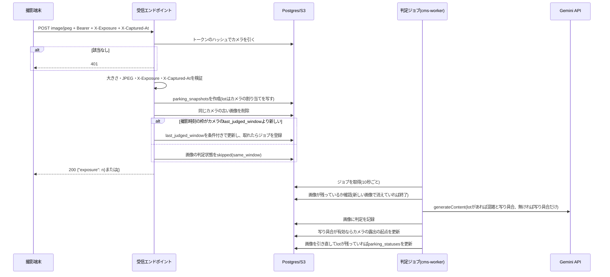

# Design Document

## Overview
**Purpose**: 撮影端末(カメラ)から届く駐車場の画像をCMSが受け取り、生成AIで混雑の度合いと写り具合を判定して、空き状況の自動更新と撮影端末への露出補正値の応答を行う。公開ページ`/parking`は駐車場ごとに最新の画像を状態と並べて出す。

**Users**: 実行委員は管理画面でカメラを登録し、トークンを発行し、駐車場に割り当てる。撮影端末は壁時計の5分境界に揃えて撮影し、撮影時刻を付けて画像を送る。来場者は`/parking`で状態と画像を見る。

**Impact**: Payload CMSに受信エンドポイント1つ、コレクション2つ(`parking_cameras`・`parking_snapshots`)、ジョブ1つを足す。`parking_statuses`の書き込み経路に判定ジョブが加わる。`/api/parking`の応答に画像の項目が加わる。

### Goals
- 撮影端末の画像から、人手なしで`parking_statuses`が更新される
- 判定の失敗やGemini APIの不調があっても、受信と保存は止まらず次の画像で回復する
- 判定の呼び出しが無料枠の1分あたり・1日あたりの上限に収まる
- 露出補正値の応答で、時間帯や天気が変わっても見やすい写りに寄せる

### Non-Goals
- 撮影端末の実装と設定
- 手入力を自動判定より優先させる仕組み
- 画像のぼかし、台数の計数、過去の画像や判定の履歴の保存と公開
- サイネージの駐車場画面以外の表示の変更

## Boundary Commitments

### This Spec Owns
- 端末とCMSの間の送受信の取り決め(「受信エンドポイントの取り決め」)
- カメラとデバイス用トークンの管理(発行・無効化・駐車場への割り当て)
- カメラごとの最新画像1枚の保存と、管理画面での確認
- 判定ジョブ(モデルの切り替え、呼び直し、レート制御、判定の記録)
- 判定結果による`parking_statuses.status`の更新
- 露出補正値の決め方
- `/api/parking`とサイネージのスナップショットに加える画像の項目と、その取得
- サイネージの駐車場画面で画像を出す条件(当日のみ、割り当て済みカメラのみ、15分で古い表示)

### Out of Boundary
- 撮影端末のファームウェア(この取り決めに合わせる側)
- `parking_statuses`の作成・削除(従来どおり`parking_lots`のフックが行う)
- サイネージ通知の仕組み(`signageNotifyHook`をそのまま使う)

### Allowed Dependencies
- Payload 3.88のLocal API、ジョブ(`jobs.tasks`)、カスタムエンドポイント、アップロードコレクション
- `@payloadcms/storage-s3`(既存のバケット・接頭辞の仕組み)
- Gemini API `generateContent`(REST、`x-goog-api-key`ヘッダー)
- 既存の`cms-worker`(ジョブを実行する唯一のPod)
- 依存の向き: 型・設定 → 純粋関数(トークン、露出補正、レート制御、Gemini呼び出し) → コレクション・ジョブ・エンドポイント → 管理画面のコンポーネント。下位は上位をimportしない

### Revalidation Triggers
- 受信エンドポイントのヘッダー・応答の形を変えるとき(撮影端末の再確認が要る)
- 判定ジョブを`cms-worker`以外で実行する構成に変えるとき(レート制御の前提が崩れる)
- `/api/parking`の`image`の形を変えるとき
- 無料枠の上限やモデルIDが変わったとき

## Architecture

### Existing Architecture Analysis
- `parking_lots`(名称)と`parking_statuses`(駐車場ごとに1件、`status`)がある。`parking_statuses`は`HOOK_MANAGED`で人による作成・削除を禁じ、保存のたびにサイネージへ通知する。
- 本番はWeb用Pod6台(`CMS_JOBS_AUTORUN=false`)とジョブ専用の`cms-worker`1台。ジョブの取得に排他が無いため、ジョブは`cms-worker`だけが実行する。
- access controlは`cms/src/access/policy.ts`に集約し、`collections/index.ts`で一括結線する。
- `/api/parking`(frontend)は`parking_statuses`を`depth: 1`で取り、20秒キャッシュする。開催当日でないときは状態を落とす。

### Architecture Pattern & Boundary Map

```mermaid
graph LR
  Cam[撮影端末] -->|POST /api/parking-ingest| Ingest[受信エンドポイント(Web用Pod)]
  Ingest --> Cameras[(parking_cameras)]
  Ingest --> Snapshots[(parking_snapshots)]
  Snapshots --> S3[(S3 parking-snapshots)]
  Ingest -->|queue| Jobs[(payload_jobs)]
  Jobs --> Worker[判定ジョブ(cms-worker)]
  Worker --> Gemini[Gemini API]
  Worker --> Snapshots
  Worker --> Cameras
  Worker --> Statuses[(parking_statuses)]
  Statuses -->|signageNotifyHook| Signage[サイネージ]
  Admin[管理画面] --> Cameras
  Admin --> Snapshots
  FE[frontend /api/parking] -->|REST| Statuses
  FE -->|REST| Snapshots
  Browser[来場者] -->|画像| S3edge[cms.aramakisai.com /api/parking_snapshots/file]
```

**Architecture Integration**:
- 選んだ形: 受信は保存とジョブの登録だけを行い、判定は`cms-worker`のジョブで行う。Gemini APIの呼び出しが1プロセスに集まるため、レート制御をメモリ上の計数だけで行える。
- 境界: カメラ(トークン・露出の起点)、画像(最新1枚と判定の記録)、空き状況(従来のコレクション)を分ける。露出はカメラの性質なのでカメラに持たせ、駐車場には持たせない。
- 維持する既存の形: `HOOK_MANAGED`による作成・削除の制限、`policy.ts`への集約、`signageNotifyHook`による通知、`cms-worker`だけのジョブ実行、Infisical`prod`→`cms-secrets`による秘密値の注入。

### Technology Stack

| Layer | Choice / Version | Role in Feature | Notes |
|---|---|---|---|
| Backend | Payload 3.88 / Next.js 16(`cms/`) | 受信エンドポイント、コレクション、ジョブ | 新しい依存は無い。SHA-256・乱数は`node:crypto` |
| External | Gemini API v1beta `generateContent` | 混雑と写り具合の判定 | `fetch`で直接呼ぶ。SDKは入れない |
| Data / Storage | Postgres 16、S3互換(Hetzner)、`@payloadcms/storage-s3` 3.88 | カメラ・画像の記録、画像ファイル | 接頭辞`<S3_PREFIX>/parking-snapshots` |
| Frontend | Next.js 15(`frontend/`) | `/api/parking`の画像の項目 | Edge Runtimeの制約内(REST取得だけ) |
| Infrastructure | `cms-worker`(1Pod)、`cms-secrets` | 判定の実行、`GEMINI_API_KEY`の注入 | `aramakisai-infra`のExternalSecretにキーを1つ足す |

## File Structure Plan

### Directory Structure
```
cms/src/
├── collections/
│   ├── parking-cameras.ts        # カメラ。トークンのハッシュ、駐車場の割り当て、露出の起点
│   └── parking-snapshots.ts      # アップロード。カメラごとの最新画像と判定の記録
├── endpoints/
│   ├── parking-ingest.ts         # POST /api/parking-ingest(撮影端末の受信口)
│   └── parking-camera-token.ts   # POST/DELETE /api/parking_cameras/:id/token(発行・無効化)
├── lib/
│   ├── parking-camera-token.ts   # トークンの生成とハッシュ
│   ├── parking-exposure.ts       # 写り具合 → 露出補正値
│   ├── parking-judge.ts          # Gemini呼び出し、呼び直し、モデル切り替え、応答の検証
│   ├── parking-judge-rate.ts     # モデルごとの1分・1日の計数(ワーカーのメモリ)
│   ├── parking-judge-task.ts     # ジョブjudgeParkingSnapshotの本体
│   ├── parking-device-status.ts  # X-Device-*ヘッダーの読み取りと検証
│   └── parking-camera-watch.ts   # 定期ジョブcheckParkingCamerasの本体とDiscordへの送信
└── components/
    └── ParkingCameraTokenField.tsx  # 発行・無効化のボタンと、発行直後の値の表示
frontend/src/lib/
    ├── parking.ts                # ParkingLotにimageを足す
    └── parking-data.ts           # 当日だけparking_snapshotsを取得して駐車場に対応付ける
```
各`lib/*.ts`は同階層に`*.test.ts`、受信と判定の結線は`*.int.test.ts`を置く。

### Modified Files
- `cms/src/payload.config.ts` — `jobs.tasks`に`judgeParkingSnapshot`と`checkParkingCameras`(`schedule`付き)を足す。`endpoints`に受信エンドポイントを足す。S3プラグインの`collections`に`parking_snapshots`を足す
- `cms/src/collections/index.ts` — 2コレクションを登録する
- `cms/src/globals/site-settings.ts` — 監視時間`parking_monitor`(`start`・`end`)を足す(列の追加だけで破壊的変更は無い)
- `cms/src/collections/parking-lots.ts` — joinフィールド`camera`(`collection: 'parking_cameras'`、`on: 'lot'`、ラベル「カメラ」)を足し、一覧の列`defaultColumns`に加える。joinは列を持たないためマイグレーションは要らない
- `cms/src/access/policy.ts` — `parking_cameras`を`PRIVATE_COLLECTIONS`に、`parking_snapshots`を`HOOK_MANAGED`と`PUBLISHED_FILTER`(`lot`がある画像だけ)に足す
- `cms/src/nav-groups.ts` — `parking_cameras`: 会場・マップ、`parking_snapshots`: 当日運営
- `cms/src/migrations/` — `pnpm migrate:create`で生成する差分(追加だけで破壊的変更は無い)
- `cms/src/app/(payload)/admin/importMap.js` — 管理画面のコンポーネントの登録(生成物)
- `frontend/src/cms-types.ts` — `pnpm generate:types`で再生成
- `docs/cms-operations.md` — 環境変数`GEMINI_API_KEY`・`PARKING_CAMERA_DISCORD_WEBHOOK_URL`・`PARKING_JUDGE_WINDOW_SECONDS`、Infisical`prod`のキー`GEMINI_API_KEY`(新規)と`DISCORD_OPS_WEBHOOK_URL`(既存を参照)、カメラの登録と割り当ての手順
- `.kiro/steering/product.md`・`tech.md` — ドメインモデルとシークレット名
- `aramakisai-infra/gitops/manifests/prod/cms-secrets/external-secret.yaml` — `cms-secrets`の`template.data`と`data`に2つを足す(別リポジトリ)。`GEMINI_API_KEY`はInfisical`prod`の同名の新しいキーを参照する。`PARKING_CAMERA_DISCORD_WEBHOOK_URL`はテンプレートで`"{{ .DISCORD_OPS_WEBHOOK_URL }}"`とし、`data`で既存のキー`DISCORD_OPS_WEBHOOK_URL`を参照する(新しいキーは作らない)

## System Flows

### 受信から判定まで



- 受信は判定を待たない(1.7)。応答の露出補正値は、その時点でカメラが持つ露出の起点から決める。
- 割り当てられていないカメラの画像も保存し、補正値を応答し、判定ジョブも積む(1.10)。ジョブは画像に`lot`が無ければ写り具合だけを判定させ、混雑の判定を求めない(4.12)。

### モデルの切り替えと呼び直し

```mermaid
flowchart TD
  S[次のモデルを選ぶ] --> R{このモデルの1分・1日の枠に空きがある}
  R -->|無い| N[次のモデルへ]
  R -->|ある| C[呼び出し(20秒で打ち切り)]
  C -->|200で応答が妥当| OK[判定を記録]
  C -->|429| Q[このモデルを60秒休ませる] --> N
  C -->|500/503/打ち切り/通信失敗/応答の形が不正| T{このモデルで3回目か}
  T -->|まだ| W2[2秒、次は4秒待つ] --> R
  T -->|3回目| N
  C -->|その他の4xx| N
  N -->|モデルが残っている| S
  N -->|残っていない| F[判定失敗 または 見送り]
```

- モデルの順: `gemma-4-26b-a4b-it` → `gemma-4-31b-it` → `gemini-3.1-flash-lite`(4.2)。
- 呼び直しのたびに、対象の画像がまだ残っているかを確かめ、消えていれば打ち切る(新しい画像が届いている)。
- 全モデルで一度も呼び出せなかった(枠が無い・休止中)ときは「見送り」、呼び出したが通らなかったときは「判定失敗」と記録する(4.4、4.6)。
- `congestion: unknown`は判定失敗とし、次のモデルへは切り替えない(画像そのものが判断できない状態で、他のモデルでも結果は変わらず、枠だけを使うため)(4.3)。

## Requirements Traceability

| Requirement | Summary | Components | Interfaces | Flows |
|---|---|---|---|---|
| 1.1 | JPEGをHTTPSのPOSTで受ける | ParkingIngestEndpoint | 受信エンドポイントの取り決め | 受信から判定まで |
| 1.2 | トークンから送信元のカメラを特定 | ParkingCameras、ParkingIngestEndpoint | トークンのハッシュ照合 | 受信から判定まで |
| 1.3 | トークン不一致は保存・判定せず拒否 | ParkingIngestEndpoint | 401 | 受信から判定まで |
| 1.4 | JPEGでない・大きすぎるは拒否 | ParkingIngestEndpoint | 413、415 | 受信から判定まで |
| 1.5 | 発行し直し・無効化で古いトークンを拒否 | ParkingCameraTokenEndpoint | POST/DELETE token | — |
| 1.6 | トークンの値を出さない | ParkingCameras、ParkingCameraTokenField | ハッシュだけ保存、発行時に1度だけ表示 | — |
| 1.7 | 判定を待たずに応答 | ParkingIngestEndpoint、JudgeParkingSnapshotTask | ジョブ登録 | 受信から判定まで |
| 1.8 | 露出補正値を応答に含める | ParkingExposure | `{"exposure":n}` | 受信から判定まで |
| 1.9 | 有効な判定が無いときは含めない | ParkingExposure | `{}` | 受信から判定まで |
| 1.10 | 未割り当てでも保存し補正値を返す | ParkingIngestEndpoint | 割り当ての有無で分岐しない | 受信から判定まで |
| 1.11 | 撮影時刻が無い・ずれていれば保存も判定もしない | ParkingIngestEndpoint | 400 `invalid_captured_at` | 受信から判定まで |
| 1.12 | 監視時間外は保存も判定もせず`{}` | ParkingIngestEndpoint | 200 `{}` | 受信から判定まで |
| 2.1 | カメラの登録・削除・トークン発行 | ParkingCameras、ParkingCameraTokenEndpoint | 管理画面 | — |
| 2.2 | 割り当て・解除 | ParkingCameras | `lot`の編集 | — |
| 2.3 | 1駐車場に1台まで | ParkingCameras | `lot`の一意制約 | — |
| 2.4 | 2台目の割り当てを保存せず示す | ParkingCameras | 一意制約の検証エラー | — |
| 2.5 | 1台の割り当て先は1駐車場まで | ParkingCameras | 単一のリレーション | — |
| 2.6 | 駐車場削除でカメラは残し割り当てだけ外す | ParkingCameras、ParkingSnapshots | `ON DELETE set null` | — |
| 2.7 | カメラ削除で画像とトークンも消す | ParkingCameras、ParkingSnapshots | beforeDelete | — |
| 2.8 | 付け替え後の受信は新しい割り当て先 | ParkingCameras、ParkingIngestEndpoint | 受信時に`lot`を写す、変更時に既存画像の`lot`をNULL | — |
| 2.9 | 駐車場の一覧・編集画面で割り当てカメラを示す | ParkingLots(joinフィールド) | `camera` join | — |
| 2.10 | カメラの一覧で割り当て先と最後の撮影時刻 | ParkingCameras、ParkingIngestEndpoint | `lot`、`last_captured_at`の列 | — |
| 3.1 | 最新画像を撮影時刻・受信時刻とともに保存 | ParkingSnapshots | `captured_at`、`createdAt` | 受信から判定まで |
| 3.2 | 古い画像を削除して1枚だけ持つ | ParkingIngestEndpoint | カメラ単位で削除 | 受信から判定まで |
| 3.3 | 割り当てに関わらず管理画面で確認 | ParkingSnapshots | 管理画面の一覧・編集画面 | — |
| 4.1 | 割り当て済みカメラの画像で3段階の判定 | ParkingJudge、JudgeParkingSnapshotTask | `congestion_and_quality`、プロンプト | モデルの切り替え |
| 4.2 | 26B → 31B → Flash Lite | ParkingJudge | モデル順 | モデルの切り替え |
| 4.3 | 当てはまらない・判断不能は失敗 | ParkingJudge | `unknown`は失敗 | モデルの切り替え |
| 4.4 | 呼び直しと切り替え、全滅は失敗 | ParkingJudge | 呼び直しの規則 | モデルの切り替え |
| 4.5 | 撮影時刻の枠ごとに1回と無料枠 | ParkingIngestEndpoint、ParkingCameras、ParkingJudgeRate | `last_judged_window`の条件付き更新、1分・1日の計数 | 両方 |
| 4.6 | 見送り時は保存して状態を変えない | ParkingIngestEndpoint、JudgeParkingSnapshotTask | `skipped` | 両方 |
| 4.7 | APIキーはCMSのサーバー側だけ | JudgeParkingSnapshotTask | `GEMINI_API_KEY`(cms-secrets) | — |
| 4.8 | 成否・理由・写り具合をカメラごとに記録 | ParkingSnapshots | 判定の項目 | — |
| 4.9 | 写り具合を4種で判定 | ParkingJudge | 応答スキーマ | — |
| 4.10 | 写り具合を混雑判定に使わない | JudgeParkingSnapshotTask | — | — |
| 4.11 | 写り具合が不正なら写り具合だけ失敗 | ParkingJudge、ParkingExposure | `quality: null` | — |
| 4.12 | 未割り当ては写り具合だけ判定 | ParkingJudge、JudgeParkingSnapshotTask | `quality_only` | 受信から判定まで |
| 4.13 | 監視時間を設定値として持つ | site_settings | `parking_monitor` | — |
| 5.1 | 判定成功で割り当て先の`status`を更新 | JudgeParkingSnapshotTask | Local API update | 受信から判定まで |
| 5.2 | 同じ結果でも更新時刻だけ新しく | JudgeParkingSnapshotTask | 同値でもupdateを発行 | — |
| 5.3 | 判定失敗では状態・時刻を変えない | JudgeParkingSnapshotTask | — | — |
| 5.4 | 判定中の割り当て変更は元の駐車場に反映しない | ParkingCameras、JudgeParkingSnapshotTask | 画像の`lot`を引き直す | 受信から判定まで |
| 5.5 | 手入力を上書き | JudgeParkingSnapshotTask | — | — |
| 5.6 | 手入力を残す | 変更なし(`parking_statuses`) | — | — |
| 5.7 | 作成・削除はフックだけ | JudgeParkingSnapshotTask | updateだけ発行 | — |
| 5.8 | 未割り当ての駐車場は手入力だけ | JudgeParkingSnapshotTask | `lot`のある画像だけで更新 | — |
| 5.9 | 手入力と自動判定を区別して出さない | ParkingData | `status`・`updatedAt`だけ | — |
| 6.1 | 当日は割り当てカメラの画像と撮影時刻 | ParkingData、ParkingRow | `ParkingLot.image` | — |
| 6.2 | 当日以外は画像を出さず応答にも含めない | ParkingData | 当日以外は取得しない | — |
| 6.3 | 割り当てが無い・画像が無いなら欄を出さない | ParkingData、ParkingRow | `image: null` | — |
| 6.4 | 割り当て解除・カメラ削除で出さない | ParkingCameras、ParkingSnapshots、ParkingData | 画像の`lot`をNULL・画像を削除 | — |
| 6.5 | 未割り当てカメラの画像を出さない | ParkingSnapshots、ParkingData | `PUBLISHED_FILTER`(`lot`がある画像だけ) | — |
| 6.6 | ポーリングで差し替える | 公開ページ(既存の20秒ポーリング) | `image.url`の変化 | — |
| 6.7 | 撮影から15分以上で古い画像の表示 | ParkingRow | `imageStale`(`IMAGE_STALE_AFTER_MS`) | — |
| 6.8 | 駐車場名を含む代替テキスト | ParkingRow | `{駐車場名}の現在の様子` | — |
| 6.9 | 加工せずに表示 | ParkingSnapshots | 受信したJPEGをそのまま保存・配信 | — |
| 6.10 | 写り具合に関わらず最新を表示 | ParkingData | 判定の項目を参照しない | — |
| 6.11 | 幅960の縮小版で表示 | ParkingSnapshots、ParkingData | `sizes.web` | — |
| 6.12 | 未割り当てと画像なしを区別しない | ParkingData | どちらも`image: null` | — |
| 6.13 | 空き状況が未設定なら画像を出さない | ParkingRow | `Stale=none`には画像なし | — |
| 6.14 | 監視時間外は画像を出さない | ParkingData | 時間外は`image: null` | — |
| 7.1 | サイネージで当日は画像を表示 | ParkingData、SignageParkingSlide | スナップショットの`parking.lots[].image` | — |
| 7.2 | サイネージで当日以外は出さない | ParkingData | 当日以外は`image: null` | — |
| 7.3 | 割り当て・画像が無ければ欄を出さない | ParkingData、SignageParkingSlide | `image: null` | — |
| 7.4 | 割り当て解除・カメラ削除で出さない | ParkingCameras、ParkingData | 画像の`lot`をNULL・画像を削除 | — |
| 7.5 | 未割り当てカメラの画像を出さない | ParkingSnapshots、ParkingData | `PUBLISHED_FILTER` | — |
| 7.6 | 撮影から15分以上で古い画像の表示 | SignageParkingSlide | `IMAGE_STALE_AFTER_MS` | — |
| 7.7 | 写り具合に関わらず最新 | ParkingData | 判定の項目を参照しない | — |
| 7.8 | 幅960の縮小版で表示 | ParkingSnapshots、ParkingData | `sizes.web` | — |
| 7.9 | 未割り当てと画像なしを区別しない | ParkingData、SignageParkingSlide | どちらも`image: null` | — |
| 7.10 | 監視時間外は画像を出さない | ParkingData | 時間外は`image: null` | — |
| 8.1 | 端末状態を最新値と受信時刻で保存 | ParkingIngestEndpoint、ParkingDeviceStatus、ParkingCameras | `X-Device-*`、`device_status` | 受信から判定まで |
| 8.2 | 欠けた・不正な項目は値なし、受付に影響させない | ParkingDeviceStatus | `readDeviceStatus` | — |
| 8.3 | 管理画面で端末状態を確認 | ParkingCameras | 一覧の列・読み取り専用フィールド | — |
| 8.4 | 監視時間中に15分届かなければ停止を通知 | CheckParkingCamerasTask | 基準時刻 = max(最後の撮影、監視開始) | — |
| 8.5 | 復旧を1回通知 | CheckParkingCamerasTask | `outage_notified_at`より新しい撮影 | — |
| 8.6 | 同じ停止を繰り返さない | CheckParkingCamerasTask、ParkingCameras | `outage_notified_at` | — |
| 8.7 | 通知の内容 | CheckParkingCamerasTask | 本文の形 | — |
| 8.8 | 対象期間外・時間外・未割り当ては通知しない | CheckParkingCamerasTask | 対象期間(開催初日の7日前〜最終日)・監視時間・`lot`の判定 | — |
| 8.9 | Webhook URLはサーバー側の秘密値 | CheckParkingCamerasTask | `PARKING_CAMERA_DISCORD_WEBHOOK_URL`(cms-secrets) | — |
| 8.10 | 監視系と同じチャンネルへ送る | CheckParkingCamerasTask | Infisical`prod`の`DISCORD_OPS_WEBHOOK_URL`を参照 | — |

## Components and Interfaces

| Component | Domain/Layer | Intent | Req Coverage | Key Dependencies | Contracts |
|---|---|---|---|---|---|
| ParkingCameras | CMSコレクション | カメラ、トークンのハッシュ、割り当て、露出の起点 | 1.2, 1.5, 1.6, 2.1–2.8, 2.10, 4.5, 8.1, 8.3, 8.6 | parking_lots (P0) | State |
| ParkingSnapshots | CMSアップロードコレクション | カメラごとの最新画像と判定の記録 | 2.6–2.8, 3.1–3.3, 4.8, 6.4, 6.5, 6.9, 6.11, 7.8 | S3プラグイン (P0) | State |
| ParkingIngestEndpoint | CMSエンドポイント | 撮影端末の受信口 | 1.1–1.4, 1.7–1.12, 3.1, 3.2, 4.5, 4.6, 8.1 | ParkingCameras (P0), jobs (P0) | API |
| ParkingCameraTokenEndpoint | CMSエンドポイント | トークンの発行・無効化 | 1.5, 1.6 | ParkingCameras (P0) | API |
| ParkingCameraTokenField | 管理画面 | 発行・無効化の操作と発行直後の表示 | 1.5, 1.6 | ParkingCameraTokenEndpoint (P0) | — |
| ParkingExposure | CMS lib | 写り具合 → 露出補正値 | 1.8, 1.9, 4.11 | — | Service |
| ParkingJudge | CMS lib | Gemini呼び出し・呼び直し・切り替え・検証 | 4.1–4.4, 4.9, 4.11, 4.12 | Gemini API (P0), ParkingJudgeRate (P0) | Service |
| ParkingJudgeRate | CMS lib | モデルごとの1分・1日の計数 | 4.5 | — | Service, State |
| JudgeParkingSnapshotTask | CMSジョブ | 判定の実行、記録、空き状況の更新 | 4.6–4.8, 4.10, 4.12, 5.1–5.5, 5.7, 5.8 | ParkingJudge (P0), parking_statuses (P0) | Batch |
| ParkingData | frontend lib | `/api/parking`に画像を足す | 5.9, 6.1–6.5, 6.10–6.12, 6.14, 7.1–7.5, 7.7–7.10 | CMS REST (P0) | API |
| ParkingLots | CMSコレクション(既存) | joinフィールドで割り当てカメラを示す | 2.9 | ParkingCameras (P1) | — |
| ParkingRow | frontend 公開ページ | 駐車場の行に画像・撮影時刻・古い表示を出す | 6.1, 6.3, 6.6–6.8, 6.12, 6.13 | ParkingData (P0) | — |
| SignageParkingSlide | frontend サイネージ | 駐車場画面に画像と古い表示を出す | 7.1, 7.3, 7.6, 7.9 | ParkingData (P0) | — |
| ParkingDeviceStatus | CMS lib | `X-Device-*`の読み取りと検証 | 8.1, 8.2 | — | Service |
| CheckParkingCamerasTask | CMSジョブ(定期) | 画像が届かないカメラと復旧をDiscordへ通知 | 8.4–8.10 | ParkingCameras (P0), Discord Webhook (P0) | Batch |

### CMS / 受信

#### ParkingIngestEndpoint

| Field | Detail |
|---|---|
| Intent | 撮影端末の画像を認証・検証して保存し、判定ジョブを積み、露出補正値を返す |
| Requirements | 1.1, 1.2, 1.3, 1.4, 1.7, 1.8, 1.9, 1.10, 1.11, 1.12, 3.1, 3.2, 4.5, 4.6, 8.1 |

**Responsibilities & Constraints**
- Payloadのルートエンドポイント(`config.endpoints`)として`/api/parking-ingest`に置く。Web用Podのどれが受けても動く(状態はDBだけに持つ)。
- 認証に成功したら、以降の検証の結果(400・413・415、監視時間外)に関わらず、カメラの`device_status`を今回のヘッダーで書き直す。端末の不調で画像が拒否されている状況でも、状態だけは遠隔で見えるようにするため(8.1)。
- 検証は認証 → 大きさ → 形式 → `X-Exposure` → `X-Captured-At` → 監視時間の順に行い、どこかで失敗したら保存もジョブ登録もしない。認証の失敗は本文を読む前に返す。
- 判定は撮影時刻の枠ごとに1回だけ行う。枠の番号は`floor(captured_at / 枠の長さ)`で、枠の長さは環境変数`PARKING_JUDGE_WINDOW_SECONDS`(秒、既定300)で変えられ、既定から変えるときだけWeb用PodのDeploymentの`env`に書く(既定のまま運用するので、反映時の変更は無い)。端末は5分境界に揃えて撮影するため、受信時刻が前後しても1枚が1つの枠に入る。
- 枠の取得はカメラの`last_judged_window`を「現在値がNULLまたは今回の枠より小さい」ことを条件にしたwhere付きの`update`で行い、更新できた件数が1のときだけジョブを積む。同時に2枚届いても1枚だけが判定される。今回の枠以下(同じ枠の2枚目、遅れて届いた古い枠)は保存だけして判定しない。

**Dependencies**
- Inbound: 撮影端末 — 画像の送信 (P0)
- Outbound: ParkingCameras・ParkingSnapshots — 保存 (P0)、`payload.jobs.queue` — 判定の登録 (P0)、ParkingExposure — 応答値 (P0)

**Contracts**: API [x] / State [ ]

##### 受信エンドポイントの取り決め

端末側はこの取り決めに合わせる。

**リクエスト**

| 項目 | 値 |
|---|---|
| メソッド・URL | `POST https://cms.aramakisai.com/api/parking-ingest` |
| `Authorization` | `Bearer <デバイス用トークン>`(必須) |
| `Content-Type` | `image/jpeg`(必須) |
| `X-Exposure` | 撮影したときの露出補正値。`-2`〜`2`の整数の10進表記(必須) |
| `X-Captured-At` | 撮影時刻。Unix秒の整数の10進表記(必須)。端末はSNTPで時刻を合わせ、壁時計の5分境界(:00、:05、…)に揃えて撮影する |
| `X-Device-Rssi` | 任意。WiFiの電波強度(dBm)の整数。-127〜0 |
| `X-Device-Uptime` | 任意。起動からの秒数の整数。0〜4294967295 |
| `X-Device-Reset-Reason` | 任意。直前の再起動の理由。英大文字・数字・`_`の1〜32字(例: `POWERON`、`TASK_WDT`、`SW`) |
| `X-Device-Failures` | 任意。この送信の直前まで続いた送信の失敗の回数の整数。0〜1000000 |
| `X-Device-Firmware` | 任意。ファームウェアの版。表示可能なASCIIの1〜64字 |
| 本文 | JPEGのバイト列そのまま(multipartにしない)。`Content-Length`を付ける |
| 上限 | 本文1MiB(1,048,576バイト) |

Arduinoの`HTTPClient`では、`addHeader`で必須の4つ(と任意の端末状態)のヘッダーを付け、`POST(fb->buf, fb->len)`でカメラのフレームバッファをそのまま送る。

**応答**

| コード | 条件 | 本文 |
|---|---|---|
| 200 | 保存した(判定は後で行う。見送った場合も200) | `{"exposure":1}`または`{}` |
| 400 | `X-Exposure`が無い、または-2〜2の整数でない | `{"error":"invalid_exposure"}` |
| 400 | `X-Captured-At`が無い、整数でない、または受信時刻より2分を超えて未来か10分を超えて過去 | `{"error":"invalid_captured_at"}` |
| 200 | 撮影時刻が監視時間の外。保存も判定もしない | `{}` |
| 401 | トークンが無い、または有効なトークンと一致しない | `{"error":"unauthorized"}` |
| 413 | 本文が1MiBを超える | `{"error":"too_large"}` |
| 415 | `Content-Type`が`image/jpeg`でない、または本文がJPEGとして読めない | `{"error":"not_jpeg"}` |
| 500 | 保存に失敗した | `{"error":"internal"}` |

- 成功の本文はJSONのオブジェクトで、`exposure`は-2〜2の整数。補正値が無いときは`exposure`のキーを含めない(`{}`)。`null`は返さない。
- `exposure`は増減ではなく、次の撮影に使う露出補正値そのもの(絶対値)。
- `X-Device-*`は任意で、欠けている・形式や範囲から外れる項目は値なしとして保存し、応答コードには影響させない(400にしない)(8.2)。
- 監視時間外の画像は200の`{}`で受けて捨てる。端末は監視時間外に送らない前提で、時計のずれで境目の前後に送っても、端末側は補正値が無い成功として通常どおり扱えばよい(専用のエラーにすると端末に分岐が増えるため、成功として返す)。
- 400は何も保存しない。`invalid_captured_at`が続くときは端末の時刻合わせの失敗を疑う。
- 端末は200以外では本文を読まずに次の撮影を続ける。CMSは端末に再送を求めない(次の画像が5分後に届く)。
- JPEGの判定: 先頭3バイトが`FF D8 FF`で、`sharp`のメタデータで形式が`jpeg`と読めること。

**Implementation Notes**
- 画像の保存: Local APIの`create`(`collection: 'parking_snapshots'`、`file`に本文のBuffer、ファイル名は`crypto.randomBytes(16)`のhexに`.jpg`)。`lot`は保存時点のカメラの割り当てを写す。`captured_at`に`X-Captured-At`を、`createdAt`に受信時刻を持つ。保存のあとカメラの`last_captured_at`を今回の撮影時刻にする。
- 古い画像の削除: 作成のあと、`camera`が同じで`id`が新しい画像でないものを削除する(ファイルはS3プラグインが消す)。削除に失敗しても応答は200にし、次の受信で消す。
- 判定の登録: 枠を取れたらジョブを積む。ジョブ入力は`{ snapshotId, image: <base64> }`。
- 枠を取れなかったときは、画像の`judge_status`を`skipped`、`judge_error`を`same_window`にする。

#### ParkingExposure

| Field | Detail |
|---|---|
| Intent | カメラの露出の起点から、応答する露出補正値を決める |
| Requirements | 1.8, 1.9, 4.11 |

##### Service Interface
```typescript
type ImageQuality = 'ok' | 'too_dark' | 'too_bright' | 'color_cast';

interface ExposureBasis {
  readonly quality: ImageQuality;
  /** 判定した画像を撮ったときの露出補正値 */
  readonly exposure: number;
  /** 判定した画像の撮影時刻 */
  readonly capturedAt: string;
}

function nextExposure(basis: ExposureBasis | null, now: Date): number | null;
```
- `null`を返したら応答に`exposure`を含めない。
- 規則: 起点が無い、または起点の画像の撮影から30分を過ぎている → `null`。それ以外は`clamp(basis.exposure + delta, -2, 2)`。`delta`は`too_dark`: +1、`too_bright`: -1、`ok`・`color_cast`: 0。
- 30分は公開ページの状態の古さ(`STALE_AFTER_MS`)と同じ値。前日の夕方の起点で翌朝の撮影を補正しないため。
- 写り具合の判定に失敗した画像は起点にしない(起点は前の有効な判定のまま)。

### CMS / カメラとトークン

#### ParkingCameras

| Field | Detail |
|---|---|
| Intent | 撮影端末1台を表し、トークンのハッシュ、駐車場の割り当て、露出の起点を持つ |
| Requirements | 1.2, 1.5, 1.6, 2.1, 2.2, 2.3, 2.4, 2.5, 2.6, 2.7, 2.8, 2.10, 4.5, 8.1, 8.3, 8.6 |

**Responsibilities & Constraints**
- 実行委員だけが読み書きできる(`PRIVATE_COLLECTIONS`に入れ、未認証・学生団体は読めない)。
- 1つの駐車場に割り当てられるカメラは1台まで(`lot`に一意制約。未割り当てのNULLは複数可)。付け替えは`lot`の変更だけで、端末の書き直しは要らない。
- 駐車場を削除すると外部キーの`ON DELETE set null`で、カメラと画像の`lot`がNULLになる。カメラは削除しない(2.6)。
- 1台のカメラの割り当て先は1駐車場まで(`lot`は単一のリレーション)(2.5)。
- 割り当て済みの駐車場にもう1台を割り当てようとすると、一意制約で保存が失敗し、Payloadの検証エラーとして`lot`の欄に示される(2.4)。
- `lot`が変わったら(afterChange、割り当てを外す・付け替えの両方)、そのカメラの既存の画像の`lot`をNULLにする。付け替える前に撮った画像は新しい割り当て先の画像として公開せず、判定中のジョブも元の割り当て先へ反映しない(2.8、5.4、6.4)。新しい割り当て先には次の受信から画像が付く。
- カメラを削除すると(beforeDelete)、そのカメラの画像を削除する。トークンのハッシュはカメラと一緒に消える(2.7)。
- 登録・削除・割り当ては通常のコレクション操作で、実行委員だけが行える(2.1、2.2)。

**Contracts**: State [x]

##### State Management
| フィールド | 型 | 管理画面 | 内容 |
|---|---|---|---|
| `name` | text、必須、255字まで | 編集可 | カメラの名前(例: 4階東側) |
| `lot` | relationship → `parking_lots`、一意、任意 | 編集可 | 割り当て先 |
| `token` | ui(`ParkingCameraTokenField`) | — | 発行・無効化の操作 |
| `token_hash` | text、一意、index | 出さない。APIでも読めない(`read: denyField`) | トークンのSHA-256(hex)。未発行・無効化後はNULL |
| `token_issued_at` | date | 読み取りのみ | 最後に発行した時刻。NULLは未発行 |
| `exposure_basis` | group(`quality`、`exposure`、`captured_at`) | 読み取りのみ | 露出の起点 |
| `last_judged_window` | number | 出さない | 最後に判定を積んだ撮影時刻の枠の番号 |
| `last_captured_at` | date | 読み取りのみ | 最後に受け取った画像の撮影時刻(`X-Captured-At`)。受信エンドポイントが保存のたびに書く。NULLはまだ受信が無い |
| `device_status` | group(`rssi` number、`uptime` number、`reset_reason` text、`failures` number、`firmware` text、`received_at` date) | 読み取りのみ | 最後の認証済みの受信に付いた端末状態と受信時刻。受信のたびに全項目を書き直し、欠けた・不正な項目はNULLにする(古い値を残して最新と誤認させないため)(8.1、8.2) |
| `outage_notified_at` | date | 読み取りのみ | 停止を通知した時刻。NULLは通知中の停止が無い(8.4〜8.6) |

- 一覧の列: `name`、`lot`(割り当て先)、`last_captured_at`(最後に受け取った画像の撮影時刻)、`device_status.rssi`、`device_status.failures`、`device_status.received_at`、`token_issued_at`(2.10、8.3)。編集画面では`device_status`の全項目を読み取り専用で出す。標準の一覧の列で出し、独自のUIは作らない。

#### ParkingCameraTokenEndpoint

| Field | Detail |
|---|---|
| Intent | トークンの発行(発行し直し)と無効化 |
| Requirements | 1.5, 1.6 |

##### API Contract
| Method | Endpoint | Request | Response | Errors |
|---|---|---|---|---|
| POST | `/api/parking_cameras/:id/token` | なし | `{"token":"<43文字>"}` | 403(実行委員でない)、404 |
| DELETE | `/api/parking_cameras/:id/token` | なし | 204 | 403、404 |

- コレクションのエンドポイントとして置き、実行委員だけに開く(`relayHandler`と同じ判定)。
- 発行: `crypto.randomBytes(32)`をbase64urlにした43文字を作り、SHA-256(hex)を`token_hash`に上書きし、`token_issued_at`を今にする。上書きの時点で古いトークンは一致しなくなる。値は応答でだけ返し、どこにも保存・記録しない。
- 無効化: `token_hash`と`token_issued_at`をNULLにする。
- 照合は受信時に`Authorization`の値のSHA-256で`token_hash`を引く。乱数256ビットのため、ソルトや低速ハッシュは使わない。

#### ParkingCameraTokenField

| Field | Detail |
|---|---|
| Intent | カメラの編集画面で、発行・無効化のボタンと、発行直後の値を出す |
| Requirements | 1.5, 1.6 |

**Implementation Notes**
- 保存済みのカメラでだけ出す(新規作成画面では出さない)。
- ボタン: 未発行なら「トークンを発行」、発行済みなら「トークンを発行し直す」と「トークンを無効にする」。発行し直しと無効化は確認ダイアログを挟む(端末が送れなくなるため)。
- 発行に成功したら、値を読み取り専用の入力欄に出し、「この画面を離れると再表示できません」と1文添える。値はコンポーネントのstateにだけ持ち、フォームに入れない。
- 既存の管理画面のボタン(`SendInviteButton.tsx`)と同じクラス(`btn btn--style-secondary`)を使う。

### CMS / 画像

#### ParkingSnapshots

| Field | Detail |
|---|---|
| Intent | カメラごとの最新画像1枚と、その判定の記録 |
| Requirements | 2.6, 2.7, 2.8, 3.1, 3.2, 3.3, 4.8, 6.4, 6.5, 6.9, 6.11, 7.8 |

**Responsibilities & Constraints**
- アップロードコレクション。原寸は受信したJPEGをそのまま保存し、形式を変換しない(6.9)。原寸は管理画面と判定にだけ使う。
- 表示用の縮小版を`upload.imageSizes`で1つ作る: `{ name: 'web', width: 960, withoutEnlargement: true, formatOptions: { format: 'webp', options: { quality: 75 } } }`。高さは縦横比を保って決まる(1600x1200なら960x720)。生成は`payload.config.ts`の`sharp`が行う。公開ページ・サイネージ・`/api/parking`はこの縮小版だけを使う(6.11、7.8)。
- 縮小版のファイル名はPayloadが原寸のファイル名から`<原寸の名前>-<幅>x<高さ>.webp`の形で付けるため、原寸と同じく推測できない。S3プラグイン(`@payloadcms/plugin-cloud-storage` 3.88)は保存時に`sizes`の各ファイルも同じ接頭辞へ上げ、削除時(afterDelete)に`sizes`の各ファイルも消すため、古い画像の削除は縮小版にも効く。
- S3プラグインの`collections`に`parking_snapshots: { prefix: '<S3_PREFIX>/parking-snapshots' }`として足す。ローカル(S3未設定)はディスクに保存する。
- 作成・削除は受信エンドポイントとカメラのフックだけが行う(`HOOK_MANAGED`)。フィールドは管理画面ですべて読み取りのみ。
- 公開判定(`PUBLISHED_FILTER`): `lot`がある画像だけを未認証に見せる。未割り当てのカメラの画像は、管理画面でだけ見られる。
- 未認証に見せる項目は`lot`、ファイル情報(`url`、`filename`、`width`、`height`、`sizes.web`)、`captured_at`、`createdAt`だけ。`camera`・`exposure`・判定の項目は`read: executiveOnlyField`。
- ファイルは`/api/parking_snapshots/file/<filename>`で配信する。ファイル名は推測できない乱数で、一度書いたファイルは書き換えないため、`upload.modifyResponseHeaders`で`Cache-Control: public, max-age=31536000, immutable`を付ける。このヘッダーはファイル配信の応答すべてに付くため縮小版にも効く。縮小版の配信も読み取りのaccessで判定される(`checkFileAccess`が`sizes.<name>.filename`も照合する)。

**Contracts**: State [x]

##### State Management
| フィールド | 型 | 内容 |
|---|---|---|
| (アップロード) | `filename`、`url`、`mimeType`、`filesize`、`width`、`height` | Payloadが持つ |
| `camera` | relationship → `parking_cameras`、必須、index | 送信元 |
| `lot` | relationship → `parking_lots`、任意、index | 公開先。受信時点のカメラの割り当てを写し、カメラの割り当てが変わるとNULLになる |
| `exposure` | number(-2〜2) | 撮影したときの露出補正値 |
| `judge_status` | select: `pending` / `succeeded` / `failed` / `skipped` | 判定の成否。作成時は`pending`(ジョブを積まないときは`skipped`) |
| `judge_error` | text | 失敗・見送りの理由(下表) |
| `congestion` | select: `available` / `crowded` / `full` / `unknown` | 混雑の判定結果 |
| `image_quality` | select: `ok` / `too_dark` / `too_bright` / `color_cast` | 写り具合の判定結果。判定できなかったら空 |
| `judge_model` | text | 判定に使ったモデルID |
| `judged_at` | date | 判定を終えた時刻 |
| `captured_at` | date、必須 | 撮影時刻(`X-Captured-At`)。管理画面・公開ページ・サイネージに出す時刻(3.1) |
| `createdAt` | date | 受信時刻(3.1) |

`judge_error`の値:

| 値 | 意味 |
|---|---|
| `same_window` | 同じ撮影時刻の枠で判定済みのため見送った |
| `rate_limited` | すべてのモデルで枠が無く見送った |
| `not_configured` | `GEMINI_API_KEY`が未設定で見送った |
| `unknown` | 画像から判断できないと答えた |
| `api_error: <要約>` | すべてのモデルで呼び出しが通らなかった。モデルごとの最後の応答コードを並べる(例: `gemma-4-26b-a4b-it 500x3, gemma-4-31b-it 500x3, gemini-3.1-flash-lite 503x3`) |
| `invalid_quality` | 混雑は判定できたが写り具合が4種のどれでもない |

- 管理画面の一覧の列: 画像(サムネイル)、`camera`、`lot`、`createdAt`、`judge_status`、`congestion`、`image_quality`。

### CMS / 判定

#### ParkingJudge

| Field | Detail |
|---|---|
| Intent | 画像1枚をGemini APIで判定し、モデルの切り替えと呼び直しを行う |
| Requirements | 4.1, 4.2, 4.3, 4.4, 4.9, 4.11, 4.12 |

##### Service Interface
```typescript
type Congestion = 'available' | 'crowded' | 'full';

type JudgeOutcome =
  | {
      readonly kind: 'judged';
      readonly model: ModelId;
      /** unknownは判定失敗として扱う。写り具合だけを判定したときはnull */
      readonly congestion: Congestion | 'unknown' | null;
      /** 4種のどれでもなければnull */
      readonly quality: ImageQuality | null;
    }
  | { readonly kind: 'failed'; readonly detail: string }
  | { readonly kind: 'rate_limited' }
  | { readonly kind: 'superseded' };

type ModelId = 'gemma-4-26b-a4b-it' | 'gemma-4-31b-it' | 'gemini-3.1-flash-lite';

interface JudgeDeps {
  readonly apiKey: string;
  readonly rate: ParkingJudgeRate;
  readonly fetchImpl: typeof fetch;
  readonly sleep: (ms: number) => Promise<void>;
  /** 呼び直しの前に、対象の画像がまだ最新かを確かめる */
  readonly isCurrent: () => Promise<boolean>;
}

type JudgeMode = 'congestion_and_quality' | 'quality_only';

function judgeImage(jpeg: Buffer, mode: JudgeMode, deps: JudgeDeps): Promise<JudgeOutcome>;
```

**リクエストの形**(`POST https://generativelanguage.googleapis.com/v1beta/models/<ModelId>:generateContent`、ヘッダー`x-goog-api-key`)
- `systemInstruction`: 下記のプロンプト
- `contents`: `role: user`に`Judge this image.`と`inline_data`(`mime_type: image/jpeg`、base64)
- `generationConfig`: `responseMimeType: application/json`、`responseSchema`は下記

**応答スキーマ**
```json
{
  "type": "OBJECT",
  "properties": {
    "congestion": {
      "type": "STRING",
      "enum": ["available", "crowded", "full", "unknown"],
      "description": "Parking lot occupancy. unknown if no parking lot is visible or cannot judge."
    },
    "image_quality": {
      "type": "STRING",
      "enum": ["ok", "too_dark", "too_bright", "color_cast"],
      "description": "How viewable the image is for website visitors, independent of congestion."
    }
  },
  "required": ["congestion", "image_quality"]
}
```

**プロンプト**(`systemInstruction`)
```
You judge an image from a fixed camera overlooking a parking lot.
congestion: estimate the occupancy rate of regular parking spaces visible in the image.
- Ignore spaces in designated areas (car-sharing, accessible, loading, hatched zones, cones) and cars parked outside marked spaces.
- full: occupancy 90% or more. crowded: 70% to under 90%. available: under 70%.
- unknown: no parking lot is visible, or the image is too degraded to estimate.
image_quality: how viewable the image is for website visitors, independent of congestion.
- ok: natural colors and brightness. too_dark / too_bright: exposure problem. color_cast: strong overall tint (e.g. cyan, green, magenta).
```

**写り具合だけの判定**(`quality_only`)
- `responseSchema`は上記から`congestion`を除き、`image_quality`だけを`required`にする。
- プロンプトは上記の`image_quality:`以降の3行だけを使い、1行目を`You judge an image from a fixed camera.`とする。

**応答の検証**
- `candidates[0].content.parts[0].text`をJSONとして読み、`congestion`が4値のどれか、`image_quality`が4値のどれかを確かめる。
- `congestion_and_quality`で`congestion`が4値のどれでもない、`quality_only`で`image_quality`が4値のどれでもない、または本文がJSONとして読めないときは「応答の形が不正」として呼び直しの対象にする。
- `congestion_and_quality`で`image_quality`だけが不正なときは`quality: null`で返す(4.11)。

**呼び直しの規則**
- 1回の呼び出しは20秒で打ち切る。
- 500・503・打ち切り・通信失敗・応答の形が不正: 同じモデルで3回まで(待ち時間は1回目の失敗後2秒、2回目の後4秒)。
- 429: 呼び直さず、そのモデルを60秒休ませて次のモデルへ。
- その他の4xx: 呼び直さず次のモデルへ。
- 呼び出しの前に`rate.tryAcquire(model)`で枠を取り、取れなければ次のモデルへ。
- 呼び直しの前に`isCurrent()`が偽なら`superseded`で打ち切る。

#### ParkingJudgeRate

| Field | Detail |
|---|---|
| Intent | モデルごとに、1分あたり・1日あたりの呼び出し回数を数え、上限を超える呼び出しを止める |
| Requirements | 4.5 |

##### Service Interface
```typescript
interface ModelLimit {
  readonly rpm: number;
  readonly rpd: number;
}

interface ParkingJudgeRate {
  /** 枠があれば1回分を確保してtrue */
  tryAcquire(model: ModelId, now: Date): boolean;
  /** 429を受けたモデルをuntilまで使わない */
  coolDown(model: ModelId, until: Date): void;
}
```
- 上限: `gemma-4-26b-a4b-it`・`gemma-4-31b-it`は30RPM・14,400RPD、`gemini-3.1-flash-lite`は15RPM・500RPD。
- 1分は直近60秒の呼び出し時刻で数える(呼び直しも1回に数える)。1日は太平洋時間(`America/Los_Angeles`)の日付で数え、日付が変わったら0に戻す。
- ワーカーのプロセスのメモリだけに持つ。判定は`cms-worker`の1プロセスだけが実行するため、全カメラの呼び出しがここで数えられる。ワーカーの再起動で計数は0に戻り、その後の超過はGemini側の429と`coolDown`で抑える。
- 1判定のトークンは約340で、16K TPMには30RPMでも届かないため、TPMは数えない。

#### JudgeParkingSnapshotTask

| Field | Detail |
|---|---|
| Intent | 判定ジョブ。画像の判定を記録し、露出の起点と空き状況を更新する |
| Requirements | 4.6, 4.7, 4.8, 4.10, 4.12, 5.1, 5.2, 5.3, 5.4, 5.5, 5.7, 5.8 |

**Contracts**: Batch [x]

##### Batch / Job Contract
- Trigger: 受信エンドポイントが`payload.jobs.queue({ task: 'judgeParkingSnapshot', input })`で積む。`cms-worker`の`autoRun`(10秒ごと)が実行する。
- Input: `{ snapshotId: number, image: string /* JPEGのbase64 */ }`。`inputSchema`は`snapshotId`(number、必須)と`image`(text、必須)。
- `retries: 0`。Gemini APIの失敗は`ParkingJudge`の中で扱い、結果を画像に記録してジョブは成功で終える(完了したジョブは削除され、画像のbase64は残らない)。DBの書き込み失敗だけが例外になり、ジョブの失敗としてログに残る。
- 処理:
  1. 画像を`snapshotId`で引く。無ければ(新しい画像で消えた)何もせず終える。画像に`lot`があれば`congestion_and_quality`、無ければ`quality_only`で判定させる(4.1、4.12)。
  2. `GEMINI_API_KEY`が未設定なら`failed`/`not_configured`を記録して終える(起動時に1度だけ警告をログに出す)。
  3. `judgeImage`を呼ぶ。
  4. 結果を画像に記録する(`judge_status`、`judge_error`、`congestion`、`image_quality`、`judge_model`、`judged_at`)。`superseded`のときは何もしない。`rate_limited`は`skipped`/`rate_limited`。
  5. `quality`が有効で、画像の撮影時刻がカメラの`exposure_basis.captured_at`より新しければ、`exposure_basis`を`{ quality, exposure: 画像のexposure, captured_at: 画像のcaptured_at }`に更新する。
  6. 混雑の判定に成功(`available`/`crowded`/`full`)し、画像を引き直したときに`lot`が残っていれば、`parking_statuses`の`lot`が一致する1件を`status`で`update`する(`overrideAccess: true`)。値が同じでも`update`を発行し、`updatedAt`を新しくする(5.2)。手入力の値もそのまま上書きする(5.5)。作成・削除はしない(5.7)。判定中に割り当てが外れた・付け替えられた場合は、カメラのafterChangeで画像の`lot`がNULLになっているため反映しない(5.4)。
  7. 写り具合は手順5でだけ使い、手順6の判断に使わない(4.10)。
- Idempotency & recovery: 同じ画像に2回走っても、記録と更新は同じ値になる。ワーカーが止まっている間に積まれたジョブは、再開後に画像が残っているものだけが判定される。

**Implementation Notes**
- `parking_statuses`の`update`は既存の`signageNotifyHook`を通り、サイネージに反映される。判定が成功するたびに(駐車場ごとに最短5分に1回)通知が出る。

### Frontend

#### ParkingData

| Field | Detail |
|---|---|
| Intent | `/api/parking`とサイネージのスナップショットの各駐車場に最新の画像を足す |
| Requirements | 5.9, 6.1, 6.2, 6.3, 6.4, 6.5, 6.10, 6.11, 6.12, 6.14, 7.1, 7.2, 7.3, 7.4, 7.5, 7.7, 7.8, 7.9, 7.10 |

**Contracts**: API [x]

##### API Data Transfer
```typescript
interface ParkingImage {
  /** 縮小版(sizes.web)の絶対URL(https://cms.aramakisai.com/api/parking_snapshots/file/<filename>-960x720.webp) */
  readonly url: string;
  /** 撮影時刻(ISO 8601) */
  readonly capturedAt: string;
  readonly width: number;
  readonly height: number;
}

interface ParkingLot {
  readonly id: number;
  readonly name: string;
  readonly status: ParkingStatus | null;
  readonly updatedAt: string | null;
  /** 当日でない、または画像が無いときnull */
  readonly image: ParkingImage | null;
}
```
- 当日のときだけ`parking_snapshots`を取得する(`where: { lot: { exists: true } }`、`sort: ['-createdAt']`、`depth: 0`、`limit: 100`、`select`で`lot`・`sizes.web`・`captured_at`)。キャッシュは既存と同じ20秒。当日以外は取得せず、全駐車場の`image`を`null`にする(6.2)。
- `url`・`width`・`height`は縮小版(`sizes.web`)の値を返す。原寸が960より小さく縮小版が無いときは、原寸の値を返す(撮影端末は1600幅のため通常は起きない)。
- 駐車場ごとに`lot`が一致する最も新しい1件を使う。判定の項目は取得せず、写り具合に関わらず最新を使う(6.10)。
- `parking_snapshots`の取得に失敗したときは、全駐車場の`image`を`null`にして状態だけを返す(画像の不調で状態の表示を止めない)。

#### 公開ページ(`/parking`)とParkingRow

| Field | Detail |
|---|---|
| Intent | 駐車場の行に、最新の画像と撮影時刻、古い画像の表示を出す |
| Requirements | 6.1, 6.3, 6.6, 6.7, 6.8, 6.12, 6.13 |

- データ: 既存の20秒ポーリングで`image.url`が変われば画像が差し替わる(6.6)。
- 古さの閾値: 画像は撮影から15分以上で古い画像とする(6.7)。`frontend/src/lib/parking.ts`に`IMAGE_STALE_AFTER_MS = 15 * 60 * 1000`と判定関数を置き、状態の古さ(`STALE_AFTER_MS`、30分)とは別に持つ。サイネージも同じ定数を使う。
- `ParkingRow`(`frontend/src/components/parking-row.tsx`)は`lot.image`と現在時刻から次を決める。
  ```typescript
  interface ParkingRowImageState {
    /** 画像を出すか。当日で、空き状況が設定済みで、image があるとき true */
    readonly image: boolean;
    /** 撮影から15分以上のとき true。image が false なら常に false */
    readonly imageStale: boolean;
  }
  ```
- Figmaの対応(file `0kWDqHsLr6xE8b4FFgR1Zx`、コンポーネントセット`ParkingRow` `812:608`、プロパティ`Stale`・`Image`・`ImageStale`):

  | `Stale`(状態の古さ) | `Image` | `ImageStale` | node-id |
  |---|---|---|---|
  | false | false | false | `812:585` |
  | true | false | false | `812:600` |
  | none(未設定) | false | false | `822:104` |
  | false | true | false | `1224:870` |
  | false | true | true | `1224:878` |
  | true | true | false | `1224:888` |
  | true | true | true | `1224:898` |

  - `Stale=none`(空き状況が未設定)には画像を出さない(6.13)。カメラ未割り当て・画像なしは`Image=false`で、見分けない(6.3、6.12)。
- 画像ありの行の構成: InfoArea内にName → 更新時刻 → CameraImage → CapturedAtの順に並べ、間隔は`spacing/1`(4px)。行の縦揃えは上揃え。
  - CameraImage: 縦横比4:3、幅はInfoAreaいっぱいで最大480px、角丸`radius/xl`(12px)。代替テキストは`{駐車場名}の現在の様子`(6.8)。
  - CapturedAt: 「HH:mm撮影」。文字スタイルはUpdatedAtと同じ。
  - 古い画像(`ImageStale=true`): 既存の状態の古い表示(StaleLine、`icon/history`)と同じ作りで「HH:mm撮影・古い画像の可能性があります」(6.7)。
- 画面: PC `815:4667`、SP `815:4703`(正門前=未設定で画像なし、第2グラウンド・北門=画像あり、荒牧臨時=状態が古く画像も古い)。取得失敗`819:74`・`815:4739`、0件`819:88`・`815:4777`、当日以外`821:113`・`821:121`は従来のまま。

#### サイネージの駐車場画面(SignageParkingSlide)

| Field | Detail |
|---|---|
| Intent | サイネージの駐車場画面に、駐車場ごとの最新の画像と古い画像の表示を出す |
| Requirements | 7.1, 7.2, 7.3, 7.4, 7.5, 7.6, 7.7, 7.8, 7.9 |

- 経路: サイネージのスナップショット(`frontend/src/lib/signage-data.ts`の`getSignageSnapshot`)は駐車場のデータを`getParkingResponse`から取り、`parking`にそのまま入れている。`ParkingLot.image`を足すと、画像は追加の取得なしでスナップショットに載る。当日以外・未割り当て・画像なしで`image`が`null`になる条件は`/api/parking`と同じ(7.2〜7.5)。
- 更新: スナップショットは端末の120秒ごとの取得と、`parking_statuses`の保存時の通知(`signageNotifyHook(['snapshot'])`)で取り直される。判定に成功するたびに空き状況が保存され通知が出るため、新しい画像は判定の完了とともに反映される。判定を見送った・失敗した画像は120秒ごとの取得で反映される。`parking_snapshots`には通知のフックを足さない。
- 表示: `frontend/src/components/signage/slides/parking-slide.tsx`の各駐車場のカードを2列にし、中身は上揃えにする。
  - 左列(`左列`): 駐車場名、その下に状態バッジと「HH:mm 更新」を縦に左揃えで並べる。名前と状態の間隔は`spacing/4`(16px)。
  - 右列(`カメラ`): 画像(4:3。横画面312×234、縦画面210×157.5)、その下に「HH:mm 撮影」、古い画像のときはキャプションを古い表示にする。画像の上端は駐車場名の上端に揃える。
  - `image`が`null`のカードは右列が無いだけで、左列の位置と大きさは画像ありのカードと同じにし、4枚とも同じ高さにする(7.3)。すべての駐車場が画像なしでも同じ2列構成(右列なし)で、現在のカードとは見た目が変わる。
  - 空き状況が未設定の駐車場は従来どおりカード自体を出さない。
- 古い表示: 撮影時刻から15分以上(`IMAGE_STALE_AFTER_MS`、公開ページと共通)で「古い画像の可能性があります」と出す(7.6)。
- Figma(file `0kWDqHsLr6xE8b4FFgR1Zx`)を正とする:
  - 横`832:4529`: カード`832:4658`・`832:4664`・`832:4677`が画像あり、`832:4671`が画像なし
  - 縦`915:1632`: カード`925:1496`・`925:1502`・`925:1515`が画像あり、`925:1509`が画像なし
  - すべて画像なしの横画面`1226:1759`: カード`1226:1767`・`1226:1773`・`1226:1780`・`1226:1786`

### カメラの稼働監視

#### ParkingDeviceStatus

| Field | Detail |
|---|---|
| Intent | 受信の`X-Device-*`ヘッダーを読み、保存する値に直す |
| Requirements | 8.1, 8.2 |

```typescript
interface DeviceStatus {
  readonly rssi: number | null;
  readonly uptime: number | null;
  readonly resetReason: string | null;
  readonly failures: number | null;
  readonly firmware: string | null;
}

function readDeviceStatus(headers: Headers): DeviceStatus;
```
- 整数の項目は10進の整数表記で範囲内のときだけ値にする(小数・空・範囲外はnull)。文字列の項目は文字の種類と長さ(取り決めの表)を満たすときだけ値にする。例外を投げない。

#### CheckParkingCamerasTask

| Field | Detail |
|---|---|
| Intent | 通知の対象期間の各日の監視時間中に、画像が届かなくなったカメラと復旧したカメラをDiscordへ1回ずつ通知する |
| Requirements | 8.4, 8.5, 8.6, 8.7, 8.8, 8.9, 8.10 |

**Contracts**: Batch [x]

##### Batch / Job Contract
- Trigger: Payloadのジョブの`schedule`(`cron: '0 * * * * *'`、毎分0秒、`queue: 'default'`)。既存の`autoRun`(`cms-worker`だけで動く)がスケジュールに従って積み、実行する。CMSには他にDiscordへ送る仕組みが無いため(緊急地震速報のDiscord通知は別のWorkerが送る)、送信はこのジョブの中で`fetch`で行う。既定の`beforeSchedule`が、同じジョブが実行中・待機中なら積まないため、重なって走らない。
- `retries: 0`。送信の失敗は次の分の実行で送り直される(下記)。
- 処理:
  1. `PARKING_CAMERA_DISCORD_WEBHOOK_URL`が未設定なら何もしない(起動時に1度だけ警告をログに出す)。
  2. `site_settings`を読み、今日が通知の対象期間の外、または現在時刻(日本時間)が監視時間(`start ≤ now ≤ end`)の外なら何もしない(8.8)。
     - 対象期間: 日本時間の暦日で、開催初日の7日前から開催最終日まで(両端を含む)。設置試験やリハーサルの日も通知する。
     - 開催日の出典: 公開ページの当日判定と同じ`site_settings.event_days`(各要素の`start_at`)を使い、`start_at`を日本時間の暦日にしたものを開催日とする(frontendの`isEventDay`/`getDaysUntilEventDay`と同じ扱い)。開催初日・最終日はその最小・最大。`event_days`が空なら通知しない。
  3. `lot`のあるカメラを`depth: 1`で読む(未割り当てのカメラは対象外、8.8)。
  4. カメラごとに基準時刻 = max(`last_captured_at`, 今日の監視開始時刻)を求める。監視開始直後(9:00〜9:15)は基準が9:00になるため、当日の画像がまだ無くても9:15までは停止にしない。前日の最後の画像も今日の基準にならない。
  5. 停止: `outage_notified_at`がNULLで、現在時刻 − 基準時刻 ≥ 15分なら停止を送り、成功したら`outage_notified_at`を今にする(8.4、8.6)。送信に失敗したら書かず、次の分にもう一度送る。
  6. 復旧: `outage_notified_at`があり、`last_captured_at`がそれより新しければ復旧を送り、成功したら`outage_notified_at`をNULLにする(8.5)。監視時間外は手順2で止まるため、前日の停止の復旧は翌日の最初の画像で送られる。
- Idempotency & recovery: 通知済みの印(`outage_notified_at`)をDBに持つため、ワーカーの再起動で同じ停止を送り直さない。

**通知先**: Falco(Falcosidekick)などの監視系の通知と同じチャンネル(8.10)。Falcosidekickは`aramakisai-infra`の`gitops/manifests/shared/eso/falcosidekick-external-secret.yaml`(ExternalSecret・Secretとも`falcosidekick-secrets`、namespace`monitoring`)で、Infisical`prod`のキー`DISCORD_OPS_WEBHOOK_URL`を`DISCORD_WEBHOOKURL`として受け取る。このキーはHealthchecks.ioやdr-triggerとも共有されている。`cms-secrets`も同じClusterSecretStore`infisical`(project`aramakisai-infra`、environment`prod`)を使うため、同じキーを`cms-secrets`から参照し、環境変数`PARKING_CAMERA_DISCORD_WEBHOOK_URL`としてCMSに渡す。

**送信**(`POST <Webhook URL>`、`Content-Type: application/json`、5秒で打ち切り)
- 本文は`{ "content": "<本文>", "allowed_mentions": { "parse": [] } }`。成功は2xx。
- 停止の本文:
  ```
  駐車場カメラの画像が届いていません
  カメラ: {カメラ名}
  割り当て先: {駐車場名}
  最後の撮影: {M/D HH:mm、無ければ「なし」}
  端末状態({受信時刻 HH:mm}時点): 電波 {rssi}dBm / 送信失敗 {failures}回 / 再起動理由 {reset_reason}
  ```
- 復旧の本文: 1行目を「駐車場カメラの画像の受信が再開しました」にし、2行目以降は同じ項目(最後の撮影は再開した画像の撮影時刻)。
- 端末状態の値が無い項目は「不明」と書く。端末状態を一度も受け取っていなければ端末状態の行を「端末状態: 未受信」にする(8.7)。

### 監視時間

- 設定: `site_settings`に`parking_monitor`グループ(`start`・`end`、text、`HH:mm`、日本時間、既定`09:00`・`17:30`)を足す。検証で`HH:mm`の形と`start < end`を確かめる。実行委員が管理画面のサイト設定で変えられる(4.13)。`site_settings`は既に未認証で読めるため、frontendも同じ値を使う。
- 範囲: 日本時間の時刻`t`が`start ≤ t ≤ end`なら監視時間内(両端を含む)。既定では9:00、9:05、…、17:30の撮影が対象で、5分枠で1台1日103回になる。公開側も現在時刻が`start ≤ now ≤ end`の間だけ画像を出す。
- 受信: `X-Captured-At`の検証のあと、撮影時刻が監視時間外なら保存・判定・露出の起点の更新をせず、200の`{}`を返す(1.12)。カメラの`last_captured_at`も更新しない。`device_status`は保存する。
- 公開側: `getParkingResponse`は当日で、かつ現在時刻(日本時間)が監視時間内のときだけ`parking_snapshots`を取得する。外なら全駐車場を`image: null`にする(6.14、7.10)。画像の無い駐車場と同じ表示で、Figmaに新しい状態は足さない(`Image=false`のバリアント)。17:30を過ぎたあとに最後の画像の「古い画像の可能性があります」が出続けないため。空き状況の表示は変えない。

### カメラが割り当てられていない駐車場

| 状態 | 自動判定 | 空き状況の更新 | 公開ページ・サイネージ・`/api/parking`の画像 |
|---|---|---|---|
| カメラが割り当てられていない | 行わない | 管理画面の手入力だけ(従来どおり) | `image: null` |
| 割り当て済みで画像がまだ無い(割り当て直後、付け替えで前の画像の`lot`がNULLになった直後) | 次の受信から行う | 判定の成功時と手入力 | `image: null` |
| 割り当て済みで画像がある | 行う | 判定の成功時と手入力 | 最新の画像の縮小版 |

- 割り当ての無い駐車場には`lot`が一致する画像が無く、判定ジョブは`lot`のある画像でしか`parking_statuses`を更新しないため、自動判定の対象外になる。仕組みを足さずに成り立ち、手入力は従来の管理画面のまま行える(5.6、5.8)。
- 公開側は「カメラ未割り当て」と「画像がまだ無い」を見分けない。どちらも`image: null`で、`/api/parking`にもサイネージのスナップショットにも割り当ての有無を出さない(6.12、7.9)。来場者には画像の欄が無い駐車場として見え、内部の設置状況を出さない。
- 空き状況が手入力と自動判定のどちらで更新されたかを記録・公開しない。公開側は従来どおり`status`と`updatedAt`だけを出す(5.9)。
- 管理画面:
  - 駐車場の一覧に列「カメラ」を出し、割り当てられたカメラの名前を示す。割り当てが無いときは、Payloadの一覧の空欄の表示(関連が無い旨)になる。編集画面ではjoinフィールドが割り当てられたカメラを一覧で示し、無ければ空の表示になる(2.9)。
  - joinフィールドは`parking_cameras`の読み取りのaccessに従う。未認証・学生団体のREST応答では`camera`が空になり、カメラの名前は公開されない。frontendはこの項目を使わない。
  - カメラの一覧で、割り当て先と最後に受け取った画像の撮影時刻を示す(2.10)。

## Error Handling

### Error Strategy
- 受信は「保存できたら200」を守る。判定・削除・通知の失敗は応答に反映しない。
- 判定の失敗は画像の`judge_status`・`judge_error`に残し、空き状況は変えない。次の画像(5分後)で自動的に再判定される。
- 人の操作が要るのは、`GEMINI_API_KEY`の未設定と、トークンの紛失(発行し直す)だけ。

### Error Categories and Responses
- 端末の誤り(4xx): 401・400・413・415を返し、何も保存しない。
- CMSの障害(5xx): 保存の失敗だけが500。端末は次の撮影で送り直す。
- 外部APIの障害: 呼び直し → モデル切り替え → 失敗の記録。

### Monitoring
- 判定の失敗・見送りは`payload.logger.warn`にカメラID・画像ID・`judge_error`を出す。成功はログに出さない(5分ごとに出るため)。
- 管理画面の`parking_snapshots`一覧で、カメラごとの最新の判定の状態を見られる。
- トークンの値とAPIキーはログに出さない。

## Testing Strategy

### Unit Tests
- `nextExposure`: 起点なし・30分超で`null`、`too_dark`で+1、`too_bright`で-1、`ok`・`color_cast`で据え置き、+2・-2で頭打ち
- トークン: 発行値が43文字のbase64url、同じ値は同じハッシュ、ハッシュから値に戻せる形で保存しない
- `ParkingJudgeRate`: 1分の上限で止まり60秒後に戻る、太平洋時間の日付の変わり目で1日の計数が戻る、`coolDown`中は取れない
- `judgeImage`(fetchを差し替え): 500を2回のあと成功、26Bが3回500で31Bへ、429で即座に次へ、全モデル失敗で`failed`と応答コードの要約、`unknown`で切り替えない、`image_quality`だけ不正で`quality: null`、`isCurrent`が偽で`superseded`
- 監視時間の判定: 日本時間8:55・17:35は外、9:00・17:30は内(撮影時刻と公開側の現在時刻の両方)、`start`・`end`の設定値に従う
- 受信の検証: `X-Exposure`の範囲外・小数・欠落で400、`X-Captured-At`の欠落・非整数・2分超の未来・10分超の過去で400(境目の2分ちょうど・10分ちょうどは受け付ける)、`Content-Type`違い・先頭バイト違いで415、1MiB超で413

- `readDeviceStatus`: 5項目すべて正しい値、欠落、小数・範囲外のRSSI、33字の再起動理由、65字・非ASCIIの版でその項目だけnull、例外を投げない
- 稼働監視の判定(時刻を差し替え): 9:14に当日の画像なしで通知しない・9:15で停止、最後の撮影10:00で10:14は通知しない・10:15で停止、通知済みなら10:16に再送しない、10:20の画像で復旧を1回送り印が消える、17:31以降・未割り当てのカメラは通知しない、対象期間の境目(開催初日の7日前の日は対象、8日前の日は対象外、最終日は対象、最終日の翌日は対象外、`event_days`が空なら対象外)、送信失敗で印を書かず次の実行で送り直す、本文に名前・割り当て先・最後の撮影・電波・失敗回数・再起動理由が入り値なしは「不明」

### Integration Tests(`*.int.test.ts`、実DB)
- 受信 → 画像1枚だけが残る → ジョブ実行(Geminiは差し替え) → `parking_statuses.status`が更新され`updatedAt`が進む
- 同じ枠の2枚目はジョブを積まず`skipped`/`same_window`、空き状況は変わらない。次の枠の画像は判定される。遅れて届いた古い枠の画像は判定されない
- `invalid_captured_at`の画像は保存されない
- 端末状態: `X-Device-*`付きの受信でカメラの`device_status`と受信時刻が書き直される、不正な項目はNULLで200のまま、400・監視時間外の受信でも`device_status`は保存される、`device_status`は未認証・学生団体に見えない
- 撮影時刻が監視時間外の画像: 200の`{}`が返り、画像・ジョブ・露出の起点・`last_captured_at`が変わらない
- 発行し直し後の古いトークン、無効化後のトークンで401
- 受信した画像に幅960のWebPの縮小版ができ、未認証で縮小版のファイルを取得でき`Cache-Control`が付く。新しい画像の受信で古い画像の原寸と縮小版の両方が消える
- 未割り当てのカメラ: 画像は保存され補正値が返る、未認証では読めない、ジョブは写り具合だけのスキーマで呼び`parking_statuses`を更新せず露出の起点だけ更新する
- 判定中に割り当てを外す・付け替える → 元の駐車場の`parking_statuses`は変わらない
- 割り当て済みの駐車場に2台目を割り当てる → 保存が失敗する
- カメラが割り当てられていない駐車場: どのカメラの受信・判定でも`parking_statuses`が変わらず、実行委員の手入力で`status`と`updatedAt`が更新される。`getParkingResponse`はその駐車場を`image: null`で返す
- 割り当て直後で画像が無い駐車場も`image: null`で返り、未割り当ての駐車場と応答の形が同じ
- 管理画面のREST: 実行委員には駐車場の`camera`(join)にカメラが入り、未認証では空になる。カメラの`last_captured_at`が受信のたびに撮影時刻で更新される
- 割り当てを外す・カメラを削除する → 未認証の`parking_snapshots`から消える。駐車場を削除する → カメラと画像の`lot`がNULL
- access: 未認証・学生団体は`parking_cameras`を読めない、`token_hash`は実行委員のREST応答にも出ない、`parking_snapshots`の判定の項目は未認証に出ない

### Frontend Tests
- `getParkingResponse`: 当日でも現在時刻が監視時間外なら`parking_snapshots`を取得せず全駐車場が`image: null`、空き状況はそのまま返る
- `getParkingResponse`: 当日は駐車場ごとに最新の画像の縮小版のURL・寸法が付く(原寸のURLは返らない)、当日以外は`parking_snapshots`を取得せず`image: null`、画像の取得失敗で状態だけ返す

- `ParkingRow`: `Stale`と画像の有無・古さの組み合わせ6通りで、画像・「HH:mm撮影」・「HH:mm撮影・古い画像の可能性があります」の出方がFigmaのバリアント(`1224:870`・`1224:878`・`1224:888`・`1224:898`と`812:585`・`812:600`)と一致する。空き状況が未設定(`822:104`)では`image`があっても画像を出さない。代替テキストが`{駐車場名}の現在の様子`
- 画像の古さ: 撮影から15分ちょうどで古い、14分59秒では古くない。状態の古さ(30分)と独立に判定される
- `ParkingSlide`: 画像ありのカードは左列(駐車場名 → 状態バッジ・更新時刻)と右列(画像 → 「HH:mm 撮影」)の2列、画像なしのカードは右列だけが無く左列の位置と大きさが同じ、4枚の高さが同じ、すべて画像なしでも2列構成の左列だけになる、撮影から15分以上で右列のキャプションが古い表示になる

### 結合確認(設置前)
- 実機の撮影端末から本番の`/api/parking-ingest`へ送り、Cloudflareの前段で遮られず200と`exposure`が返ること

## Security Considerations
- トークンは256ビットの乱数。保存はSHA-256だけで、DBが漏れても値は分からない。値は発行の応答で1度だけ返す。
- `token_hash`はフィールドのaccessで誰にも読ませない。`parking_cameras`自体も未認証・学生団体には見せない。
- `GEMINI_API_KEY`(Infisical`prod`に新しく登録)と`PARKING_CAMERA_DISCORD_WEBHOOK_URL`(既存の`DISCORD_OPS_WEBHOOK_URL`を参照)は`cms-secrets`経由で注入する。frontendには渡さず、ログにも出さない(8.9)。
- 受信エンドポイントは本文を読む前に認証する。上限を超える本文は`Content-Length`で読む前に拒否し、`Content-Length`が無いときも1MiBを超えた時点で読むのをやめる。
- 画像は4階からの撮影で個人を判別できないため、加工せずに公開する。無料枠への送信データはGoogleの学習に使われうるが、公開する画像と同じものしか送らない。

## Performance & Scalability
- 呼び出し回数: 監視時間9:00〜17:30(8.5時間)の5分枠で1台あたり1日103判定。駐車場4箇所で1日412判定、Gemma 4の500で平均約2回の呼び出しになっても約824回で、26Bの14,400回に収まる。1分あたりは約1回。
- 1日の上限から見たカメラ数の上限は、呼び直しが無ければ約139台、平均2回なら約69台。
- 画像の配信: ファイル名が毎回変わり、`immutable`のためCloudflareとブラウザにキャッシュされる。来場者1人あたり、駐車場ごとに5分に1回、幅960のWebPの縮小版を1枚取得する(原寸の約220KBのJPEGは取得しない)。
- `/api/parking`はCMSへの取得が1回増える(当日のみ、20秒キャッシュ)。

## Migration Strategy
- `pnpm migrate:create`で`parking_cameras`・`parking_snapshots`の追加とジョブの`task`の選択肢の追加を生成する。既存のコレクションの列は変えないため、`cms-schema-check`の破壊的変更には当たらない。
- 本番の反映順: Infisical`prod`に`GEMINI_API_KEY`を登録し、`aramakisai-infra`の`cms-secrets`に`GEMINI_API_KEY`と`PARKING_CAMERA_DISCORD_WEBHOOK_URL`(`DISCORD_OPS_WEBHOOK_URL`を参照)を足して同期 → CMSのイメージを反映 → 管理画面でカメラを登録・トークンを発行して端末に書き込む → frontendを反映。
