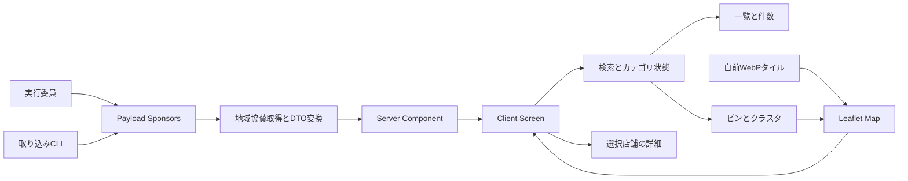
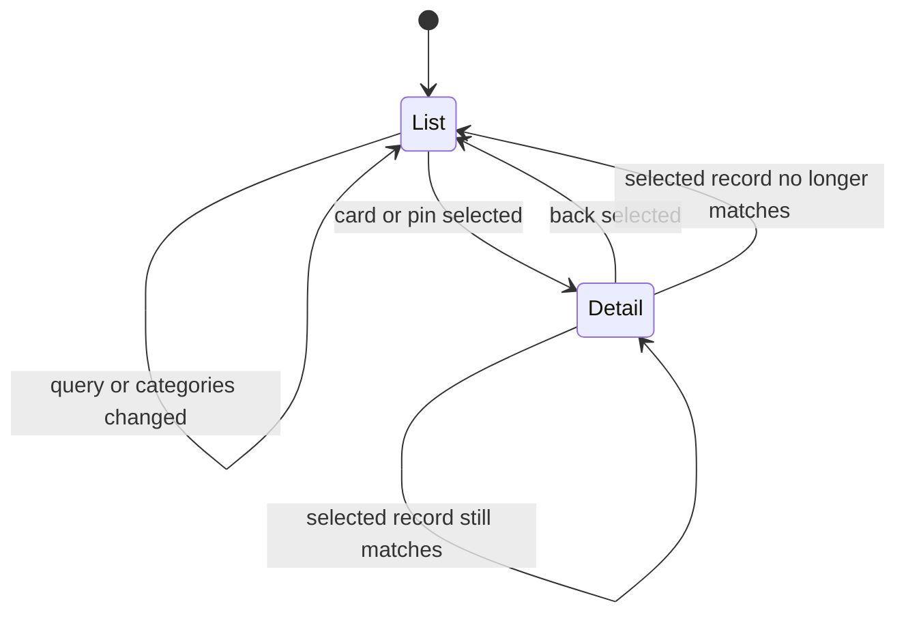
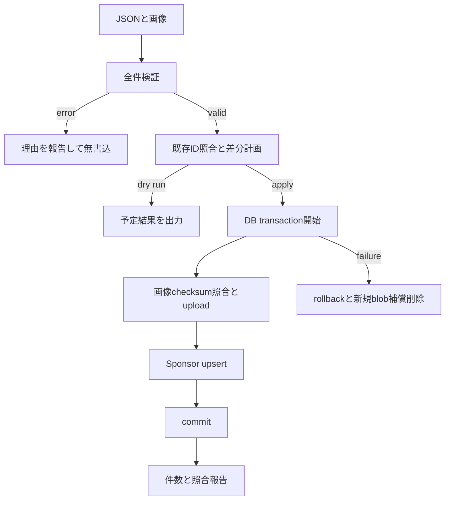

# 地域協賛マップ 技術設計

## 1. 概要

`/sponsors/local` に、地域協賛の地図、検索、6カテゴリの複数選択、店舗一覧、店舗詳細を1画面で提供する。PCでは左サイドパネル、スマートフォンではボトムシートを使い、最終確定Figmaの4画面をそのまま実装基準とする。

既存の `Sponsors` コレクション、CMS取得基盤、会場マップのLeaflet・自前タイル・メニュー・ズーム・ボトムシート機構を再利用する。地域協賛固有のデータ変換、カード、詳細、フィルタ、クラスタだけを追加し、新しい地図ライブラリや公開ワークフローは導入しない。

### 1.1 目標

- 承認済み13要件・110件のAcceptance Criteriaを、Tasksへ直接分解できる境界とインターフェースで具体化する。
- FigmaのPC一覧、PC詳細、スマートフォン一覧、スマートフォン詳細を忠実に再現する。
- 地域協賛の増減を固定件数に依存せず、一覧・件数・ピン・クラスタへ同期する。
- 正式データ受領後に追加設計せず、検証、冪等取り込み、画像紐付け、地域タイル生成へ進める構成にする。
- 会場マップと他の協賛表示を回帰させない。

### 1.2 非目標

- 地域協賛の実データ、画像、座標の作成・投入
- Figmaの変更、補完、再設計
- 地域協賛専用の公開ステータス、承認フロー、管理画面
- 地図表示範囲による店舗一覧の絞り込み
- 店舗詳細ごとのURL、URLパラメータによる検索状態の共有
- ナビゲーション、ヘッダー、フッター、既存協賛表示の再設計
- Design承認、Tasks作成、実装、デプロイ

## 2. 境界と責務

### 2.1 システム境界

| 境界             | 入力                                         | 出力                                        | 所有責務                                               |
| ---------------- | -------------------------------------------- | ------------------------------------------- | ------------------------------------------------------ |
| Payload CMS      | 実行委員が管理する協賛・メディア             | 既存REST APIと生成型                        | 保存、検証、既存公開管理、並び順                       |
| 取り込みCLI      | UTF-8 JSON、画像ディレクトリ、実行オプション | 検証報告、dry-run、冪等upsert結果           | 全件検証、transaction、重複防止                        |
| Server Component | CMS APIの `Sponsor[]`                        | 公開用 `RegionalSponsor[]` または取得エラー | local抽出、掲載条件判定、安全なDTO変換、60秒キャッシュ |
| Client Screen    | DTO、Figmaに対応する初期状態                 | 地図、一覧、詳細、操作状態                  | 検索、カテゴリ、選択、レスポンシブ表示                 |
| Map View         | 絞り込み済みDTO、選択ID、タイル設定          | Leafletレイヤー、ピン、クラスタ             | 地理座標の投影、表示範囲、地図操作                     |
| 自前タイル生成   | 正式座標から確定したprofile、OSM PBF         | WebPタイルと検証報告                        | 実行時に第三者タイルへ依存しない配信物                 |

### 2.2 変更を許可する範囲

- 地域協賛用ページ、コンポーネント、純粋関数、テスト
- `Sponsors` への後方互換な `local_*` フィールド追加、migration、生成型更新
- 既存ボトムシートとviewport制御からの汎用機構抽出
- 既存タイル生成処理のprofile対応
- ルート分類、サイトマップ、メタデータへの `/sponsors/local` 追加

### 2.3 変更しない契約

- `Sponsors.type`、`name`、`logo`、`url`、`description`、`business_category`、`address`、`tier`、出店配置項目の既存意味
- `local` 以外の協賛レコードと既存表示条件
- 会場マップのURL、タイルURL、範囲、ポリゴン、検索、シートのsnap値、地図操作
- CMSの既存アクセス方針と公開管理
- 既存のデザイントークン値

## 3. システム構成

`/sponsors/local` は全画面route groupに置くServer Componentとし、CMS取得結果をClient Screenへ渡す。Leafletを参照するMap Viewだけを `ssr: false` で遅延読込する。



### 3.1 レンダリング方針

1. Server Componentが `getRegionalSponsorMapData` を呼ぶ。
2. 正常時は公開用DTOだけを直列化してClient Screenへ渡す。
3. CMS取得失敗時はエラー種別だけを渡し、地図自体は構成する。
4. Client Screenは同じ状態からPC UIとスマートフォン UIを構成する。
5. 非表示側はCSSだけで隠さず、既存breakpoint hookと `hidden`、`inert`、`aria-hidden` を同期し、操作対象から外す。
6. CMS更新は既存の60秒キャッシュ方針に従い、再デプロイなしで反映する。再試行は `router.refresh()` を使う。

全画面route groupのlayoutを使用し、サイト共通ヘッダーとフッターは描画しない。他ページへの導線はFigmaどおり既存 `MapMenuButton` に集約する。書体は既存の `font-display` と `font-sans`、余白・角丸・枠・影は既存Tailwind themeと会場マップの値を使い、地域協賛専用tokenを追加しない。

## 4. ファイル構成計画

### 4.1 フロントエンド

| パス                                                                             | 種別       | 単一責務                                                        |
| -------------------------------------------------------------------------------- | ---------- | --------------------------------------------------------------- |
| `frontend/src/app/(fullscreen)/sponsors/local/page.tsx`                          | 新規       | CMS取得、メタデータ、Client Screen境界                          |
| `frontend/src/components/regional-sponsor-map/regional-sponsor-map-screen.tsx`   | 新規       | 全クライアント状態とPC・スマートフォン構成の統合                |
| `frontend/src/components/regional-sponsor-map/regional-sponsor-map-view.tsx`     | 新規       | Leaflet MapContainer、タイル、viewport、ローディング・失敗通知  |
| `frontend/src/components/regional-sponsor-map/regional-sponsor-marker-layer.tsx` | 新規       | 単独ピン、選択ピン、クラスタ、同一座標展開                      |
| `frontend/src/components/regional-sponsor-map/regional-sponsor-panel.tsx`        | 新規       | PC用左パネルと一覧・詳細の切替                                  |
| `frontend/src/components/regional-sponsor-map/regional-sponsor-bottom-sheet.tsx` | 新規       | スマートフォン用シート設定と一覧・詳細の切替                    |
| `frontend/src/components/regional-sponsor-map/regional-sponsor-search.tsx`       | 新規       | 検索入力と6カテゴリ操作                                         |
| `frontend/src/components/regional-sponsor-map/regional-sponsor-list.tsx`         | 新規       | 見出し、件数、空状態、スクロール位置                            |
| `frontend/src/components/regional-sponsor-map/regional-sponsor-card.tsx`         | 新規       | Figma準拠カード                                                 |
| `frontend/src/components/regional-sponsor-map/regional-sponsor-detail.tsx`       | 新規       | Figma準拠詳細、任意項目の省略、戻る操作                         |
| `frontend/src/components/regional-sponsor-map/sponsor-image.tsx`                 | 新規       | 一覧・詳細共通の画像、alt、失敗時placeholder                    |
| `frontend/src/components/regional-sponsor-map/use-regional-sponsor-map-state.ts` | 新規       | 検索、カテゴリ、選択、focus、scroll、sheet状態                  |
| `frontend/src/components/map/map-bottom-sheet-shell.tsx`                         | 新規       | 会場・地域共通のdrag、snap、keyboard、inert機構                 |
| `frontend/src/components/map/map-viewport-controller.tsx`                        | 新規       | 設定注入可能なfit、maxBounds、resize制御                        |
| `frontend/src/components/campus-map/map-bottom-sheet.tsx`                        | 変更       | 汎用shellへ既存値を渡す薄い会場マップラッパー                   |
| `frontend/src/components/campus-map/map-viewport-sync.tsx`                       | 変更       | 汎用controllerへ既存設定を渡し公開APIを保持                     |
| `frontend/src/lib/regional-sponsors.ts`                                          | 新規       | CMS取得、掲載条件判定、公開DTO変換                              |
| `frontend/src/lib/regional-sponsor-search.ts`                                    | 新規       | 正規化とAND・ORフィルタの純粋関数                               |
| `frontend/src/lib/regional-sponsor-clustering.ts`                                | 新規       | 画面座標クラスタと同一座標展開モデル                            |
| `frontend/src/lib/regional-map-config.ts`                                        | 新規       | 地域タイルprofile、初期範囲、zoom契約                           |
| `frontend/src/lib/phase.ts`                                                      | 変更       | 全画面公開routeの分類を明示                                     |
| `frontend/src/lib/route-metadata.ts`                                             | 変更       | `/sponsors/local` のtitle、descriptionを登録                    |
| `frontend/src/lib/crawl-targets.ts`、`frontend/src/app/sitemap.ts`               | 変更       | 二階層routeを明示的にサイトマップへ含める                       |
| `frontend/src/app/globals.css`                                                   | 変更       | Leafletピン、クラスタ、選択、placeholderの既存token利用スタイル |
| 近接する `*.test.ts`、`*.test.tsx`                                               | 新規・変更 | 各純粋関数、コンポーネント、回帰契約                            |

`MapMenuButton`、`MapZoomControl`、`useIsAboveMapBreakpoint` は現行パスからそのままimportし、移動しない。

### 4.2 CMSと取り込み

| パス                                                    | 種別     | 単一責務                                        |
| ------------------------------------------------------- | -------- | ----------------------------------------------- |
| `cms/src/collections/sponsors.ts`                       | 変更     | `local_*` フィールドと条件付き管理UI            |
| `cms/src/hooks/local-sponsor-map.ts`                    | 新規     | localレコードの条件付き正規化・整合性検証       |
| `cms/src/hooks/local-sponsor-map.test.ts`               | 新規     | 境界値、任意値、他種別の非干渉                  |
| `cms/scripts/local-sponsor-import.ts`                   | 新規     | JSON解析、全件検証、差分計画の純粋ロジック      |
| `cms/scripts/import-local-sponsors.ts`                  | 新規     | CLI、Payload接続、transaction、画像upsert、報告 |
| `cms/scripts/local-sponsor-import.test.ts`              | 新規     | dry-run、重複、rollback、冪等性、保護           |
| `cms/package.json`                                      | 変更     | 明示的な取り込みscript                          |
| `cms/src/migrations/<timestamp>_regional_sponsor_map.*` | 新規     | 追加カラム、index、制約のschema migration       |
| `cms/src/migrations/index.ts`                           | 変更     | 新migration登録                                 |
| `cms/src/payload-types.ts`                              | 生成更新 | CMSの正式生成型                                 |
| `frontend/src/cms-types.ts`                             | 同期更新 | フロントエンドのCMS生成型                       |

### 4.3 タイル生成

| パス                                                  | 種別     | 単一責務                                        |
| ----------------------------------------------------- | -------- | ----------------------------------------------- |
| `frontend/src/lib/map-tile-profile.ts`                | 新規     | `campus` と `regional` の型、境界、zoom、出力先 |
| `frontend/src/lib/campus-map-config.ts`               | 変更     | 現在値を `campus` profileとして公開             |
| `frontend/scripts/map-tile-bounds.ts`                 | 変更     | profile別の範囲・枚数計算                       |
| `frontend/scripts/fetch-map-tiles.ts`                 | 変更     | profile別のPNG取得                              |
| `frontend/scripts/convert-map-tiles.ts`               | 変更     | profile別のWebP変換                             |
| `frontend/scripts/verify-map-tiles.ts`                | 変更     | profile別の欠損、形式、上限検証                 |
| `.github/workflows/generate-map-tiles.yml`            | 変更     | 手動実行時にprofileを選択し、成果物名を分離     |
| `frontend/public/regional-map-tiles/{z}/{x}/{y}.webp` | 後続生成 | 正式座標確定後の地域用静的タイル                |

## 5. データモデル

### 5.1 CMSフィールド

`Sponsors` へ次を追加する。すべて管理UIでは `type` が `local` を含む場合だけ表示する。既存項目は削除・改名しない。

| CMSフィールド            | 型                     | 必須条件                         | 用途・検証                                                   |
| ------------------------ | ---------------------- | -------------------------------- | ------------------------------------------------------------ |
| `local_import_id`        | text、unique、indexed  | 取り込み時は必須、手入力では任意 | 同一所在地の冪等upsertキー。空白はnull                       |
| `local_map_category`     | select                 | local掲載時                      | `hospital`、`life`、`car`、`education`、`food`、`shop` の1値 |
| `local_latitude`         | number、admin readOnly | local掲載時                      | 住所保存時にCMS hookで算出。有限数、-90以上90以下            |
| `local_longitude`        | number、admin readOnly | local掲載時                      | 住所保存時にCMS hookで算出。有限数、-180以上180以下          |
| `local_image`            | upload to media        | 任意                             | 企業指定の掲載画像1枚                                        |
| `local_image_alt`        | text                   | 情報画像のとき                   | 画像内容を表す代替テキスト                                   |
| `local_image_decorative` | checkbox               | 任意、既定false                  | trueならaltを空にして読み上げ対象外                          |
| `local_business_hours`   | textarea               | 任意                             | 提供された営業時間または診療時間をそのまま保存               |
| `local_closed_days`      | textarea               | 任意                             | 提供された定休日または休診日をそのまま保存                   |
| `local_phone`            | text                   | 任意                             | 先頭0、記号、内線を保つ。数値化しない                        |
| `local_image_checksum`   | text、admin readOnly   | 取り込み画像があるとき           | SHA-256。再取り込み時の画像重複防止                          |

次の既存項目を地域協賛に再利用する。

| 既存フィールド | 地域協賛での意味       |
| -------------- | ---------------------- |
| `type`         | `local` を含むこと     |
| `name`         | 正式な企業・店舗名     |
| `address`      | 住所                   |
| `description`  | 紹介文・応援メッセージ |
| `url`          | 公式WebサイトURL       |
| `_order`       | 一覧表示順             |

`url` のlocalレコードに限り、空または `http:`、`https:` の絶対URLを許可する。`local_image` がある場合、`local_image_alt` の非空文字列または `local_image_decorative=true` のどちらか一方を要求する。管理画面の保存時検証と、公開用DTO変換時の防御的検証を両方行う。

既存DBに追加項目未設定のlocal行があってもmigrationは値を捏造しない。公開用DTO変換は必須条件を満たす行だけを掲載し、除外理由をレコードID付き構造化ログへ残す。

### 5.2 公開用型

```ts
export type RegionalSponsorCategory = NonNullable<
  Sponsor["local_map_category"]
>;

export interface RegionalSponsor {
  readonly id: number;
  readonly name: string;
  readonly category: string;
  readonly latitude: number;
  readonly longitude: number;
  readonly address: string | null;
  readonly imageId: string | null;
  readonly imageAlt: string | null;
  readonly imageDecorative: boolean;
  readonly message: string | null;
  readonly businessHours: string | null;
  readonly closedDays: string | null;
  readonly phone: string | null;
  readonly websiteUrl: string | null;
  readonly order: number;
}

export type RegionalSponsorMapDataResult =
  | { readonly ok: true; readonly sponsors: readonly RegionalSponsor[] }
  | { readonly ok: false; readonly error: "unavailable" };
```

DTOには管理用識別子、checksum、他種別のフィールドを含めない。URLは変換時にも `URL` でparseし、`http:` と `https:` 以外は `null` にする。テキストはReactの通常のtext nodeとして描画し、HTMLとして解釈しない。

Payloadの生成型ではupload relationが `number | null | Media` となる。既存 `toMediaId` はこの型を受けて `string | null` を返し、`toAssetUrl` も `string | null` を受けるため、DTOの `imageId: string | null` は既存契約と一致している。変換時は `toMediaId(s.local_image)` を使用し、unsafe castや別のID変換を追加しない。

### 5.3 カテゴリ定義

カテゴリのruntime値はCMSのselect optionsを唯一の定義とし、Frontendの型はPayload生成型から得る。表示名・色・ピンassetはFrontendの表示mappingへ分離し、未知の値はレコードを除外せず中立色の「未分類」として表示する。

| 値          | 表示名   | 既存トークン      | HEX       |
| ----------- | -------- | ----------------- | --------- |
| `hospital`  | 病院     | `bansai-rose`     | `#e0666d` |
| `life`      | 生活     | `bansai-sage`     | `#aeb49c` |
| `car`       | 車       | `bansai-aqua`     | `#a2c2c6` |
| `education` | 教育     | `bansai-wisteria` | `#d2c6da` |
| `food`      | 飲食     | `bansai-ochre`    | `#e4ab53` |
| `shop`      | ショップ | `bansai-olive`    | `#c9bf86` |

新しいカラートークンは作らない。ピン、一覧のカテゴリドット、詳細タグは同じmappingを使い、検索チップの選択状態はFigmaどおりprimary色を使う。

## 6. CMS取得と掲載条件

`getRegionalSponsorMapData` は既存 `cms.findMany('sponsors', { sort: ['_order', 'id'], limit: 0, depth: 0 })` を使う。既存取得型にhasMany専用operatorを増やさず、全協賛を取得後に `type.includes('local')` で抽出する。現行データ規模では単純で、既存 `getSponsors` と同じ取得契約を維持できる。

掲載可能条件は次のすべて。

- `type` が `local` を含む
- `name` が空白でない
- `local_map_category` が空でない（未知の値は中立表示へフォールバック）
- 緯度・経度が有限かつ範囲内
- 緯度・経度が固定regionalサービス範囲内

任意文字列は前後空白だけを正規化し、本文の改行や表記は変えない。CMS順を優先し、同順位はID昇順で決定的にする。返す件数、一覧、ピン、クラスタはこの掲載可能DTOの配列長から生成し、34を定数にしない。

## 7. ページとコンポーネント

### 7.1 PC

- 地図はviewport全体に配置する。
- 左24px、上24px、幅348px、高さ `calc(100dvh - 48px)` のパネルを置く。1440×900ではFigmaの852pxになる。
- パネル内paddingは24px、内容幅は300pxとする。
- 一覧状態は検索46px、2段カテゴリ72px、件数見出し64px、divider、124pxカードを16px間隔で表示する。
- 詳細状態は40pxの戻る操作、300×169の16:9画像領域、名称、カテゴリ、任意のメッセージ・基本情報を同一パネル内で縦スクロールする。
- メニューは右上、ズームは右下に既存コンポーネントを置く。

### 7.2 スマートフォン

- 上部overlayは検索行と、1行横スクロールのカテゴリ操作で構成する。
- 390×844基準で検索・メニュー領域は16px余白、カテゴリ行はその下に置く。
- 一覧はFigmaの半展開位置を初期snapとし、358px幅の124pxカードを16px間隔で表示する。
- 詳細選択時はFigmaの詳細用snapへ移動し、戻る、358×201の16:9画像、詳細本文をシート内でスクロールする。
- `env(safe-area-inset-*)` を上部overlay、シート下端、地図操作余白へ反映する。
- viewport高さには `100dvh` を使い、ページbodyの横・縦スクロールを発生させない。

Figma寸法は代表viewportで固定検証し、それ以外は同じ余白・最大幅・safe areaを保ちながら既存breakpointで連続的に収める。

### 7.3 一覧と詳細

カードは正式名称、カテゴリ、登録済み住所、画像または共通の画像なし表示を描画する。カード全体をbutton相当の操作面とし、DOM順とCMS順を一致させる。

詳細は次の順に描画する。

1. 「店舗一覧に戻る」
2. 掲載画像または画像なし表示
3. 正式名称
4. カテゴリタグ
5. メッセージ節
6. 基本情報節

病院は営業時間・定休日の統合見出しを「診療時間・休診日」、その他は「営業時間・定休日」とする。`local_business_hours` と `local_closed_days` は提供文を変更せず、同じ見出しの下でそれぞれ `white-space: pre-wrap` により表示する。一方だけでも表示し、両方なければ見出しごと省略する。

住所、電話、Webサイトも値があるときだけ行を作る。節内が空なら節見出しとdividerも作らない。Webサイトは「公式Webサイト（外部サイト）」というアクセシブルネーム、外部リンクicon、`target="_blank"`、`rel="noopener noreferrer"` を持つ。

### 7.4 画像

`SponsorImage` に同じ `imageId` を渡し、一覧ではカード向け幅、詳細では詳細向け幅を `toAssetUrl` で要求する。元データは1枚であり、優先順位判定は持たない。

- コンテナはFigma寸法、画像は `object-fit: contain`、中央配置とする。
- altは情報画像なら登録値、装飾画像なら空文字列にする。
- 未登録時は共通placeholderを描画する。
- `onError` 後は壊れた画像を非表示にし、同じplaceholderへ切り替える。
- placeholderは既存のgray、border、iconを使い、新しい代替画像を生成しない。

## 8. クライアント状態と画面遷移

### 8.1 状態

```ts
interface RegionalSponsorMapState {
  readonly query: string;
  readonly selectedCategories: ReadonlySet<RegionalSponsorCategory>;
  readonly selectedSponsorId: number | null;
  readonly listScrollTop: number;
  readonly mobileSheetSnap: "collapsed" | "list" | "expanded" | "detail";
  readonly spiderfiedClusterId: string | null;
}
```

`selectedCategories.size === 0` を「すべて」とする。「すべて」の選択はSetを空にし、空の状態から個別カテゴリを押すとその1値を追加する。複数カテゴリはOR、検索語とはANDである。

一覧と地図は同じ `filteredSponsors` を読む。件数は `filteredSponsors.length`、ピン・クラスタも同じ配列から導出し、個別の件数状態を持たない。

### 8.2 遷移



- カード選択時にcard要素IDと一覧scrollTopを保存し、詳細先頭の見出しへfocusする。
- ピン選択時は詳細先頭へfocusし、戻ると対応カードまたは一覧見出しへfocusする。
- 戻る操作は検索語、カテゴリ、Leafletのcenter・zoom、一覧scrollTopを変更しない。
- 戻った描画後に保存したscrollTopを復元し、元カードが存在すればそこへfocusする。
- 詳細表示中に条件変更で選択行が対象外になった場合は一覧へ戻し、更新後の件数を通知する。
- ブラウザURLやhistoryは変更せず、同一ページ内状態として扱う。

### 8.3 検索

検索用文字列は `value.normalize('NFKC').toLocaleLowerCase('ja-JP')` で正規化する。正式名称、カテゴリの日本語表示名、住所を同じ方法で比較し、制御文字やHTMLらしい文字も除去・実行せず単なる文字列として部分一致する。

データはブラウザ取得済み配列を `useMemo` で即時絞り込みし、検索・カテゴリ操作でネットワーク通信やページ再読込を行わない。地図移動イベントはクラスタ投影だけを更新し、`filteredSponsors` を変えない。

## 9. 地図、ピン、クラスタ

### 9.1 地図構成

- `MapContainer`、`TileLayer`、既存の透過エラータイル、OSM attributionを使用する。
- `MapViewportController` に地域profileの初期中心・zoom、選択座標、パネル余白を渡す。
- 初回は既存会場マップの確定済みキャンパス範囲中央を、会場マップと同じ最小zoomで表示する。全有効座標への `fitBounds` は行わない。
- カードまたはピンから店舗を選択したときは、PC左パネルまたはスマートフォンの詳細シートを除く表示領域の中央へ選択ピンを移動する。通常は短い `flyTo`、reduced motion時は非アニメーションの `setView` を使う。
- データ0件または取得失敗時も同じ初期中心を表示する。地域profileのboundsは年度ごとの協賛企業に依存しない固定サービス範囲とする。
- 初期中心は初回だけ適用し、resize、一覧・詳細切替、filter変更だけでcenter・zoomを戻さない。選択後にuserが地図操作した場合も、同じ選択へ自動追従し続けない。
- `maxBounds`、`minZoom`、`maxZoom` は地域profileに従い、範囲外を表示しない。
- zoom、pan、pinch、wheelと既存ズーム操作をLeaflet標準で提供する。

### 9.2 ピン

各ピンはcategory mappingから同じtoken classを得る。PC48px、スマートフォン32pxでFigma形状を描画し、アクセシブルネームを「{正式名称}、{カテゴリ}」とする。選択ピンは元のカテゴリ色を保ち、既存outline token、太い枠、`aria-current`、上位z-indexで色以外にも区別する。

緯度・経度はLeafletの `LatLng` へ直接渡し、CSS offsetはicon anchorにだけ適用する。同一座標展開中を除き、見た目の重なり回避のために地理座標を変更しない。

### 9.3 クラスタ

`regional-sponsor-clustering.ts` はLeaflet map本体に依存しない。

```ts
interface ProjectedSponsor {
  readonly sponsor: RegionalSponsor;
  readonly x: number;
  readonly y: number;
}

type MarkerGroup =
  | { readonly kind: "single"; readonly sponsor: RegionalSponsor }
  | {
      readonly kind: "cluster";
      readonly id: string;
      readonly sponsors: readonly RegionalSponsor[];
      readonly anchor: {
        readonly latitude: number;
        readonly longitude: number;
      };
    };
```

処理順は次のとおり。

1. 絞り込み済み各座標を `map.project(latLng, zoom)` で画面座標へ変換する。
2. marker径に対応する固定pixel半径で空間hashを作る。
3. 自cellと隣接8cellを調べ、重なる点をdisjoint-setで結合する。
4. ID順に並べ、単独点とクラスタを決定的に返す。
5. `zoomend`、`moveend`、resize、絞り込み結果変更時に再計算する。

選択中の店舗はクラスタ入力から除いて元座標に単独表示する。クラスタはFigmaの雫型ピンを中立色で表示し、Figmaにない件数バッジは重ねない。件数と内訳はアクセシブル名で伝える。

クラスタ選択時は次の分岐とする。

- 異なる座標へ分離可能：子のboundsへpanel/sheet余白付きで `fitBounds` し、最大zoomを超えない。
- 最大zoomまたは全件同一座標：元座標を中心に画面pixel上で一時的に放射状展開し、各ピンをbuttonとして選べるようにする。

放射状展開は地図移動、zoom、絞り込み変更、背景選択、詳細選択で閉じる。クラスタbuttonの名前は「{件数}件の地域協賛。選択して拡大」とする。一覧カードは常に同等の到達手段として残す。

クラスタ自体はカテゴリを表さないため、既存の白・gray・文字色tokenで件数を表示する。カテゴリを表す単独ピンとタグだけに6色mappingを適用し、混在クラスタへ任意のカテゴリ色を割り当てない。

### 9.4 タイル状態

`TileLayer` のload完了までは地図上に非妨害の読み込み表示を出す。`tileerror` が1件でも発生した場合は地図上に通知を出し、透明error tileへ置換する。エラーは一覧・詳細を覆わず、`role="status"` または `role="alert"` で通知する。再移動・再読込で成功したタイルは通常表示へ戻す。

## 10. 地図タイルの拡張

### 10.1 profile

```ts
interface MapTileProfile {
  readonly id: "campus" | "regional";
  readonly bounds: readonly [
    readonly [number, number],
    readonly [number, number],
  ];
  readonly minZoom: number;
  readonly maxZoom: number;
  readonly minNativeZoom: number;
  readonly maxNativeZoom: number;
  readonly publicDirectory: string;
  readonly urlTemplate: string;
  readonly expectedMaxTileCount: number;
  readonly expectedMaxBytes: number;
}
```

`campus` は現在の設定と `/map-tiles/{z}/{x}/{y}.webp` をそのまま持つ。`regional` は `/regional-map-tiles/{z}/{x}/{y}.webp` を持つ。生成・検証scriptはprofile引数を必須とし、未指定で別profileを上書きしない。

### 10.2 地域profile確定手順

年度ごとの受領データから独立した固定の地域サービス範囲を定める。

1. 前橋市街と荒牧キャンパス周辺で継続的に提供する範囲を候補にする。
2. PC・スマートフォンのpanel/sheetを考慮したpan許容余白を加える。
3. 各native zoomのXYZタイル範囲、枚数、推定WebP容量をdry-runする。
4. PC・スマートフォンで地名の判読性と全店舗の包含を確認する。
5. 採用したbounds、native zoom、最大枚数、最大容量を `regional` profileに確定する。
6. verify scriptで欠損、範囲外タイル、形式、枚数、容量を検証する。

採用値は `map-tile-profile.ts` の固定profileを正とし、協賛企業が変わっても自動拡張しない。範囲外の企業はFrontendの公開DTO変換で除外し、レコードIDと理由を警告する。

### 10.3 生成と共存

workflowは手動の `profile` choiceを受け、Kanto PBFからprofile bboxを切り出し、既存rendererでPNGを作成し、WebPへ変換、検証してprofile名付きartifactにする。地域profileの出力は会場profileのディレクトリとartifactを共有しない。

実行時は同梱された静的WebPだけを参照し、第三者tile endpointへfallbackしない。OSM由来であることとライセンスリンクは常時表示する。

## 11. データ一括取り込み

### 11.1 入力契約

入力はUTF-8 JSON配列と画像ディレクトリである。1オブジェクトを1所在地とする。

```ts
type LocalSponsorImportCategory =
  "hospital" | "life" | "car" | "education" | "food" | "shop";

interface LocalSponsorImportRow {
  readonly importId: string;
  readonly name: string;
  readonly category: LocalSponsorImportCategory;
  readonly latitude: number;
  readonly longitude: number;
  readonly address: string | null;
  readonly imageFile: string | null;
  readonly imageAlt: string | null;
  readonly imageDecorative: boolean;
  readonly message: string | null;
  readonly businessHours: string | null;
  readonly closedDays: string | null;
  readonly phone: string | null;
  readonly websiteUrl: string | null;
  readonly order: number | null;
}
```

任意項目の `null` はCMS上の空欄を意味する。省略値を架空値で補わない。`imageFile` は入力画像ディレクトリ直下または配下の相対パスだけを許可し、`path.resolve` 後にroot外へ出る参照を拒否する。

取り込み境界ではCMS selectのcanonical 6値だけを受け付ける。別名や大文字小文字の推測変換は行わず、表記ゆれは投入前のデータ側で修正する。

### 11.2 検証

書き込み前に全行へ次を適用する。

- JSON構造、型、空白でない `importId` と `name`
- 入力内 `importId` の一意性
- CMS内 `local_import_id` の一意性
- categoryをCMS selectのcanonical 6値として検証する
- 座標の有限性と緯度経度範囲
- websiteUrlの `http:`、`https:`
- imageFileの存在、許可された画像MIME、root内参照
- 画像ありの場合のaltまたはdecorative
- orderの整数性

全エラーを `importId`、配列index、field、理由で収集する。1件でもあれば終了コードを失敗にし、Payloadのcreate/updateを1件も呼ばない。

### 11.3 dry-runと適用

既定はdry-runとし、追加・更新・変更なし・エラーの件数とID、画像差分、入力件数を出力する。`--apply` を明示したときだけ書き込む。初回データ確認に限り `--expected-count 34` を指定できるが、CMSや画面の固定値にはしない。



### 11.4 冪等性と保護

- 照合は `local_import_id` だけで行い、名称・住所による推測照合をしない。
- 同じchecksumなら既存 `local_image` を再利用し、新しいmediaを作らない。
- checksumが変わった場合だけ新mediaをuploadし、relationを更新する。
- 既存Sponsor更新時は `type` に `local` を追加または維持し、`ad`、`vendor`、`other`、`tier`、`logo`、`business_category`、出店配置を保持する。
- 取り込み対象外のSponsorを削除しない。入力から消えた行は「未入力」と報告するだけで、自動削除しない。
- DB transaction IDをすべてのPayload操作へ渡す。途中失敗はrollbackし、新規upload済みblobは補償削除する。
- 旧画像の削除はcommit後、他レコード参照がないことを確認できた場合だけ行う。判定不能なら残して警告する。

### 11.5 公開前照合

適用後に入力件数、create/update/unchanged、掲載可能件数、必須項目、座標、画像relation、画像判読確認対象、外部リンク確認対象を出力する。34件の初回は `--expected-count 34` を通し、地図上の全ピン位置と画像・リンクは実行委員が公開前チェックリストで確認する。

### 11.6 検証環境から本番への適用

現行 `sponsors` は `PUBLISHED_FILTER` の対象外で、地域協賛専用statusも持たない。そのため本番CMSへ保存したレコードは未認証REST APIから直ちに読み取り可能となり、公式サイトには既存キャッシュの最大60秒後に反映される。新しい承認状態は設けず、次の運用ゲートを本番書き込みの前に置く。

1. 受領したJSONと画像を固定し、ファイル一覧とSHA-256を記録する。
2. CMS専用stagingは存在しないため、既存の使い捨てPostgreSQLと本番同等CMSイメージを使うローカル検証環境へmigrationを適用する。
3. 検証環境でdry-runを通した後に `--apply` し、同環境を参照するローカルフロントエンドで、件数、全必須項目、画像、座標、ピン、カテゴリ、外部リンク、PC・スマートフォン表示を確認する。
4. 検証結果と入力checksumを保存し、確認済みbundleを変更不可の本番投入単位とする。
5. 本番では同じbundleで再度dry-runし、検証環境の計画と件数・`importId`・checksumが一致しない場合は適用を中止する。
6. 一致した場合だけ本番へ `--apply` し、反映後に匿名REST取得と公式サイトを再確認する。

この手順は既存環境とCLIだけを使い、新しい管理画面、公開status、承認ワークフローを追加しない。

## 12. エラー・空状態

| 状況                     | 表示・処理                                                   |
| ------------------------ | ------------------------------------------------------------ |
| CMSに掲載可能レコード0件 | 地図と操作枠を保持し、「掲載可能な地域協賛情報はありません」 |
| 検索結果0件              | 件数0と条件変更を促す文言。地図ピン・クラスタは0件           |
| CMS取得失敗              | fallback地図と操作枠を保持し、一覧領域に説明と再試行button   |
| 一部レコード不正         | 不正行だけ除外し、サーバーログへIDと理由。残りを表示         |
| URL未登録・無効          | リンク行を作らない                                           |
| 画像未登録・失敗         | 共通placeholderへ切替。名称は維持                            |
| 地図tile失敗             | 透明tileと非妨害通知。一覧・詳細・検索は継続                 |
| 取り込み検証失敗         | 全理由を報告し無書込                                         |
| 取り込み途中失敗         | DB rollbackと新規blob補償削除、失敗IDを報告                  |

## 13. アクセシビリティ

- 検索は可視labelまたは同等のアクセシブルネームを持つ。
- category buttonは `aria-pressed`、選択icon・枠・文言を持ち、色だけに依存しない。
- card、戻る、menu、zoom、cluster、単独pin、外部linkをkeyboard操作可能にする。
- 更新件数は控えめな `aria-live="polite"` で通知する。
- 詳細遷移時は詳細見出し、戻る時は起点cardへfocusする。
- 地図を操作できなくても一覧から全詳細へ到達できる。
- ボトムシートhandleはbuttonとして、既存の矢印キー・Home・End・Enter操作を維持する。
- pointer drag中も、scroll領域とhandle領域の競合を既存shellで制御する。
- 非表示のPCまたはスマートフォンUIは `inert`、`aria-hidden` とfocus管理から外す。
- 選択pinはoutline・z-index・`aria-current`、errorはicon・文言・live regionを併用する。
- reduced motion設定ではsheetとpin展開のtransitionを無効化する。

## 14. テスト戦略

### 14.1 CMS・取り込み単体

- local条件付き必須、CMS selectの6カテゴリ、住所からの座標算出、URL protocol、電話文字列、画像alt/decorative
- local以外に新検証を適用しないこと
- JSONの型、重複ID、画像不存在、path traversal、MIME、全件検証
- category別名と未知categoryの拒否
- 1件の失敗でもwrite 0件であること
- 同じ入力の再実行でSponsor・Mediaが増えないこと
- 既存の複数typeと地域外フィールドを保持すること
- transaction失敗時のrollbackと補償削除

### 14.2 フロントエンド単体

- CMSからlocalだけを抽出し、不正行だけを除外する
- CMS順とID tie-break、動的件数
- `NFKC`、大文字小文字、名称・カテゴリ・住所の部分一致
- 複数カテゴリORと検索AND、「すべて」の状態遷移
- 表示範囲変更で一覧が変わらないこと
- clusteringのzoom別結果、filter後件数、選択pin分離、同一座標展開
- optional fieldの完全省略、病院とその他の見出し
- 画像contain、alt、decorative、未登録・onError placeholder
- list/detail遷移、scroll・focus・地図状態保持
- CMS、tile、空結果の各状態

### 14.3 統合・回帰

- migration適用とPayload生成型の同期
- 既存CMS公開アクセスで地域協賛が取得でき、専用statusがないこと
- 検証環境と本番dry-runの件数・`importId`・入力checksumが一致しない場合に本番適用を中止すること
- 60秒cache経由の更新反映と再試行
- `/sponsors/ad`、トップ協賛、signage snapshotで既存ロゴ・type・tierが維持されること
- `/map` のbounds、polygon、検索、sheet snap、menu、zoomが変更前と同じこと
- `campus` tile profileのURL、範囲、枚数検証が変わらないこと
- `regional` が別directory・artifactだけへ出力すること

### 14.4 E2Eと視覚確認

Playwrightで1440×900と390×844を固定viewportとして、Figma4画面と比較する。

- 一覧・詳細の位置、寸法、余白、字体、色、角丸、枠、影
- PC左パネル、スマートフォン半展開・詳細展開・横スクロール
- search、複数category、0件、件数・card・pin・cluster同期
- card・pin・cluster・同一座標展開・戻る状態保持
- missing/failed image、partial invalid data、CMS error、tile error
- keyboard順、focus復帰、live region、非表示UIの非操作性
- 横scrollなし、safe area、現行対応browser
- `/map` と既存協賛ページの主要導線

テストfixtureはテストコード内だけの明示的な識別子を使用し、CMS seed、公開データ、実在企業の代替には使わない。

## 15. 要件トレーサビリティ

| Requirement            | Acceptance Criteria                                     | 設計箇所        | 主な検証                                                |
| ---------------------- | ------------------------------------------------------- | --------------- | ------------------------------------------------------- |
| 1 地域協賛マップページ | 1.1, 1.2, 1.3, 1.4, 1.5, 1.6                            | 3、4、6、7      | route、local抽出、4画面、menu E2E                       |
| 2 地図表示と操作       | 2.1, 2.2, 2.3, 2.4, 2.5, 2.6, 2.7, 2.8                  | 9、10           | fit、bounds、zoom、出典、loading、tile profile          |
| 3 データ成立条件       | 3.1, 3.2, 3.3, 3.4, 3.5, 3.6, 3.7, 3.8, 3.9, 3.10, 3.11 | 5、6            | CMS field validation、access、order                     |
| 4 実データ検証         | 4.1, 4.2, 4.3, 4.4, 4.5, 4.6, 4.7, 4.8                  | 11              | parser、dry-run、transaction、idempotency、audit        |
| 5 ピンとクラスタ       | 5.1, 5.2, 5.3, 5.4, 5.5, 5.6, 5.7, 5.8, 5.9             | 5.3、9          | category mapping、cluster、spiderfy、pin選択            |
| 6 検索と絞り込み       | 6.1, 6.2, 6.3, 6.4, 6.5, 6.6, 6.7, 6.8, 6.9, 6.10       | 7、8            | normalization、AND・OR、0件、同期                       |
| 7 一覧カード           | 7.1, 7.2, 7.3, 7.4, 7.5, 7.6, 7.7, 7.8                  | 6、7.3、7.4     | card content、image fallback、order、detail遷移         |
| 8 詳細表示             | 8.1, 8.2, 8.3, 8.4, 8.5, 8.6, 8.7, 8.8, 8.9, 8.10, 8.11 | 7.3、8、9.2     | conditional sections、heading、selection、state restore |
| 9 画像品質             | 9.1, 9.2, 9.3, 9.4, 9.5, 9.6, 9.7, 9.8                  | 5、7.4          | same media、contain、16:9、alt、failure                 |
| 10 レスポンシブ        | 10.1, 10.2, 10.3, 10.4, 10.5, 10.6, 10.7, 10.8, 10.9    | 7.1、7.2、13    | side panel、sheet snap、safe area、no overflow          |
| 11 アクセシビリティ    | 11.1, 11.2, 11.3, 11.4, 11.5, 11.6, 11.7, 11.8          | 8、9、13        | keyboard、names、focus、live、inert                     |
| 12 欠損と失敗          | 12.1, 12.2, 12.3, 12.4, 12.5, 12.6                      | 6、7.4、9.4、12 | empty、retry、invalid exclusion、safe text              |
| 13 共存と品質          | 13.1, 13.2, 13.3, 13.4, 13.5, 13.6, 13.7, 13.8          | 3、4、6、10、14 | dynamic count、cache、no third party、regression        |

## 16. 主要な技術判断と理由

| 判断                                   | 理由                                                                         |
| -------------------------------------- | ---------------------------------------------------------------------------- |
| 既存 `Sponsors` を拡張                 | 一元管理と既存公開方式を保ち、別コレクション同期を避ける                     |
| 地図固有項目だけ `local_*`             | 既存広告・出店・その他協賛への意味変更を防ぐ                                 |
| ServerでDTO化、Clientで操作            | CMS型と不正データを境界で閉じ、操作は再通信なしにする                        |
| 新cluster依存なし                      | Leafletの投影APIと少数データで要件を満たし、bundleと保守対象を増やさない     |
| Bottom Sheet機構だけ共通化             | 複雑なpointer・keyboard処理を重複させず、画面固有UIは混ぜない                |
| JSON一括入力                           | 改行、nullable値、電話、URLを追加parserなしで保持する                        |
| import IDとchecksum                    | レコードと画像の再取り込みを決定的・冪等にする                               |
| tile profile分離                       | 生成ロジックを再利用しながら会場タイルの範囲と成果物を保護する               |
| 地域boundsを固定サービス範囲として管理 | 年度ごとの協賛企業変更でタイルとテストを作り直さず、範囲外は明示的に警告する |

## 17. Designレビュー時の確認事項

追加の製品判断は不要である。固定 `regional` profileのbounds、native zoom、最大枚数、最大容量はタイル生成・完全性検査で維持する。新規レコードが範囲外の場合は、タイル範囲を暗黙に変えず運用判断を求める。
