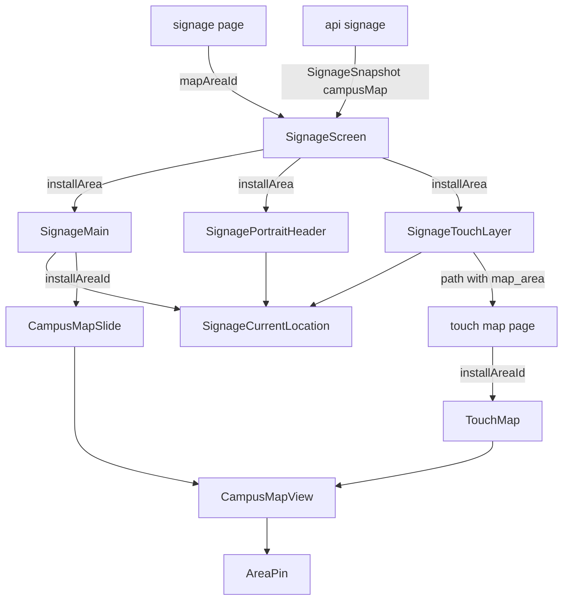
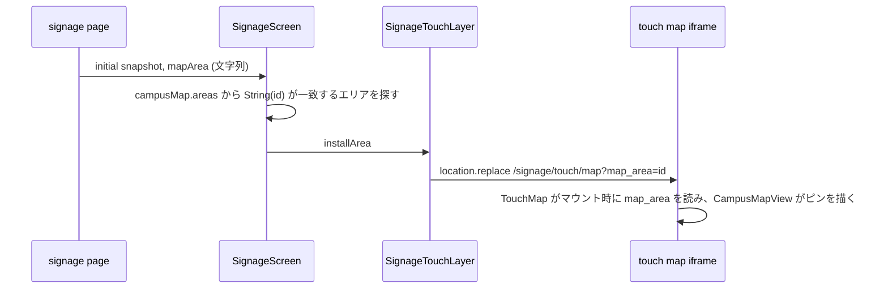

# Design Document

## Overview
**Purpose**: サイネージ端末の設置エリアを「現在地」として、サイネージの全画面のラベルと、構内マップ上のピンで示す。あわせて構内マップスライドを、CMS に登録した画像から、タッチ操作の構内マップと同じ地図に置き換える。

**Users**: 来場者は、サイネージの前で自分のいる場所と地図を結び付ける。実行委員は、端末を設置するときに URL で設置エリアを指定し、CMS で構内マップスライドを画像なしで登録する。

**Impact**: `/signage` が検索パラメータ `map_area` を受け取るようになる。サイネージのスナップショットに地図データが加わる。構内マップスライドの描画が画像から地図に変わり、CMS の構内マップスライドから画像の入力欄が消える。

### Goals
- `/signage?map_area=<id>` の端末で、横型・縦型・タッチ操作の全画面に Figma どおりの現在地ラベルを出す
- タッチ操作の構内マップと構内マップスライドの地図に、設置エリアのピンを出す
- 構内マップスライドを、画像なしで巡回する地図のスライドにする
- パラメータの無い端末・不正な ID の端末では、構内マップスライドの地図化以外の見え方を変えない

### Non-Goals
- 端末の位置の自動取得、CMS での端末ごとの設置場所の管理、経路案内
- 一般向けサイトの構内マップ `/map` の変更
- エリアの変更を版通知で即時に届ける仕組み(既存の TTL・ポーリングに任せる)

## Boundary Commitments

### This Spec Owns
- 検索パラメータ `map_area` の解釈と、設置エリアの解決(ID → `CampusMapArea`、見つからなければ無し)
- 現在地ラベル部品と、横型スライド・縦型ヘッダー・タッチ操作画面での配置
- 構内マップ上の設置エリアのピン(マーカー部品と、`CampusMapView` での描画)
- 構内マップスライドの地図の描画と、その巡回条件
- サイネージのスナップショットの地図データ `campusMap`
- CMS の `signage_slides` の、種別「構内マップ」の画像の入力欄と検証

### Out of Boundary
- 緊急地震速報・ステージ開始告知・試験運転の表示(既存のまま。重なり順も変えない)
- タッチ操作の構内マップのエリア選択・絞り込み・拡大縮小の振る舞い
- 一般向けサイトの構内マップ、地域協賛マップ
- `map_areas` コレクションの定義

### Allowed Dependencies
- `lib/campus-map.ts` の地図データの型と取得(`CampusMapArea`・`CampusMapPoint`・`toCampusMapArea`・`toCampusMapPoint`)
- `components/campus-map/campus-map-view.tsx`、`components/exhibition-location-map/area-pin.tsx`(`AreaPin`)、`lib/campus-map-geometry.ts`
- `components/icons.tsx` の `LocationPinIcon`(`location_on` の FILL 1。`location_on` は `app/layout.tsx` の読み込み一覧に登録済み)
- 依存の向き: `lib/*`(型・純関数) → `components/campus-map/*` → `components/signage/*` → `app/(fullscreen)/signage/*`。逆向きの import をしない

### Revalidation Triggers
- `SignageSnapshot` の形の変更(`campusMap` の追加)は、スナップショットを読むテスト・部品が追随する
- `CampusMapView` の props 追加(`installAreaId`)は、一般向けサイト・地域協賛マップ・タッチ操作の各呼び出しで既定値のまま動くことを確かめる
- `AreaLabelMarker` の寸法を変えると、ピンとエリア名ラベルの間隔がずれる(ピン側の持ち上げ量は、エリア名ラベルの高さ 22px を前提にしている)

## Architecture

### Existing Architecture Analysis
- `/signage` はサーバーで初回のスナップショットを取り、`SignageScreen` が `/api/signage` の版通知と 120 秒のポーリングで更新する。向きはルート要素の実寸で決まり、URL を使わない
- タッチ操作は親文書のレイヤー `SignageTouchLayer` で、行き先のページを同一オリジンの iframe に出す。行き先の切替は親が `contentWindow.location.replace(path)` で行う。タッチ操作は横型のときだけ開く
- 重なり順は DOM の順(後ろほど前面): 背景 → 左カラム・縦型ヘッダー → テロップ → バス → `SignageMain`(スライドとステージ開始告知) → `SignageTouchLayer` → `SignageQuakeOverlay` → `SignageTrialOverlay`

### Architecture Pattern & Boundary Map



**Architecture Integration**:
- Selected pattern: 既存の props の受け渡しの延長。設置エリアの ID はサーバーの `page.tsx` で読み、`SignageScreen` がスナップショットの地図データから解決して下へ渡す。iframe へは地図の行き先の path の検索パラメータで渡す
- Domain/feature boundaries: 設置エリアの解決は `SignageScreen` 内の 1 行(`campusMap?.areas.find(...) ?? null`)で行う。ピンは既存の `AreaPin` を props で拡張して使う
- Existing patterns preserved: スナップショットの更新経路、iframe の遷移、`CampusMapView` の client 専用読み込み(`next/dynamic` の `ssr: false`)
- New components rationale: ラベル(3 か所で共有)、構内マップスライド(画像スライドから分離)。ほかは既存の部品・関数を拡張する
- Steering compliance: Edge Runtime で動く。型は生成型 `cms-types.ts` から導く。`any` を使わない

### Technology Stack

| Layer | Choice / Version | Role in Feature | Notes |
|-------|------------------|-----------------|-------|
| Frontend | Next.js 16 / React 19、react-leaflet(既存) | ラベル・ピン・地図スライド | 新しい依存なし |
| Backend | Payload 3(既存) | 構内マップスライドの検証の変更 | マイグレーションなし |
| Data | `map_areas`・`map_points`(既存) | 設置エリアの名前・形、地図の描画 | 公開の読み取り |

## File Structure Plan

### Directory Structure
```
frontend/src/components/signage/
├── signage-current-location.tsx   # 現在地ラベル
└── slides/
    └── campus-map-slide.tsx       # 構内マップスライド (地図)
```

### Modified Files
- `frontend/src/app/(fullscreen)/signage/page.tsx` — `searchParams` の `map_area` を文字列のまま `SignageScreen` に渡す
- `frontend/src/components/signage/signage-screen.tsx` — スナップショットの地図データから設置エリアを解決し、`SignageMain`・`SignagePortraitHeader`・`SignageTouchLayer` に渡す
- `frontend/src/components/signage/signage-main.tsx` — スライドの層ごとに、横型の現在地ラベルを重ねる。`installArea` と `SlideRenderProps.installAreaId` は任意(既定 null)。緊急地震速報の表示(`signage-quake-overlay.tsx`)は渡さないので、速報ではラベルもピンも出ない
- `frontend/src/components/signage/signage-portrait-header.tsx` — 縦型の現在地ラベルを開催日の左に置く
- `frontend/src/components/signage/signage-touch-layer.tsx` — 左下の現在地ラベルを置く。地図の行き先の path に `map_area` を付ける(ファイル内の関数)
- `frontend/src/components/signage/slide-renderers.tsx` — `campus_map` を `CampusMapSlide` に替える
- `frontend/src/components/signage/slides/image.tsx` — 構内マップ用の分岐(`kind` の prop、`bg-gray-100`、見出しチップ)を外し、画像スライド専用にする
- `frontend/src/lib/signage.ts` — `SignageSnapshot` に `campusMap` を足す。`campus_map` のスライドから `image` を外す。`pageCount` の `campus_map` を地図データの有無で決める
- `frontend/src/lib/signage-data.ts` — スナップショットで地図データを取る。`toSlide` の `campus_map` から画像を外す
- `frontend/src/lib/campus-map.ts` — `map_points` の取得と変換を関数に切り出し、`getCampusMapData` とスナップショットで共有する(`map_areas` は既存の `getCampusMapAreas` を使う)
- `frontend/src/lib/campus-map-geometry.ts` — `polygonCentroid` の中の「最大のポリゴンを選ぶ」処理を関数として出す(ピンをエリア名ラベルと同じポリゴンに立てるため)
- `frontend/src/components/signage/touch/touch-map.tsx` — マウント時に `location.search` の `map_area` を読み、`CampusMapView` に `installAreaId` を渡す
- `frontend/src/components/campus-map/campus-map-view.tsx` — `installAreaId` を受け、`AreaPin` を描く
- `frontend/src/components/exhibition-location-map/area-pin.tsx` — 色と持ち上げ量を props で受ける(既定は現行のまま)
- `cms/src/collections/signage-slides.ts` — 画像の `admin.condition` と `requiredWhen` から `campus_map` を外す
- `cms/src/collections/signage-slides.test.ts` — 構内マップに画像を求める既存の 2 つのテストを、画像なしで通る内容に書き換える

## System Flows



- 設置エリアは描画のたびにスナップショットから解決する。スナップショットが更新されてエリアが消えれば、ラベルとマップスライドのピンは消える(1.3)。タッチ操作の構内マップのピンは、次に地図の行き先を開いたときに反映される
- 地図の行き先以外(企画一覧・タイムテーブル・駐車場・トピック)の path には `map_area` を付けない。これらの画面のラベルは親のレイヤーが描く

## Requirements Traceability

| Requirement | Summary | Components | Interfaces | Flows |
|-------------|---------|------------|------------|-------|
| 1.1 | ID で設置エリア | signage page、`SignageScreen` | `mapArea` | 上図 |
| 1.2, 1.3 | 無し・不正なら出さない | `SignageScreen`、`TouchMap` | 一致するエリアが無ければ null | — |
| 1.4 | エリア名の表示 | `SignageCurrentLocation` | `CampusMapArea.name` | — |
| 1.5 | タッチ操作でも同じ設置エリア | `SignageTouchLayer`、`TouchMap` | path の検索パラメータ | 上図 |
| 1.6 | ほかの表示を変えない | `SignageScreen` | — | — |
| 2.1 | ラベルの見た目 | `SignageCurrentLocation` | — | — |
| 2.2, 2.3 | 横型の右上・全スライド | `SignageMain` | — | — |
| 2.4 | 縦型ヘッダー | `SignagePortraitHeader` | — | — |
| 2.5, 2.6 | タッチ操作の左下・全行き先 | `SignageTouchLayer` | — | — |
| 2.7 | 速報より前面に出さない | 既存の DOM 順、速報は `installArea` を渡さない | — | — |
| 3.1〜3.5 | ピン | `AreaPin`、`CampusMapView` | `installAreaId` | — |
| 4.1〜4.5 | 地図スライド | `CampusMapSlide` | `SlideRenderProps` | — |
| 4.6 | 画像なしで巡回 | `pageCount` | `SignageSnapshot.campusMap` | — |
| 5.1〜5.4 | CMS 入力 | `signage-slides.ts` | — | — |

## Components and Interfaces

| Component | Domain/Layer | Intent | Req Coverage | Key Dependencies | Contracts |
|-----------|--------------|--------|--------------|------------------|-----------|
| `SignageCurrentLocation` | UI | 現在地ラベル | 1.4, 2.1 | `LocationPinIcon` (P1) | — |
| `AreaPin`(拡張) | UI(地図) | 設置エリアのピン | 3.1〜3.5 | `singlePolygonCentroid` (P0) | — |
| `CampusMapSlide` | UI(スライド) | 構内マップスライドの地図 | 4.1〜4.5 | `CampusMapView` (P0) | — |
| `SignageSnapshot.campusMap` | lib(データ) | 地図データをサイネージに届ける | 1.4, 4.1, 4.6 | `map_areas`・`map_points` (P0) | State |
| `signage-slides.ts` | CMS | 構内マップスライドの画像を任意にする | 5.1〜5.4 | — | — |

### 設置エリアの解決
- `page.tsx` は `searchParams.map_area` が文字列のときだけ、その値を `mapArea: string | null` として渡す
- `SignageScreen` と `TouchMap` は、`areas.find((a) => String(a.id) === mapArea) ?? null` で設置エリアを決める。数値でない値・0・負数・存在しない ID は一致せず null になる(1.2, 1.3)。専用の解析関数は作らない

### Data

#### SignageSnapshot.campusMap

**Contracts**: State [x]

##### State Management
```typescript
interface SignageCampusMap {
  readonly areas: readonly CampusMapArea[];
  readonly points: readonly CampusMapPoint[];
}

interface SignageSnapshot {
  // 既存のフィールドは変えない
  readonly campusMap: SignageCampusMap | null;
}

type SignageSlide =
  // 既存の種別は変えない。campus_map だけ image を持たなくなる
  | { readonly kind: 'campus_map'; /* 既存の共通フィールド */ };
```
- `getSignageSnapshot` は既存の `Promise.all` に、既存の `getCampusMapAreas()` と、切り出した `map_points` の取得を加える
- `map_areas` の取得に失敗したときは `campusMap: null` とし、スナップショット全体は失敗にしない。`map_points` だけ失敗したときは `points: []` とする
- 更新は既存のスナップショットの経路(TTL 15 秒、版通知、120 秒のポーリング)に乗る。`map_areas` に版通知は足さない

### UI

#### SignageCurrentLocation
- props: `{ readonly name: string; readonly className?: string }`
- 見た目(Figma `1555:63` 実測): `inline-flex items-center gap-2 whitespace-nowrap rounded-full bg-white/[0.92] px-4 py-2 text-signage-meta`。中に `gap-1` の組で `LocationPinIcon`(24px、`text-primary`)と「現在地」(Bold、`text-text`)、続けてエリア名(Regular、`text-text`)。高さは 46px、幅はエリア名で伸びる
- 配置は呼び出し側が決める
  - 横型: `SignageMain` がスライドの層ごとに `absolute right-6` で重ねる。top は、見出しチップを持たない種別(`image`・`layout`)なら 24px、ほか(`campus_map`・`sponsors`・`lost_items`・`parking`・`timetable`)なら 27px(高さ 52px のチップと上下中央をそろえる)。スライドと一緒に切り替わる。縦型のメイン枠(横型の縮小)では描かない(`portrait:hidden`)
  - 縦型: `SignagePortraitHeader` の右の列(`flex-col items-end`)の開催日の行を `flex items-center gap-[43px]` にし、ラベル → `SignageDayDate` の順に並べる。43px は Figma の開催日の左端 796 − ラベルの右端 753。エリア名の長さ・開催日の有無に応じて、開催日の左に付いたまま伸びる
  - タッチ操作: `SignageTouchLayer` の最後(行き先ナビと読み込み中の幕より後)に `pointer-events-none absolute left-6 top-[981px]` で置く。下にある iframe の項目へのタップを遮らない
- 設置エリアが null のときは呼び出し側が描かない

#### AreaPin(拡張)
- 既存の `AreaPin`(`iconSize [0, 0]` の divIcon、`LocationPinIcon`、`interactive={false}`、字形の下端の空きを補正する `-translate-y-[89.58%]`)に、任意の props `colorClassName`(既定 `text-accent`)と `liftPx`(既定 0)を足す。既存の呼び出しは変わらない
- 設置エリアのピンは、エリア名ラベルと同じポリゴン(最大のポリゴン)の重心に、`size={29}`・`colorClassName="text-primary"`・`liftPx={17}` で立てる。`zIndexOffset` を大きくし、同じ `markerPane` のエリア名ラベル・地点マーカーより手前に出す
- 大きさと持ち上げ量は、Figma のピンとエリア名ラベルの比率を実装の地図の縮尺に合わせて決めた。Figma の地図は画像で、エリア名ラベルを高さ 34px で描いている(実装の約 1.55 倍)。Figma のピンは描画幅 29px・高さ 37px、先端とラベル上端の距離 10px
  - 実装のエリア名ラベル(`text-xs`・`py-0.5`・枠 1px)の高さ 22px を基準に、字形の高さ = 22 × 37/34 ≒ 24px(文字サイズ 29px)、距離 = 22 × 10/34 ≒ 6px
  - 持ち上げ量 17px = ラベルの高さの半分 11px + 距離 6px。選択中のエリア名ラベル(枠 2px、高さ 24px)では距離が 5px になる
- 地図の拡大・縮小・移動では、Leaflet のマーカーとして地理座標に留まる(3.5)

#### CampusMapView(変更)
- props に `installAreaId?: number | null` を足す(既定 null)。`areas` に該当するエリアがあれば、上の指定で `AreaPin` を描く。既存の呼び出しは変わらない

#### CampusMapSlide
- props: `SlideRenderProps`(`installAreaId` を含む)
- 1536×864、`rounded-2xl overflow-clip` の枠に、`inert` 属性を付けた層で `CampusMapView` を描く。Leaflet はポリゴン・ラベル・コントロールに `pointer-events: auto` を付け直すため、`pointer-events-none` では操作を止められない(4.4)。`CampusMapView` の指定: `areas`・`points` はスナップショットの `campusMap`、`selectedAreaId={null}`、`onSelectArea` は何もしない、`showUserLocation={false}`、`showZoomControl={false}`、`fitExcludeOutliers`、`installAreaId`
- 著作権表示: 位置は右下(`CampusMapView` は幅 1024px 以上で右下に出す。サイネージは 1920 幅のため、マウント直後の判定が済むと右下になる)。書式はタッチ操作の構内マップと同じ上書き(`touch-map.tsx` の caption の指定)を使う。Figma の位置(枠の右から 26px、下端 0)と実ブラウザで比べる
- 見出しチップ「構内マップ」(`SignageHeadingChip icon="map"`)を左上に重ねる
- `CampusMapView` は既存と同じく `next/dynamic` の `ssr: false` で読み込む
- `campusMap` が null のときは描かない(`pageCount` が 0 になり巡回に出ない)

#### SignageTouchLayer(変更)
- 地図の行き先で設置エリアがあれば、path を `/signage/touch/map?map_area=<id>` にする。iframe の最初の src と `navigate` の両方で使う。ほかの行き先は既存の `path` のまま
- iframe → 親の知らせ(`signage-touch-path` 等)は `usePathname` の値で、検索パラメータを含まないため、行き先の判定と QR の URL は変わらない

#### TouchMap(変更)
- マウント時に `location.search` の `map_area` を読む(前例: `components/map/use-map-url-state.ts`)。ページは `revalidate = 60` のまま。地図はもともと `ssr: false` なので、見た目は変わらない

#### signage-slides.ts(CMS)
- `image` の `admin.condition` を `kindIs('image')`、`validate` を `requiredWhen(['image'], '画像を選んでください')` にする。フィールド自体は残す
- 管理画面の表示条件と入力検証だけの変更で、DB の構造は変わらない。マイグレーションは作らない
- 既存の構内マップスライドの `image` の値は残り、フロントでは読まなくなる

## Error Handling
- `map_area` が数値でない・存在しない ID: 設置エリア無しとして扱い、ラベルもピンも出さない。エラー表示はしない
- 地図データの取得失敗: `campusMap: null`。ラベル・ピンを出さず、構内マップスライドを巡回から外す。ほかのスライドは既存どおり
- 地図タイルの読み込み失敗: 既存の構内マップと同じく、タイルの無い部分が地の色で出る。ポリゴン・ラベル・ピンは描かれる

## Testing Strategy
- Unit
  - `pageCount` の `campus_map`: 地図データあり 1、null 0(画像の有無によらない)
- Component
  - `SignageScreen`: `map_area` が実在の ID → 横型スライド・縦型ヘッダー・タッチ操作でラベルが出る/無し・`'abc'`・存在しない ID → どこにも出ない/タッチ操作の地図の iframe の src に `map_area` が付き、ほかの行き先には付かない
  - `SignageMain`: ラベルの top が種別で 24/27、縦型では出ない。`installArea` を渡さない呼び出し(速報)では出ない
  - `CampusMapView`: `installAreaId` 該当でピンが出る/該当なし・null で出ない
  - `AreaPin`: 既定の props で現行の出力と変わらない
  - `CampusMapSlide`: 画像を使わず地図を描く、`inert` の層、`fitExcludeOutliers`、見出しチップ
  - `signage-data`: 地図データ取得失敗でスナップショットが成功し `campusMap` が null
  - 既存テストのうち `campusMap` の追加で直すもの: `signage-screen.test.tsx`・`signage-screen-touch.test.tsx`・`lib/signage.test.ts`
- CMS(`cms/src/collections/signage-slides.test.ts`): 構内マップに画像を求める既存の 2 つのテストを、画像なしで通る内容に書き換える。画像スライドは画像なしで失敗するまま
- 実ブラウザ(Playwright、headless、ローカルの `make dev` と共有 CMS)
  - 1920×1080 と 1080×1920 で、ローカルの CMS にある実在のエリア(例: 「2号館」と、最長の名前「武道館ステージ」)の ID で `/signage?map_area=<ID>` を開き、ラベルの `getBoundingClientRect` を測る。横型: スライド枠の右 24・top 24/27・高さ 46。縦型: 開催日の左 43px、開催日と上下中央がそろい、「武道館ステージ」でも開催日と重ならない。タッチ操作: 24,981
  - タッチ操作の構内マップで、ラベルの下にある左パネルの項目をタップできる
  - 構内マップスライドで、ポリゴン・ラベルからドラッグ・ピンチしても地図が動かない(縦型でも)
  - 構内マップスライドとタッチ操作の構内マップで、エリア名ラベルの高さ(22px)、ピンの描画幅・高さ(約 19×24px)、先端とラベル上端の距離(6px)を画素で測る。22px でなければ比率で求め直す
  - `/signage`(パラメータ無し)と `?map_area=99999` でラベル・ピンが無いことを確かめる
  - 各画面のスクリーンショットを Figma のフレームと並べて目視で比べる
