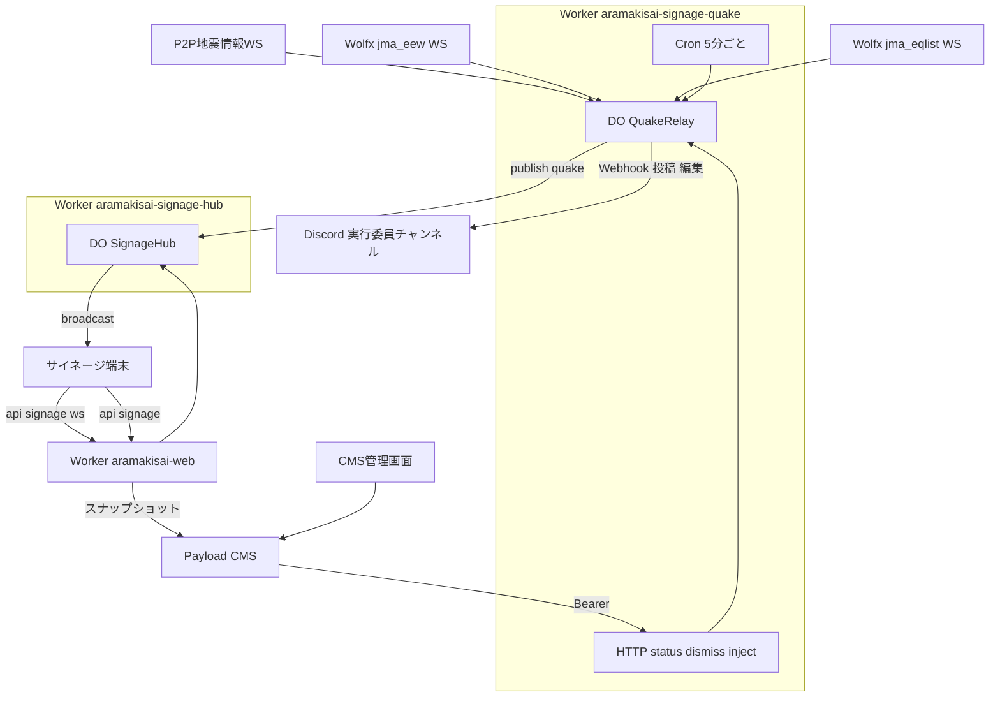
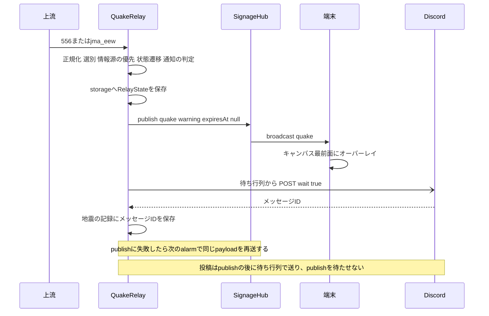
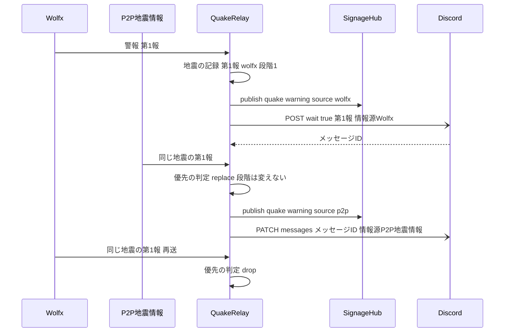
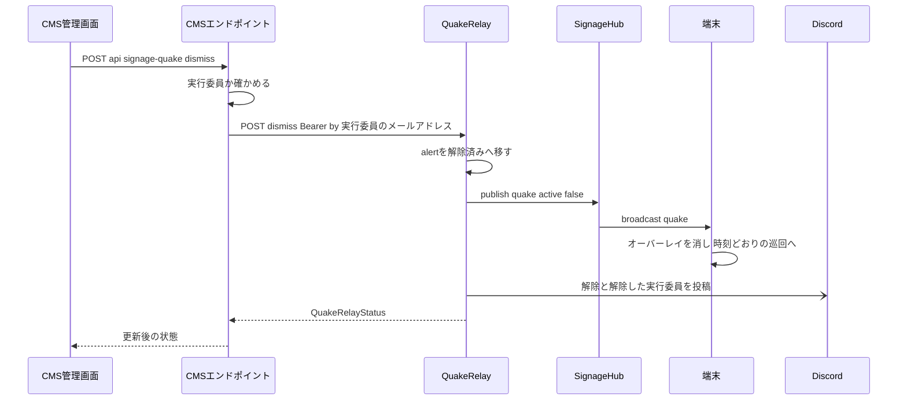
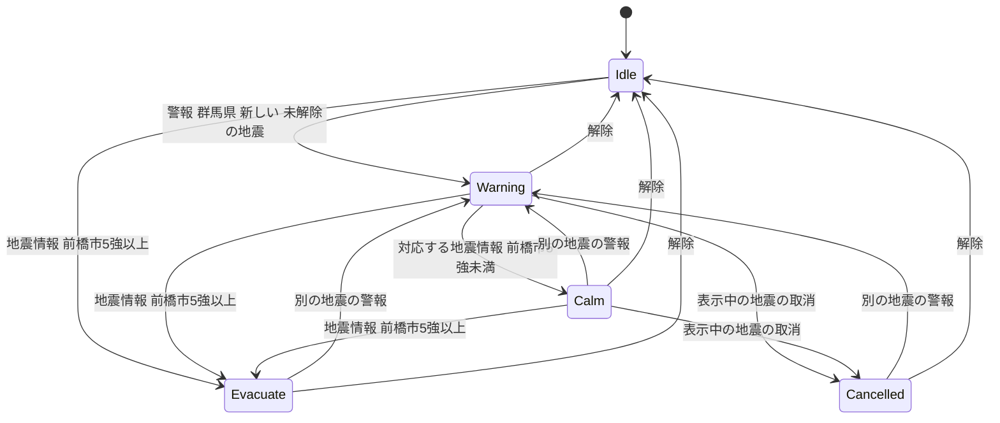

# Design Document

## Overview

**Purpose**: 気象庁の緊急地震速報(警報)と地震情報を無料の2系統(P2P地震情報・Wolfx)からサーバー側で受け、サイネージの全端末に全画面の速報表示を出す。警報で身を守る行動を促し、前橋市の観測点の実測震度で「揺れは収まりました」(段階2)か「移動せずスタッフの指示を待ってください」と避難場所の案内(段階3)へ自動で切り替え、実行委員がCMSで解除するまで続ける。群馬県に関係する速報・地震情報、段階の変化、解除、受信状態の変化を、実行委員用のDiscordチャンネルへ受信値と情報源つきで投稿する。2系統で同じ報を受けたときは、粒度の細かいP2P地震情報の内容を優先する。

**Users**: 来場者は会場の端末で速報と次の行動を読む。実行委員はCMSのサイネージのスライドの一覧の上部で、速報の状態と上流の受信状態を確かめ、解除する。運用者は「緊急地震速報」のグループのスライドとして避難誘導の内容を用意する。実行委員はDiscordの専用チャンネルで、サイネージより詳しい速報の内容(予想震度・到達予想時刻を含む受信値)と情報源を読む。

**Impact**: 上流の接続を持つWorker `aramakisai-signage-quake`(Durable Object `QuakeRelay`)を新設し、既存のハブの`publish`へ機能`quake`を足す。端末はキャンバスの最前面にオーバーレイを出す。CMSは`signage_groups`に緊急地震速報のグループと段階→スライドの対応付けを足し、解除と受信状態の表示をスライドの一覧の上部に足す。リレーは実行委員用のDiscordチャンネルのWebhookへ投稿・編集する。

### Goals
- 警報の受信からおよそ2秒以内に全端末で段階1を出す(2.5)
- 地震情報で段階2・段階3へ受信した値の比較だけで切り替える(3.1〜3.8)
- 解除の保存からおよそ3秒以内に全端末で通常の表示へ戻す(6.4)
- 上流の接続をWorkers Paidの期間だけ自動で動かす(10.1〜10.6)
- サンドボックスと保存したJSONで、開催前に全段階を確かめられる(11.1〜11.7)
- 群馬県に関係する報と表示の変化を、サイネージの表示を遅らせずにDiscordへ投稿する(12.1〜12.17)
- 同じ報はP2P地震情報の内容を優先し、表示の帯とDiscordの投稿を置き換える(13.1〜13.8)

### Non-Goals
- 緊急地震速報(予報)、津波・気象の情報、警報音
- サイネージでの予想震度・到達予想時刻・猶予秒数の表示(Discordには受信値のまま載せる)と、震度・到達時刻の自前の計算
- 配信経路(ハブ・端末のクライアント・再接続・時刻補正・有効期限の判定)の変更
- 公式サイト(サイネージ以外)への速報の表示
- 試験報を本番の端末から隔離する仕組み(11.2)
- 既存の運用通知(`aramakisai-infra`の`DISCORD_OPS_WEBHOOK_URL`)の変更と、そのチャンネルへの投稿

## Boundary Commitments

### This Spec Owns
- 上流2系統への接続・再接続・無受信の監視、報の解釈・選別・重複除去、段階の判定(`QuakeRelay`)
- 速報の状態(`RelayState`)の正本と、端末へ配る`quake`のpayloadの形
- リレーのHTTPの口(状態の取得・解除・開発時の投入)と、その共有秘密
- 稼働期間の判定と自動の開始・停止
- 端末のオーバーレイ(固定の帯・段階のスライド・既定の文言)
- CMSの緊急地震速報のグループ、段階→スライドの対応付け、巡回と固定からの除外、解除と受信状態の表示、リレーへの中継のエンドポイント
- 試験モード、保存したJSONの投入の手段、試験用のfixtures
- 情報源の優先(P2P地震情報を優先する置き換え)の規則
- 実行委員用のDiscordチャンネルへの投稿・編集・再試行と、その文面
- リレーのWorkerのデプロイの条件(CIのパスの絞り込み)

### Out of Boundary
- ハブのコード(`frontend/workers/signage-hub/`の`index.ts`・`hub-core.ts`)、pinの応答、`getPinState`、`/api/signage/pin`、`/api/signage/notify`、サイトのWorkerの入口(`frontend/workers/site-entry.ts`)、`frontend/wrangler.toml`のハブのbinding
- 端末のWebSocketクライアント(`use-signage-channel.ts`)の接続・再接続・時刻補正の挙動
- Workers Paidへの切り替えと戻しの作業(WBSの別項目)
- 端末の機材・ブラウザの設定
- 既存の運用通知(`DISCORD_OPS_WEBHOOK_URL`)と、Discordのチャンネル・Webhookの作成(運用側の作業)

### Allowed Dependencies
- ハブのDO `SignageHub`の`publish` RPC(DO binding、`script_name = "aramakisai-signage-hub"`、固定名`signage-hub`)
- `frontend/src/lib/signage-channel.ts`の型と`useSignageFeature`
- 既存のスナップショット(`/api/signage`)とCMSの保存時の通知(`signageNotifyHook`)
- Cloudflare Workers・Durable Objects(SQLite backed)・Cron Triggers(有料プランの基本料金の範囲)
- 上流: `wss://api.p2pquake.net/v2/ws`、`wss://ws-api.wolfx.jp/jma_eew`、`wss://ws-api.wolfx.jp/jma_eqlist`
- Discord Webhook: `POST /webhooks/{id}/{token}?wait=true`(投稿、作成したメッセージを返す)、`PATCH /webhooks/{id}/{token}/messages/{message_id}`(編集)
- 依存の方向: `signage-quake.ts`(型) → `relay-config.ts` → `upstream.ts` → `relay-core.ts` → `discord.ts` → `index.ts`(DO・Worker)。端末は型 → `signage-data.ts` → 部品。逆向きのimportは禁止

### Revalidation Triggers
- `SignageQuakePayload`の形の変更(リレー・端末・CMSの表示が同時に追随する)
- ハブの`publish`の型・保持の仕組みの変更
- `signage_groups`の`is_quake`・`quake_slides`の変更、`visibleSlideIds`の意味の変更
- 上流のスキーマの変更(551・556・`jma_eew`・`jma_eqlist`)
- 稼働期間(Paidの契約期間)の変更
- Discord Webhookの投稿・編集の口とレート制限の扱いの変更
- オーバーレイのFigmaのフレームの確定・変更(帯とスライドの枠の配置、文字の大きさ)

## Architecture

### Existing Architecture Analysis
- ハブ(`aramakisai-signage-hub`)は端末のWebSocketをHibernationで受け、機能ごとの最新のbroadcastを保持し、接続直後に期限内の保持をすべて送る。他機能は`publish`(RPC)でbroadcastを足す。ハブは公開のURLを持たない。
- 端末は未知の機能のbroadcastも`latest`に入れ、`useSignageFeature`で読む。旧版の画面は`quake`を読まないため、速報以外の表示は変わらない(8.6はこの性質で満たす)。
- スナップショットは未認証でCMSを読み、`withPin`は`visibleSlideIds`でスライドを絞るだけで足さない。
- CMSの「すべて」のグループはマイグレーションで作る1件と不変のフラグ`is_all`で表す。

### Architecture Pattern & Boundary Map



**Architecture Integration**:
- Selected pattern: 上流の接続を持つ単一インスタンスのDO + 純粋な状態遷移の関数(`relay-core.ts`)。DOは入出力(WebSocket・alarm・ストレージ・RPC)だけを持ち、判定はすべて純粋関数に置く。
- Domain/feature boundaries: 速報の状態の正本はリレー。ハブは保持と配信だけ、端末は表示だけ、CMSは内容(スライド)と操作の中継だけ。
- Existing patterns preserved: ハブの`publish`と保持、`SignageFeaturePayloads`の判別共用体、`is_all`方式の不変グループ、`signageNotifyHook`による保存時の反映、Workersの秘密の`--secrets-file`、CMSの接続先URLはDeploymentのenv・秘密はInfisical。
- New components rationale: 別Workerはハブ・サイトの入口を変えずにCMSからの解除の口を持つため(research.mdの比較を参照)。Discordへの投稿は報を選別したリレーが行い、通知の判定(何を投稿・編集するか)は`relay-core.ts`の純粋関数、文面と送信の待ち行列は`discord.ts`に置く。
- Steering compliance: 型はstrict、`any`なし。CMSのスキーマは追加のみ。Edge Runtimeの制約はWorkerのランタイムで満たす(Node専用APIを使わない)。

### Technology Stack

| Layer | Choice / Version | Role in Feature | Notes |
|-------|------------------|-----------------|-------|
| Frontend | Next.js 15 / React 19(既存) | オーバーレイ、スナップショットの拡張 | 新規の依存なし |
| Backend / Services | Cloudflare Workers + Durable Objects(SQLite backed)、wrangler ^4 | `QuakeRelay`、上流の外向きWebSocket、HTTPの口、Cron Trigger | 新規Worker `aramakisai-signage-quake` |
| CMS | Payload 3 / Postgres 16(既存) | グループと対応付け、ルートのカスタムエンドポイント、管理画面の部品 | 追加のマイグレーション1本 |
| Data / Storage | DOのストレージ(KV API) | `RelayState`の永続化 | 1キー |
| Messaging / Events | 既存のハブの`publish`/broadcast | 機能`quake`の配信 | `expiresAt: null` |
| Notification | Discord Webhook(実行委員用のチャンネル) | 報・段階・解除・受信状態の投稿と、P2P地震情報の内容への編集 | 新規の依存なし(`fetch`) |
| Infrastructure / Runtime | Infisical prod、`aramakisai-infra`のCMSのDeployment | `SIGNAGE_QUAKE_TOKEN`、`SIGNAGE_QUAKE_URL`、`DISCORD_QUAKE_WEBHOOK_URL` | infra側の変更を伴う(CMSの2キー) |

## File Structure Plan

### Directory Structure
```
frontend/
├── workers/signage-quake/
│   ├── wrangler.toml          # Worker aramakisai-signage-quake。DO QuakeRelay、ハブへのDO binding、Cron、稼働期間と接続先のvars
│   ├── index.ts               # Workerのfetch(HTTPの口)とscheduled(Cron)、DOクラスQuakeRelay(接続・alarm・ストレージ・publish)
│   ├── relay-config.ts        # varsの解釈、本番の接続先の定数、系統ごとの試験モード、稼働期間の判定
│   ├── upstream.ts            # P2P・Wolfxの生のJSONをQuakeReportへ正規化する純粋関数
│   ├── relay-core.ts          # 選別・情報源の優先・段階の状態遷移・解除・受信状態の判定と、通知の判定の純粋関数
│   ├── discord.ts             # 通知の文面(純粋関数)と、Webhookへの投稿・編集の待ち行列(レート制限・再試行)
│   ├── fixtures/              # 保存したJSON(サンドボックスの実データ、Wolfxの実データ、手で作った訓練・取消・段階3)
│   └── *.test.ts              # 各モジュールと同じ階層
├── scripts/quake-inject.ts    # fixturesのJSONを開発時の投入口へ順に送る
└── src/
    ├── lib/signage-quake.ts   # SignageQuakePayloadの型、端末側の検査、段階→既定の文言、震度コードの表示名
    └── components/signage/signage-quake-overlay.tsx   # 全画面のオーバーレイ(固定の帯+段階のスライド)
cms/src/
├── lib/signage-quake-relay.ts         # リレーへのBearer付きの呼び出しと環境変数の読み取り
├── endpoints/signage-quake.ts         # /api/signage-quake(GET)と/api/signage-quake/dismiss(POST)
├── components/SignageQuakePanel.tsx   # スライドの一覧の上部の速報の状態・受信状態・解除ボタン
├── components/useSignageQuake.ts      # 状態の取得(10秒ごと)と解除の保存
└── migrations/<timestamp>_signage_quake.ts   # is_quake・quake_slides_*の列と緊急地震速報のグループ1件
```

### Modified Files
- `frontend/src/lib/signage-channel.ts` — `SignageFeaturePayloads`に`quake: SignageQuakePayload`を足す
- `frontend/src/lib/signage.ts` — `SignageSnapshot`に`quakeSlides`を足す
- `frontend/src/lib/signage-data.ts` — 緊急地震速報のグループを読み、所属のスライドを`slides`から除き、対応付けを`quakeSlides`にする
- `frontend/src/components/signage/signage-screen.tsx` — `quake`を読み、`.signage-canvas`の最後の子としてオーバーレイを出す
- `frontend/src/app/globals.css` — オーバーレイの帯とスライドの枠の位置(横・縦)
- `frontend/package.json` — `types:workers`にリレーの設定を足す
- `frontend/workers/tsconfig.json` — リレーのディレクトリを含める(含まれていなければ)
- `.github/workflows/frontend-ci.yml`と`frontend/frontend-ci.workflow.test.ts` — `deploy-prod`でサイトの後に、リレーの変更があるときだけリレーを`wrangler deploy --secrets-file`で出す(Migration Strategyのパスの絞り込み)
- `Makefile`・`scripts/dev.sh` — `quake-dev`(リレー単体の`wrangler dev`)を足し、`cms-worktree`でローカルのリレーのURLを渡す
- `cms/src/collections/signage-groups.ts` — `is_quake`・`quake_slides`、緊急地震速報のグループでは`visible`を隠す
- `cms/src/lib/signage-visibility.ts` — 緊急地震速報のグループの所属を表示対象から常に除く、未認証の読み取り用の`publicSlideFilter`
- `cms/src/access/payload-access.ts` — 未認証の`signage_slides`の読み取りを`publicSlideFilter`で絞る、緊急地震速報のグループの削除を禁じる
- `cms/src/components/SignageGroupSwitches.tsx`(または`useSignageGroups.ts`) — 緊急地震速報のグループを表示の切り替えの一覧に出さない
- `cms/src/collections/signage-slides.ts` — `beforeListTable`の先頭に`SignageQuakePanel`
- `cms/src/payload.config.ts` — ルートの`endpoints`に速報のエンドポイントを足す
- `cms/src/migrations/index.ts`、`cms/src/payload-types.ts`、`frontend/src/cms-types.ts`、`cms/src/app/(payload)/admin/importMap.js` — 生成物
- `docs/cms-operations.md` — 環境変数(`SIGNAGE_QUAKE_URL`・`SIGNAGE_QUAKE_TOKEN`)と運用(解除、受信状態、Discord通知、試験、開催期間中のリレーのデプロイの控え)
- `aramakisai-infra`: CMSのDeployment(`gitops/manifests/prod/cms/deployment.yaml`)のenvに`SIGNAGE_QUAKE_URL`、ExternalSecret(`gitops/manifests/prod/cms-secrets/external-secret.yaml`)に`SIGNAGE_QUAKE_TOKEN`。Discordのキーはリレーのデプロイだけが読むため、infraの変更は無い

## System Flows

### 警報から段階1の表示まで



### 情報源の置き換え(Wolfxが先、P2P地震情報が後)



### 解除



### 段階の状態遷移



遷移の規則(図に載らない条件):
- 続報(同じ地震の別の続報番号・最終報)は段階を変えない(2.4)。段階1の表示中に別の地震の警報を受けたら、表示は段階1のまま、その地震を表示中の地震に足す。
- 情報源の優先(13.1〜13.5)で`replace`になった報は、payloadの`source`だけを変え、段階を変えない。`drop`になった報は遷移の入力にならない。
- 段階3を表示中は、より小さな震度の地震情報(訂正を含む)と取消報で段階を変えない(3.7・4.6)。取消報で取消の表示にするのは段階1・段階2だけ(4.1)。
- 段階3(警報なしの段階3を含む)はP2P地震情報の551だけが決める。Wolfxの地震情報は最大震度`1`〜`4`のときに段階1から段階2へ進めるだけ(3.10)。P2P地震情報が止まっていて最大震度が5弱以上・不明のときは段階1のまま解除を待つ(3.12)。
- 前橋市の観測点に46(5弱以上と推定、震度未入手)があり50以上が無い地震情報は、段階を変えない(3.11)。帯の受信値と情報源の置き換え(13.7)は行う。
- 表示中の`observation`がP2P地震情報由来の地震に対応するWolfxの地震情報は捨てる(13.8)。
- 解除した地震の警報の続報・取消報は表示を出さない(6.6)。解除した地震の地震情報で前橋市5強以上と分かり、その地震が段階3に達していなかったときだけ段階3を出す(6.7)。
- 本物の報の表示中は訓練報を捨てる(4.5)。訓練の表示中に本物の報を受けたら、表示していないときと同じ規則で本物の表示を始める(始まらない報なら訓練の表示を保つ)。
- 選別(1.4・1.6・1.8)を通らない報は遷移の入力にならない。

## Requirements Traceability

| Requirement | Summary | Components | Interfaces | Flows |
|-------------|---------|------------|------------|-------|
| 1.1, 1.2 | 2系統へ1本ずつ接続 | QuakeRelay, RelayConfig | `ensure()`、3つの外向きWS | 警報から段階1 |
| 1.3, 1.4, 1.8 | 警報のみ、群馬県のみ | Upstream, RelayCore | `normalizeMessage`、`acceptReport`、`processReport` | 状態遷移 |
| 1.5 | 同じ報の置き換え・破棄 | RelayCore | `eewPrecedence`、`EewRecord` | 情報源の置き換え |
| 1.6 | 古い報・接続直後の過去の報を除く | RelayCore | `acceptReport`の鮮度 | 状態遷移 |
| 1.7 | 解釈できない報を捨てる | Upstream, QuakeRelay | `normalizeMessage`が`null` | — |
| 2.1, 2.5 | 全端末で段階1、2秒以内 | QuakeRelay, SignageQuakeOverlay | `publish`、`useSignageFeature` | 警報から段階1 |
| 2.2, 2.3, 2.6 | 行動の表示、予想値を出さない、音なし | SignageQuakeOverlay, SignageQuakeLib | `QUAKE_DEFAULT_COPY`、payloadに予想値を持たない | — |
| 2.4, 2.7 | 続報で変えない、別の地震で段階1 | RelayCore | `processReport` | 状態遷移 |
| 3.1〜3.8, 3.10〜3.12 | 地震情報による段階、P2P地震情報だけで段階3 | Upstream, RelayCore | `observation`・`eqlist`の報、`processReport` | 状態遷移 |
| 3.9 | 受信値と情報源の表示 | SignageQuakeOverlay | `SignageQuakeObservation`、`source` | — |
| 4.1〜4.3, 4.6 | 取消、段階3では取消を無視 | RelayCore, SignageQuakeOverlay | `processReport` | 状態遷移 |
| 4.4, 4.5 | 訓練の明示と優先 | Upstream, RelayCore, SignageQuakeOverlay | `training` | 状態遷移 |
| 5.1, 5.2, 5.5 | 最前面の全画面、巡回・テロップを見せない、横縦 | SignageQuakeOverlay, SignageScreen | `.signage-quake` | — |
| 5.3 | 公式の警報でない旨 | SignageQuakeOverlay | 固定の帯 | — |
| 5.4 | 受信値を加工しない | Upstream, SignageQuakeLib | 文字列をそのまま、コード→表示名だけ | — |
| 5.6 | 起動・再接続直後に現在の段階 | 既存のハブの保持 | `planConnect`(既存) | — |
| 6.1, 6.6, 6.7 | 手動の解除のみ、再表示の抑止 | RelayCore | `applyDismiss`、`dismissed` | 解除、状態遷移 |
| 6.2, 6.3, 6.8 | CMSの解除の場所・表示・権限 | SignageQuakePanel, SignageQuakeEndpoints | `GET/POST /api/signage-quake` | 解除 |
| 6.4, 6.5 | 3秒以内に通常の表示へ、時刻どおりの巡回 | QuakeRelay, SignageScreen | `publish({active:false})` | 解除 |
| 7.1, 7.2 | グループと対応付け | SignageGroupsQuake | `is_quake`、`quake_slides` | — |
| 7.3, 7.6 | 段階のスライド、既定の文言 | SignageQuakeOverlay, SnapshotQuake | `quakeSlides`、`QUAKE_DEFAULT_COPY` | — |
| 7.4 | 巡回・固定に混ぜない | SignageVisibility, SnapshotQuake | `visibleSlideIds`、`slides`からの除外 | — |
| 7.5 | 固定の帯 | SignageQuakeOverlay | 帯はスライドの外 | — |
| 7.7 | 保存の反映 | 既存の`signageNotifyHook` | スナップショットの版 | — |
| 8.1, 8.4, 8.5 | publishで中継、期限なし、解除の口 | QuakeRelay | `publish`、`POST /dismiss` | 解除 |
| 8.2, 8.3 | 既存を変えない、別クラス | QuakeWorker | DO binding | — |
| 8.6 | 旧版の画面を乱さない | 既存の`parseServerMessage` | 未知の機能は無視 | — |
| 9.1, 9.2, 9.8 | 再接続、半開き、間隔の上限 | QuakeRelay, RelayCore | `nextRetryAt`、無受信の閾値 | — |
| 9.3 | 再起動後の再接続 | QuakeRelay, Cron | alarm、`ensure()` | — |
| 9.4 | 片系統で継続 | QuakeRelay | 系統ごとに独立 | — |
| 9.5, 9.6, 9.7 | 受信状態はCMSだけ | RelayCore, SignageQuakePanel | `QuakeRelayStatus` | — |
| 10.1〜10.6 | 稼働期間 | RelayConfig, QuakeWorker | `isInPeriod`、Cron、alarm | — |
| 11.1, 11.5, 11.6 | 接続先の設定と試験モード | RelayConfig | `channelTest` | — |
| 11.2 | 隔離しない | — | 本番のハブへそのまま | — |
| 11.3, 11.7 | 開発環境での再現、Wolfxの保存JSON | QuakeWorker, QuakeInjectScript | `POST /dev/inject/{channel}` | — |
| 11.4 | 自動テスト | RelayCore, Upstream | fixtures | — |
| 12.1〜12.3, 12.11, 12.12 | 投稿する報、1回だけ、古い報を投稿しない | Upstream, RelayCore | `processReport`の`notices`、`EewRecord.notify`、`seenObservation` | 警報から段階1 |
| 12.4, 12.5 | 段階の変化と解除の投稿 | RelayCore, QuakeRelay, SignageQuakeEndpoints | `applyDismiss(by)`、`stage`・`dismissed`の通知 | 解除 |
| 12.6 | 受信状態の変化の投稿 | QuakeRelay, RelayCore | `isReceiving`、`channel`の通知 | — |
| 12.7〜12.10, 12.16 | 文面、加工しない、公式でない旨、訓練 | DiscordNotifier | `formatNotice` | — |
| 12.13 | 失敗でサイネージを止めない、限定的な再試行、CMSで確かめる | DiscordNotifier, QuakeRelay, SignageQuakePanel | `DiscordQueue`、`QuakeRelayStatus.discord` | 警報から段階1 |
| 12.14, 12.17 | 専用のWebhook、秘密、試験用に差し替え | RelayConfig, QuakeWorker | `DISCORD_QUAKE_WEBHOOK_URL`、`make quake-dev` | — |
| 12.15 | 期間外は報と受信状態を投稿しない | QuakeRelay | 期間外は接続もalarmも無い | — |
| 13.1〜13.5 | 情報源の優先と置き換え | RelayCore, DiscordNotifier | `eewPrecedence`、`edit`の通知、`PATCH messages` | 情報源の置き換え |
| 13.6 | 帯の情報源 | SignageQuakeOverlay | `source`、`observation.source` | — |
| 13.7, 13.8 | 地震情報の優先 | RelayCore | `processReport` | 状態遷移 |

## Components and Interfaces

| Component | Domain/Layer | Intent | Req Coverage | Key Dependencies | Contracts |
|-----------|--------------|--------|--------------|------------------|-----------|
| SignageQuakeLib | 共有の型(frontend/src/lib) | payloadの型・検査・既定の文言・震度の表示名 | 2.2, 2.3, 3.9, 5.4, 7.6, 8.1 | なし | State |
| RelayConfig | リレー | varsの解釈、本番の接続先、試験モード、稼働期間、Webhook | 1.1, 10.1, 10.2, 10.6, 11.1, 11.5, 11.6, 12.14, 12.17 | Env(P0) | Service |
| Upstream | リレー | 上流のJSONを正規化 | 1.3, 1.4, 1.7, 3.1, 4.4, 5.4, 12.7〜12.9 | なし | Service |
| RelayCore | リレー | 選別・情報源の優先・状態遷移・解除・受信状態・通知の判定 | 1.4〜1.6, 1.8, 2.4, 2.7, 3.1〜3.8, 3.10〜3.12, 4.1〜4.6, 6.1, 6.6, 6.7, 9.6, 11.4, 11.5, 12.1〜12.6, 12.11, 12.12, 13.1〜13.5, 13.7, 13.8 | Upstream(P0) | Service, State |
| DiscordNotifier | リレー | 通知の文面と、Webhookへの投稿・編集の待ち行列 | 12.7〜12.10, 12.13, 12.16, 13.2 | Discord Webhook(P1) | Service |
| QuakeRelay | リレー(DO) | 上流の接続、alarm、保存、publish、通知の送出、HTTPの処理 | 1.1, 1.2, 2.5, 8.1, 8.3〜8.5, 9.1〜9.5, 9.8, 10.1〜10.3, 12.6, 12.13, 12.15 | SignageHub(P0)、上流(P0)、DiscordNotifier(P1) | Service, API, Event, State |
| QuakeWorker | リレー(Worker) | HTTPの口の認証と振り分け、Cron | 6.4, 8.5, 10.6, 11.3, 12.5 | QuakeRelay(P0) | API, Batch |
| QuakeInjectScript | 開発 | fixturesを投入口へ送る | 11.3, 11.7 | QuakeWorker(P1) | Batch |
| SnapshotQuake | frontend(lib) | スナップショットに段階のスライドを足し巡回から除く | 7.3, 7.4, 7.7 | CMS REST(P0) | State |
| SignageQuakeOverlay | frontend(UI) | 全画面の速報表示 | 2.1〜2.3, 2.6, 3.9, 4.4, 5.1〜5.3, 5.5, 7.3, 7.5, 7.6, 13.6 | SignageMain(P1) | — |
| SignageScreen(変更) | frontend(UI) | オーバーレイを最前面に差す | 5.1, 5.6, 6.5 | useSignageChannel(P0) | — |
| SignageGroupsQuake | CMS(コレクション) | 緊急地震速報のグループと対応付け | 7.1, 7.2 | signage_slides(P0) | State |
| SignageVisibility(変更) | CMS(lib/access) | 巡回・固定から除外、未認証の読み取りに通す | 7.4 | signage_groups(P0) | Service |
| SignageQuakeEndpoints | CMS(API) | 実行委員の認証とリレーへの中継 | 6.2〜6.4, 6.8, 9.5, 12.5 | QuakeWorker(P0) | API |
| SignageQuakePanel | CMS(UI) | 速報の状態・受信状態・Discord通知の失敗・解除 | 6.2, 6.3, 9.5, 9.6, 12.13 | SignageQuakeEndpoints(P0) | — |

### 共有の型

#### SignageQuakeLib(`frontend/src/lib/signage-quake.ts`)

| Field | Detail |
|-------|--------|
| Intent | リレー・ハブ・端末・CMSが共有する`quake`のpayloadの型と、端末側の表示の補助 |
| Requirements | 2.2, 2.3, 3.9, 5.4, 7.6, 8.1 |

**Responsibilities & Constraints**
- DOMの型に依存しない(リレーとハブの型検査に引き込むため)。
- payloadに予想震度・到達予想時刻・猶予秒数を持たせない(2.3)。
- 受信した時刻・震源は文字列のまま運ぶ。震度はP2Pのコード・Wolfxの文字列を表示名(「震度5強」等)に置き換えるだけ(5.4)。

**Contracts**: State [x]

```typescript
export type SignageQuakeStage = 'warning' | 'calm' | 'evacuate' | 'cancelled';

export interface SignageQuakeObservation {
  readonly source: 'p2p' | 'wolfx';
  /** 受信した発生時刻の文字列(日本時間、例"2023/05/26 19:03:00") */
  readonly originTime: string;
  /** 受信した震源名 */
  readonly hypocenter: string;
  /** 前橋市の観測点の最大震度の表示名。P2Pで前橋市が載らないときと、Wolfx由来のときはnull */
  readonly maebashiIntensity: string | null;
  /** 最大震度の表示名(受信値) */
  readonly maxIntensity: string | null;
}

export type SignageQuakePayload =
  | { readonly active: false }
  | {
      readonly active: true;
      readonly stage: SignageQuakeStage;
      readonly training: boolean;
      /** 段階1・取消の根拠の警報の情報源。情報源の優先(13.2)で置き換わる。段階2・段階3の情報源はobservation.source */
      readonly source: 'p2p' | 'wolfx';
      /** リレーが表示を始めた時刻(ISO) */
      readonly startedAt: string;
      /** リレーが最後に段階・受信値を変えた時刻(ISO) */
      readonly updatedAt: string;
      /** 段階2・段階3の根拠の地震情報。段階1・取消、地震情報を受けていないときはnull */
      readonly observation: SignageQuakeObservation | null;
    };

/** 端末側の検査。形が合わなければnull(表示しない) */
export function parseQuakePayload(value: unknown): SignageQuakePayload | null;

/** P2Pの震度コード(10〜70)の表示名。46は「震度5弱以上(推定)」、未知のコードはnull */
export function p2pScaleLabel(scale: number): string | null;

/** 段階ごとの既定の文言(7.6)。見出しと行動の箇条 */
export const QUAKE_DEFAULT_COPY: Readonly<
  Record<SignageQuakeStage, { readonly heading: string; readonly lines: readonly string[] }>
>;
```

既定の文言:

| 段階 | 見出し | 行動の箇条 |
|------|--------|------------|
| warning | 地震です。落ち着いて身を守ってください | 頭を守ってください / 窓や吊り下げ物から離れてください / 出口に走らないでください |
| calm | 揺れは収まりました | その場で落ち着いてお待ちください |
| evacuate | 移動せずスタッフの指示を待ってください | 避難場所はスタッフが案内します |
| cancelled | 緊急地震速報は取り消されました | 落ち着いてお待ちください |

- `frontend/src/lib/signage-channel.ts`の`SignageFeaturePayloads`に`readonly quake: SignageQuakePayload`を足す。ハブの`publish`の引数の型は`{ feature: 'quake', payload, expiresAt }`になる。

### リレー

#### RelayConfig(`relay-config.ts`)

| Field | Detail |
|-------|--------|
| Intent | Workerのvarsを型付きの設定にし、系統ごとの試験モードと稼働期間を判定する |
| Requirements | 1.1, 10.1, 10.2, 10.6, 11.1, 11.5, 11.6 |

**Contracts**: Service [x]

```typescript
export type ChannelName = 'p2p' | 'wolfxEew' | 'wolfxEqlist';

export const PRODUCTION_URLS: Readonly<Record<ChannelName, string>> = {
  p2p: 'wss://api.p2pquake.net/v2/ws',
  wolfxEew: 'wss://ws-api.wolfx.jp/jma_eew',
  wolfxEqlist: 'wss://ws-api.wolfx.jp/jma_eqlist',
};

export interface RelayConfig {
  readonly urls: Readonly<Record<ChannelName, string>>;
  /** 接続先が本番のURLと一致しない系統は試験モード */
  readonly test: Readonly<Record<ChannelName, boolean>>;
  readonly activeFrom: number; // epoch ms
  readonly activeUntil: number; // epoch ms、この時刻を含まない
  readonly devInject: boolean;
  readonly token: string;
  /** 実行委員用のチャンネルのWebhook。未設定・形が不正ならnull(投稿しない) */
  readonly discordWebhookUrl: string | null;
}

export type ConfigResult =
  | { readonly ok: true; readonly config: RelayConfig }
  | { readonly ok: false; readonly reason: string };

export function readRelayConfig(env: QuakeEnv): ConfigResult;
export function isInPeriod(config: RelayConfig, now: number): boolean;
```

- vars: `QUAKE_P2P_URL`・`QUAKE_WOLFX_EEW_URL`・`QUAKE_WOLFX_EQLIST_URL`(未設定なら本番のURL)、`QUAKE_ACTIVE_FROM = "2026-10-23T09:00:00+09:00"`、`QUAKE_ACTIVE_UNTIL = "2026-11-22T00:00:00+09:00"`、`QUAKE_DEV_INJECT`(本番の設定に書かない)。秘密: `SIGNAGE_QUAKE_TOKEN`、`DISCORD_QUAKE_WEBHOOK_URL`。
- `DISCORD_QUAKE_WEBHOOK_URL`は`https://discord.com/api/webhooks/`で始まる値だけを使い、それ以外は`null`にして`console.warn`に「Webhookの設定が不正」とだけ出す(値は出さない)。Webhookの不備は速報の表示を止めないため`ok: false`にしない。
- 試験の投稿(12.17)は本番と同じ`DISCORD_QUAKE_WEBHOOK_URL`へ送り、試験モードの報の先頭行の「【訓練】」で本番の投稿と区別する。設定値で投稿先を切り替える口は持たない。
- 期間・トークンが解釈できない設定は`ok: false`。そのときDOは接続せず、HTTPは503を返す。
- 試験モードを直接オンにする設定は持たない(11.6: 本番の接続先で試験モードにならない)。

#### Upstream(`upstream.ts`)

| Field | Detail |
|-------|--------|
| Intent | 上流の生のテキストを、系統に依らない`QuakeReport`へ正規化する |
| Requirements | 1.3, 1.4, 1.7, 3.1, 4.4, 5.4 |

**Contracts**: Service [x]

```typescript
export interface EewReport {
  readonly kind: 'eew';
  readonly source: 'p2p' | 'wolfx';
  /** 気象庁のEventID(14桁)。2系統で共通 */
  readonly eventId: string;
  readonly serial: number;
  readonly cancelled: boolean;
  /** 警報か。予報(WolfxのisWarn: false)はfalse。P2Pの556は常にtrue */
  readonly warning: boolean;
  /** 対象地域に群馬県を含むか。P2P: areas[].nameが「群馬県」で始まる。Wolfx: WarnArea[]のTypeがWarningでChiikiが「群馬県」で始まる */
  readonly gunma: boolean;
  /** 発表時刻(epoch ms)。P2P issue.time、Wolfx AnnouncedTimeを日本時間として解釈 */
  readonly issuedAt: number;
  /** 発生時刻(epoch ms)。取消で無いときはnull */
  readonly originTime: number | null;
  /** P2P test === true、Wolfx isTraining、または試験モードの系統 */
  readonly training: boolean;
  /** Discordに載せる受信値(12.7)。payloadには載せない(2.3) */
  readonly detail: EewDetail;
}

export interface EewArea {
  /** P2P areas[].name、Wolfx WarnArea[].Chiiki */
  readonly name: string;
  /** 予想震度。P2PはscaleFrom・scaleToのコードの表示名、WolfxはShindo1・Shindo2の文字列のまま */
  readonly intensityFrom: string;
  readonly intensityTo: string;
  /** 到達予想時刻。P2PはarrivalTimeの文字列(kindCode 11は「既に到達と予測」、19は「到達予想なし」)、WolfxはTimeの文字列(Arriveが真なら「既に到達と予測」) */
  readonly arrival: string | null;
}

export interface EewDetail {
  /** WolfxのisFinal。P2Pは持たないためnull */
  readonly final: boolean | null;
  readonly hypocenter: string | null;
  /** P2Pの-1とWolfxの欠落はnull */
  readonly magnitude: number | null;
  /** km。P2Pは整数部、-1はnull */
  readonly depth: number | null;
  readonly originTimeText: string | null;
  readonly issuedAtText: string;
  /** 受信した順。群馬県南部を先頭にするのは文面を作るとき */
  readonly areas: readonly EewArea[];
}

export interface ObservationReport {
  readonly kind: 'observation';
  readonly source: 'p2p';
  /** P2PのWSの`_id`(`/history`由来のJSONは`id`)。`id ?? _id`で読む。Discordの投稿の重複を除くために使う */
  readonly id: string;
  readonly issuedAt: number;
  readonly originTime: number;
  readonly observation: SignageQuakeObservation;
  /** isArea === falseの観測点が1つ以上ある */
  readonly hasStations: boolean;
  /** 前橋市の観測点のscaleの最大。前橋市が載らなければnull */
  readonly maebashiMaxScale: number | null;
  /** 前橋市の観測点に46(5弱以上と推定)がある */
  readonly maebashiEstimated: boolean;
  /** pref === '群馬県'かつisArea === falseの観測点がある(12.3) */
  readonly gunmaStations: boolean;
  readonly detail: {
    /** issue.typeの表示名(各地の震度に関する情報 等) */
    readonly issueType: string;
    readonly magnitude: number | null;
    readonly depth: number | null;
    readonly issuedAtText: string;
  };
  readonly training: boolean;
}

export interface EqlistReport {
  readonly kind: 'eqlist';
  readonly source: 'wolfx';
  readonly eventId: string;
  readonly originTime: number;
  readonly observation: SignageQuakeObservation;
  /** No1のshindoが"1"〜"4"のときtrue */
  readonly belowFiveLower: boolean;
  readonly training: boolean;
}

export type QuakeReport = EewReport | ObservationReport | EqlistReport;

/** 段階の判定に関係しない種類(555・heartbeat等)と解釈できない形はnull */
export function normalizeMessage(
  channel: ChannelName,
  raw: string,
  context: { readonly test: boolean },
): QuakeReport | null;
```

- P2P: `code`が556なら`EewReport`、551なら`ObservationReport`(`issue.type`が`ScalePrompt`・`Destination`・`Foreign`・`Other`のものは`hasStations: false`)。IDはWSでは`_id`で、`/history`由来のJSONでは`id`のため`id ?? _id`で読み、段階の判定には使わず、地震情報の投稿の重複除去にだけ使う。
- Wolfx `jma_eew`: `isWarn`または`isCancel`のものを`EewReport`にする。`jma_eqlist`: `No1`だけを`EqlistReport`にする。`type: "heartbeat"`は`null`(受信時刻の更新はDOが行う)。
- 前橋市の判定は`pref === '群馬県'`かつ`addr`が「前橋市」で始まる`isArea === false`の観測点。
- 時刻の文字列(`YYYY/MM/DD HH:mm[:ss]`)は`+09:00`を付けて解釈する。解釈できなければ報ごと`null`(1.7)。`detail`の時刻は受信した文字列のまま持つ。
- WolfxのDiscordに載せる値: `Hypocenter`・`Magnitude`(無ければ`Magunitude`)・`Depth`・`WarnArea[]`の全件。

#### RelayCore(`relay-core.ts`)

| Field | Detail |
|-------|--------|
| Intent | 報の選別・情報源の優先と、速報の状態遷移・解除・受信状態・通知の判定を、入出力なしの関数で行う |
| Requirements | 1.4, 1.5, 1.6, 1.8, 2.4, 2.7, 3.1〜3.8, 3.10〜3.12, 4.1〜4.6, 6.1, 6.6, 6.7, 9.6, 11.4, 11.5, 12.1〜12.6, 12.11, 12.12, 13.1〜13.5, 13.7, 13.8 |

**Responsibilities & Constraints**
- 状態の正本は`RelayState`。`processReport`・`applyDismiss`は新しい状態と、Discordへ送る通知の列を返す。端末へ送るpayloadは`toPayload`で状態から作る。
- 時刻はすべて引数の`now`で受ける(テストで固定する)。

**Contracts**: Service [x] / State [x]

```typescript
export const EEW_FRESH_MS = 120_000;          // 警報: 発表から2分
export const OBSERVATION_FRESH_MS = 600_000;  // P2P 551: 発表から10分
export const EQLIST_FRESH_MS = 1_200_000;     // Wolfx eqlist: 発生から20分
export const MATCH_WINDOW_MS = 120_000;       // 551の発生時刻と警報の発生時刻の差
export const THRESHOLD_SCALE = 50;            // 震度5強
export const EEW_RECORD_LIMIT = 50;
export const SEEN_OBSERVATION_LIMIT = 200;
export const DISMISSED_LIMIT = 20;

export interface AlertEvent {
  readonly eventId: string | null; // 警報を受けていない地震(3.8)はnull
  readonly originTime: number;
}

export interface ActiveAlert {
  readonly stage: SignageQuakeStage;
  readonly training: boolean;
  /** 段階1・取消の根拠の警報の情報源 */
  readonly source: 'p2p' | 'wolfx';
  readonly events: readonly AlertEvent[];
  readonly reachedEvacuate: boolean;
  readonly observation: SignageQuakeObservation | null;
  readonly startedAt: number;
  readonly updatedAt: number;
}

/** 地震ごとに、最も新しい報と、その報のDiscordの投稿を1件だけ持つ */
export interface EewRecord {
  readonly eventId: string;
  readonly serial: number;
  readonly cancelled: boolean;
  readonly source: 'p2p' | 'wolfx';
  /** 群馬県を含む警報(または試験モードの報)を投稿した地震。続報・取消の投稿の可否(12.2) */
  readonly notify: boolean;
  /** この報の投稿のメッセージID。未投稿・投稿の失敗はnull */
  readonly discordMessageId: string | null;
}

export interface RelayState {
  readonly alert: ActiveAlert | null;
  readonly dismissed: readonly { readonly event: AlertEvent; readonly reachedEvacuate: boolean }[];
  readonly eew: readonly EewRecord[];
  /** 投稿したP2P 551のID */
  readonly seenObservation: readonly string[];
  /** 最後にpublishに成功したpayloadのJSON。nullは未送信 */
  readonly published: string | null;
}

export type Precedence = 'new' | 'replace' | 'drop';

export interface EewKey {
  readonly eventId: string;
  readonly serial: number;
  readonly cancelled: boolean;
}

/** 情報源の優先(13.1〜13.5)。順位は(続報番号, 取消か)の辞書順 */
export function eewPrecedence(record: EewRecord | undefined, report: EewReport): Precedence;

export interface Outcome {
  readonly state: RelayState;
  readonly notices: readonly QuakeNotice[];
}

export function emptyRelayState(): RelayState;

/** 選別(1.4・1.6)。testが真(試験モードの系統)の報は鮮度の判定を飛ばす。群馬県の判定(1.8)はprocessReportで行う */
export function acceptReport(report: QuakeReport, now: number, test: boolean): boolean;

export function processReport(state: RelayState, report: QuakeReport, now: number, test: boolean): Outcome;
/** byは解除した実行委員(CMSのユーザーのメールアドレス) */
export function applyDismiss(state: RelayState, now: number, by: string): Outcome;
/** 投稿の応答のメッセージIDを、同じ報の記録にだけ保存する(記録が新しい報に進んでいれば何もしない) */
export function recordDiscordMessage(
  state: RelayState,
  key: EewKey,
  messageId: string,
): RelayState;
export function toPayload(state: RelayState): SignageQuakePayload;

export interface ChannelHealthInput {
  readonly connected: boolean;
  readonly lastReceivedAt: number | null;
  /** DOが起動した時刻。再起動の直後に受信不能と誤判定しないための基準 */
  readonly bootedAt: number;
}
/** 無受信の閾値: P2P 12分、Wolfx 3分 */
export const SILENCE_LIMIT_MS: Readonly<Record<ChannelName, number>>;
export function isReceiving(channel: ChannelName, input: ChannelHealthInput, now: number): boolean;
```

- 選別: `EewReport`は`warning || cancelled`と鮮度(`now - issuedAt <= EEW_FRESH_MS`)。`ObservationReport`は`hasStations`と鮮度。`EqlistReport`は鮮度。試験モードの系統の報は鮮度の判定を飛ばす(11.5)。選別を通らない報は表示にも投稿にも使わない(12.12)。
- 情報源の優先(警報): `eewPrecedence`は、記録が無ければ`new`。報の順位が記録より上なら`new`、下なら`drop`。同じ順位なら、記録が`wolfx`で報が`p2p`のときだけ`replace`、それ以外は`drop`(13.4)。`new`は記録を報で置き換え(`discordMessageId`はnull)、`replace`は`source`だけを`p2p`に替える。`drop`は状態を変えず通知も出さない。2系統の同じ報で段階の判定が重複しない(1.5)。
- 表示(警報): `new`の報は、群馬県を含む警報(`gunma`、試験モードは常に真)か、表示中の地震の取消のときだけ状態遷移に使う。`replace`は表示中の地震なら`alert.source`を`p2p`にするだけで段階を変えない(13.3)。
- 情報源の優先(地震情報): 表示中の地震の`observation.source`が`p2p`のとき、同じ地震の`EqlistReport`を捨てる(13.8)。`ObservationReport`は`observation`がWolfx由来でも通常どおり遷移に使い、`observation`をP2P地震情報の内容にする(13.7)。地震情報の遷移は冪等(同じ入力で同じ状態)なので、表示のための重複の記録は持たない(3.5)。
- 対応付け: `EewReport`・`EqlistReport`は`eventId`の一致、`ObservationReport`は`|originTime - event.originTime| <= MATCH_WINDOW_MS`。
- 遷移は「段階の状態遷移」の図と規則に従う。`eew`・`seenObservation`・`dismissed`は上限を超えたら古いものから捨てる。
- 通知の判定(`notices`):
  - 警報: `new`で、`gunma`(試験モードは常に真)か記録の`notify`が真なら`{ kind: 'eew', op: 'post' }`を出し、記録の`notify`を真にする(12.1・12.2)。予報は選別で落ちる。`replace`で記録の`notify`が真なら`{ kind: 'eew', op: 'edit' }`を出す(13.2)。解除済みの地震の続報・取消も投稿する(表示の抑止(6.6)はサイネージだけに効く)。
  - 地震情報: `ObservationReport`で`gunmaStations`が真、かつ`id`が`seenObservation`に無ければ`{ kind: 'observation' }`を出し、`id`を記録する(12.3・12.11)。`EqlistReport`は観測点を持たず群馬県に関係するかを決められないため投稿しない。地震情報の投稿はP2P地震情報だけなので、地震情報の投稿の置き換えは起きない。
  - 段階: 遷移の前後で`toPayload`の`active`・`stage`・`training`のどれかが変わったら`{ kind: 'stage' }`を出す(12.4)。情報源・受信値の置き換えだけでは出さない。
  - 解除: `applyDismiss`は表示中なら`{ kind: 'dismissed', by }`を出す(12.5)。表示中でなければ通知も出さない。
  - 通知の`training`は報の`training`(試験モードの系統の報を含む)、段階・解除はpayloadの`training`(12.16)。

#### DiscordNotifier(`discord.ts`)

| Field | Detail |
|-------|--------|
| Intent | 通知を文面にし、実行委員用のチャンネルのWebhookへ1件ずつ投稿・編集する。失敗してもサイネージの表示を待たせない |
| Requirements | 12.7〜12.10, 12.13, 12.16, 13.2 |

**Contracts**: Service [x]

`QuakeNotice`は`relay-core.ts`が返す値の型なので`relay-core.ts`で定義し、`discord.ts`はそれと`EewKey`を`relay-core.ts`からimportする(`relay-core.ts`は`discord.ts`をimportしない)。

```typescript
// relay-core.tsで定義
export type QuakeNotice =
  | { readonly kind: 'eew'; readonly op: 'post' | 'edit'; readonly report: EewReport; readonly receivedAt: number }
  | { readonly kind: 'observation'; readonly report: ObservationReport; readonly receivedAt: number }
  | { readonly kind: 'stage'; readonly payload: SignageQuakePayload; readonly at: number }
  | { readonly kind: 'dismissed'; readonly by: string; readonly training: boolean; readonly at: number }
  | {
      readonly kind: 'channel';
      readonly channel: ChannelName;
      readonly receiving: boolean;
      readonly lastReceivedAt: number | null;
      readonly at: number;
    };

export interface WebhookBody {
  readonly content: string; // 2000文字以内
  readonly allowed_mentions: { readonly parse: readonly [] };
}

/** 純粋関数。受信値は文字列・コードの表示名だけを使い、計算しない(12.9) */
export function formatNotice(notice: QuakeNotice): WebhookBody;

export interface DiscordStatus {
  readonly configured: boolean;
  /** 401・403・404を受けて、再起動まで投稿を止めている */
  readonly disabled: boolean;
  readonly lastSuccessAt: string | null;
  readonly lastFailureAt: string | null;
  /** 'http_429'・'http_500'・'network'・'timeout'等。URLは含めない */
  readonly lastFailure: string | null;
}

export interface DiscordQueueDeps {
  readonly webhookUrl: string | null;
  readonly fetch: typeof fetch;
  readonly sleep: (ms: number) => Promise<void>;
  readonly now: () => number;
  /** 編集の直前に、その報の記録のメッセージIDを読む。記録が別の報に進んでいればundefined */
  readonly messageIdFor: (key: EewKey) => string | null | undefined;
  /** 投稿の応答のメッセージIDを保存する(recordDiscordMessage→storage) */
  readonly saveMessageId: (key: EewKey, messageId: string) => Promise<void>;
}

export class DiscordQueue {
  constructor(deps: DiscordQueueDeps);
  /** 待ち行列に足すだけで待たない */
  enqueue(notice: QuakeNotice): void;
  status(): DiscordStatus;
}
```

**文面**(すべての通知の最終行に「気象庁発表の転送・参考情報(公式の警報ではない)」、訓練の報・試験モードの報・訓練の表示の段階と解除は先頭行に「【訓練】」を付ける(12.10・12.16))

| 通知 | 行 |
|------|----|
| 警報 | 「【緊急地震速報(警報)】第N報」(第2報以降は「続報」、WolfxのisFinalが真なら「最終報」、取消は「【緊急地震速報(取消)】第N報」) / 震源地・M・深さ / 発生時刻・発表時刻 / 「予想震度・到達予想時刻」の見出しと地域ごとの「・地域名: 震度X〜Y、到達予想時刻」(群馬県南部を先頭、残りは受信順) / 「情報源: P2P地震情報」または「情報源: Wolfx」・受信時刻 |
| 地震情報 | 「【地震情報】」と`issueType` / 震源地・M・深さ / 発生時刻・発表時刻 / 「前橋市の震度: 震度X」(前橋市が載らなければ「前橋市の観測点の発表なし」、46は「震度5弱以上(推定)」) / 情報源・受信時刻 |
| 段階 | 「【サイネージ】段階1(身を守る)を表示しました」等、段階1〜3・取消のどれになったか |
| 解除 | 「【サイネージ】速報の表示を解除しました(解除: メールアドレス)」 |
| 受信状態 | 「【受信状態】P2P地震情報(またはWolfx緊急地震速報・Wolfx地震情報)を受信できていません(最後の受信: 時刻)」、戻ったら「受信を再開しました」。P2P地震情報が受信できないときは「前橋市の震度による段階3の判定ができません」を足す(3.12) |

- 値が無いもの(P2Pの-1、取消で震源が無い等)は「不明」と出す。震度はP2Pのコードの表示名とWolfxの文字列だけを使う。
- 2000文字を超えるときは、地域の行を後ろから省いて「ほかN地域」を足す(群馬県の地域は省かない)。
- `allowed_mentions: { parse: [] }`で、受信した文字列によるメンションを起こさない。
- 編集(13.2)は投稿と同じ文面を作り直して送る。

**送信の規則**(一次情報: https://docs.discord.com/developers/topics/rate-limits 、https://docs.discord.com/developers/resources/webhook)
- 投稿は`POST {webhook}?wait=true`。応答のメッセージの`id`を`saveMessageId`で地震の記録に保存する(`wait`が無いと204で本文もIDも返らない)。
- 編集は`PATCH {webhook}/messages/{message_id}`。`messageIdFor`が`undefined`(記録が新しい報に進んだ)なら送らない。`null`(先の投稿が失敗した)なら編集の代わりに投稿する。
- 1件ずつ順に送り、同時に送る要求は1つだけ。応答の`X-RateLimit-Remaining`が0なら、次の要求の前に`X-RateLimit-Reset-After`(秒)だけ待つ。
- 429: 本文の`retry_after`(秒、小数)、無ければ`Retry-After`ヘッダ(秒)だけ待って同じ要求を送り直す。待ちが30秒を超えるならその通知を諦める。`X-RateLimit-Scope: shared`の429は無効な要求の数に入らない。
- 5xx・通信の失敗・10秒のタイムアウト: 2秒・5秒待って送り直す。1件につき3回まで(12.13)。
- 400: 送り直さず捨てる。401・403・404: 捨てて、DOの再起動まで`disabled`にして以後送らない(404のWebhookを使い続けない。401・403・429は無効な要求として10分に10,000件を超えるとIPごと一時的に制限される)。
- 待ち行列はメモリだけに持ち、上限100件(超えたら新しい通知を捨てて`console.warn`)。DOの再起動で未送信の通知は失われる。
- 失敗は`status()`(CMSの管理画面に出す)と`console.warn`(通知の種類と状態コードだけ。URL・本文は出さない)に出す。
- Discordの文書はWebhookの経路ごとの具体的な上限の数を示さないため、応答のヘッダに従って待つ。

#### QuakeRelay(`index.ts`のDOクラス)

| Field | Detail |
|-------|--------|
| Intent | 上流3本の外向きWebSocketを保ち、受信をRelayCoreへ通し、状態を保存してハブへpublishし、通知をDiscordの待ち行列へ渡す |
| Requirements | 1.1, 1.2, 2.5, 8.1, 8.3, 8.4, 8.5, 9.1〜9.5, 9.8, 10.1〜10.3, 12.6, 12.13, 12.15 |

**Responsibilities & Constraints**
- 固定名`signage-quake`の1インスタンス。`locationHint: 'apac'`で作る(上流は東京)。
- 状態`RelayState`はストレージの1キーに保存し、コンストラクタで`blockConcurrencyWhile`で読む。系統ごとの接続・最終受信時刻・再試行の時刻はメモリだけに持つ。
- 外向きの接続は`fetch(url, { headers: { Upgrade: 'websocket' } })`の`webSocket.accept()`。系統ごとに1本だけ(1.2)。
- 受信: テキストを受けるたびに最終受信時刻を更新し、`normalizeMessage`→`processReport`。状態が変わったら保存し、`toPayload`が`published`と異なればハブへ`publish`し、その後に`notices`を`DiscordQueue.enqueue`へ渡す(publishを投稿で待たせない、12.13)。
- publish: `env.SIGNAGE_HUB.get(env.SIGNAGE_HUB.idFromName('signage-hub')).publish({ feature: 'quake', payload, expiresAt: null })`。成功したら`published`を更新して保存。失敗は次のalarmで再送(8.4)。
- alarm(期間内は30秒ごと): 期間外なら全接続を閉じ、alarmを消して終わる(10.2)。期間内なら、閉じている系統のうち再試行の時刻を過ぎたものに接続し、`isReceiving`が偽の開いた接続を閉じて再接続の待ちに入れ(9.2)、未送信のpayloadを再送し、次のalarmを`min(30秒後, 最も早い再試行の時刻)`に張る。
- 再試行の間隔: 1秒から倍々、上限60秒、±20%の揺らぎ。受信したら0に戻す(9.1・9.8)。
- 系統の失敗は他の系統に影響しない(9.4)。
- 受信状態の通知(12.6): alarmごとに系統ごとの`isReceiving`を求め、メモリの前回の値(起動時は真)と変わった系統だけ`{ kind: 'channel' }`を待ち行列に足す。`isReceiving`は起動直後の猶予を持つため、デプロイの再起動では通知しない。期間外は接続もalarmも無いので投稿しない(12.15)。
- `DiscordQueue`はコンストラクタで`discordWebhookUrl`から作る。`saveMessageId`は`recordDiscordMessage`で状態を更新して保存する。

**Dependencies**
- Inbound: QuakeWorker — HTTPとCronの委譲(P0)
- Outbound: SignageHub — `publish`(P0)
- External: P2P地震情報・Wolfx — 上流(P0)

**Contracts**: Service [x] / API [x] / Event [x] / State [x]

##### Service Interface(Workerから呼ぶRPC)
```typescript
export interface QuakeRelayRpc {
  /** 期間内なら接続とalarmを確かめる。期間外なら何もしない */
  ensure(): Promise<void>;
  status(): Promise<QuakeRelayStatus>;
  /** 期間に依らず受け付ける。表示中でなければ何もしない(冪等)。byは解除した実行委員 */
  dismiss(by: string): Promise<{ readonly ok: true; readonly status: QuakeRelayStatus } | { readonly ok: false; readonly reason: 'publish_failed' }>;
  /** 開発時のみ。試験モードの系統の受信として処理する */
  inject(channel: ChannelName, raw: string): Promise<'accepted' | 'ignored'>;
}

export interface QuakeChannelStatus {
  readonly connected: boolean;
  readonly lastReceivedAt: string | null;
  readonly receiving: boolean;
  readonly test: boolean;
}

export interface QuakeRelayStatus {
  readonly inPeriod: boolean;
  readonly period: { readonly from: string; readonly until: string };
  readonly alert: SignageQuakePayload;
  readonly channels: Readonly<Record<ChannelName, QuakeChannelStatus>>;
  /** 期間内で、P2PとWolfx(jma_eew)がともに受信できていない(9.6) */
  readonly unreachable: boolean;
  readonly discord: DiscordStatus;
}
```
- `dismiss`はpublishに失敗したら状態を戻さず`publish_failed`を返す(保存した解除はalarmで再送されるため、状態は解除済みのまま保つ)。

##### Event Contract
- Published: `{ feature: 'quake', payload: SignageQuakePayload, expiresAt: null }`。段階・訓練・受信値・情報源が変わったとき、解除したときだけ。
- Discord: `QuakeNotice`を待ち行列で投稿・編集する。投稿の順は待ち行列の順。
- Ordering: リレーは単一インスタンスで、DOの入力ゲートにより1件ずつ処理する。ハブは機能ごとの最新で置き換える。
- 受信状態(`QuakeRelayStatus`)は端末へ送らない(9.7)。

##### State Management
- 永続: `RelayState`(1キー)。再起動で失うのは接続・受信時刻・Discordの待ち行列と送信の状態。
- 解除済みの地震(最大20件)、地震ごとの最新の報とDiscordのメッセージID(最大50件)、投稿した地震情報のID(最大200件)を保ち、再起動後も6.6・1.5・13.2・12.11が効く。

#### QuakeWorker(`index.ts`のWorker)

| Field | Detail |
|-------|--------|
| Intent | HTTPの口の認証と振り分け、Cronでの稼働期間の開始 |
| Requirements | 6.4, 8.5, 10.6, 11.3 |

**Contracts**: API [x] / Batch [x]

##### API Contract(`https://aramakisai-signage-quake.<subdomain>.workers.dev`)
| Method | Endpoint | Request | Response | Errors |
|--------|----------|---------|----------|--------|
| GET | /status | `Authorization: Bearer` | `QuakeRelayStatus` | 401, 503(設定不正) |
| POST | /dismiss | `Authorization: Bearer`、本文`{ "by": string }`(1〜254文字) | `QuakeRelayStatus` | 400(`by`が無い), 401, 502(publish失敗), 503 |
| POST | /dev/inject/{channel} | `Authorization: Bearer`、本文は上流のJSONそのまま | 204 | 401, 404(`QUAKE_DEV_INJECT`が無い), 400(未知の系統) |

- トークンは定数時間で比較する。その他のパスは404。
- `wrangler.toml`: `workers_dev = true`、`preview_urls = false`、`[[migrations]] new_sqlite_classes = ["QuakeRelay"]`、ハブへのDO binding(`name = "SIGNAGE_HUB"`、`class_name = "SignageHub"`、`script_name = "aramakisai-signage-hub"`。ハブのmigrationは書かない)、`[triggers] crons = ["*/5 * * * *"]`。

##### Batch / Job Contract(Cron)
- Trigger: 5分ごと。
- 処理: `isInPeriod`が真のときだけ`ensure()`を呼ぶ。期間外はDOを起こさない(10.2)。
- 冪等: `ensure()`は接続済み・alarm設定済みなら何もしない。

#### QuakeInjectScript(`frontend/scripts/quake-inject.ts`)
- `tsx scripts/quake-inject.ts --url <リレーのURL> --channel <p2p|wolfxEew|wolfxEqlist> --interval <秒> <fixture.json...>`。各ファイルのJSONを順に`POST /dev/inject/{channel}`へ送る。トークンは環境変数`SIGNAGE_QUAKE_TOKEN`から読む。
- fixtures(`frontend/workers/signage-quake/fixtures/`): サンドボックスで受けたP2Pの551・556、Wolfxの`jma_eew`・`jma_eqlist`の実データ、手で作った群馬県の警報・取消(`isCancel`)・訓練(`isTraining`)・前橋市5強以上の551・46を含む551、同じ報のWolfx版とP2P版の組(情報源の置き換えの確認)。単体テストと投入で同じファイルを使う。

### frontend

#### SnapshotQuake(`signage-data.ts`・`signage.ts`の変更)

| Field | Detail |
|-------|--------|
| Intent | スナップショットに段階のスライドを足し、緊急地震速報のスライドを巡回の一覧から除く |
| Requirements | 7.3, 7.4, 7.7 |

**Contracts**: State [x]

```typescript
export interface SignageSnapshot {
  // 既存のフィールドは変えない
  readonly quakeSlides: Readonly<Record<SignageQuakeStage, SignageSlide | null>>;
}
```
- `cms.findMany('signage_groups', { where: { is_quake: { equals: true } }, depth: 1, limit: 1 })`を既存の並列取得に足す。グループが無い・取得に失敗したときは全段階`null`(既定の文言で表示)にし、スナップショット全体は失敗させない。
- グループの`slides`のIDを`slides`から除く(固定の`withPin`は絞るだけなので、`/api/signage/pin`の`visibleSlideIds`に緊急地震速報のスライドが含まれても巡回に出ない)。
- `quake_slides`の各参照は、展開された文書で`enabled`のものだけを`toSlide`で変換する。

#### SignageQuakeOverlay(`signage-quake-overlay.tsx`)

| Field | Detail |
|-------|--------|
| Intent | キャンバスの最前面に、固定の帯と段階のスライドを全画面で出す |
| Requirements | 2.1〜2.3, 2.6, 3.9, 4.4, 5.1〜5.3, 5.5, 7.3, 7.5, 7.6, 13.6 |

```typescript
interface SignageQuakeOverlayProps {
  readonly quake: Extract<SignageQuakePayload, { active: true }>;
  readonly slide: SignageSlide | null;
  readonly snapshot: SignageSnapshot | null;
  readonly now: Date;
  readonly renderers: SlideRenderers;
}
```
- `.signage-canvas`の最後の子として`absolute inset-0`の不透明な面に出し、左カラム・テロップ・バス案内・メイン領域をすべて覆う(5.1・5.2)。下の巡回とテロップは描画を続けるが画面には出ない。解除で面を外すと、巡回は既存の`slideAt`(補正済みの時刻)のまま全端末で同じスライドから続く(6.5)。
- 固定の帯(スライドの外、編集で消せない、7.5): 段階名、訓練の印(`training`のとき全段階で「訓練」を大きく、4.4)、段階2・段階3の受信値(発生時刻・震源・前橋市の震度。前橋市が無いときはP2P由来なら「前橋市の観測点の発表なし」、Wolfx由来なら「最大震度」を出す、3.9)、情報源(段階1・取消は`source`、段階2・段階3は`observation.source`。「P2P地震情報」「Wolfx」、13.6)、「気象庁が発表した情報を転送した参考情報です。公式の警報ではありません」(常時、5.3)。情報源の置き換え(13.2)は帯の情報源の表示だけを変え、段階とスライドは変えない。
- 見た目はFigma(ファイル`0kWDqHsLr6xE8b4FFgR1Zx`、ページ「デジタルサイネージ」`828:2`)で確定しており、実装はそのフレームに従う。
  - 横長: 段階1`1032:1583`、段階2`1032:1614`、段階3`1032:1665`、取消`1032:1746`、段階1・訓練`1032:1777`
  - 縦長: 段階1`1032:1599`、段階2`1032:1640`、段階3`1032:1706`、取消`1032:1762`、段階1・訓練`1032:1795`
  - コンポーネント: `Signage/Quake/Band``1031:1703`(横長の帯、段階×訓練)、`Signage/Quake/Portrait/Header``1031:1760`、`Signage/Quake/Portrait/Info``1031:1789`、`Signage/Quake/Telop``1031:1790`、`Signage/Quake/Portrait/Telop``1031:1792`
- 配置は通常画面のグリッドをそのまま使う。横長は左カラムの位置(312×1032)に帯(段階名64px・受信値・情報源)、メインの位置(1536×864)に段階のスライド、テロップの位置(1536×144)に「公式の警報ではない」旨の注記。縦長はHeaderの位置に訓練の印と見出し、メイン(1032×580.5、0.671875倍)にスライド、Info・BusInfoの位置(1032×923)に段階名104px・受信値・情報源、テロップの位置に注記。帯の地は段階1・段階3が`warning`、段階2が`bansai-sage`、取消が`gray-200`。文字の大きさは実ブラウザで切れないことを測って確かめる(5.5)。
- スライドが無い、または`buildPlaylist`でページ0(画像なし等)のときは`QUAKE_DEFAULT_COPY`を枠に出す(7.6)。
- 音を鳴らす要素を持たない(2.6)。

#### SignageScreen(変更)
- `const quake = parseQuakePayload(useSignageFeature(channel, 'quake', now))`。`quake?.active`のときだけオーバーレイを出し、`slide`は`data?.quakeSlides[quake.stage] ?? null`。
- スナップショットが無い起動直後でも、配信経路の保持を受けた時点で既定の文言のオーバーレイを出す(5.6)。

### CMS

#### SignageGroupsQuake(`signage-groups.ts`の変更とマイグレーション)

| Field | Detail |
|-------|--------|
| Intent | 緊急地震速報のグループを1件だけ持ち、その編集画面で段階→スライドを対応付ける |
| Requirements | 7.1, 7.2 |

**Contracts**: State [x]

- フィールド追加:
  - `is_quake`: checkbox、既定false、`access: { create: () => false, update: () => false }`、`admin.hidden`。マイグレーションで作った1件だけが持つ。
  - `quake_slides`: group(条件`data.is_quake`)。`warning`・`calm`・`evacuate`・`cancelled`の4つの`relationship`(`relationTo: 'signage_slides'`、任意)。ラベルは「段階1(身を守る)」「段階2(揺れは収まりました)」「段階3(指示を待つ・避難場所)」「取消」。`filterOptions`はそのグループの`slides`に含まれるスライド。
  - `visible`は`is_quake`のとき隠す。
- マイグレーション: `signage_groups`に`is_quake boolean default false`と`quake_slides_warning_id`等4列(`signage_slides`への外部キー、`ON DELETE SET NULL`)を足し、`name = '緊急地震速報'`・`visible = false`・`is_quake = true`の1件を入れる。`down`は列と行を消す。既存の列は変えない(破壊的変更なし)。
- 削除の禁止: `payload-access.ts`の`signage_groups`の削除条件に`is_quake not_equals true`を足す。
- 表示の切り替えの一覧(`SignageGroupSwitches`)には緊急地震速報のグループを出さない。

#### SignageVisibility(変更)

| Field | Detail |
|-------|--------|
| Intent | 緊急地震速報のスライドを巡回・固定から除き、未認証の読み取り(スナップショット)には通す |
| Requirements | 7.4 |

**Contracts**: Service [x]

```typescript
export type VisibilityGroup = {
  is_all?: boolean | null;
  is_quake?: boolean | null;
  visible?: boolean | null;
  slides: number[];
};

/** 巡回・固定の対象。緊急地震速報のグループの所属は「すべて」が表示中でも除く */
export function visibleSlideIds(enabledSlideIds: number[], groups: VisibilityGroup[]): number[];

/** 未認証の読み取りの条件。表示対象か、緊急地震速報のグループの所属(有効なもの)なら読める */
export async function publicSlideFilter(payload: Reader, req?: Partial<PayloadRequest>): Promise<Where>;
```
- `visibleSlideFilter`(固定の選択肢)と`releasePinIfHidden`は`visibleSlideIds`を使うため、緊急地震速報のスライドは固定できず、緊急地震速報のグループに足したスライドが固定中なら固定が外れる。
- `payload-access.ts`の未認証の`signage_slides`の読み取りは`visibleSlideFilter`から`publicSlideFilter`に替える。

#### SignageQuakeEndpoints(`cms/src/endpoints/signage-quake.ts`)

| Field | Detail |
|-------|--------|
| Intent | 実行委員だけに、リレーの状態の取得と解除を中継する |
| Requirements | 6.2〜6.4, 6.8, 9.5 |

**Contracts**: API [x]

| Method | Endpoint | Request | Response | Errors |
|--------|----------|---------|----------|--------|
| GET | /api/signage-quake | セッション | `QuakeRelayStatus` | 403(実行委員でない), 502(リレーに届かない), 503(未設定) |
| POST | /api/signage-quake/dismiss | セッション | `QuakeRelayStatus` | 403, 502, 503 |

- 権限は`isExecutive`(固定表示の保存と同じ実行委員、6.8)。
- 解除はリレーの`POST /dismiss`へ`{ by: req.user.email }`を付けて中継する(12.5)。管理画面からの本文は受け取らない。
- `SIGNAGE_QUAKE_URL`(CMSのDeploymentのenv、Infisicalには置かない)と`SIGNAGE_QUAKE_TOKEN`(Infisical prod→ExternalSecret→`cms-secrets`)が揃わなければ503 `{ error: 'not_configured' }`。リレーへの要求は3秒で打ち切る。
- 型`QuakeRelayStatus`はCMS側に同じ形で定義する(ワークスペースが別のため)。

#### SignageQuakePanel(`SignageQuakePanel.tsx`・`useSignageQuake.ts`)
- `signage_slides`の`beforeListTable`の先頭(固定の帯の上、6.2)。表示中は10秒ごと、非表示のタブでは止めて`/api/signage-quake`を読む。
- 表示: 速報の表示中か、段階、訓練か取消かの別、表示を始めた時刻・最後に変わった時刻(6.3)。系統ごとの接続中か・最後に受信した時刻・試験モードか(9.5)。`unreachable`のとき「緊急地震速報を受信できていません」を目立たせる(9.6)。期間外は「停止中(稼働期間: 10/23 9:00〜11/22 0:00)」。未設定・リレーに届かないときはその旨。Discord通知は、未設定なら「Discord通知: 未設定」、`disabled`なら「Discord通知: 停止中(Webhookを確かめてください)」、`lastFailureAt`が`lastSuccessAt`より新しければ「Discord通知に失敗(時刻)」を出す(12.13)。
- 解除ボタン: 表示中だけ出し、`window.confirm`の確認の後にPOSTする。保存中は無効、失敗は「解除できませんでした」。

## Data Models

### Domain Model
- 集約: `RelayState`(リレーのDOが単独で持つ)。端末・ハブはその投影(`SignageQuakePayload`)だけを持つ。
- 不変条件: 表示中の速報は高々1件。`training`の速報は本物の報で置き換わり、逆は起きない。同じ報の内容はWolfxからP2P地震情報へだけ置き換わり、逆は起きない。地震ごとの記録は最も新しい続報番号の報だけを持つ。`evacuate`からは解除以外で他の段階へ移らない(別の地震の警報で段階1に移るのを除く)。
- CMS: 緊急地震速報のグループはちょうど1件(`is_quake`はAPIから付け外しできず、削除もできない)。段階→スライドの参照はそのグループの所属のスライドに限る。

### Logical Data Model
- `signage_groups`: `is_quake: boolean`、`quake_slides.{warning,calm,evacuate,cancelled}: signage_slides | null`。
- リレーのストレージ: キー`state`に`RelayState`のJSON(地震ごとの記録とDiscordのメッセージIDを含む)。

### Data Contracts & Integration
- 端末への配信: `SignageBroadcast`の`feature: 'quake'`、`expiresAt: null`。端末は`parseQuakePayload`で検査し、形が合わなければ表示しない。
- 互換: 旧版の端末は`quake`を無視する。`quake`が無い間(ハブの保持に無い)は表示しない。

## Error Handling

### Error Strategy
- 上流の解釈失敗: 報を捨て、接続を保つ(1.7)。
- 上流の切断・無受信: 系統ごとに再接続、間隔は上限60秒(9.1・9.2・9.8)。
- ハブへのpublishの失敗: 状態は保存済みのまま、30秒ごとのalarmで再送。解除のときはCMSへ502を返し、管理画面に失敗を出す(再送は続く)。
- 設定の不正: DOは接続せず、HTTPは503。CMSの管理画面に出る。Webhookだけの不正は投稿を止めるだけで、受信と表示は続ける。
- Discordの投稿の失敗: 送信の規則(DiscordNotifier)に従い限られた回数だけ送り直し、諦めた通知は捨てる。publishと状態の保存は投稿を待たないので、サイネージの表示に影響しない(12.13)。失敗はCMSの管理画面に出す。
- 端末: payloadの形が合わなければ表示しない。スライドが無ければ既定の文言。

### Monitoring
- リレーは接続・切断・publishの失敗・Discordの投稿の失敗を`console.warn`でWorkersのログに出す(上流の報の中身、WebhookのURL、投稿の本文は出さない)。
- 実行委員は受信状態の変化をDiscordでも受け取る(12.6)。
- 受信状態はCMSの管理画面で確かめる(9.5・9.6)。端末には出さない(9.7)。

## Testing Strategy

- 単体(リレー、vitest):
  - `upstream.test.ts`: fixturesのP2P 551(DetailScale・ScalePrompt・Destination)・556、Wolfx `jma_eew`(予報・警報・取消・訓練)・`jma_eqlist`・heartbeatの正規化、壊れたJSONで`null`、`id`/`_id`の両方
  - `relay-core.test.ts`: 状態遷移の全辺(表駆動)、続報で不変、`eewPrecedence`の全組(記録なし・新しい番号・古い番号・同じ番号でwolfx→p2p・p2p→wolfx・同じ系統の再送・取消)、`replace`で段階が変わらず`source`だけ変わる、Wolfxの地震情報で段階2の後にP2Pの551で置き換わる・P2Pの後のWolfxの地震情報を捨てる、P2Pが無くWolfxの最大震度5弱以上で段階1のまま、通知の判定(群馬県を含む警報だけ投稿、投稿した地震の続報・取消は群馬県外でも投稿、予報・古い報は投稿しない、`replace`で`edit`、群馬県の観測点を含む551だけ投稿・同じ`id`は1回、段階の変化・解除の通知、試験モードで訓練)、`recordDiscordMessage`が進んだ記録を書き換えない、予報・古い報・群馬県外の除外、試験モードで鮮度と群馬県を飛ばし訓練になる、46で不変、段階3から下がらない、段階3での取消で不変、解除後の続報・取消の抑止と6.7の再表示、本物の表示中の訓練の破棄、`isReceiving`の閾値と起動直後
  - `relay-config.test.ts`: 本番のURLで試験モードにならない、サンドボックスで試験モード、期間の境界(開始を含み終端を含まない)、不正な設定
  - `discord.test.ts`: `formatNotice`の各種(群馬県南部が先頭、-1は「不明」、訓練の印、公式でない旨が常に入る、2000文字を超えると地域を省く、群馬県の地域は省かない)、待ち行列(`?wait=true`で投稿しIDを保存、`edit`はPATCH、IDがnullなら投稿、記録が進んでいれば送らない、429で`retry_after`だけ待つ・30秒超は諦める、`X-RateLimit-Remaining: 0`で待つ、5xxで3回まで、404で`disabled`、上限100件)。`fetch`と`sleep`は差し替える
  - `index.test.ts`: トークン無し・誤りで401、`/dismiss`で`by`が無いと400、`QUAKE_DEV_INJECT`無しで投入口が404、Cronが期間外でDOを呼ばない
- 単体(frontend): `signage-data`で緊急地震速報のスライドが`slides`から除かれ`quakeSlides`に入る、グループ無しで全段階null。オーバーレイの各段階と既定の文言、訓練の印、公式でない旨が常に出る、予想値を出さない。`signage-screen`で`quake.active`のときだけ最前面に出る、未知の形で出ない
- 単体・統合(CMS): `visibleSlideIds`で「すべて」表示中でも緊急地震速報のスライドが除かれる、未認証の読み取りで緊急地震速報のスライドが読める、固定の選択肢に出ない、緊急地震速報のグループを削除できない・`is_quake`を付け外しできない(`access.int.test.ts`)、エンドポイントの403・503・中継
- ワークフロー: `frontend-ci.workflow.test.ts`でリレーのデプロイの手順、秘密のファイルの扱い、リレーのパスに変更が無いときにリレーのデプロイの手順が飛ぶ条件を検証
- 手動(開催前、開発環境): `make signage-dev`と`make quake-dev`(P2Pはサンドボックス)で、訓練の段階1→段階2(2023/05/05等の再生)を実ブラウザで横長・縦長とも確認。`quake-inject.ts`で段階3・取消・Wolfxの系統(訓練・取消を手で作ったJSON)を確認。CMSの解除で3秒以内に戻ること、警報の受信から2秒以内に出ることを測る。Discordは試験の投稿がすべて「【訓練】」付きで出ること、各通知の文面、同じ報のWolfx版→P2P版の投入で投稿が編集されることを確かめる

## Security Considerations
- リレーのHTTPの口はBearerの共有秘密で守り、定数時間で比較する。投入口は`QUAKE_DEV_INJECT`の無い本番では存在しない。
- CMSの管理画面からリレーを直接呼ばない(秘密をブラウザに出さない)。CMSのエンドポイントが実行委員の認証を確かめて中継する。
- 端末へ送るのは表示に使う受信値だけ。受信状態・接続先は送らない。
- Wolfxの規約に従い、公式の警報でない旨を常に出す(5.3・12.10)。
- WebhookのURLはトークンを含む秘密として扱う。Workersの秘密に置き、端末・CMS・ログ・`QuakeRelayStatus`に出さない(12.14)。
- 解除した実行委員のメールアドレスは実行委員用のチャンネルにだけ載る。リレーはCMSのエンドポイントが認証したユーザーの値だけを受ける。

## Performance & Scalability
- 目標: 上流の受信から端末の表示まで2秒以内(処理はmsのオーダーで、DO間のRPCと端末へのbroadcastが主)。Discordへの投稿はpublishの後に待ち行列で送るので、この目標に入らない。解除は保存から3秒以内。再接続した端末はハブの接続直後の送信で即時に現在の段階を得る。
- 費用: リレーは期間中は常時起動で1日約10,800 GB-s(Paidの込み量の範囲、ハブと合わせた超過はWBSの見積もりどおり)。期間外は起動しない。Cronは月約8,600回。

## Migration Strategy
- 順序: CMS(マイグレーションで緊急地震速報のグループを作る) → frontend(スナップショット・オーバーレイ・リレー)。frontendはグループが無くても既定の文言で動くため、順序が逆でも壊れない。
- リレーのデプロイは`deploy-prod`でサイトの後に`wrangler deploy -c workers/signage-quake/wrangler.toml --secrets-file`(Infisical prodの`SIGNAGE_QUAKE_TOKEN`・`DISCORD_QUAKE_WEBHOOK_URL`を書いた一時ファイル。未設定ならKeyErrorでデプロイを止め、ファイルは`if: always()`で消す)。`--secrets-file`はファイルにあるキーを追加・上書きし、無いキーは削除しない。秘密を削除するときは`wrangler secret bulk`でJSONの値を`null`にする。DOクラスを含むため`versions upload`は使わない。デプロイのたびに上流が最大30秒切れる。
- パスの絞り込み: `deploy-prod`は`actions/checkout`を`fetch-depth: 0`にし、`git diff --name-only ${{ github.event.before }} ${{ github.sha }}`に`frontend/workers/signage-quake/`・`frontend/src/lib/signage-quake.ts`・`frontend/src/lib/signage-channel.ts`の変更があるときだけ、リレーの秘密のファイルの作成とデプロイの手順を動かす。`before`が全0、または差分を取れないときはデプロイする。ハブとサイトのデプロイは従来どおり毎回動く。
- 開催期間中の運用: 稼働期間(10/23 9:00〜11/22 0:00)はリレーのパスを変えるPRをmainへマージしない。緊急で必要なときは開催時間外にマージし、CMSの管理画面で全系統が受信中に戻ったことを確かめる。
- Infisical prod(このリポジトリのproject)に足すキー: `SIGNAGE_QUAKE_TOKEN`、`DISCORD_QUAKE_WEBHOOK_URL`(実行委員用のチャンネルのWebhook。既存の`DISCORD_OPS_WEBHOOK_URL`とは別のチャンネル)。試験(`make quake-dev`)も同じWebhookへ投稿し、先頭行の「【訓練】」で本番の投稿と区別する。
- infra: `aramakisai-infra`でCMSのDeploymentのenvに`SIGNAGE_QUAKE_URL`、ExternalSecretに`SIGNAGE_QUAKE_TOKEN`を足し、反映後にPodのenvにキーがあることを実測する。
- ローカル: `make quake-dev`はリレーを単体の`wrangler dev`で、worktreeのポート+2000で起動する。`script_name = "aramakisai-signage-hub"`付きのDO bindingで、別プロセスの`make signage-dev`のハブのDOをRPCで呼ぶ。ハブを先に起動し、`--port`と`--inspector-port`は`make signage-dev`と重ならない値にする。Infisical prodで`SIGNAGE_QUAKE_TOKEN`を受け、`--var`で稼働期間を現在を含む範囲に、`QUAKE_DEV_INJECT=1`に、P2Pの接続先をサンドボックスにする(Wolfxは本番のまま)。Discordは`DISCORD_QUAKE_WEBHOOK_URL`をそのまま渡す(試験の投稿は「【訓練】」で区別する、12.17)。キーが無ければ投稿しない。`make cms-worktree`はローカルのリレーのURLを`SIGNAGE_QUAKE_URL`に渡す。共有の`make cms`は渡さない(本番のリレーを叩かない)。
