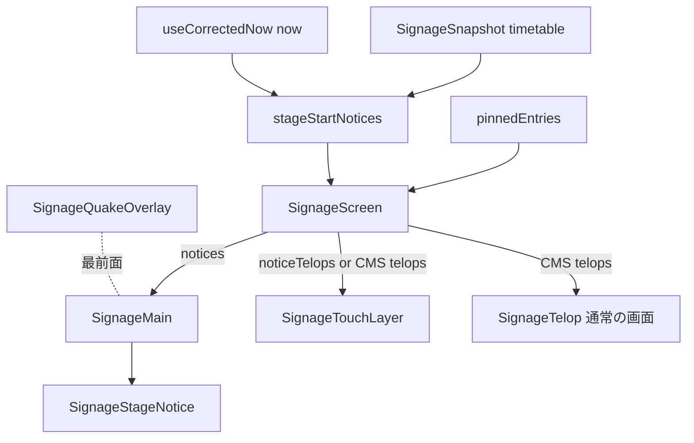
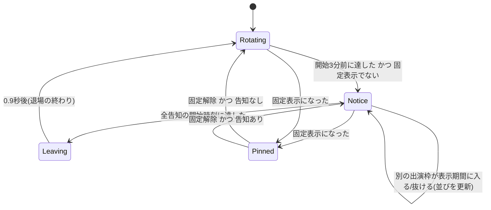

# Design Document

## Overview

**Purpose**: サイネージ(`/signage`)で、ステージ出演枠の開始3分前から開始時刻まで、メインのスライド領域を「まもなく〇〇が始まります」の割り込み表示に置き換え、来場者に出演の開始を知らせる。

**Users**: 会場の来場者が通常の画面で、タッチ操作中の来場者がタッチ操作の画面のテロップで告知を見る。実行委員の操作は増えない(出演枠の登録だけで告知が出る)。

**Impact**: 端末側に、補正済みの時刻とスナップショットのタイムテーブルから表示中の告知を求める純関数を足す。`SignageMain`は告知があればスライドの上に告知の層を重ね、背景図形の集合・拍・退場の動きを付ける。`SignageScreen`はタッチ操作の画面へ渡すテロップを表示期間中だけ告知に差し替える。CMS・API・配信経路は変更しない。

### Goals
- 全端末が同じ瞬間に告知を出し入れする(2.1〜2.3)
- 告知の間も左カラム・テロップ・バス案内と、裏の巡回の位置を保つ(1.3、3.1)
- 固定表示・地震速報・タッチ操作を妨げない(3.3、5.1、7.1)

### Non-Goals
- 出演枠ごとの表示可否、告知の分数の設定(1.4。3分は定数)
- 終了前・公演中の告知、音
- 通常の画面のテロップへの告知(7.4)、テロップの告知の動き(8.8)

## Boundary Commitments

### This Spec Owns
- 表示中の告知を求める純関数`stageStartNotices`と型`StageStartNotice`
- 告知をテロップの項目へ変換する`noticeTelops`
- メインの領域の告知の部品`SignageStageNotice`と、そのFigmaのフレーム
- 告知の背景図形の配置と動きの値(`signage-stage-notice-shapes.ts`)

### Out of Boundary
- CMSのコレクション・グローバル、`/api/signage`、スナップショットの形、配信経路(`signage-hub`・`signage-channel`)
- `SignageTelop`・`SignageTouchLayer`の見た目と内部の挙動(渡す`telops`の中身だけを替える)
- 地震速報のオーバーレイ、固定表示の判定(`pinnedEntries`)、タッチ操作の開閉(`useTouchSession`)

### Allowed Dependencies
- `frontend/src/lib/timetable.ts`の`Timetable`・`TimetablePerformance`・`TimetableStage`
- `frontend/src/lib/signage.ts`の`SignageSnapshot`・`SignageTelopItem`・`pinnedEntries`
- `useCorrectedNow`が返す補正済みの`now`
- 既存の`CrossFade`
- `frontend/src/components/background-shapes.tsx`の`ShapeFill`・`InfRing`と質感画像(`/images/textures/pamphlet/*.webp`)

### Revalidation Triggers
- `TimetablePerformance`の`name`・`slot.startAt`、`Timetable.stages`の形の変更
- `SignageTelopItem`の形、`SignageTouchLayer`の`telops`の受け方の変更
- 固定表示・地震速報の重なり順(`.signage-canvas`の子の順)の変更

## Architecture

### Existing Architecture Analysis
- 表示はすべて補正済みの`now`(`Date.now() + offsetMs`、毎秒)から純関数で決まる。巡回は`slideAt(buildPlaylist(data, now), now)`、いまのステージは`stageNow(data.timetable, now)`
- `.signage-canvas`の子の順は、左カラム等 → テロップ → バス → `SignageMain` → `SignageTouchLayer`(開いている間は`absolute inset-0 bg-background`でキャンバス全体を覆う) → 地震速報のオーバーレイ
- 固定表示中は`buildPlaylist`が固定スライドだけを返し、`useTouchSession`は`pinned`でタッチ操作を閉じる

### Architecture Pattern & Boundary Map



**Architecture Integration**:
- Selected pattern: 端末側の純関数(`stageNow`・`slideAt`と同じ)。サーバー・配信経路を足さない
- Domain/feature boundaries: 判定は`lib`、表示は`components/signage`。`SignageScreen`は判定結果を部品へ配るだけ
- Existing patterns preserved: 補正済みの`now`による全端末同期、`CrossFade`によるメインの切り替え、地震速報のオーバーレイが最前面
- New components rationale: `SignageStageNotice`はCMSのスライドの種別ではないため、`SLIDE_RENDERERS`に入れず別部品にする(research.md「割り込みはプレイリストの項目にせず」)

### Technology Stack

| Layer | Choice / Version | Role in Feature | Notes |
|-------|------------------|-----------------|-------|
| Frontend | Next.js 15 / React 19(既存) | 判定関数・告知の部品 | 新規の依存なし |
| Backend / Data | 変更なし | — | 既存のスナップショットの`timetable`を使う |

## File Structure Plan

### Directory Structure
```
frontend/src/
├── lib/
│   └── signage-stage-notice.ts          # stageStartNotices / noticeTelops / STAGE_NOTICE_LEAD_MS
│   └── signage-stage-notice.test.ts
│   └── signage-stage-notice-shapes.ts   # 告知の図形9個の配置、拍・集合・退場の値と拍の位相の関数
│   └── signage-stage-notice-shapes.test.ts
└── components/signage/
    ├── signage-stage-notice.tsx         # メインの領域の告知(1〜4件を1枚に並べる)
    └── signage-stage-notice.test.tsx
```

### Modified Files
- `frontend/src/components/signage/signage-main.tsx` — props `notices`・`now`を足し、スライドの上に`SignageStageNotice`の層を重ねる。告知が空になった後も退場の間だけ直前の告知を保持する
- `frontend/src/app/globals.css` — 告知の集合・拍・回転・退場・フェードの`@keyframes`
- `frontend/src/components/signage/signage-screen.tsx` — 固定表示でなければ`stageStartNotices`を求め、`SignageMain`へ`notices`、`SignageTouchLayer`へ告知があれば`noticeTelops(notices)`を、無ければCMSのテロップを渡す

## System Flows



- 状態は保持せず、毎秒`now`から求め直す。上の遷移は`now`・固定表示・スナップショットの変化の結果
- Rotating・Notice・Leaving のどれでも`slideAt`は同じ`now`で計算し続け、告知の層の下にスライドを出し続ける。退場で白の地が消えると、その時刻のスライドが見える(1.3、8.6)
- 固定表示になった場合も Leaving を経る(告知が空になったことは同じため)
- タッチ操作の画面を開いている間は、`SignageTouchLayer`がキャンバス全体を覆うため、メインの告知は見えない(7.1)。テロップだけが告知に替わる(7.2、7.3)
- 地震速報のオーバーレイは最前面のため、どの状態でも上に出る(3.3)

## Requirements Traceability

| Requirement | Summary | Components | Interfaces | Flows |
|-------------|---------|------------|------------|-------|
| 1.1, 1.2 | 開始3分前〜開始に出す | stageStartNotices, SignageMain | `stageStartNotices`, `STAGE_NOTICE_LEAD_MS` | Rotating⇄Notice |
| 1.3 | 裏で巡回が進む | SignageScreen | `slideAt`(既存) | — |
| 1.4 | 全出演枠が対象 | stageStartNotices | — | — |
| 1.5 | 出演枠の変更に追随 | SignageScreen | 既存のスナップショット更新 | — |
| 2.1〜2.3 | 全端末の同期 | stageStartNotices | `now`(既存) | — |
| 3.1, 3.2 | メインの領域だけ、横・縦 | SignageMain, SignageStageNotice | `.signage-main-frame` | — |
| 3.3 | 地震速報の下 | SignageScreen | 子の順(既存) | — |
| 4.1, 4.2 | 文言と表示名・ステージ名 | SignageStageNotice | `StageStartNotice` | — |
| 4.3 | 表示名が空なら出さない | stageStartNotices | — | — |
| 4.4 | Figmaに合わせる | SignageStageNotice | Figmaのフレーム | — |
| 5.1 | 固定表示を優先 | SignageScreen | `pinnedEntries`(既存) | Pinned |
| 6.1 | 重なりは1枚に並べる | stageStartNotices, SignageStageNotice | ステージ順の並び | — |
| 7.1 | タッチ中はメニュー等に出さない | SignageTouchLayer(既存) | — | — |
| 7.2, 7.3 | タッチ中のテロップは告知だけ | noticeTelops, SignageScreen | `noticeTelops` | — |
| 7.4 | 通常の画面のテロップは不変 | SignageScreen | — | — |
| 8.1 | 図形を文字の背面に | SignageStageNotice | `NOTICE_SHAPES` | — |
| 8.2 | 集合とフェードイン | SignageStageNotice | `NOTICE_MOTION.enter` | Rotating→Notice |
| 8.3〜8.5 | 拍・回転・テンポ上昇・全端末同期 | SignageStageNotice | `noticeBpm`, `beatDelaySec` | Notice |
| 8.6 | 退場 | SignageMain, SignageStageNotice | `NOTICE_MOTION.leave` | Notice→Leaving |
| 8.7 | 増減で集合をやり直さない | SignageStageNotice | — | Notice |
| 8.8 | テロップは動かさない | SignageScreen | — | — |

## Components and Interfaces

| Component | Domain/Layer | Intent | Req Coverage | Key Dependencies | Contracts |
|-----------|--------------|--------|--------------|------------------|-----------|
| stageStartNotices | lib | 表示中の告知を求める | 1.1, 1.2, 1.4, 2.1〜2.3, 4.3, 6.1 | Timetable(P0) | Service |
| noticeTelops | lib | 告知をテロップの項目へ | 7.2, 7.3 | SignageTelopItem(P0) | Service |
| SignageStageNotice | UI | メインの領域の告知と背景図形の動き | 3.2, 4.1, 4.2, 4.4, 6.1, 8.1〜8.7 | Figma(P0), ShapeFill・InfRing(P0) | State |
| notice shapes | lib | 図形の配置・動きの値、拍の速さと位相 | 8.1〜8.5 | — | Service |
| SignageMain(変更) | UI | 告知があればスライドの代わりに出す | 1.1, 3.1 | CrossFade(P1) | State |
| SignageScreen(変更) | UI | 判定結果の配布、固定表示の優先 | 1.3, 3.3, 5.1, 7.2〜7.4 | pinnedEntries(P0) | — |

### lib

#### stageStartNotices / noticeTelops(`signage-stage-notice.ts`)

| Field | Detail |
|-------|--------|
| Intent | `now`とタイムテーブルから表示中の告知を求め、テロップの項目にも変換する |
| Requirements | 1.1, 1.2, 1.4, 2.1〜2.3, 4.3, 6.1, 7.2, 7.3 |

**Responsibilities & Constraints**
- 表示期間は`startAt - STAGE_NOTICE_LEAD_MS <= now < startAt`(開始時刻ちょうどで消える)
- 開催日での絞り込みはしない(`startAt`が絶対時刻のため)
- `name`が空白のみ・空の出演枠と、`stageId`が`timetable.stages`に無い出演枠は除く
- 並びは`timetable.stages`の並び順、同じステージ内は開始の早い順
- ステージの色は、左カラムのいまのステージと同じ色になるよう`stageNow`と同じく当日の公演から`stagesWithPerformances`で割り当てる

##### Service Interface
```typescript
export const STAGE_NOTICE_LEAD_MS = 3 * 60 * 1000;

export interface StageStartNotice {
  readonly performanceId: number;
  /** TimetablePerformance.name */
  readonly name: string;
  readonly stageName: string;
  /** STAGE_BAND_CLASSES の添字。いまのステージ(stageNow)と同じ stagesWithPerformances の割り当て */
  readonly colorIndex: number;
  /** ISO。TimetablePerformance.slot.startAt */
  readonly startAt: string;
}

export function stageStartNotices(
  timetable: Timetable,
  now: Date,
): readonly StageStartNotice[];

/** id = -performanceId、audience = 'visitor'、target = stageName、body = `まもなく${name}が始まります` */
export function noticeTelops(
  notices: readonly StageStartNotice[],
): readonly SignageTelopItem[];
```
- Postconditions: 同じ`timetable`と`now`には同じ配列を返す(全端末で一致)
- Invariants: `noticeTelops`の`id`は負数で、CMSのテロップのIDと衝突しない

### UI

#### SignageStageNotice(`signage-stage-notice.tsx`)
```typescript
interface SignageStageNoticeProps {
  /** 1件以上。上限はステージ数 */
  readonly notices: readonly StageStartNotice[];
  /** 補正済み時刻。拍の速さ(残り時間)と位相に使う */
  readonly now: Date;
  /** true の間は退場の動きを出す(SignageMain が告知の空を検知して立てる) */
  readonly leaving: boolean;
}
```
- 層の順(下から): 白の地 → 図形 → 文字。白の地の下に`SignageMain`のスライドがある
- 入場(8.2): マウント時に1度だけ。白の地と文字は0.6秒でフェードイン。図形は定位置から、メイン中心(768,432)→図形中心の向きに離れた位置から寄せる(一辺150以下は200px・1.0秒、それ以外は120px・1.4秒、曲線`cubic-bezier(0.16, 0.84, 0.44, 1)`)。∞の2つの輪は左右に120px離れた位置から寄り、右の輪は0.15秒遅れる。`notices`の増減では再生しない(8.7)
- 拍(8.3〜8.5): 図形ごとに集合が終わってから始める。keyframes は 0%:scale(1) / 15%:scale(1.08) / 100%:scale(1)、ease-out、周期 60/BPM 秒。∞のリングは別に`rotate`で8拍1回転(linear)。`animation-delay`は`beatDelaySec(now, bpm)`で、BPMが変わったときだけ取り直す
- BPM は`noticeBpm(残り秒)`。残り秒 = `notices`の中で最も早い`startAt` − `now`
- 退場(8.6): `leaving`が立ったら、文字を0.3秒でフェードアウト、図形をメイン中心→図形中心の向きに1400px動かす(一辺150以下は0.6秒、それ以外は0.8秒、曲線`cubic-bezier(0.4, 0, 1, 1)`)。∞の2つの輪は左右に160px分かれる。白の地は0.5秒遅れて0.4秒でフェードアウト
- 縦型は既存の仕組みでメインの領域ごと縮小されるため、図形の配置も1種類
- 「まもなく〇〇が始まります」(〇〇 = `name`)とステージ名を、件数分1枚に並べる
- 配置・文字の大きさ・色はFigmaのフレーム(1件・4件の見本)の実測値。縦型は既存の仕組みでメインの領域ごと縮小されるため、横型の16:9の1種類だけを作る
- **Figmaのフレーム**: ファイル`0kWDqHsLr6xE8b4FFgR1Zx`、ページ「デジタルサイネージ」`828:2`の section「ステージ開始告知」`1546:4531`
  - 横型 1件 `1546:4532`(メイン`1546:4534`)、4件 `1546:4637`(メイン`1546:4639`)
  - 縦型 1件 `1547:4344`(メイン`1547:4346`)、4件 `1547:4467`(メイン`1547:4469`)。既存の縦型フレームと同じく横型の値の0.671875倍
  - タッチ操作中のテロップ `1546:4756`
  - 背景図形(静止、各メインの最背面の frame「背景図形」): 横型1件 `1573:4838`、横型4件 `1573:4850`、縦型1件 `1573:4862`、縦型4件 `1573:4874`。配置は下の`NOTICE_SHAPES`と一致
- 1件: ステージ名チップ → 「まもなく」 → 出演名(最大2行・末尾省略) → 「が始まります」。2件以上: 「まもなく」 → 行(ステージ名チップ+出演名、1行・末尾省略)の並び → 「が始まります」。どちらも上下中央・左揃え
- チップの色は`STAGE_BAND_CLASSES[colorIndex]`(Figmaでは`color/bansai-*`の変数)

#### SignageMain(変更)
- props に`notices: readonly StageStartNotice[]`(既定は空配列)を足す。`now`は既存の props を使う
- スライドは従来どおり`CrossFade`で出し続け、その上に`SignageStageNotice`の層を重ねる

##### State Management
- 直前の空でない`notices`と退場中かを保持する。`notices`が空になったら`leaving`を立て、`NOTICE_MOTION.leave.totalMs`(900)後に層を外す。退場中に`notices`が空でなくなったら、層を新しくマウントし直す(入場から再生)
- 告知の判定そのものは持たない。`notices`は毎秒の`now`から親が求める

#### notice shapes(`signage-stage-notice-shapes.ts`)
```typescript
type NoticeShape =
  | { readonly kind: ShapeKind; readonly size: number; readonly rot: number; readonly cx: number; readonly cy: number;
      readonly texture: TextureId; readonly pos: readonly [number, number]; readonly texRot: number }
  | { readonly kind: 'ring'; readonly diameter: number; readonly rot: number; readonly cx: number; readonly cy: number;
      readonly colors: readonly [RingColor, RingColor] };

export const NOTICE_SHAPES: readonly NoticeShape[];
export function noticeBpm(remainingSec: number): 100 | 120 | 140;
/** 壁時計に揃えた負の animation-delay(秒)。全端末で拍が揃う */
export function beatDelaySec(now: Date, bpm: number, beats?: number): number;
```
- `NOTICE_SHAPES`(メイン 1536×864 の座標、中心。回転は度、時計回り正):

| # | 種類 | 一辺/直径 | 回転 | 中心 | 質感 / 色 | 模様の位置 | 模様の回転 |
|---|------|-----------|------|------|-----------|------------|------------|
| 1 | square | 340 | 15 | 1450,120 | watercolor | 0,40 | 30 |
| 2 | semicircle | 300 | -20 | 1380,800 | gradient | 100,50 | 120 |
| 3 | ring | 160 | -8 | 1200,160 | ochre / salmon | — | — |
| 4 | circle | 90 | 0 | 90,60 | grain | 40,100 | 200 |
| 5 | triangle | 100 | 20 | 60,820 | streak | 100,0 | 60 |
| 6 | quarterCircle | 110 | 0 | 760,840 | grain | 0,40 | 300 |
| 7 | roundedSquare | 80 | -15 | 1530,470 | gradient | 40,100 | 90 |
| 8 | circle | 260 | 0 | 700,430 | streak | 100,50 | 150 |
| 9 | square | 90 | 25 | 300,200 | watercolor | 100,0 | 10 |

- `noticeBpm`: 残り60秒より多い→100、30〜60秒→120、30秒未満→140(8.4)
- `beatDelaySec`: `-((now.getTime() % (周期ms × beats)) / 1000)`。拍は`beats=1`、回転は`beats=8`

#### SignageScreen(変更)
- `const pinned = data !== null && pinnedEntries(data, now).length > 0`を1度求め、`useTouchSession`と告知の両方に使う
- `const notices = data && !pinned ? stageStartNotices(data.timetable, now) : []`
- `SignageMain`に`notices`を渡す
- `SignageTouchLayer`の`telops`は`notices.length > 0 ? noticeTelops(notices) : data?.telops ?? []`。通常の画面の`SignageTelop`は従来どおりCMSのテロップ

## Performance
- 図形は9個固定。動きはCSSの`animation`(`transform`・`rotate`・`translate`・`opacity`)だけで、毎フレームのJSは使わない。拍の再計算はBPMが変わったとき(最大3回)だけ

## Error Handling
- スナップショットが無い(`data === null`)間は告知を出さない(巡回と同じ)
- 表示名が空・ステージが見つからない出演枠は黙って除く(4.3)。例外は投げない

## Testing Strategy
- **Unit(`signage-stage-notice.test.ts`)**: 開始3分前ちょうどで含む・開始時刻ちょうどで含まない・3分1秒前は含まない、別の日の同じ時刻を含まない、表示名が空の枠を除く、ステージの並び順、`noticeTelops`の`id`・`target`・`body`
- **Unit(`signage-stage-notice-shapes.test.ts`)**: `noticeBpm`の境界(60秒ちょうど・30秒ちょうど)、`beatDelaySec`が周期内の負の値で同じ時刻に同じ値
- **Unit(`signage-main.test.tsx`)**: `notices`があればスライドの上に告知の層、空になってから0.9秒は`leaving`で残り、その後に外れる
- **Unit(`signage-screen.test.tsx`)**: 固定表示中は告知を出さない、告知中も通常の画面のテロップはCMSのまま、タッチ操作の画面のテロップは告知に替わる、地震速報のオーバーレイが告知より後(上)の子
- **実ブラウザ**: ローカルのCMSで出演枠の開始時刻を数分後に合わせ、`make dev`の`/signage`で横型・縦型の告知の出入り、1件・複数件の並び、タッチ操作中のテロップを実測する。集合後・退場の途中(0.3秒)・退場後(0.75秒で全図形が枠外)を、Artifact の見本(https://claude.ai/artifact/MXawNgJ1QmV9sUep4spLVk)と数値で突き合わせる。寸法はFigmaのフレームと突き合わせる
