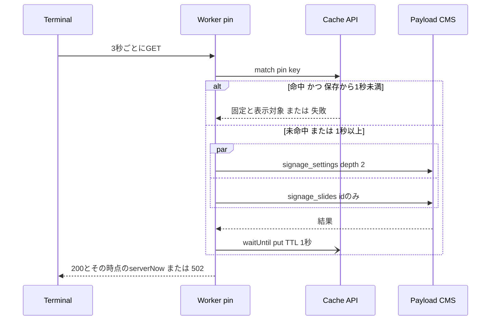

# Design Document

## Overview
**Purpose**: サイネージの固定表示とグループの表示状態の確認(`/api/signage/pin`)が、CMSへ届く問い合わせを端末の台数に比例させないようにする。

**Users**: 実行委員はCMSで固定やグループを切り替え、来場者は会場の各端末で同期した表示を見る。どちらの操作・見え方も変わらない。

**Impact**: `getPinState`が、固定と表示対象(または失敗)をWorkersのCache APIにTTL 1秒で1エントリとして共有する。CMSへの2回の問い合わせはキャッシュ未命中時だけになり、データセンターあたり概ね1秒に1組に収まる。端末のポーリング、時刻補正、スナップショット、CMSは変えない。

### Goals
- CMSへの確認の問い合わせを、端末の台数に依らない上限(データセンターあたり概ね1秒に1組)に収める
- CMS障害中も、問い合わせ頻度を正常時の上限以下に保つ
- `serverNow`による時刻補正と、全端末の同期の精度を維持する

### Non-Goals
- Workersの要求数そのものの削減(端末のポーリング間隔は変えない。要求数は運用で抑える)
- push(WebSocket・SSE・Durable Objects)、条件付きリクエスト、スナップショットへの統合(不採用の理由は`research.md`)
- CMSへの保存時通知の追加
- スナップショット`/api/signage`の取得方式とキャッシュの変更

## Boundary Commitments

### This Spec Owns
- `getPinState`の取得経路: Cache APIのエントリの形・キー・TTL・失敗の保存
- `/api/signage/pin`の応答の作り方(`serverNow`を要求ごとに付けること)

### Out of Boundary
- 端末側のポーリング(`usePinnedSlide`・`usePolling`)、時刻補正(`clockOffsetMs`・`useCorrectedNow`)、同期の計算(`buildPlaylist`・`slideAt`)、`withPin`・`missingSlideIds`
- スナップショットの取得と`cachedFetch`の振る舞い
- CMSの公開判定・表示対象の計算(`cms/src/lib/signage-visibility.ts`)、固定とグループの操作画面とフック
- Cloudflare Accessの設定

### Allowed Dependencies
- `frontend/src/lib/cms.ts`の`cms.findGlobal`・`cms.findMany`(`ttlSeconds: 0`)と、Cache APIの取得(`getEdgeCache`を公開して共有する)
- `@opennextjs/cloudflare`の`getCloudflareContext().ctx.waitUntil`(既存の`cachedFetch`と同じ使い方)
- 依存方向: `cms-types.ts` → `lib/cms.ts` → `lib/signage-data.ts` → `app/api/signage/pin/route.ts`。逆向きの参照はしない

### Revalidation Triggers
- `SignagePinState`のフィールドの削除・型変更(稼働中の端末の旧JSが読む)
- `PIN_CACHE_TTL_SECONDS`またはポーリング間隔の変更(反映時間の見積もりが変わる)
- サイネージのAPIを保護する方式の変更(Accessの有無でCache APIの可否が変わりうる)
- `/api/signage/pin`の利用者がサイネージ端末以外に増えること

## Architecture

### Existing Architecture Analysis
- 端末は取得完了から3秒後に次の`/api/signage/pin`を送る。画面が非表示の間はポーリングを止め、表示に戻ると即時に1回取得する
- `getPinState`は毎回`signage_settings`(depth=2)と`signage_slides`(idのみ)をno-storeで並行して取得する。CMSは未認証の読み取りごとに有効なスライドとグループをDBから読み、表示対象に絞る
- 応答の`serverNow`は、端末の時刻補正(serverNow+RTT/2−受信時刻)の情報源で、補正は3秒ごとに更新される
- スナップショットは20秒ごとに、CMSへの約10回の取得をCache API(TTL 15秒)で共有している
- Cache API(`caches.default`)はデータセンター単位で、複製されない

### Architecture Pattern & Boundary Map
- Selected pattern: 結果単位の短TTL共有キャッシュ(read-through、負キャッシュあり)
- Domain/feature boundaries: 共有するのはサーバー側の「固定と表示対象」だけ。時刻はキャッシュに入れない
- Existing patterns preserved: `CmsResult`による成功・失敗の判別、`waitUntil`での保存、routeは502とno-storeを返す
- New components rationale: 新しいファイルや抽象化は増やさない。`signage-data.ts`内の関数の追加と`getPinState`の中身の変更に留める
- Steering compliance: Edge Runtimeの制約内(Node専用APIを使わない)、`any`を使わない、追加の有料サービスを使わない

### Technology Stack

| Layer | Choice / Version | Role in Feature | Notes |
|-------|------------------|-----------------|-------|
| Backend / Services | Next.js 15 Route Handler(既存) | `/api/signage/pin`の応答 | 変更なし |
| Data / Storage | Cloudflare Workers Cache API(`caches.default`) | pinの状態の共有(TTL 1秒) | 新たな依存なし。既にスナップショットで使用 |
| Infrastructure / Runtime | Cloudflare Workers + `@opennextjs/cloudflare`(既存) | `waitUntil`による非同期保存 | 変更なし |

## File Structure Plan

### Modified Files
- `frontend/src/lib/signage-data.ts` — pinの状態のCache APIへの読み書きを追加し、`getPinState`をキャッシュ経由にする。`PIN_CACHE_TTL_SECONDS`を定義する
- `frontend/src/lib/cms.ts` — `getEdgeCache`を公開する(振る舞いは変えない)
- `frontend/src/lib/signage-data.test.ts` — 命中・失効・負キャッシュ・`serverNow`のテストを追加する

`route.ts`、`signage-pin.ts`、端末側のコンポーネント、`cms/`は変更しない。

## System Flows



- `serverNow`はキャッシュの命中・未命中に関わらず、応答を組み立てる直前の時刻を付ける。端末の補正は従来どおりRTTの半分を足すので、命中で応答が速くなっても補正の式は変わらない
- 保存は`waitUntil`で応答と並行して行う。CMSの往復中に届いた要求は未命中になり、それぞれCMSへ問い合わせる(許容。上限はPerformance & Scalability)
- 失敗も同じTTLで保存し、命中した要求は502を返す

## Requirements Traceability

| Requirement | Summary | Components | Interfaces | Flows |
|-------------|---------|------------|------------|-------|
| 1.1 | 固定の選択・解除をおよそ3秒で反映 | PinStateCache | `getPinState` | 反映遅延は最悪約4秒強(Performance & Scalability) |
| 1.2 | グループの切替を反映 | PinStateCache(表示対象を固定と同じエントリに持つ)、端末の既存の取り直し | `getPinState` | 外すのは1.1と同じ時間。加わるスライドは既存の`?fresh=1`経由で数秒 |
| 1.3 | 自動解除も同じ時間で反映 | PinStateCache | `getPinState` | CMSの自動解除の結果を1.1と同じ経路で読む |
| 1.4 | 他データの更新を待たない | PinStateCache | `getPinState` | スナップショットとは別のエントリ・TTL |
| 1.5 | 非表示からの復帰・通信回復で追いつく | 既存の`usePolling`(変更なし)、PinStateCache | — | 復帰時の即時取得が受け取るのは最大1秒前の状態 |
| 2.1 | 同時刻に同じスライド | 既存の同期計算(変更なし) | — | 全端末が同じエントリを読むので、データセンター内では同じ組を受け取る |
| 2.2 | 配信元の時刻に合わせる | PinRoute(`serverNow`を要求ごとに付与) | `SignagePinState.serverNow` | System Flows |
| 2.3 | 反映途中の食い違いを1の範囲に | PinStateCache | — | 端末間の差はポーリングの位相差(最大約3秒)+TTL(1秒)以内 |
| 2.4 | 起動・回復直後に揃う | 既存の`usePolling`の即時取得、PinStateCache | — | — |
| 3.1 | CMSへの問い合わせを台数に比例させない | PinStateCache | — | データセンターあたり概ね1秒に1組 |
| 3.2 | Paidの込み量に収める | 運用と実測に依存 | — | Performance & Scalability、Testing Strategy |
| 3.3 | 有料の追加サービスを使わない | Cache APIのみ | — | — |
| 3.4 | 失敗中も問い合わせを増やさない | PinStateCache(負キャッシュ)、既存の端末の再試行間隔 | `PinCacheEntry` | Error Handling |
| 4.1 | 失敗時は直前の状態を保つ | PinRoute(502、変更なし)、既存の`usePolling` | — | Error Handling |
| 4.2 | 時刻を取れないときは直前のずれ | 既存の`usePinnedSlide`(失敗時は補正を更新しない) | — | — |
| 4.3 | 成功で再読み込みなしに戻る | 既存の`usePolling` | — | — |
| 5.1 | 表示対象外の中身を配信しない | PinStateCache(保存する前に表示対象で絞った結果だけを持つ) | `PinCacheEntry` | Security Considerations |
| 5.2 | 認証を通った要求だけ受け付ける | Cloudflare Access(変更なし) | — | Security Considerations |
| 5.3 | 他データは数十秒以内に反映 | スナップショット(変更なし) | — | — |
| 5.4 | 操作の手順と画面を変えない | CMS(変更なし) | — | — |

## Components and Interfaces

| Component | Domain/Layer | Intent | Req Coverage | Key Dependencies (P0/P1) | Contracts |
|-----------|--------------|--------|--------------|--------------------------|-----------|
| PinStateCache | lib(`signage-data.ts`) | 固定と表示対象をCache APIで共有し、未命中時だけCMSへ問い合わせる | 1.1, 1.2, 1.3, 1.4, 1.5, 2.1, 2.3, 2.4, 3.1, 3.3, 3.4, 5.1 | `cms`(P0)、Cache API(P1) | Service, State |
| PinRoute | app/api(`pin/route.ts`) | 結果を200/502で返す | 2.2, 4.1 | PinStateCache(P0) | API |

### lib

#### PinStateCache

| Field | Detail |
|-------|--------|
| Intent | pinの状態(または失敗)を1エントリで共有し、`serverNow`を要求ごとに付けて返す |
| Requirements | 1.1, 1.2, 1.3, 1.4, 1.5, 2.1, 2.2, 2.3, 2.4, 3.1, 3.3, 3.4, 5.1 |

**Responsibilities & Constraints**
- 固定のスライドと表示対象のIDを、同じ時点に取得した組として保存する。片方だけを新しくしない
- 失敗(2回の問い合わせのどちらかの失敗)も同じTTLで保存する
- `serverNow`はエントリに含めない
- Cache APIが無い・使えない環境(テスト、ローカル、Cache APIが無効な経路)では、毎回CMSへ問い合わせる現行の振る舞いになる
- 保存の失敗(`waitUntil`を取れない等)は応答に影響させない

**Dependencies**
- Inbound: PinRoute — 状態の取得(P0)
- Outbound: `cms.findGlobal('signage_settings', { depth: 2 }, { ttlSeconds: 0 })`・`cms.findMany('signage_slides', …, { ttlSeconds: 0 })` — 未命中時の取得(P0)
- External: Cloudflare Cache API(`getEdgeCache()`)— 共有(P1。無くても動く)、`getCloudflareContext().ctx.waitUntil` — 非同期保存(P1)

**Contracts**: Service [x] / API [ ] / Event [ ] / Batch [ ] / State [x]

##### Service Interface
```typescript
// signage-data.ts
export const PIN_CACHE_TTL_SECONDS = 1;

/** 既存の公開関数。シグネチャは変えない */
export function getPinState(): Promise<CmsResult<SignagePinState>>;

// cms.ts(既存の非公開関数を公開する)
export function getEdgeCache(): Cache | undefined;
```
- Preconditions: なし(未認証の公開読み取りのみを行う)
- Postconditions: 成功なら`serverNow`は応答を組み立てた時点の時刻、`slide`と`visibleSlideIds`は同じ時点にCMSから得た組。保存から`PIN_CACHE_TTL_SECONDS`未満の保存済みの結果があればCMSへ問い合わせない
- Invariants: `slide`が`null`でないとき、そのIDは`visibleSlideIds`に含まれる(既存の判定をそのまま使う)

##### State Management
- State model:
```typescript
type PinCacheEntry =
  | {
      readonly ok: true;
      /** 保存した時刻(epoch ms)。Cache APIの失効の精度に頼らず読み出し時にも判定する */
      readonly storedAtMs: number;
      readonly slide: SignageSlide | null;
      readonly visibleSlideIds: readonly number[];
    }
  | {
      readonly ok: false;
      readonly storedAtMs: number;
      readonly error: CmsFetchError;
    };
```
- Persistence & consistency: `caches.default`に1キー(CMSのURLを基にした固定のGETキー。例`${NEXT_PUBLIC_CMS_URL}/__signage_pin`)で、JSONの200応答として保存する。`Cache-Control: s-maxage=1`を付け、読み出し時は`storedAtMs`から1秒以上経っていれば未命中として扱う。データセンターごとに独立した状態で、データセンター間の整合はとらない
- Concurrency strategy: 単一フライト化しない。CMSの往復中の未命中は各自問い合わせ、最後に保存したものが残る(どれも同じ時点前後のCMSの状態なので、どれが残っても正しい)

**Implementation Notes**
- Integration: 現行の`getPinState`の2回の取得と`toSlide`による整形を、キャッシュ未命中時の取得として使う。`cachedFetch`は使わない(成功しか保存しない、2つの取得が別々の時点で保存・失効し固定と表示対象が不整合になりうる)
- Validation: 読み出したJSONが`PinCacheEntry`の形でなければ未命中として扱う(デプロイをまたいで形が変わった場合に備える)
- Risks: Cloudflare Accessの背後でCache APIが使えない可能性がある(公式ドキュメントの記載)。その場合も振る舞いは現行と同じで、CMS負荷が下がらないだけ。本番で命中を確かめる(Testing Strategy)

### app/api

#### PinRoute
- 既存の`/api/signage/pin`。変更しない。`getPinState`が成功なら200で`SignagePinState`、失敗なら502で`{ error: 'cms_unavailable' }`、どちらも`Cache-Control: no-store`

##### API Contract
| Method | Endpoint | Request | Response | Errors |
|--------|----------|---------|----------|--------|
| GET | /api/signage/pin | なし | `SignagePinState`(`serverNow`・`slide`・`visibleSlideIds`) | 502(CMSの取得失敗、保存された失敗の命中を含む) |

## Data Models

### Data Contracts & Integration
- `SignagePinState`は変更しない。稼働中の端末の旧JSと新しいWorkerの組み合わせでもそのまま動く
- `PinCacheEntry`はWorker内だけで使う。端末へは出さない

## Error Handling

### Error Strategy
- CMSへの2回の問い合わせのどちらかが失敗したら、その`CmsFetchError`をTTL 1秒で保存し、502を返す。失敗中もCMSへの問い合わせはデータセンターあたり概ね1秒に1組で、正常時の上限を超えない(3.4)
- 端末は502を受けると直前の状態と直前の時刻補正のまま表示を続け、3秒後に再試行する(既存の`usePolling`。4.1, 4.2)。間隔は短くしないので、端末からの要求も増えない(3.4)
- CMSが復旧すると、最長1秒で保存された失敗が失効し、次の未命中で成功が保存される。端末は再読み込みなしに戻る(4.3)
- Cache APIの読み書きの例外は握りつぶし、CMSへの直接の取得に倒す。キャッシュの不調で確認を止めない

### Monitoring
- 新しいログは足さない。CMS側のアクセスログで`/api/globals/signage_settings?depth=2`の頻度を見れば、命中の有無と失敗中の問い合わせ頻度が分かる

## Testing Strategy

### Unit Tests(vitest、`signage-data.test.ts`。`caches`は既存の`cms.test.ts`と同じく`vi.stubGlobal`で差し替える)
- 保存から1秒未満のエントリがあれば、CMSへ問い合わせずにその`slide`と`visibleSlideIds`を返す
- 保存から1秒以上経ったエントリは使わず、CMSへ2回問い合わせて保存し直す
- CMSの失敗を保存し、1秒未満の後続の呼び出しはCMSへ問い合わせずに失敗を返す
- 命中した2回の呼び出しで、`serverNow`がそれぞれの呼び出し時点の時刻になる(エントリの時刻ではない)
- `caches`が無い環境と形の合わないエントリでは、毎回CMSへ問い合わせる(現行の振る舞い)

### Integration Tests
- `route.test.ts`の既存のテスト(成功で200、失敗で502、no-store)が変更なしに通る

### 本番での確認
- CMSへの問い合わせ数: 本番で端末を1台と複数台(例3台)表示した状態をそれぞれ数分保ち、CMSのアクセスログ(`make kubectl ARGS="logs …"`でCMSのPodまたはIngressのログ)から`/api/globals/signage_settings?depth=2`の1分あたりの件数を数える。台数を増やしても概ね60件/分前後に留まれば命中している。台数に比例して増えるならCache APIが効いていない(Accessの背後の制約の疑い)と判断し、`research.md`の代替案を検討する
- 反映時間: CMSで固定を保存してから、複数の端末の表示が切り替わるまでの時間をストップウォッチで測り、最悪約4秒強に収まることを確かめる
- CPU時間: 実装後、CloudflareのダッシュボードのWorkersのメトリクスでCPU時間(中央値・p99)を確認する。要求の大半がpinなので、全体の値でpinを近似できる。1要求あたり平均約3.2msを超えるなら、Paid期間の込み量(3,000万ms)を超えうるので、表示時間を運用で絞る
- PRプレビュー(workers.dev)では応答の形と502の振る舞いだけを確かめ、命中の確認には使わない

## Security Considerations
- 共有するのは、未認証の公開読み取りの結果(表示対象で絞られた固定のスライドと表示対象のID)だけで、現行の応答と同じ情報である(5.1)
- エントリはWorker内のCache APIにあり、外部から直接読む経路は無い。`/api/signage/pin`への要求はこれまでどおりCloudflare Accessで認証され、拒否された要求はWorkerを起動しない(5.2)

## Performance & Scalability
- CMSへの確認の問い合わせ: 1データセンターあたり、1秒に「1組+CMSの往復中に届いた要求の数」組が上限。9台(合計約3要求/秒)・往復0.2秒なら平均で1秒に約1.6組で、現行(1秒に約3組)より少なく、台数を増やしても1組/秒の部分は増えない。数十台に増やすなら、往復中の未命中が比例して増えるので、isolate内で進行中の取得を共有するかTTLを延ばす
- 反映時間: 保存の直前にCMSから得た状態がキャッシュに1秒残り、端末の次の取得まで最大3秒+往復かかるため、最悪で約4秒強(TTL 1秒+ポーリング3秒+CMSと端末の往復)。平均は約2秒強。現行(最悪3秒+往復)より最大1秒遅く、1.1の「およそ3秒」をわずかに超えうる
- 端末間の食い違い: 同じデータセンターの端末は同じエントリを読むので、食い違いはポーリングの位相差(最大約3秒)とTTL(1秒)の範囲に収まる
- Workersの要求数: 端末1台あたりpin 28,800件/日+スナップショット約4,320件/日。9台で約30万件/日、Paid期間(10/23〜11/22、31日)を終日つけっぱなしにすると約924万件となり、公式サイト分(ピーク日に1日約10万件)と合わせると月1,000万件の込み量に迫るか超える。使わない時間帯は画面を消す(非表示でポーリングが止まる)と大きく下回る(例: 開催3日間に1日12時間だけ表示すると約45万件)。超過しても100万件あたり0.30ドルで、配信は止まらない
- CPU時間: 924万件を3,000万msに収めるには、1要求あたり平均約3.2ms以下が要る。命中時はCMSへの問い合わせが無くなるが、Next.jsのルート処理自体の時間は実測が要る(Testing Strategy)
