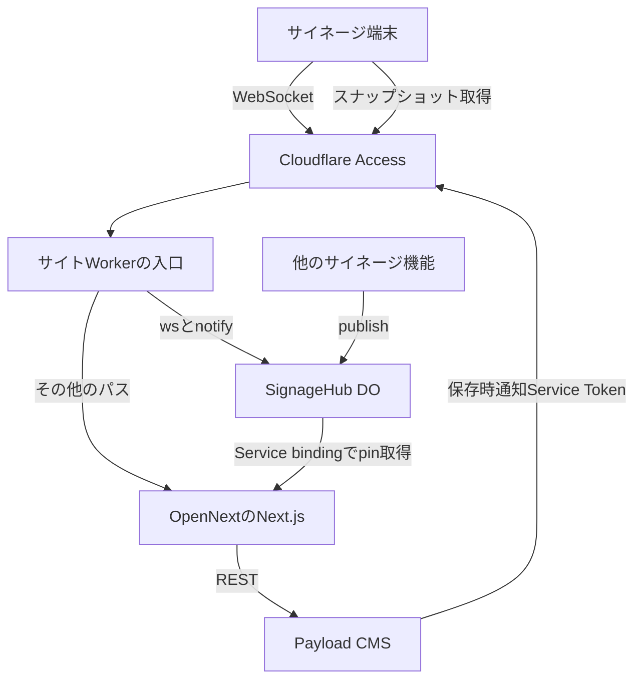
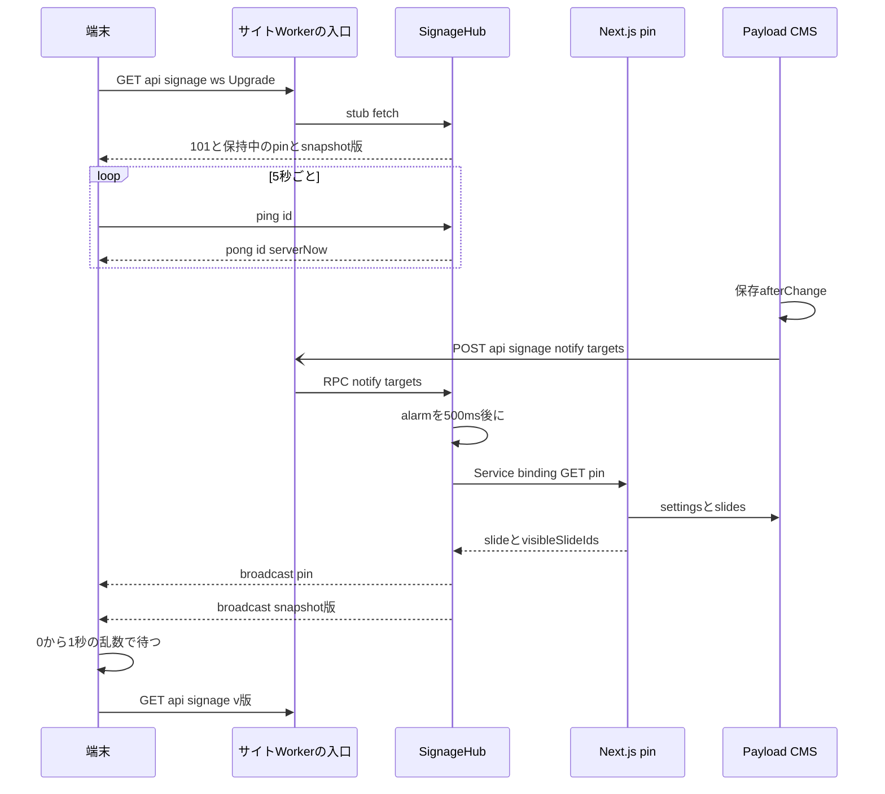

# Design Document

## Overview
**Purpose**: サイネージの全端末へサーバーから即時に知らせる配信経路を、Durable Object(以下DO)とWebSocket Hibernationで用意する。固定表示とグループの表示状態はこの経路で端末へ届け、スライドやテロップなど表示内容の更新は「取り直せ」という知らせだけを届けて、端末が既存のスナップショットを取り直す。

**Users**: 実行委員はCMSでこれまでどおり保存するだけで、数秒以内に全端末の表示が変わる。来場者は会場のどの端末でも同じ時刻に同じ表示を見る。緊急地震速報など他のサイネージ機能の開発者は、同じ経路で全端末へメッセージを送る。

**Impact**: 端末の3秒ごとの`/api/signage/pin`のポーリングをやめ、1本のWebSocketとその上のping/pongに置き換える。CMSは保存時にサイトのWorkerへ通知する。スナップショットのポーリングは20秒から2分に延ばす。DOは別のWorker(`aramakisai-signage-hub`)に置き、サイトのWorkerはカスタムの入口からDOへ中継する。

### Goals
- 固定表示とグループの切替を保存からおよそ3秒以内、表示内容の更新を保存から数秒以内に全端末へ反映する
- CMSへの問い合わせとWorkersの要求数を、端末の台数にほぼ比例させない(9台・31日で約38万要求)
- 時刻補正をWebSocketのping/pong上で続け、全端末の同期の精度を保つ
- 他のサイネージ機能が全端末へメッセージを送れる共通の口と、メッセージの有効期限の扱いを定める
- Workersのリクエスト数・CPU時間とDOのリクエスト数・GB-sを、運用ダッシュボードで込み量・上限に対する割合として見られるようにする

### Non-Goals
- 緊急地震速報の上流接続(P2P地震情報・Wolfx)、中継、速報の中身と有効期限の値
- スライドやテロップの中身をpushで配ること(中身は既存の公開判定を通るHTTP取得のままにする)
- Cloudflare Accessの保護範囲の変更(既存の`aramakisai.com/api/signage`配下に収める)
- `cachedFetch`のCache APIがAccessの背後で効くかどうかの解消

## Boundary Commitments

### This Spec Owns
- サイネージのハブのDO(`SignageHub`)とその置き場のWorker(`aramakisai-signage-hub`)
- サイトのWorkerのカスタムの入口(`/api/signage/ws`と`/api/signage/notify`の振り分け)
- 端末とハブのあいだのメッセージの型(`SignageServerMessage`・`SignageClientMessage`)と、他機能が送るメッセージの型(`SignageBroadcast`)、有効期限の扱い
- 端末のWebSocketクライアント(接続・再接続・追いつき・ping/pongによる時刻補正)
- CMSの保存時通知(送る側のフックと、受ける側の認証)
- スナップショットの取り直しの経路(版による共有キー)と、ポーリング間隔
- デプロイ手順への組み込み(ハブのWorkerのデプロイ、bindingとmigration)
- 運用ダッシュボードのCloudflareの利用量のうち、WorkersのCPU時間とDOのリクエスト数・GB-sの取得と表示、Workersのプランの期間の宣言(`aramakisai-infra`のcollectorの該当部分)

### Out of Boundary
- 緊急地震速報の上流接続・中身・有効期限の値(別spec。この経路の`publish`を使う)
- スナップショットの中身の組み立て(`getSignageSnapshot`の各取得と整形)、`getPinState`の判定、同期の計算(`buildPlaylist`・`slideAt`)
- CMSの公開判定・表示対象の計算(`signage-visibility.ts`)、固定の自動解除(`releasePinIfHidden`等)の判定
- Cloudflare AccessのアプリケーションとService Tokenの定義(`aramakisai-infra`のTerraform)、CMSのk8s Secret(`aramakisai-infra`の`cms-secrets`)
- 運用ダッシュボードの画面の構成、警告の閾値(`thresholds.warn_ratio`)、Cloudflare以外の利用量

### Allowed Dependencies
- Cloudflare Workers・Durable Objects(SQLite backed)・Service binding・`@opennextjs/cloudflare`の生成する`.open-next/worker.js`
- 既存の`/api/signage/pin`(ハブがService binding経由で読む)と`/api/signage`
- CMSの`afterChange`・`afterDelete`フックと`cms/src/env.ts`の`optionalEnv`
- 運用ダッシュボードのcollectorの既存の仕組み(`plan.py`の`quota_item`・`active_plan`、`OPS_CLOUDFLARE_READ_TOKEN`)
- 依存方向: `lib/signage-channel.ts`(型と純粋関数) → `workers/signage-hub`・`workers/site-entry.ts`・`lib/use-signage-channel.ts` → `components/signage/signage-screen.tsx`。`signage-channel.ts`は`@/`の別モジュールを型のimportでしか参照しない(ハブのWorkerからも読むため)

### Revalidation Triggers
- `SignageServerMessage`・`SignageBroadcast`・`SignageFeaturePayloads`の形の変更(PRプレビューのサイトは本番のハブに繋がり、稼働中の端末は旧JSのまま繋がる)
- ハブの固定名・binding名・Worker名の変更
- 通知のパス・認証ヘッダ・本文の変更(CMSとWorkerを別々にデプロイするため)
- Accessの保護範囲の変更(`/api/signage/ws`・`/api/signage/notify`が外れると認証の前提が崩れる)
- スナップショットが参照するコレクション・グローバルの追加(通知を送るフックの追加が要る)
- Workersの契約期間の変更(`dashboard.toml`の`[[plans]]`の期間を書き換える)

## Architecture

### Existing Architecture Analysis
- 端末は`/api/signage/pin`を取得完了から3秒後に再取得し、応答の`serverNow`から時刻のずれ(serverNow+RTT/2−受信時刻)を求めている。スナップショット`/api/signage`は20秒ごとで、表示対象なのに中身の無いスライドがあると`?fresh=1`で取り直す(端末側10秒・`__refresh`キー5秒の間隔制限)
- 画面が非表示の間は`usePolling`がポーリングを止め、表示に戻ると即時に1回取得する
- `getPinState`は`signage_settings`(depth=2)と`signage_slides`(idのみ)を毎回no-storeで取得する。CMSの未認証の読み取りは表示対象のスライドだけに絞られる
- `cachedFetch`はCache APIで取得を共有するが、Accessの背後のWorkerではCache APIが使えないと公式に記載がある。共有が効いていない前提でも成り立つように設計する
- CMSは保存時に外へ知らせる経路を持たない。afterChangeフックは同じトランザクションの中で、commitより前に走る(Payload 3.88の`update`・`updateByID`・`delete`はフックの後に`commitTransaction`を呼ぶ)
- `wrangler versions upload`のPRプレビューURLがe2eの前提になっている。DOを実装するWorkerにはバージョンのURLが発行されない

### Architecture Pattern & Boundary Map



**Architecture Integration**:
- Selected pattern: 単一のハブがWebSocketを保持してブロードキャストし、直近の状態を保持して接続直後に送る(fan-out hub)。DOは固定名`signage-hub`の1インスタンス
- Domain/feature boundaries: ハブは「誰に・いつ届けるか」だけを持ち、中身は機能ごとの`payload`に閉じる。固定と表示対象はハブがCMSから取り直して配る。表示内容は版だけを配り、中身は端末がHTTPで取る
- Existing patterns preserved: `CmsResult`による成功・失敗の判別、`usePolling`による非表示時の停止と復帰時の即時取得、`clockOffsetMs`のRTT/2補正、`/api/signage/pin`と`getPinState`(ハブが読む)
- New components rationale: DOを別のWorkerに置くのは、サイトのWorkerのバージョンURL(PRプレビューとe2e)を保つため。カスタムの入口は、WebSocketのupgradeと通知をNext.jsのルートを通さずDOへ渡すため
- Steering compliance: Edge Runtimeの制約内、`any`を使わない、環境変数は`env.ts`経由(Workerの入口とハブは`env`引数のbindingを使う)、`.env`を使わない

### Technology Stack

| Layer | Choice / Version | Role in Feature | Notes |
|-------|------------------|-----------------|-------|
| Frontend | React 19・ブラウザ標準の`WebSocket` | 端末のWebSocketクライアント | 新しい依存なし |
| Backend / Services | Cloudflare Durable Objects(SQLite backed、WebSocket Hibernation API、RPC) | ハブ | Freeでも使える。新しいWorker `aramakisai-signage-hub` |
| Backend / Services | `@opennextjs/cloudflare` 1.20系のカスタムworker | `/api/signage/ws`・`/api/signage/notify`の振り分け | `main`を`.open-next/worker.js`から`workers/site-entry.ts`へ |
| Backend / Services | Payload 3.88の`afterChange`・`afterDelete` | 保存時通知 | 送信は`fetch`、待たない |
| Data / Storage | DOのストレージ(`ctx.storage`のKV API) | 直近のメッセージ・版・alarmの段取り | 変化時だけ書く |
| Infrastructure / Runtime | wrangler 4.105系 | ハブのデプロイ、`durable_objects`の`script_name`付きbinding | ハブは`wrangler deploy`のみ |

## File Structure Plan

### Directory Structure
```
frontend/
├── workers/
│   ├── tsconfig.json                 # Workersの型で検査する(src/のDOM型と分ける)
│   ├── site-entry.ts                 # サイトWorkerの入口。wsとnotifyをハブへ、他はOpenNextへ
│   ├── site-entry.test.ts
│   └── signage-hub/
│       ├── wrangler.toml             # aramakisai-signage-hub。DO・migration・SITE service binding
│       ├── index.ts                  # SignageHubクラスと最小のdefault fetch(404)
│       ├── hub-core.ts               # 保持・期限・alarmの段取り・受信の解釈を純粋関数で持つ
│       └── hub-core.test.ts
└── src/lib/
    ├── signage-channel.ts            # メッセージの型、期限の判定、定数(ping間隔等)
    ├── signage-channel.test.ts
    ├── use-signage-channel.ts        # 端末のWebSocketクライアントのhook
    └── use-signage-channel.test.ts
cms/src/lib/
├── signage-notify.ts                 # 通知の送信とフック
└── signage-notify.test.ts
```

### Modified Files
- `frontend/wrangler.toml` — `main`を`workers/site-entry.ts`にする。`[[durable_objects.bindings]]`(`SIGNAGE_HUB`、`class_name = "SignageHub"`、`script_name = "aramakisai-signage-hub"`)を足し、`[env.dev]`にも同じ値(本番のハブ)で再掲する。サイト側に`migrations`は書かない
- `frontend/src/lib/signage-pin.ts` — `usePinnedSlide`(ポーリング)と`missingSlideIds`を削除する。`withPin`の引数を`SignagePinPayload`にする。`PIN_POLL_INTERVAL_MS`を削除する
- `frontend/src/components/signage/signage-screen.tsx` — `useSignageChannel`から固定・表示対象・時刻のずれ・スナップショットの版を受け取る。ポーリング間隔を2分にし、`fetchFreshSnapshot`と`REFRESH_MIN_GAP_MS`による取り直しを、版の知らせによる取り直しに置き換える
- `frontend/src/app/api/signage/route.ts` — `?fresh=1`を`?v=<版>`に置き換える
- `frontend/src/lib/signage-data.ts` — `getSignageSnapshot({ version })`で、版があれば全取得を版付きの共有キーで行う。`SIGNAGE_REFRESH_INTERVAL_SECONDS`を削除する
- `frontend/src/lib/parking-data.ts`・`frontend/src/lib/sponsors.ts` — 版を受け取り、`cms`の取得へ渡す
- `frontend/src/lib/cms.ts` — `CmsFetchOptions.refreshIntervalSeconds`を`version`に置き換える。版があれば通常のキーを読まず`__v=<版>`のキーで共有する
- `frontend/package.json` — `type-check`に`tsc --noEmit -p workers`を足す。`wrangler types`の生成物を`workers/`に置く
- `.github/workflows/frontend-ci.yml` — `deploy-prod`で、サイトのデプロイの前にハブを`wrangler deploy -c workers/signage-hub/wrangler.toml`でデプロイする。`deploy-dev`とPRプレビューではハブをデプロイしない(dev環境とPRプレビューのサイトも本番のハブに繋ぐ)
- `frontend/frontend-ci-deploy.workflow.test.ts` — 上記の順序を検査する
- `cms/src/globals/signage-settings.ts`、`cms/src/collections/`の`signage-slides.ts`・`signage-groups.ts`・`telops.ts`・`lost-items.ts`・`sponsors.ts`・`stages.ts`・`performance-slots.ts`・`parking-statuses.ts`・`parking-lots.ts`、`cms/src/globals/festival-meta.ts` — `afterChange`(グローバルは`afterChange`のみ)・`afterDelete`に通知のフックを足す
- `Makefile` — ハブとサイトを`wrangler dev`でまとめて起動する`signage-dev`を足す。ポートは`make dev`と同じくworktree名から決める
- `docs/cms-operations.md` — 通知の環境変数とService Tokenの値の置き場、トークンの更新の手順を書く

`/api/signage/pin`の`route.ts`と`getPinState`は変更しない。

### Modified Files(`aramakisai-infra`)
- `terraform/access.tf` — 通知用の`cloudflare_zero_trust_access_service_token`と、`aramakisai_signage`のアプリケーションへの`decision = "non_identity"`の独立したpolicyを足す(既存の`e2e_ci`と同じ形)。`terraform/outputs.tf`にトークンの`client_id`・`client_secret`(sensitive)を足す
- `gitops/manifests/prod/cms-secrets/external-secret.yaml` — `SIGNAGE_NOTIFY_ACCESS_CLIENT_ID`・`SIGNAGE_NOTIFY_ACCESS_CLIENT_SECRET`を足す。`gitops/manifests/prod/cms/`のDeploymentに`SIGNAGE_NOTIFY_URL`を足す
- `gitops/manifests/prod/ops-dashboard/collector/dashboard.toml` — `cloudflare_workers`の`[[plans]]`の期間を、Free〜2026-10-22、Paid 2026-10-23〜2026-11-22、Free 2026-11-23〜にする。`[[credentials]]`に通知用のService Tokenの期限日を足す。`limits`に、Freeは`do_requests_day = 100_000`・`do_gbs_day = 13_000`、Paidは`cpu_ms_month = 30_000_000`・`do_requests_month = 1_000_000`・`do_gbs_month = 400_000`を足す
- `gitops/manifests/prod/ops-dashboard/collector/app/sources/billing_cloudflare.py` — GraphQLの問い合わせに、`workersInvocationsAdaptive`の`sum.cpuTimeUs`、`durableObjectsInvocationsAdaptiveGroups`の`sum.requests`、`durableObjectsPeriodicGroups`の`sum.duration`(GB-s)と`sum.inboundWebsocketMsgCount`を足し、プランの`limits`のキーに応じて`quota_item`を作る。Paidの期間の集計の起点を暦の月初でなくプランの`from`にする
- `gitops/manifests/prod/ops-dashboard/collector/app/render/labels.py` — `quota.workers_cpu_month`・`quota.do_requests_day`・`quota.do_requests_month`・`quota.do_gbs_day`・`quota.do_gbs_month`の表示名を足す
- `gitops/manifests/prod/ops-dashboard/collector/app/tests/test_billing.py` — 上記の項目と期間の切り替えのテストを足す

## System Flows



- 通知はcommitの前に送られるので、ハブは通知から500ms後のalarmで取り直す。続く保存の通知は同じalarmにまとまる。commitやレプリカの遅れに備えて、5秒後にもう1回、同じ`targets`で取り直す。固定と表示対象は変わっていれば配り、版はもう一度進める
- 固定と表示対象の取り直しは`targets`に`pin`を含むときだけ、版を進めるのは`snapshot`を含むときだけ行う
- 端末は受け取った版が手元の版と違うときだけ取り直す。接続直後は保持中の版を受け取るので、切断中の更新にも追いつく

## Requirements Traceability

| Requirement | Summary | Components | Interfaces | Flows |
|-------------|---------|------------|------------|-------|
| 1.1 | 固定の選択・解除をおよそ3秒で反映 | SignageNotify、SiteEntry、SignageHub、SignageChannelClient | `SignageHubRpc.notify`、`pin`メッセージ | System Flows(保存から約1.5〜2秒) |
| 1.2 | グループの切替を反映 | 同上、スナップショットの版 | `pin`・`snapshot`メッセージ | 外すのはpinで、加わる中身は版の取り直しで |
| 1.3 | 自動解除も同じ時間で反映 | SignageNotify(自動解除が書く`signage_settings`の`afterChange`) | — | 1.1と同じ |
| 1.4 | 他データの更新を待たない | SignageHub(pinと版を別のメッセージで配る) | `SignageBroadcast` | — |
| 1.5 | 非表示からの復帰・通信回復で追いつく | SignageChannelClient、SignageHub(接続直後の送信) | `SignageServerMessage` | 再接続と保持の送信 |
| 2.1 | 同時刻に同じスライド | SignageChannelClient(時刻のずれ)、既存の同期計算 | `pong` | — |
| 2.2 | 配信元の時刻に合わせる | SignageHub(pongに`serverNow`)、SignageChannelClient(RTT/2補正) | `pong`・`clockOffsetMs` | 5秒ごとのping |
| 2.3 | 反映途中の食い違いを1の範囲に | SignageHub(全端末へ同時に送る) | — | Performance & Scalability |
| 2.4 | 起動・回復直後に揃う | SignageHub(接続直後の送信)、SignageChannelClient(接続直後のping) | — | — |
| 3.1 | CMSへの確認を台数に比例させない | SignageHub(取り直しは1か所) | — | — |
| 3.2 | Paidの込み量に収める | 全体 | — | Performance & Scalability |
| 3.3 | 有料の追加サービスを使わない | Durable Objects(Workers Paidの込み量内、Freでも利用可) | — | — |
| 3.4 | 失敗中も要求を増やさない | SignageHub(取り直しはalarmの固定の段取り)、SignageChannelClient(再接続の指数バックオフ) | — | Error Handling |
| 4.1 | 失敗時は直前の状態を保つ | SignageChannelClient(切断中も最後の値を返す) | — | Error Handling |
| 4.2 | 時刻を取れないときは直前のずれ | SignageChannelClient(最後のずれを保つ) | — | — |
| 4.3 | 成功で再読み込みなしに戻る | SignageChannelClient(再接続で保持を受け取る) | — | — |
| 5.1 | 表示対象外の中身を配信しない | SignageHub(pinは`/api/signage/pin`の応答のみ、表示内容は版だけ) | `SignagePinPayload` | Security Considerations |
| 5.2 | 認証を通った要求だけ受け付ける | Access(既存の保護範囲、通知はService Token) | — | Security Considerations |
| 5.3 | 操作の手順と画面を変えない | SignageNotify(フックの追加のみ) | — | — |
| 6.1 | 表示内容の保存を数秒以内に反映 | SignageNotify、SignageHub(版)、SignageChannelClient、SnapshotVersionFetch | `snapshot`メッセージ、`GET /api/signage?v=` | System Flows(保存から約2〜4秒) |
| 6.2 | 知らせが届かなくても数分以内 | スナップショットのポーリング(2分) | — | 最悪約3分(ポーリング2分+共有キャッシュのTTL最大60秒) |
| 6.3 | 反映途中の食い違いを6.1の範囲に | SignageChannelClient(乱数の待ちは1秒以内) | — | Performance & Scalability |
| 7.1 | 送信からおよそ1秒以内に届ける | SignageHub(`publish`で全接続へ送る) | `SignageHubRpc.publish` | — |
| 7.2 | 他機能が同じ経路で送れる | SignageHub、`SignageFeaturePayloads` | `SignageHubRpc.publish` | — |
| 7.3 | 上流への接続・問い合わせを台数に依らない | SignageHub(固定名の1インスタンス) | — | — |
| 7.4 | 切断時に自動で接続し直す | SignageChannelClient | — | Error Handling |
| 7.5 | 認証を通った接続だけ受け付ける | Access(`/api/signage/ws`は既存の保護範囲)、SiteEntry(Originの検査) | — | Security Considerations |
| 7.6 | 期限切れを表示に使わない | `signage-channel.ts`の`isExpired`、SignageHub(保持から捨てる)、SignageChannelClient(受信時と表示時に捨てる) | `SignageBroadcast.expiresAt` | — |
| 8.1 | WorkersのリクエストとCPU時間、DOのリクエストとGB-sを割合とともに表示 | CloudflareUsageCollector | `quota_item` | — |
| 8.2 | 一定の割合を超えたら警告 | CloudflareUsageCollector(既存の`usage_status`、`warn_ratio = 0.8`) | `quota_item` | — |
| 8.3 | WBSの契約期間でプランを切り替える | `dashboard.toml`の`[[plans]]`の期間、CloudflareUsageCollector(Paidの集計の起点をプランの`from`に) | `active_plan` | — |

## Components and Interfaces

| Component | Domain/Layer | Intent | Req Coverage | Key Dependencies (P0/P1) | Contracts |
|-----------|--------------|--------|--------------|--------------------------|-----------|
| SignageChannel | lib(`signage-channel.ts`) | メッセージの型と期限の判定 | 1.4, 5.1, 7.2, 7.6 | なし | State |
| SignageHub | Worker(`workers/signage-hub`) | WebSocketの保持、ブロードキャスト、直近の保持、pinの取り直し、版の発行 | 1.1〜1.5, 2.2〜2.4, 3.1, 3.3, 3.4, 5.1, 6.1, 7.1〜7.4, 7.6 | DO runtime(P0)、Service binding `SITE`(P0) | Service, State, Batch |
| SiteEntry | Worker(`workers/site-entry.ts`) | `/api/signage/ws`と`/api/signage/notify`をハブへ、他をOpenNextへ | 1.1, 5.2, 7.5 | `SIGNAGE_HUB` binding(P0)、`.open-next/worker.js`(P0) | API |
| SignageChannelClient | lib(`use-signage-channel.ts`) | 接続・再接続・ping/pong・受信の保持 | 1.5, 2.1, 2.2, 2.4, 3.4, 4.1〜4.3, 6.1, 6.3, 7.4, 7.6 | ブラウザの`WebSocket`(P0) | State |
| SnapshotVersionFetch | lib・app/api(`signage-data.ts`・`cms.ts`・`route.ts`) | 版付きのスナップショットの取得 | 6.1, 6.3 | `cms`(P0) | API |
| SignageNotify | cms(`signage-notify.ts`) | 保存時にサイトのWorkerへ通知する | 1.1〜1.3, 5.3, 6.1 | `fetch`(P1。失敗しても保存は成功させる) | Event |
| CloudflareUsageCollector | infra collector(`billing_cloudflare.py`) | Cloudflareの利用量を込み量・上限と比べて表示する | 8.1, 8.2, 8.3 | Cloudflare GraphQL Analytics API(P0)、`dashboard.toml`(P0) | Batch |

### lib

#### SignageChannel

| Field | Detail |
|-------|--------|
| Intent | 端末・ハブ・他機能が共有するメッセージの型と、期限の判定 |
| Requirements | 1.4, 5.1, 7.2, 7.6 |

**Responsibilities & Constraints**
- 機能ごとの`payload`の型を`SignageFeaturePayloads`に集める。他のspecは自分の機能名をこのinterfaceに足す(同じファイルに追記する)
- 型のimport以外で`@/`の別モジュールに依存しない(ハブのWorkerもこのファイルを読む)

**Contracts**: State [x]

##### State Management
```typescript
import type { SignagePinState } from './signage-pin';

/** ハブが配る固定と表示対象。serverNowはpongで配るので含めない */
export type SignagePinPayload = Omit<SignagePinState, 'serverNow'>;

/** スナップショットの版。版が変わったら端末は /api/signage?v=<version> を取り直す */
export interface SignageSnapshotPayload {
  /** ハブが取り直しを決めた時刻(epoch ms)。単調増加 */
  readonly version: number;
}

/** 機能名 → payloadの型。他機能はここにキーを足す */
export interface SignageFeaturePayloads {
  readonly pin: SignagePinPayload;
  readonly snapshot: SignageSnapshotPayload;
}

export type SignageFeature = keyof SignageFeaturePayloads;

/** 他機能がハブへ渡すもの。sentAtはハブが付ける */
export type SignagePublishInput = {
  [F in SignageFeature]: {
    readonly feature: F;
    readonly payload: SignageFeaturePayloads[F];
    /** ISO 8601。nullは期限なし。過ぎたら端末は表示に使わず、ハブは保持から捨てる */
    readonly expiresAt: string | null;
  };
}[SignageFeature];

export type SignageBroadcast = SignagePublishInput & {
  readonly kind: 'broadcast';
  /** ハブが送った時刻(ISO) */
  readonly sentAt: string;
};

export type SignageServerMessage =
  | SignageBroadcast
  | { readonly kind: 'pong'; readonly id: number; readonly serverNow: string };

export type SignageClientMessage = { readonly kind: 'ping'; readonly id: number };

export const SIGNAGE_PING_INTERVAL_MS = 5_000;
export const SIGNAGE_PONG_TIMEOUT_MS = 5_000;

/** 補正済みの現在時刻で期限を判定する。expiresAtがnullなら常に偽 */
export function isExpired(message: Pick<SignageBroadcast, 'expiresAt'>, nowMs: number): boolean;

/** 受信した文字列を解釈する。形の合わないものはnull(anyを経由しない) */
export function parseServerMessage(raw: string): SignageServerMessage | null;
export function parseClientMessage(raw: string): SignageClientMessage | null;
```
- Persistence & consistency: 持たない(型と純粋関数のみ)
- Concurrency strategy: 該当なし

**Implementation Notes**
- Integration: `parseServerMessage`は`feature`が未知のbroadcastも`null`にせず捨てずに返し、端末は未知の機能を無視する(新しい機能を足したハブに旧JSの端末が繋がっても壊れない)
- Validation: `kind`・`feature`・`expiresAt`の型だけを検査する。`payload`の中の検査は各機能が受け取り側で行う
- Risks: `SignageFeaturePayloads`は複数のspecが追記する。キーの衝突は型検査で検出される

#### SignageChannelClient

| Field | Detail |
|-------|--------|
| Intent | 端末で1本のWebSocketを保ち、受け取った状態と時刻のずれを返す |
| Requirements | 1.5, 2.1, 2.2, 2.4, 3.4, 4.1, 4.2, 4.3, 6.1, 6.3, 7.4, 7.6 |

**Responsibilities & Constraints**
- `wss://<同じホスト>/api/signage/ws`に接続する。Accessのcookieは同じオリジンのupgrade要求に付く
- 開いた直後と、その後5秒ごとにpingを送る。pongから`clockOffsetMs(serverNow, 送信時刻, 受信時刻)`でずれを更新する
- pingから5秒以内にpongが無ければ切断して接続し直す。再接続の待ちは1秒から倍々に最大30秒(±20%の乱数)。接続が開いてpongを1回受けたら待ちを1秒に戻す。`online`イベントで待ちを打ち切って即時に接続し直す
- 画面が非表示になったら閉じ、表示に戻ったら即時に接続する(`usePolling`と同じ扱い)
- 機能ごとに最後に受け取った`SignageBroadcast`を保持する。期限切れは受信時に捨て、保持中のものは`isExpired`で表示時に除く
- 切断中も最後の状態とずれを返し続ける(画面にエラーを出さない)

**Dependencies**
- Inbound: SignageScreen — 固定・表示対象・ずれ・版の利用(P0)。他機能の画面部品 — `useSignageFeature`(P1)
- Outbound: SiteEntry `/api/signage/ws`(P0)
- External: ブラウザの`WebSocket`(P0)

**Contracts**: State [x]

##### State Management
```typescript
export interface SignageChannelState {
  readonly pin: SignagePinPayload | undefined;
  readonly snapshotVersion: number | undefined;
  /** 最後に得たずれ。一度もpongを受けていなければnull */
  readonly offsetMs: number | null;
  /** 機能名ごとの最後のbroadcast(期限切れは受信時に捨てる) */
  readonly latest: Partial<{ readonly [F in SignageFeature]: Extract<SignageBroadcast, { feature: F }> }>;
}

export function useSignageChannel(): SignageChannelState;

/** 補正済みのnowで期限切れならundefined。他機能の部品はこれでpayloadを読む */
export function useSignageFeature<F extends SignageFeature>(
  state: SignageChannelState,
  feature: F,
  now: Date,
): SignageFeaturePayloads[F] | undefined;
```
- Persistence & consistency: メモリのみ。再読み込みでは接続直後の保持の送信で戻る
- Concurrency strategy: 接続は常に1本。新しい接続を張る前に古い接続のハンドラを外し、古い接続からの受信を捨てる

**Implementation Notes**
- Integration: `SignageScreen`は`offsetMs`を`channel.offsetMs ?? polled.offsetMs ?? mountOffsetMs`の順に使う。`withPin(snapshot, channel.pin)`はこれまでどおり。`snapshotVersion`が手元の版と違えば、0〜1,000msの乱数で待ってから`refresh(() => fetchSnapshotFrom('/api/signage?v=' + version))`を呼び、成功したらその版を手元の版とする。初回の`snapshotVersion`は手元の版が無いので必ず取り直す
- Validation: `parseServerMessage`が`null`を返した受信は捨てる
- Risks: 半開きの接続はpongの待ちで検出するため、検出まで最大約10秒かかる

### Worker

#### SignageHub

| Field | Detail |
|-------|--------|
| Intent | 全端末のWebSocketを保持し、機能ごとの最新のメッセージを保持して配る |
| Requirements | 1.1, 1.2, 1.3, 1.4, 1.5, 2.2, 2.3, 2.4, 3.1, 3.3, 3.4, 5.1, 6.1, 7.1, 7.2, 7.3, 7.4, 7.6 |

**Responsibilities & Constraints**
- 固定名`signage-hub`の1インスタンス(`idFromName`)。`wrangler.toml`の`[[migrations]]`で`new_sqlite_classes = ["SignageHub"]`
- upgrade要求を`ctx.acceptWebSocket`で受け、Hibernation APIの`webSocketMessage`・`webSocketClose`・`webSocketError`で扱う。`setTimeout`・`setInterval`は使わない(hibernationを妨げる)。遅延はすべてalarmで行う
- 受け入れ直後に、保持中の期限内の`SignageBroadcast`を全部その接続へ送る。保持に`pin`が無ければalarmを即時に設定して取り直す
- `ping`には`pong`(`serverNow`はその時点の`Date.now()`)を返す。`setWebSocketAutoResponse`は固定文字列しか返せないので使わない
- `notify(targets)`: 保留中の`targets`に足して保存し、alarmが500ms後より遅ければ500ms後に設定する
- `alarm()`: 保留中に`pin`があれば`SITE`のService bindingで`/api/signage/pin`を取得し、`slide`と`visibleSlideIds`が保持と違えば`pin`として配る。保留中に`snapshot`があれば`version = Date.now()`(保持より大きくなるよう`max(保持+1, now)`)で`snapshot`を配る。続けて次のalarmを決める: 通知で取り直した直後は5秒後(同じ`targets`での確かめ、1回だけ。`snapshot`を含むなら版をもう一度進める)、それ以外は接続が1本以上あれば60秒後(保険の取り直し)、接続が無ければ設定しない
- `publish(input)`: `sentAt`を付けて全接続へ送り、`expiresAt`が過ぎていなければ機能ごとに保持を置き換えて保存する。既に期限切れなら送らずに捨てる
- 保持の送信の前に期限切れを保持から捨てる

**Dependencies**
- Inbound: SiteEntry — upgradeと`notify`(P0)。他機能のWorkerのコード — `publish`(P1)
- Outbound: `SITE` Service binding → サイトのWorker `/api/signage/pin`(P0)
- External: Durable Objects runtime(P0)

**Contracts**: Service [x] / Batch [x] / State [x]

##### Service Interface
```typescript
export type NotifyTarget = 'pin' | 'snapshot';

/** サイトのWorkerからのRPC。SignageHub(DurableObject)の公開メソッド */
export interface SignageHubRpc {
  /** 保存の通知。即時には取りに行かずalarmで段取りする */
  notify(targets: readonly NotifyTarget[]): Promise<void>;
  /** 他機能が全端末へ送る。pinとsnapshotはハブ自身が発行するので受け付けない */
  publish(input: Exclude<SignagePublishInput, { feature: 'pin' | 'snapshot' }>): Promise<void>;
}

/** ハブのWorkerのenv */
export interface SignageHubEnv {
  readonly SIGNAGE_HUB: DurableObjectNamespace;
  /** サイトのWorker(本番aramakisai-web、devはaramakisai-web-dev) */
  readonly SITE: Fetcher;
}
```
- Preconditions: `publish`の`expiresAt`はISO 8601かnull
- Postconditions: `publish`の返却時に、その時点で接続中の全端末への送信を終えている(`ws.send`は非同期のキューに積む)
- Invariants: 保持は機能ごとに最大1件。`snapshot.version`は単調増加

##### Batch / Job Contract
- Trigger: `notify`によるalarm(500ms後)、確かめのalarm(5秒後)、保険のalarm(60秒ごと、接続があるときのみ)
- Input / validation: 保留中の`targets`(ストレージ)。pinの応答は`SignagePinState`の形を検査し、合わなければ失敗として扱う
- Output / destination: 全接続への`pin`・`snapshot`のbroadcast、保持の更新
- Idempotency & recovery: 取り直しは何度行っても同じ結果。失敗したら保持と保留を残して次のalarm(60秒後)に任せる。デプロイでDOが再起動しても保留とalarmはストレージに残る

##### State Management
- State model: `HubState = { retained: Partial<Record<SignageFeature, SignageBroadcast>>; pendingTargets: NotifyTarget[]; confirmDue: boolean }`。接続の一覧は`ctx.getWebSockets()`に任せ、自前で持たない
- Persistence & consistency: `ctx.storage`(SQLite backedのKV API)に`retained`と保留を保存し、変化時だけ書く。hibernationから起きたらストレージから読み直す
- Concurrency strategy: DOの入力ゲートで直列化される。alarmは1つだけなので、通知の集中は1回の取り直しにまとまる

**Implementation Notes**
- Integration: 状態の遷移(`notify`後のalarm時刻、alarm後の次のalarm、保持の置き換えと期限切れの除去、受信の解釈)は`hub-core.ts`の純粋関数に置き、DOのクラスはストレージ・WebSocket・Service bindingとの受け渡しだけを持つ
- Integration(他機能の拡張点): Workerのコードからは`env.SIGNAGE_HUB.get(env.SIGNAGE_HUB.idFromName('signage-hub')).publish(...)`で送る。上流の配信元へDOの中から接続する場合、outboundのWebSocketはhibernationの対象外で、開いている間DOはメモリに残りduration課金が続く。デプロイでDOは再起動し全接続が切れるので、上流の接続はalarmで張り直す必要がある。上流の接続を持つなら`SignageHub`とは別のDOクラス(同じWorker)に置き、`SignageHub.publish`を呼ぶ形を推奨する(端末の接続の受け持ちとデプロイ時の振る舞いを分けるため)。この判断と実装は緊急地震速報のspecが行う
- Validation: 端末からの受信は`parseClientMessage`で`ping`だけを受け、それ以外は捨てる
- Risks: ハブのWorkerをデプロイすると全端末の接続が切れ、指数バックオフで接続し直す(1〜数秒)。開催中のハブのデプロイは避ける

#### SiteEntry

| Field | Detail |
|-------|--------|
| Intent | サイトのWorkerの入口で、サイネージの配信経路だけをハブへ振り分ける |
| Requirements | 1.1, 5.2, 7.5 |

**Responsibilities & Constraints**
- `default`のfetchで、`/api/signage/ws`と`/api/signage/notify`だけを扱い、他は`.open-next/worker.js`の`default.fetch`へそのまま渡す
- `/api/signage/ws`: `Upgrade: websocket`でなければ426。`Origin`がリクエストのホストと同じでなければ403。ハブのstubの`fetch`へ要求をそのまま渡し、その応答(101)を返す
- `/api/signage/notify`: POSTのみ。認証はAccess(Service Token)に任せ、Workerでは照合しない。本文の`targets`を検査し、`stub.notify(targets)`を呼んで204を返す
- OpenNextが生成するDOのクラス(`DOQueueHandler`等)は再exportしない(使っていない。DOを実装するWorkerにするとバージョンURLが出なくなる)

**Dependencies**
- Inbound: 端末(P0)、CMS(P0)
- Outbound: `SIGNAGE_HUB`(P0)、OpenNextのハンドラ(P0)
- External: Cloudflare Access(P0。両パスとも既存の`aramakisai.com/api/signage`の保護範囲)

**Contracts**: API [x]

##### API Contract
| Method | Endpoint | Request | Response | Errors |
|--------|----------|---------|----------|--------|
| GET | /api/signage/ws | `Upgrade: websocket`、同じオリジンの`Origin`、Accessのcookie | 101(以後は`SignageServerMessage`・`SignageClientMessage`のJSON文字列) | 403(Origin不一致)、426(upgradeでない)、Accessの拒否はWorkerに届かない |
| POST | /api/signage/notify | ヘッダ`CF-Access-Client-Id`・`CF-Access-Client-Secret`(Accessが検査)、本文`{ "targets": ["pin" \| "snapshot", ...] }` | 204 | 400(本文の形)、405(POST以外)、Accessの拒否はWorkerに届かない |

```typescript
export interface SiteEntryEnv {
  readonly SIGNAGE_HUB: DurableObjectNamespace<SignageHub>;
}
```

**Implementation Notes**
- Integration: `wrangler.toml`の`main = "workers/site-entry.ts"`。OpenNextの公式手順(カスタムworkerから`./.open-next/worker.js`の`default`をimportして委ねる)に従う。生成物はビルド時にできるので、importには型の抑制が要る
- Validation: 振り分けは`URL.pathname`の完全一致。`/api/signage/notify`の判定と本文の検査は純粋関数に切り出してテストする
- Risks: 通知の認証はAccessの設定だけに依る。`/api/signage`がAccessの保護から外れると、誰でも通知を送れる(Revalidation Triggers)

#### SnapshotVersionFetch
- `GET /api/signage?v=<版>`: 版は正の整数。版があれば`getSignageSnapshot({ version })`が全取得で通常のキーを読まず、`__v=<版>`を付けたキーで取得・保存する(TTLは`SIGNAGE_TTL_SECONDS`)。同じ版を取りに来た端末どうしでは、Cache APIが効く環境なら1回の取得を共有し、効かない環境では各自がCMSから取る。どちらでも保存より前の内容を返さない
- 版の無い通常の取得(2分ごと)は既存のキーとTTLのまま
- 版の形が不正なら版なしとして扱う

### cms

#### SignageNotify

| Field | Detail |
|-------|--------|
| Intent | サイネージが参照するデータの保存時に、サイトのWorkerへ通知する |
| Requirements | 1.1, 1.2, 1.3, 5.3, 6.1 |

**Responsibilities & Constraints**
- 対象と`targets`:

| 対象 | フック | targets |
|------|--------|---------|
| `signage_settings`(グローバル) | afterChange | pin |
| `signage_groups` | afterChange、afterDelete | pin |
| `signage_slides` | afterChange、afterDelete | pin, snapshot |
| `telops`・`lost_items`・`sponsors`・`stages`・`performance_slots`・`parking_statuses`・`parking_lots` | afterChange、afterDelete | snapshot |
| `festival_meta`(グローバル) | afterChange | snapshot |

- 送信は待たない(フックは`fetch`を開始してすぐ`doc`を返す)。タイムアウト3秒。失敗は`req.payload.logger.warn`に残し、保存は成功させる
- 環境変数が揃っていなければ何もしない(ローカル・テスト)。未設定はプロセスにつき1回だけ警告する(`edge-purge.ts`と同じ扱い)
- 変更前後の比較はしない(取り直しはハブ側で500msにまとまり、無駄な通知の費用は小さい)

**Contracts**: Event [x]

##### Event Contract
- Published events: `POST ${SIGNAGE_NOTIFY_URL}`、本文`{ "targets": NotifyTarget[] }`、ヘッダ`CF-Access-Client-Id`・`CF-Access-Client-Secret`
- Subscribed events: なし
- Ordering / delivery guarantees: 最大1回、順序の保証なし。欠落はハブの保険の取り直し(pin、60秒)と端末のスナップショットのポーリング(2分)で補う

```typescript
export type NotifyTarget = 'pin' | 'snapshot';
export interface SignageNotifyConfig {
  readonly url: string;
  readonly accessClientId: string;
  readonly accessClientSecret: string;
}
export function readSignageNotifyConfig(env?: Record<string, string | undefined>): SignageNotifyConfig | null;
export function notifySignage(
  targets: readonly NotifyTarget[],
  log: (message: string) => void,
  fetchImpl?: typeof fetch,
): void;
/** コレクションに付けるフック(afterChange・afterDelete共用) */
export function signageNotifyHook(targets: readonly NotifyTarget[]): CollectionAfterChangeHook & CollectionAfterDeleteHook;
export function signageNotifyGlobalHook(targets: readonly NotifyTarget[]): GlobalAfterChangeHook;
```

**Implementation Notes**
- Integration: 既存のフック(`releasePinIfHidden`等)の後ろに足す。自動解除は同じ要求の中で`signage_settings`を更新するので、その`afterChange`からも通知が出る(ハブでまとまる)
- Validation: なし(送る値は固定の配列)
- Risks: 通知はcommitの前に送られる。ハブの500msの待ちでcommitを待つ前提で、commitやレプリカがそれより遅れた場合は5秒後の確かめ(固定と版の両方)で補い、それも外れたら2分のポーリングで補う

### infra collector

#### CloudflareUsageCollector

| Field | Detail |
|-------|--------|
| Intent | 運用ダッシュボードの`billing.cloudflare`に、WorkersのCPU時間とDOのリクエスト数・GB-sを足し、WBSの契約期間のプランで判定する |
| Requirements | 8.1, 8.2, 8.3 |

**Responsibilities & Constraints**
- 既存の`billing.cloudflare`(1時間ごと)の1回のGraphQLの問い合わせに項目を足す。新しい情報源やトークンは作らない。既存の`OPS_CLOUDFLARE_READ_TOKEN`は`Account Analytics Read`を持ち、アカウント単位の`workersInvocationsAdaptive`・`durableObjects*`を読める
- プランは`cfg.active_plan("cloudflare_workers", jst_today(now))`で選び、DOの上限も同じプランの`limits`に置く(DOの込み量はWorkersのプランで決まるため)
- 集計の範囲: Freeの日次の項目はUTCの0時から(Cloudflareの日次の上限がUTCの0時に戻るため)。Paidの項目はプランの`from`の0時(UTC)から現在まで(請求の月は契約日から数えるため、暦の月初ではない)
- 項目は`limits`にあるキーだけ作る。FreeのCPU時間は1要求あたりの上限で、日・月の込み量が無いので出さない
- 警告は既存の`usage_status`(`warn_ratio = 0.8`で警告、1.0以上で超過)をそのまま使う

**Contracts**: Batch [x]

##### Batch / Job Contract
- Trigger: 既存の`billing.cloudflare`の周期(1時間)
- Input / validation: GraphQL Analytics APIの応答。`errors`があれば既存どおり例外にして、その回の結果を失敗として扱う
- Output / destination: `Item`(`quota_item`)。キーと値は次の表

| 項目のキー | プランの`limits`のキー | 値 |
|------------|------------------------|-----|
| `quota.workers_day`・`quota.workers_month` | `requests_day`・`requests_month` | `workersInvocationsAdaptive`の`sum.requests`(既存。monthの起点のみ変更) |
| `quota.workers_cpu_month` | `cpu_ms_month` | `workersInvocationsAdaptive`の`sum.cpuTimeUs`÷1,000 |
| `quota.do_requests_day`・`quota.do_requests_month` | `do_requests_day`・`do_requests_month` | `durableObjectsInvocationsAdaptiveGroups`の`sum.requests`−`durableObjectsPeriodicGroups`の`sum.inboundWebsocketMsgCount`×19/20 |
| `quota.do_gbs_day`・`quota.do_gbs_month` | `do_gbs_day`・`do_gbs_month` | `durableObjectsPeriodicGroups`の`sum.duration`(GB-s) |

- Idempotency & recovery: 毎回、範囲の累計を取り直すので再実行してよい

**Implementation Notes**
- Integration: `durableObjectsPeriodicGroups`は`datetime`ではなく`date`・`datetimeHour`等で絞る。問い合わせの前にスキーマのintrospectionで、`cpuTimeUs`・`duration`・`inboundWebsocketMsgCount`の名前と単位、hibernation中の受信が`durableObjectsInvocationsAdaptiveGroups`の`requests`に数えられているかを確かめる
- Validation: DOのリクエスト数の換算は、実装後にCloudflareのダッシュボードのDurable Objectsの請求の使用量と1日分を比べて確かめる。合わなければ換算をやめ、`requests`をそのまま上限側に寄せた値として出す
- Risks: 31日の範囲が問い合わせの期間の上限を超える場合は、日ごとに分けて足す

## Data Models

### Data Contracts & Integration
- 端末とハブのあいだはJSON文字列のテキストフレーム。型は`SignageServerMessage`・`SignageClientMessage`
- `SignagePinState`(`/api/signage/pin`の応答)は変更しない。ハブがこれを読んで`serverNow`を除いた`SignagePinPayload`を配る。旧JSの端末はこれまでどおり`/api/signage/pin`をポーリングでき、切り替えの間も動く
- 互換性: `SignageFeaturePayloads`へのキーの追加は互換。既存のキーの`payload`の形を変えるときは、本番のハブと稼働中の端末とPRプレビューが混在することを前提に、新旧どちらでも読める形で足してから古い形を消す

## Error Handling

### Error Strategy
- 接続できない・切れた: 端末は直前の固定・表示対象・ずれのまま表示を続ける(4.1, 4.2)。指数バックオフで接続し直し、要求は失敗していないときより増えない(3.4)。繋がり直すと保持の送信で最新に戻る(4.3, 7.4)
- Accessのセッション切れ: upgradeがWorkerに届かず失敗する。端末は同じ指数バックオフ(最大30秒)を続け、再ログインまで直前の表示のまま
- CMSの障害: ハブの取り直しが失敗したら保持を変えず、次は60秒後の保険のalarmまで取りに行かない(3.4)。端末のスナップショットの取得は既存どおり502で直前を保つ
- 通知の失敗・欠落: CMSはログを残して保存を成功させる。固定と表示対象は60秒以内、表示内容は2分以内に反映される(6.2)
- 不正な受信: ハブは`ping`以外を捨てる。端末は解釈できないメッセージと未知の機能を捨てる

### Monitoring
- ハブのWorkerは`console.warn`で取り直しの失敗だけを残す(Workers Logs)。ログを増やさない
- CMSは通知の失敗を`payload.logger.warn`に残す
- 要求数・CPU時間・DOの要求数とGB-sは、運用ダッシュボードで込み量・上限に対する割合として見る(CloudflareUsageCollector)

## Testing Strategy

### Unit Tests(vitest)
- `hub-core.test.ts`: `notify`後のalarm時刻(500ms、既存の早いalarmは延ばさない)、alarm後の次のalarm(確かめの5秒→保険の60秒→接続なしなら無し)、確かめのalarmで`snapshot`を含む束なら版がもう一度進むこと、`publish`の保持の置き換え、期限切れの保持からの除去と送信の省略、接続直後に送る一覧、`snapshot.version`の単調増加、pinの応答が変わらなければ配らないこと
- `signage-channel.test.ts`: `isExpired`(null・境界)、`parseServerMessage`・`parseClientMessage`の不正な入力と未知の機能
- `site-entry.test.ts`: 通知の正しい本文で`notify`が呼ばれ204、本文の検査(400)、POST以外(405)、`/api/signage/ws`のupgradeでない要求(426)とOrigin不一致(403)、その他のパスがOpenNextへ渡ること。ハブのstubは差し替える
- `use-signage-channel.test.ts`: 偽の`WebSocket`で、開いた直後のping、pongからのずれ、pongの待ちの超過で再接続、バックオフの増加と復帰、非表示で閉じて表示で即時接続、期限切れの受信の破棄、`useSignageFeature`が期限後に`undefined`
- `signage-notify.test.ts`(cms): 設定が揃わなければ送らない、送るヘッダと本文、`fetch`の失敗で例外を出さない
- `signage-screen.test.tsx`: 版が変わったら乱数の待ちの後に`/api/signage?v=`を取り直し、同じ版では取り直さない
- `cms.test.ts`・`signage-data.test.ts`: 版があるときは通常のキーを読まず`__v=`のキーで保存する

### Integration Tests
- ローカルで`make signage-dev`(サイトを`opennextjs-cloudflare build`の後、`wrangler dev -c wrangler.toml -c workers/signage-hub/wrangler.toml`をworktreeごとのポートで起動する)を使い、ブラウザで`/signage`を2枚開き、`curl`で`/api/signage/notify`を送って両方の表示が変わること、DevToolsでping/pongが5秒ごとに流れることを確かめる。CMSは`make cms`の共有インスタンスに`SIGNAGE_NOTIFY_URL`をローカルの入口へ向けて保存から通しても確かめる
- 最初のPRで、サイトのWorkerが`script_name`付きのDOのbindingを持ってもバージョンURLが発行され、e2eが通ることを確かめる
- ハブにはdev環境もPRプレビューも無い。ハブの変更は`make signage-dev`で確かめてから本番へ出す
- collector(`aramakisai-infra`): `test_billing.py`で、FreeとPaidの期間それぞれで出る項目と上限、Paidの集計の起点がプランの`from`であること、DOのリクエスト数からWebSocketの受信の換算分を差し引くこと、80%で警告・100%で超過になること

### E2E/UI Tests
- 既存のe2e(PRプレビュー)が変更なしに通る。プレビューのサイトは本番のハブに繋がる

### Performance/Load(本番、開催前)
- Accessの背後での接続: ログイン済みの端末で`/signage`を開き、DevToolsのNetworkで`/api/signage/ws`が101になること。ログインしていないブラウザでは接続できないこと
- 反映時間: 端末を3台以上並べ、画面の時計が映るように1台のカメラ(スマートフォンの動画)で撮りながら、CMSで固定・グループ・テロップをそれぞれ保存する。保存ボタンを押した瞬間と各端末の切り替わりのフレームを動画から読み、1.1は3秒、6.1は数秒、端末間の差は1秒程度以内であることを確かめる
- 通知の欠落時: `SIGNAGE_NOTIFY_URL`を一時的に外したCMS(ローカル)で、固定は60秒以内、テロップは2分以内に反映されること
- 要求数: 開催前の1日、全端末を表示した状態で、運用ダッシュボードの各項目とCloudflareのダッシュボードの値を読み、Performance & Scalabilityの見積もりと比べる

## Security Considerations
- `/api/signage/ws`と`/api/signage/notify`は既存のAccessアプリケーション(`aramakisai.com/api/signage`、ホスト名とパスで指定する種類)の配下に置く。Worker単位のAccessではWebSocketのupgradeが403になるが、この種類は対象外。認証を通っていない要求はWorkerを起動しない(5.2, 7.5)
- CMSからの通知は、通知専用のAccessのService Tokenで認証する。トークンは`aramakisai-infra`の`terraform/access.tf`に、既存のE2E用(`e2e_ci`)と同じ形で新設する: `cloudflare_zero_trust_access_service_token`(`duration = "8760h"`、`min_days_for_renewal = 30`、`create_before_destroy`)と、`decision = "non_identity"`の独立したpolicyをサイネージのアプリケーション(`aramakisai_signage`)に足す。`e2e_ci`は使い回さない(workers.devのアプリにしか許可されておらず、用途ごとに分ければ失効や更新が互いに影響しない)
- 残るリスク: サイネージのアプリケーションはZitadelでログインした利用者も通すため、サイネージ用の共有アカウントでログインしたブラウザからも`/api/signage/notify`を送れる。通知は本文に中身を持たず、起きるのはハブがCMSから取り直すこと(500msに1回まで)だけで、表示の中身を差し込むことはできない
- `Origin`の検査で、他のサイトのページからログイン済みの端末のcookieを使った接続を拒む
- ハブのWorkerは`workers_dev = false`・`preview_urls = false`で公開のURLを持たず、サイトのWorkerのbinding経由でしか呼べない
- ハブが配るのは`/api/signage/pin`の応答(表示対象で絞った固定と表示対象のID)と版の数値だけ。表示内容はこれまでどおり端末が公開判定を通るHTTPで取る(5.1)
- シークレットの置き場:

| 値 | 置き場 | 使う側 |
|----|--------|--------|
| `SIGNAGE_NOTIFY_ACCESS_CLIENT_ID`・`SIGNAGE_NOTIFY_ACCESS_CLIENT_SECRET` | `aramakisai-infra`のTerraformが作るService Tokenの出力をInfisical prodへ登録 | CMS(`cms-secrets`) |
| `SIGNAGE_NOTIFY_URL` | CMSのDeploymentのenv(秘密でない。`https://aramakisai.com/api/signage/notify`) | CMS |

## Performance & Scalability
- 反映時間: 固定は、保存→通知(約0.1〜0.3秒)→500msの待ち→pinの取得(約0.3〜0.5秒)→配信(約0.1秒)で約1〜1.5秒。表示内容は、これに乱数の待ち(0〜1秒)とスナップショットの取得(約0.5〜1.5秒)を足して約2〜4秒。端末間の差は乱数の待ちと取得時間の差で、1秒強に収まる
- 時刻補正: 5秒ごとのpingで、精度は従来(3秒ごと)と同じRTT/2の誤差の範囲

### 要求数とコスト(9台、Paid期間31日、終日表示)
前提: 保存は1日300回(取り直しの束で数える。駐車場の状況の更新を含む)、端末1台あたりの再接続は1日20回。

| 項目 | 1日あたり | 31日 |
|------|-----------|------|
| Workers: スナップショットのポーリング(2分) | 9×720=6,480 | 200,880 |
| Workers: 版の取り直し(通知時と5秒後の2回) | 9×300×2=5,400 | 167,400 |
| Workers: CMSからの通知 | 300 | 9,300 |
| Workers: WebSocketの接続 | 9×20=180 | 5,580 |
| Workers計 | 約12,400 | 約38万(込み量1,000万) |
| DO: pingの受信(5秒ごと、20:1換算) | 9×17,280÷20=7,776 | 241,056 |
| DO: alarm(保険60秒+通知と確かめ) | 1,440+600=2,040 | 63,240 |
| DO: 接続・notifyのRPC | 180+300=480 | 14,880 |
| DO計 | 約10,300 | 約32万(込み量100万) |

- pinの取得はService binding経由で、要求の追加料金がかからない(上表に含めない)。WebSocketで送るメッセージと端末のプロトコルのpingは課金されない
- DOのduration: 待機中はhibernationできるので、課金されるのはメッセージとalarmの処理時間だけ。仮にhibernationが一切効かなくても、128MB×86,400秒=10,800GB-s/日で、31日で334,800GB-s(込み量40万)
- 駐車場の更新が集中した場合(例: 1分に1回を10時間)は、1日あたり通知600・版の取り直し10,800が増えるだけで、込み量に影響しない。CMSへの問い合わせは、Cache APIが効かない場合、1回の版につき9台×約10件=約90件で、保存1回あたり2回の版で約180件。ハブの500msのまとめで、連続保存は1組の版になる
- CPU時間: サイネージの要求は約38万で、3,000万msに対して1要求あたり70ms使っても収まる
- 11/22以降のFree: Workersは1日10万要求で、サイネージは約12,400/日。DOはFreeで1日10万要求・13,000GB-sで、約10,300/日・最悪10,800GB-s/日。込み量を超えると要求が失敗するが、超えない。10/23より前のFree期間も同じ

## Migration Strategy
順に本番まで出す。各段は前の段が本番にあることを前提にする。

- 1: `aramakisai-infra`で通知用のService Tokenと`non_identity`のpolicyを足し、Infisical prodに値を登録する。`cms-secrets`に2つのキー(`SIGNAGE_NOTIFY_ACCESS_CLIENT_ID`・`SIGNAGE_NOTIFY_ACCESS_CLIENT_SECRET`)を足す
- 2: ハブのWorkerとそのデプロイのジョブだけをmainまで出す。サイトのWorkerが`script_name`で参照するには、ハブが先に本番に存在している必要がある(存在しないscriptを指すbindingでは`wrangler deploy`・`versions upload`が失敗する見込み。未確認のため、順序で避ける)。DOの新しいクラスのmigrationを含む版は`versions upload`できないので、ハブは常に`wrangler deploy`で出す
- 3: サイトのWorkerのbinding・入口・端末のクライアントを出す。旧JSの端末は`/api/signage/pin`のポーリングのまま動く
- 4: CMSの通知のフックを出す(cms-ci→infraのタグ更新PR→ArgoCD)
- 5: 全端末・配信PCを再読み込みして新しいJSにする
- 監視(`aramakisai-infra`のcollector)は上の段と独立に出せる。`dashboard.toml`の期間はPaidの開始(10/23)より前に直す
- 切り戻し: サイトのWorkerを前の版に戻せば端末は`/api/signage/pin`のポーリングに戻る。CMSの通知は宛先が無くても保存に影響しない

### 運用: 通知用のService Tokenの更新
- トークンの有効期限は1年(`duration = "8760h"`)。期限の30日前以降の`terraform apply`で作り直され(`create_before_destroy`)、古いトークンは消える。運用ダッシュボードの`dashboard.toml`の`[[credentials]]`に期限日を宣言して気づけるようにする
- 作り直したら、Terraformの出力の新しい`client_id`・`client_secret`でInfisical prodの`SIGNAGE_NOTIFY_ACCESS_CLIENT_ID`・`SIGNAGE_NOTIFY_ACCESS_CLIENT_SECRET`を差し替え、`cms-secrets`のExternalSecretの同期を待ってCMSのDeploymentを再起動する(環境変数は起動時にしか読まないため)。`dashboard.toml`の期限日も更新する
- 差し替えまでの間、通知はAccessに拒否される。CMSは警告を残して保存を続け、固定と表示対象は60秒以内、表示内容は2分以内にポーリングで反映される
- 手順は`docs/cms-operations.md`に書く
