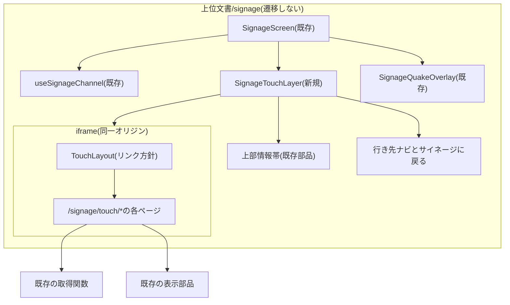
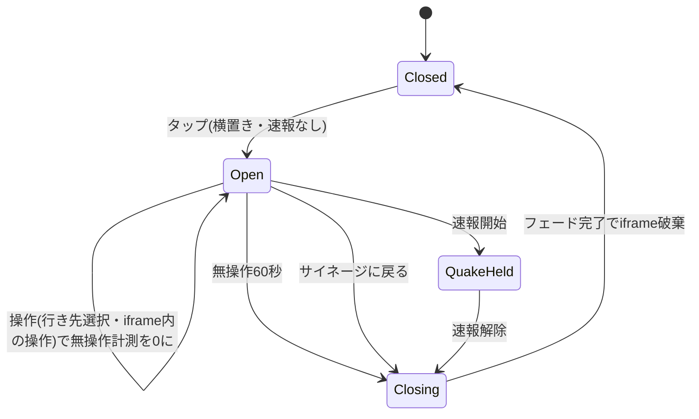
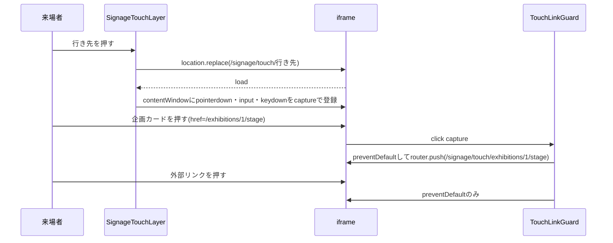

# Design Document

## Overview
**Purpose**: 会場の電子黒板(エルモ、Android、横置き)で、サイネージ表示をタップした来場者に構内マップ・企画一覧・タイムテーブル・駐車場・トピックを見せる。
**Users**: 来場者(子ども・車椅子利用者を含む)が操作し、実行委員が設置する。
**Impact**: `/signage`に操作画面の層を足す。誰も触らない端末・タッチできない端末の表示は変えない。

### Goals
- 上位文書を`/signage`から一度も遷移・再読込させず、行き先は同一オリジンのiframeで表示する。これで速報の購読(要件4)・全画面の維持(要件6)・操作内容の消去(要件3.2)を同時に満たす
- 操作部品を画面下端から22cm以内(1080基準でy≥859)に集める
- 端末のCSS表示幅(1920・3840等)に依らず同じレイアウトにする

### Non-Goals
- 縦置き端末での操作(縦置きはタップを無視し現行表示のまま)
- 速報オーバーレイ・サイネージ表示の見た目の変更(例外: 文字の大きさを「サイネージの文字」の段階にそろえる3か所。Modified Files参照)
- 操作画面の見た目の値(Figmaで決める)
- 公開ページ(`(site)`・`/map`)の振る舞いの変更

## Boundary Commitments

### This Spec Owns
- `/signage`の操作状態(閉・開・閉じるフェード・速報保留)とその遷移
- 端末用ページ`/signage/touch/*`と、その中のリンク方針
- `/signage`の全画面化と電子黒板の設置手順

### Out of Boundary
- 配信経路・速報の受信と表示(`useSignageChannel`・`SignageQuakeOverlay`)は現行のまま使う
- 行き先のデータ取得関数・CMSのスキーマ
- Cloudflare Accessの設定(現行の範囲で足りる)

### Allowed Dependencies
- 既存の取得関数: `getCampusMapData`・`getExhibitionCatalog`・`getExhibitionDetail`・`getTimetable`・`getParkingResponse`・`getTopics`/トピック詳細の取得
- 既存の表示部品: `CampusMapView`・`AreaExhibitionList`・`ExhibitionCard`・`TimetableGrid`・`ParkingList`・`TopicsList`・企画/トピック詳細の本文部品・サイネージの部品(`SignageClock`・`SignageStageChip`等、`SignageBusInfo`)
- `filterExhibitions`(`lib/exhibitions.ts`)、`stageNow`・`nextDepartures`

### Revalidation Triggers
- `SignageScreen`のキャンバス構造・速報オーバーレイの位置の変更
- 公開ページのリンク先パス(`/exhibitions/:id/:category`・`/topics/:id`)の変更
- Accessの`aramakisai_signage`のdestinations変更
- `PRE_EVENT_PUBLIC_*`の変更

## Architecture

### Existing Architecture Analysis
- `SignageScreen`が購読・速報・1920×1080キャンバスの`transform: scale`を持つ(`components/signage/signage-screen.tsx:73,103-107,120-131`)。速報オーバーレイはキャンバスの最後の子(`:158-166`)
- `/signage`は再読込されずに動き続ける(`app/(fullscreen)/signage/page.tsx:6`の`force-dynamic`、ポーリングとWebSocketで更新)。上位文書を再読込・遷移させるコードは無い(後述「上位文書の再読込・遷移の経路」)
- 行き先の公開ページは`(site)`レイアウトでヘッダー・フッター・下部ナビ付き(`app/(site)/layout.tsx:26-33`)。マップはハンバーガー・現在地付き(`campus-map-screen.tsx:127`、`campus-map-view.tsx:94`)
- 絞り込みはURLへ書き込む(`exhibition-list.tsx:65`、`use-map-filters.ts:58`)

### Architecture Pattern & Boundary Map



- 選択: iframe方式(比較は`research.md`のArchitecture Pattern Evaluation)
- 境界: 上位文書は状態・購読・時間計測・ナビを持つ。iframeは行き先の表示と行き先内の操作だけを持つ
- 速報オーバーレイはキャンバス内で操作層より後ろの兄弟に置き、重なり順で操作画面を覆う

### Technology Stack

| Layer | Choice / Version | Role in Feature | Notes |
|---|---|---|---|
| Frontend | Next.js 16.4 / React 19.2 | `/signage/touch/*`のページ、操作層 | 既存 |
| 地図 | leaflet 1.9.4 / react-leaflet 5.0.0 | 構内マップ | `scale`下・iframe内で座標が正しいことを実験で確認(`research.md`実験1) |
| Runtime | Android Chrome(通常のタブ)+Fullscreen API | アドレスバー非表示 | 端末へのインストール・設定変更はしない |
| Infra | Cloudflare Access `aramakisai_signage` | `/signage/touch/*`を保護 | 変更なし |

## File Structure Plan

### Directory Structure
```
frontend/
└── src/
    ├── lib/
    │   └── signage-touch.ts                # 行き先定義・状態遷移(純関数)・時間定数・toTouchHref
    ├── components/signage/
    │   ├── signage-touch-layer.tsx         # 操作層: 上部情報帯・iframe・ナビ・閉じるフェード
    │   ├── use-touch-session.ts            # 状態遷移と時計・iframe内の操作検知を結ぶフック
    │   └── touch/
    │       ├── touch-link-guard.tsx        # iframe側のクリック捕捉(リンク方針)
    │       ├── touch-segment.tsx           # 楕円のボタン群と、滑って移る選択中の背景
    │       ├── touch-parking-card.tsx      # 駐車場のカード
    │       ├── touch-map.tsx               # 構内マップ: 地図+エリアの企画一覧+下部操作
    │       ├── touch-exhibitions.tsx       # 企画一覧: カード+下部の絞り込み
    │       └── touch-timetable.tsx         # タイムテーブル: 表+下部の日付切替
    └── app/(fullscreen)/signage/touch/
        ├── layout.tsx                      # 端末用ページの共通枠(チャネル無し・サイトの枠無し)
        ├── not-found.tsx                   # リンク無しの「見つかりません」(後述)
        ├── gated/page.tsx                  # 開催前フェーズのゲート先。notFound()でnot-found.tsxを通す
        ├── map/page.tsx
        ├── exhibitions/page.tsx
        ├── exhibitions/[id]/[category]/page.tsx
        ├── timetable/page.tsx
        ├── parking/page.tsx
        ├── topics/page.tsx
        └── topics/[id]/page.tsx
```

### Modified Files
- `components/signage/signage-screen.tsx` — ルートで`pointerdown`を受けて全画面化(後述)と操作層の開閉を行う。キャンバス内で`SignageMain`の後・速報オーバーレイの前に`SignageTouchLayer`を置く。速報の有効状態を操作層へ渡す
- `app/(fullscreen)/signage/page.tsx` — `viewport`に`maximumScale: 1`・`userScalable: false`
- `app/globals.css` — `fade-out`(`fade-in`と同じ600ms ease-out、opacity 1→0)と、端末用ページで止めたリンクの見た目を消す規則
- `components/campus-map/campus-map-view.tsx` — 現在地(`MapUserLocation`)を出さない指定を受け付ける(既定は現行通り出す)
- `app/(site)/exhibitions/[id]/[category]/page.tsx`・`app/(site)/topics/[id]/page.tsx` — 本文部分を部品へ切り出し、端末用詳細ページと共有する。端末用では共有・ブックマーク・外部リンク・スタンプを描画しない
- `components/signage/slides/lost-items.tsx`・`signage-left-column.tsx`(いまのステージの企画名)・`slides/parking-slide.tsx`(状態) — 文字の大きさを「サイネージの文字」の段階にそろえる(30→28、36→32)
- `tailwind.config.ts` — 「サイネージの文字」の9段階を`fontSize`に`signage-display`〜`signage-caption`として足す(大きさと行間。太さとフォントは持たせない)。端末用の文字はこのクラスで指定する
- 公開ページと共有する見るだけの部品 — `variant: 'site' | 'signage'`(既定`'site'`)を受け、`'signage'`では文字の大きさ・行間・色を「サイネージの文字」に、アイコンを隣の文字と同じ大きさにする。`'site'`の見た目は変えない。対象: `exhibition-card.tsx`(企画名2行・場所1行で「…」)、`campus-map/`のエリアの企画一覧(`'signage'`で2列・パネル内スクロール)、`TimetableGrid`と枠(`'signage'`で1分6px・時刻の列96・枠の並び)、企画詳細とトピック詳細の本文部品、`TopicsList`のカード
- `components/campus-map/campus-map-view.tsx` — 端末用では地図の著作権表示の右端をキャンバスx1896にそろえる。端末用ではLeafletの`ZoomControl`(`map-zoom-control.tsx`)を出さず、`touch-map`の拡大・縮小ボタンが地図の`zoomIn`・`zoomOut`を呼ぶ
- 駐車場は端末用のカード(`touch/touch-parking-card.tsx`)を新しく作る。公開ページの`ParkingList`は使わない

## System Flows

### 操作状態



- Closed: 操作層を描画しない。現行のサイネージ表示そのもの(要件1.2・1.4)
- Open: 上部情報帯・iframe・ナビを描画。行き先未選択ならiframeは無し
- QuakeHeld: 操作層を残したまま時計を止める。速報オーバーレイが上に重なりタップはオーバーレイで止まる。ルートの`pointerdown`は速報中は無視する(要件4.1・4.2)
- Closing: 操作層を`fade-out`(600ms)で消し、下で動き続けているサイネージ表示が現れる(要件3.3)。完了でiframeと状態を破棄する(要件2.5・3.2・4.3)。速報解除時は既存どおりオーバーレイが即時に外れ、残っていた操作層がフェードする
- 開くときは即時(フェードしない)。タップへの反応を遅らせないため
- 縦置き(`orientation === 'portrait'`)ではタップを無視する

### 行き先の表示



- 行き先の切替は`location.replace`で行い、共有履歴を増やさない
- iframeの`load`ごとに操作検知のリスナーを付け直す(実験2で親から検知できることを確認)

### 画面の動き

#### 選択中の背景の移動
楕円のボタン群で選択を変えると、選択中の背景(楕円)が前の位置から新しい位置へ滑って移る。

- 対象: 行き先ナビ(選択中の背景の高さ88)と、各ページの操作のうち選択状態を持つもの(企画一覧のカテゴリ、タイムテーブルの日付、構内マップの絞り込み。高さ56)。構内マップの拡大・縮小と「サイネージに戻る」は選択状態を持たないので対象外
- 作り: ボタン群ごとに選択中の背景を1つだけ持ち、ボタン群の中に`absolute`で置く。ボタンごとに背景を持たない(持つと消えて現れるだけで移動にならない)。背景の位置と幅は、選択中のボタンの`offsetLeft`と`offsetWidth`に合わせ、`transform: translateX(offsetLeft)`と`width`で指定する。上下は楕円の縁から8(配置規則のとおり)。ボタンの幅は文言によって違うため、位置と幅を一緒に変える
- 測る単位: `offsetLeft`・`offsetWidth`はキャンバスの`scale`を受けない値なので、キャンバス座標のまま使える。初回の測定は`document.fonts.ready`の後に行う(フォント読み込み前の幅で置かない)
- 動き: `transform`・`width`・`background-color`を200ms、`ease-out`で変える。選択色が行き先ごとに違う(行き先ナビ)ため背景色も同時に変える。ボタンのアイコンとラベルの色は変えない
- 始める時点: 選択を変えた操作(タップ)の時点ですぐ動かす。行き先ナビでは、行き先の読み込み(`location.replace`)の完了を待たない
- 選択が無い状態からの最初の選択(タップ直後の行き先未選択から行き先を選ぶ、絞り込みの「すべて」を持たない群で最初に選ぶ)は移動させず、選んだボタンの位置で背景の不透明度を0→1に200ms、`ease-out`で変える
- 同じボタンをもう一度押したときは動かない
- 部品: `components/signage/touch/touch-segment.tsx`に置き、上位文書の行き先ナビ(`SignageTouchLayer`)とiframe内の各ページの操作(`touch-map`・`touch-exhibitions`・`touch-timetable`)の両方で使う

#### 行き先の読み込み中
行き先ナビで行き先を切り替えると、iframeは前のページを捨てて次のページを読み込み直すため、その間は表示領域が空になる。この間は「読み込み中」を出す(Figma 1274:3412)。

- 出す時点: 行き先ナビで行き先を押し、iframeの`location.replace`を呼ぶ直前。行き先未選択から最初の行き先を選んだときも出す
- 消す時点: iframeの`load`。フェードせずに消す
- 置き場所: 上位文書(`SignageTouchLayer`)で、iframeの上に重ねる。範囲はiframeと同じ(上部情報帯の下端からキャンバス下端まで、全幅)。行き先ナビはその上に重なったまま押せる。読み込み中に別の行き先を押したら、読み込み中を出したまま次の`location.replace`を呼ぶ
- 見た目: 背景は`color/background`。表示領域の中央に`progress_activity`(64、`color/info`)と、その下に「読み込み中」(signage/heading 28、Bold、`color/gray-600`)。アイコンは1秒で1回転、一定の速さで回し続ける(Tailwindの`animate-spin`)
- 出さない場面: iframe内の移動(企画カードから企画詳細など、`TouchLinkGuard`の`router.push`)。この移動は次の画面の準備ができるまで前の画面を残すため空にならない。「サイネージに戻る」・放置・速報解除による終了(Closingのフェード)

## Requirements Traceability

| Requirement | Summary | Components | Flows |
|---|---|---|---|
| 1.1 | タップでナビ | SignageScreen, SignageTouchLayer | 操作状態Closed→Open |
| 1.2 | 無操作は現行表示 | SignageScreen | Closed |
| 1.3 | 同じURL・端末設定なし | SignageScreen | 判定はタップの有無だけ |
| 1.4 | 非タッチ端末は現行通り | SignageScreen | Closedのまま |
| 2.1 | 5つの行き先 | SignageTouchLayer, signage-touch.ts | |
| 2.2 | 行き先の内容 | `/signage/touch/*` | 行き先の表示 |
| 2.3 | 対象外導線を出さない | TouchLayout, TouchLinkGuard, 端末用詳細 | 行き先の表示 |
| 2.4 | ナビと戻るを常時表示 | SignageTouchLayer | Open |
| 2.5 | 戻るで消去 | use-touch-session | Open→Closing→Closed |
| 3.1 | 無操作60秒で戻る | use-touch-session, signage-touch.ts | Open→Closing |
| 3.2 | 操作内容の消去 | SignageTouchLayer(iframe破棄) | Closing→Closed |
| 3.3 | クロスフェード | SignageTouchLayer, globals.css | Closing |
| 4.1–4.3 | 速報の上書き・タッチ無効・解除後に消去 | SignageScreen, use-touch-session | QuakeHeld→Closing |
| 5.1 | 操作部品をy≥859 | SignageTouchLayer, touch-map/exhibitions/timetable | 配置規則 |
| 5.2 | 見るだけの部分は既存と同じ | 既存表示部品 | |
| 5.3 | 上部は情報帯、タップ対象はその下 | SignageTouchLayer | 配置規則 |
| 6.1–6.2 | アドレスバーを出さない | SignageScreen・use-touch-session(全画面化), viewport | 設置手順の1タップ |
| 7.1–7.4 | スマホで見るQR・UTM | SignageTouchLayer(上部情報帯のQR) | 「スマホで見るQR」の節 |
| 8.1 | 11/1までに2台で動く | 設置手順、Testing Strategyの実ブラウザ確認(速報) | |

## Components and Interfaces

| Component | Layer | Intent | Req | Key Dependencies |
|---|---|---|---|---|
| signage-touch.ts | lib | 行き先・状態遷移・リンク読み替え | 2.1, 2.3, 3.1, 4 | なし(純関数) |
| use-touch-session | hook | 時計・操作検知を状態遷移へ流す | 2.5, 3, 4 | signage-touch.ts(P0) |
| SignageTouchLayer | UI(上位) | 情報帯・iframe・ナビ・フェード | 1.1, 2.4, 3.3, 5, 6 | use-touch-session(P0), サイネージ部品(P1) |
| TouchLayout / TouchLinkGuard | UI(iframe) | サイトの枠を出さず、リンクを読み替え・遮断 | 2.3 | signage-touch.ts(P0) |
| touch-map / touch-exhibitions / touch-timetable | UI(iframe) | 既存表示部品+下部の操作部品 | 2.2, 5.1, 5.2 | 既存部品(P0) |

### lib

#### signage-touch.ts

| Field | Detail |
|---|---|
| Intent | 操作状態の遷移・行き先・リンク方針を純関数で持つ |
| Requirements | 2.1, 2.3, 2.5, 3.1–3.2, 4.1–4.3 |

**Contracts**: Service [x] / State [x]

```typescript
type TouchDestination = 'map' | 'exhibitions' | 'timetable' | 'parking' | 'topics';

const TOUCH_DESTINATIONS: readonly { readonly key: TouchDestination; readonly label: string; readonly path: string }[];
// label: 構内マップ / 企画一覧 / タイムテーブル / 駐車場 / トピック
// path: /signage/touch/<key>

const IDLE_TIMEOUT_MS = 60_000;
const CLOSE_FADE_MS = 600; // globals.cssのfade-inと同じ値

type TouchState =
  | { readonly kind: 'closed' }
  | { readonly kind: 'open'; readonly destination: TouchDestination | null; readonly idleSince: number }
  | { readonly kind: 'quakeHeld'; readonly destination: TouchDestination | null }
  | { readonly kind: 'closing' };

type TouchEvent =
  | { readonly type: 'tap'; readonly at: number; readonly orientation: SignageOrientation }
  | { readonly type: 'select'; readonly destination: TouchDestination; readonly at: number }
  | { readonly type: 'activity'; readonly at: number }
  | { readonly type: 'tick'; readonly at: number }
  | { readonly type: 'back' }
  | { readonly type: 'quake'; readonly active: boolean }
  | { readonly type: 'fadeEnd' };

function nextTouchState(state: TouchState, event: TouchEvent): TouchState;

/** 公開パスを端末用パスへ読み替える。端末用に無い行き先はnull(遮断) */
function toTouchHref(href: string): string | null;
```
- `toTouchHref`: `/exhibitions/:id/:category`→`/signage/touch/exhibitions/:id/:category`、`/topics/:id`→`/signage/touch/topics/:id`、`/exhibitions`・`/topics`→各一覧、`/signage/touch/…`と`#…`はそのまま、それ以外(外部・`/mypage`・ご案内ページ等)は`null`
- 不変条件: `quake`が`active: true`の間は`tap`・`activity`・`tick`を無視する。`closed`での`quake`は何もしない(現行の速報表示のみ)

### hooks

#### use-touch-session

| Field | Detail |
|---|---|
| Intent | `nextTouchState`に時刻・操作・速報を流し、iframeへ操作検知を結ぶ |
| Requirements | 2.5, 3.1–3.3, 4.1–4.3 |

**Responsibilities & Constraints**
- 開いている間だけ1秒間隔の`tick`を出す(閉じている間はタイマー無し)
- 操作検知: 上位文書の操作層と、iframeの`contentWindow`の`pointerdown`・`pointermove`・`wheel`・`touchmove`・`input`・`keydown`(capture)。スクロール・ドラッグ中は`pointerdown`が最初の1回しか出ない(タッチのスクロールは`pointercancel`で途切れる)ため、`wheel`・`touchmove`・`pointermove`も操作として扱う。iframeの`load`ごとに付け直す
- iframeの`pointerdown`でも全画面化の判定を行う(iframe内のタップは上位文書のルートへ伝わらないため)
- 速報の有効状態は`SignageScreen`の`quake?.active`をそのまま受ける
- 時刻は端末時計(`Date.now()`)。無操作の計測は相対時間なので補正済み時刻は使わない

### UI(上位文書)

#### SignageTouchLayer

| Field | Detail |
|---|---|
| Intent | キャンバス内に操作画面を描く |
| Requirements | 1.1, 2.1, 2.4, 3.1, 3.3, 5.1, 5.3, 6.1 |

**Responsibilities & Constraints**
- キャンバス(1920×1080)内の`absolute inset-0`。不透明の背景でサイネージ表示を覆う。キャンバスの`scale`をそのまま受けるため、iframe内は端末のCSS幅に依らずキャンバス単位でレイアウトされる(実験1)
- 上から: 上部情報帯(タップ対象なし)/iframe(行き先未選択時は無し)/行き先ナビ。
- 上部情報帯はキャンバス上部の全幅で、外側の余白を持たずキャンバスの上・左右の端に付ける。iframeは帯の下端に接して始める。サイネージ表示の情報(ロゴ・DAY・日付・時計・いまのステージ・バス案内・テロップ・QR)をすべてここに横に並べ、左カラムは使わない。データはサイネージ表示と同じ`now`・`stageNow`の結果・`nextDepartures`の結果を使う。並べ方はFigma
- iframeは全幅で、上部情報帯の下からキャンバス下端まで。行き先ナビ・各ページの操作部品は帯にせず、右下にフローティングの楕円(カプセル形)のボタンとしてiframeの上に重ねる。キーワード検索は持たず、絞り込み(ファセット)だけにする。画面キーボードを使わないため。選んだ絞り込みはそのページの行き先の色の楕円背景で示し、チェックボックスは使わない。操作部の楕円の地は白で影で浮かせる。情報部(上部情報帯)と操作部(ボタン群)は色で区別する。情報帯の背景は角丸にしない。帯の中のサイネージ部品(ロゴ・時計・いまのステージ・テロップ・バス案内・QR)は既存の見た目のまま使い、上書きしない。ボタン群の外形は楕円で、選択中の背景も外形に合わせた楕円にする。ボタンは大きめのアイコンの下にラベルを置く。選択中の行き先ボタンとページ内のファセットの選択中は、一般向けサイトのヘッダーの現在地下線と同じ色(`lib/navigation.ts:36-45`。企画一覧primary・構内マップsecondary・タイムテーブルinfo・トピックはお知らせのwarning。駐車場はヘッダーに無いため、一般向けサイトの下部ナビの現在地の色`accent`(`components/bottom-navigation.tsx`)にそろえる)を背景色にする。隠れる分は内容の最下部に余白を足してスクロールで見せる
- iframe: `src`は`location.replace`で切替。`title`属性に行き先名。破棄で操作内容を消す

### UI(iframe)

#### TouchLayout / TouchLinkGuard

| Field | Detail |
|---|---|
| Intent | 端末用ページの枠。サイトの枠を出さず、リンクを方針で読み替える |
| Requirements | 2.3 |

- `app/(fullscreen)/signage/touch/layout.tsx`は`(fullscreen)`配下なのでヘッダー・フッター・下部ナビを持たない。`metadata.robots`は`index: false`
- `signage/touch/not-found.tsx`: 端末用詳細で`notFound()`になったとき、ルートの`not-found.tsx`(`TouchLayout`の外側)が使われると「トップページに戻る」リンク(`components/error-page-content.tsx:19`)がガード無しで出る。端末用の`not-found.tsx`を`TouchLayout`の内側に置き、リンク無しで「見つかりません」だけを出す。開催前フェーズのゲート(`middleware.ts`)も、`/signage/touch/`配下は公開サイトの`/gated`ではなく`/signage/touch/gated`へ振り、同じ`not-found.tsx`を出す
- `TouchLinkGuard`: `document`のcaptureで`click`を受け、`a[href]`なら`toTouchHref`で読み替えて`router.push`、`null`なら`preventDefault`のみ。`target="_blank"`も同じ扱い
- 止めるリンクはCSSでリンクの見た目(色・下線・ポインタ)を消し、本文として見せる。対象は外部URL・`mailto:`・`tel:`と、読み替え対象外の内部パス

#### 端末用ページ

| ページ | 見るだけの部分(既存) | 操作部品(下端、y≥859) | 描画しないもの |
|---|---|---|---|
| map | `CampusMapView`(現在地なし)、エリアの企画一覧`AreaExhibitionList` | カテゴリ絞り込み・拡大/縮小(端末用のアイコンボタンから地図の`zoomIn`・`zoomOut`を呼ぶ。Leafletの`ZoomControl`は出さない) | ハンバーガー、現在地、`MapSearchOverlay`/`MapSidePanel`/`MapBottomSheet`の検索 |

構内マップの初期表示は、全エリアの外接矩形を左パネルと下部の操作部品(絞り込み・行き先ナビ)を除いた範囲(キャンバスx680〜1920・y352〜864)に収めて中央に置く。可視領域の中央へ置けるよう、端末用の地図は`maxBounds`をタイル範囲の辺の長さの25%だけ広げる(下余白は上余白と対称にそろえる)。
| exhibitions | `ExhibitionCard`(`bookmarkable`なし)の一覧。全件をスクロール | カテゴリ(エリアの絞り込みは持たない。場所からは構内マップで探す) | `ExhibitionFilters`、ページ送り |
| exhibitions/[id]/[category] | 詳細の本文部品(3列: 左に写真とサムネ、中央に基本情報と出店メニュー、右に紹介と場所の地図) | なし | 「企画一覧に戻る」、「構内マップで見る」、共有・ブックマーク・外部リンク・スタンプ |
| timetable | `TimetableGrid` | 日付切替 | `TimetableView`の日付・ステージのボタン |
| parking | 駐車場のカード(2列) | なし | |
| topics・topics/[id] | `TopicsList`・詳細の本文部品 | なし | 「一覧に戻る」 |

- 絞り込み・日付の状態は`useState`に持ち、URLへ書かない(`use-map-filters.ts`・`ExhibitionList`は使わない)。iframe破棄で消える
- 取得関数・再検証間隔は公開ページと同じ
- 見るだけの部分の内容は公開ページと同じにし、文字の大きさ・行間・色は「サイネージの文字(Foundation)」に従う。公開ページの部品をそのまま使うと文字が小さすぎるため、端末用は大きさを上書きする(公開ページの見た目は変えない)
- 文字の横に並ぶアイコンは、その文字と同じ大きさにする
- 行き先の表示領域がスクロールする画面(企画一覧・企画詳細・タイムテーブル・トピック)は、スクロール内容の下端に余白240を置き、最後の行を操作の楕円(y864〜)より上まで送れるようにする
- 企画一覧はカード6列(幅292)。企画名は2行まで、場所は1行まで、超えた分は「…」
- 企画詳細は3列のまま縦スクロールする。紹介文は5行で「…」、出店メニューは全品出す。場所の欄は「場所」見出しの下に場所の表記、その下に地図を置き、地図の下端y936、地図の上に重なる「企画位置に戻す」ボタンの上端y872(y≥859)。地図の下の「構内マップで見る」は出さない
- タイムテーブルは1分6px(30分180px)、時刻の列の幅96、ステージ列は残りを3等分。枠は1行目に時刻、2行目に企画名。出演中の枠は1行目に「▶出演中」と時刻を並べる。15分未満の枠は時刻と企画名を1行に並べる
- 駐車場は、カード924×246を2列×2段(間隔24)に並べ、4か所をスクロールなしで出す。カードは左に写真285×214、右に駐車場名・状態・更新/撮影時刻。写真がない駐車場は写真の場所を空ける。カードは待機中サイネージの駐車場カードと同じ見た目(塗りなし、外枠1px gray-200、角丸16)、状態は状態色(空きsuccess・混雑primary・満車warning)で塗る
- トピック一覧はカード450×338の4列
- 構内マップのエリアの企画一覧(`AreaExhibitionList`)は端末用では2列のグリッドにし、パネルの中でスクロールする(公開ページは1列)。地図の著作権表示は右端をx1896にそろえる
- 構内マップの地図は上部情報帯の下・操作部品の上に置く(要件5.3)。ピンチ・ドラッグはLeafletが処理する

## 画面配置規則(要件5)

| 項目 | 値 | 根拠 |
|---|---|---|
| 対象の最大サイズ | 86型(現行ELMO Boardは55・65・75・86型) | `research.md` |
| 86型の表示高さ | 1070.9mm(16:9)。1080基準で1px=0.992mm | 86×25.4×9/√337 |
| 手の届く帯 | 画面下端から22cm=221.9px | 122−100cm |
| 操作部品の位置 | 部品の上端がキャンバスy≥859 | 1080−221.9 |
| 上部情報帯 | タップ対象を置かない | 要件5.3 |
| タップ対象(カード・行) | 情報帯より下 | 要件5.3 |

操作部の寸法(Figmaで確定、キャンバス座標)。楕円と選択中の背景の間の余白は上下左右8にそろえる。

| 部品 | 楕円の高さ | 選択中の背景の高さ | y |
|---|---|---|---|
| 行き先ナビ | 104 | 88 | 952〜1056 |
| 各ページの操作(企画のカテゴリ・タイムテーブルの日付・構内マップの絞り込みとズーム) | 72 | 56 | 864〜936 |

- 各ページの操作の楕円どうしの間隔は16
- 構内マップの「拡大」「縮小」はアイコンだけ(文字なし、高さ56)

- 操作部品: 行き先5つ・サイネージに戻る・企画の絞り込み・日付切替・マップの絞り込み/ズーム。開いて上へ伸びる部品(ドロップダウン・シート)もy≥859に収める
- 前提: キャンバス下端=画面下端。16:9パネルを全画面で表示すれば`fitCanvas`の上下余白は0(`signage-viewport.ts:22-32`)
- 小さい方の電子黒板では同じpxが物理的に低い位置になり、条件を満たし続ける

## サイネージの文字(Foundation)

待機中サイネージと操作画面で共通に使う。Figmaの変数コレクション「Signage Type」、説明はFoundationsページの「Signage Foundations」。フォントの種類と太さは各部品の現行のまま(段階では決めない)。

| 段階 | 大きさ | 行間 | 用途 |
|---|---|---|---|
| display | 104 | 100% | 時計 |
| hero | 64 | 100% | 待機中の駐車場名 |
| title-lg | 44 | 100% | テロップ本文 |
| title | 32 | 40px | 見出しバー、詳細ページの題名、バスの発車時刻、待機中の駐車場の状態 |
| heading | 28 | 35px | 小見出し、カードや一覧の項目名(企画名・駐車場名・スロット名・エリア名) |
| body | 24 | 38px | 本文(企画の説明・トピック本文・表) |
| meta | 24 | 30px、色gray-600 | 補足(日時・場所・メニュー・件数・更新/撮影/時点・時刻軸) |
| label | 24 | 100% | チップ・バッジ・ナビのラベル |
| caption | 18 | 100% | 最小の注記(地図の著作権表示、バスの◯分後・乗り場) |

- 待機中サイネージの値は、ステージの企画名・落とし物の品名を30→28、待機中の駐車場の状態を36→32にそろえる

## スマホで見るQR(要件7)

- 操作中の上部情報帯のQRは、見出しを「この画面をスマホで見る」にし、いま表示している行き先に対応する公式サイトのURLを符号化する。待機中のサイネージ表示のQR(`/images/qr-aramakisai.svg`、`signage-parts.tsx:81`)は変えない
- 対応: `/signage/touch/{map,exhibitions,exhibitions/[id]/[category],timetable,parking,topics,topics/[id]}` → 公式サイトの同じパス(`/signage/touch`を除いたもの)。行き先未選択のときはトップ(`/`)
- 絞り込みは、公式サイトがURLから復元できるものだけ含める。企画一覧は`buildExhibitionsHref`(`exhibition-list.tsx:65`)、構内マップは`use-map-filters.ts:31-35`のクエリ名で組む。日付切替などURLで復元できない状態は含めない
- 上位文書はiframeのパスと絞り込みを`postMessage`で受け、QRを作り直す
- GA4: URLにUTMを付ける。`utm_source=signage`、`utm_medium=qr`、`utm_campaign=touch_navigation`、`utm_content`=行き先(`map`・`exhibitions`・`exhibition_detail`・`timetable`・`parking`・`topics`・`topic_detail`・`home`)。GA4はUTMを自動でセッションの参照元・メディア・キャンペーンとして集計するため、計測コードの追加は要らない。行き先別の内訳は探索レポートの「セッションの手動広告コンテンツ」で見る
- QRはクライアントで`qrcode`(`toString`のSVG出力)により生成する。`qrcode`は現在devDependencies(`frontend/package.json`)なのでdependenciesへ移す

## Figmaで作る画面・状態
Figma(file key `0kWDqHsLr6xE8b4FFgR1Zx`)、1920×1080、上の配置規則に従う。

1. 操作画面の枠: 上部情報帯+行き先ナビ(5つ+サイネージに戻る)。行き先未選択(タップ直後)・各行き先の選択中
2. 行き先の読み込み中
3. 構内マップ: 初期、エリア選択時(エリアの企画一覧)、カテゴリ絞り込み中、該当なし
4. 企画一覧: 一覧、絞り込み中、該当なし
5. 企画詳細(除外部品なし)
6. タイムテーブル: 日付切替
7. 駐車場
8. トピック一覧・トピック詳細

速報オーバーレイは既存のまま(Figma不要)。

## アドレスバーを出さない方式(要件6)

電子黒板は借り物のため、アプリのインストール(manifestによるインストール・ホーム画面への追加を含む)や端末の設定変更はしない。Chromeの通常のタブで`/signage`を開き、Fullscreen APIで全画面にする。

- **全画面化**: 上位文書のルートとiframeの`contentWindow`の`pointerdown`で、`document.fullscreenElement`が無ければ上位文書の`document.documentElement.requestFullscreen()`を呼ぶ(失敗は無視)。`requestFullscreen`はユーザー操作が要る。iframe内のタップでも上位文書がユーザー操作を得る(HTML Standardのactivation notificationは祖先のwindowにも付与する)
- **維持**: 上位文書は遷移・再読込しないので、行き先の切替・iframe内の遷移・サイネージ表示への復帰でも全画面は解除されない(`research.md`実験2)
- **スクロール**: 全画面ではアドレスバーが隠れた状態に固定され、スクロールしても出ない(Chrome「URL bar resizing」)。スクロールはiframe内でのみ起きる(要件6.2)
- **解除後の復旧**: Androidの戻る操作等で全画面が解除されたら、次のタップで再び全画面にする。そのタップは通常のタップとしても扱う(閉じていればナビを開き、操作中なら押した部品が動く)。理由: 全画面化だけで何も起きないタップは来場者には無反応に見えるため。速報中・縦置きでも全画面化は行う(表示内容は変えないので要件4.2に反しない)
- **要件6.1との対応**: 待機中にアドレスバーを出さない条件は、設置時の1タップで全画面にした後に満たされる。解除後は次のタップまでアドレスバーが出る
- **拡大の禁止**: `/signage`のviewportを`maximum-scale=1, user-scalable=no`にする。iframe内のピンチは上位文書を拡大し、拡大はサイネージ表示へ戻った後も残る(実験3)

### 上位文書の再読込・遷移の経路
`components/signage/`・`lib/use-polling.ts`・`lib/use-signage-channel.ts`・`app/(fullscreen)/signage/`・エラー境界を確認した結果、上位文書を再読込・遷移させるコード(`location.reload`・`location.href`代入・`router.push`/`refresh`等)は無い。

| 経路 | 上位文書への影響 | 扱い |
|---|---|---|
| 版の知らせ・定期取得(`signage-screen.tsx:61-93`、`use-polling.ts`) | `fetch`のみ | 変更なし |
| WebSocketの再接続(`use-signage-channel.ts:72-81`) | 接続の張り直しのみ | 変更なし |
| エラー境界(`app/(fullscreen)/error.tsx`、`app/global-error.tsx`) | 「再読み込み」ボタンはNextの`reset`(再描画)でページを再読込しない。リンクは無い(`error-page-content.tsx:26-39`) | 変更なし |
| `router.refresh()`(`components/phase-toggle.tsx:30,36`) | 開発用フラグ有効時のみ描画(`app/layout.tsx:110`)。本番に無い | 変更なし |
| 行き先の切替(`location.replace`)・iframe内の`router.push` | iframe内だけ | 変更なし |
| Chromeによるタブの再読込(メモリ不足での破棄・クラッシュ) | 全画面が解除される | 次のタップで全画面化(上記の復旧) |
| 戻る操作で`/signage`から離れる | 全画面解除後にiframe内の履歴が尽きると上位文書が戻る | 設置担当が`/signage`を開き直し1タップする |

### 設置手順(電子黒板ごと)
1. Chromeで`https://aramakisai.com/signage`を開き、Accessでログインする(セッション730h)
2. 画面を1回タップする。全画面になり、ナビが開く。「サイネージに戻る」を押す
3. 次を確認する: アドレスバー・ステータスバーが出ない/タップでナビが出る/5つの行き先を切り替え、スクロールし、「サイネージに戻る」の後もアドレスバーが出ない
4. 全画面が解除されている(アドレスバーが見える)ときは1回タップする

端末の設定変更・アプリの追加は行わない。

### フェーズ
- 電子黒板を使う開催当日(11/14・15)は開催中フェーズ(live)のため、5つの行き先とも表示される。開催中への切替は開催前に手動で行う(`lib/phase.ts:13-16`)
- live切替前の本番では`/signage/touch/*`は404(開催前の公開パス`phase.ts:29-58`に無い)
- 11/1までの実機確認はPRプレビューURLで行う。プレビューはフェーズの切替が有効(`.github/workflows/frontend-ci.yml:175`の`NEXT_PUBLIC_ENABLE_PHASE_OVERRIDE=true`)

## Error Handling
- 行き先ページの取得失敗: 公開ページと同じ表示(各取得関数の既存の失敗表示)。ナビと戻るは上位文書にあるため常に操作できる
- iframeがAccessのログインへ飛ばされた(セッション切れ): iframeは空になるが、無操作60秒で閉じる。サイネージ表示も同時に更新できなくなるため、設置手順1のログインで復旧する
- 全画面の解除: 次のタップで全画面に戻す(アドレスバーを出さない方式)
- WebSocket切断中は速報を受けられない(現行と同じ。ポーリングと再接続は既存)

## Testing Strategy
- 単体(`lib/signage-touch.test.ts`): 状態遷移の全辺(開く・60秒で閉じる・戻る・速報開始で保留しタップ無視・速報解除でclosing・fadeEndでclosed・縦置きのタップ無視)。`toTouchHref`の読み替えと遮断(外部・`/mypage`・ご案内ページ・`mailto:`)
- コンポーネント(`signage-screen.test.tsx`に追加): タップで操作層が出る/速報中のタップで開かない/速報オーバーレイが操作層より後にある/タップしない限り操作層が無い
- コンポーネント(`touch-link-guard`): 公開パスのクリックが端末用パスへ、外部リンクのクリックが止まる
- コンポーネント(全画面化): 全画面でないときのタップで`requestFullscreen`が呼ばれ、同じタップでナビも開く/全画面中は呼ばれない/iframe内のタップでも呼ばれる
- ページ: 端末用の`not-found`にリンクが無い
- ページ: 端末用詳細に共有・ブックマーク・外部リンク・スタンプが無い。端末用マップに現在地・ハンバーガーが無い
- 実ブラウザ(Playwright、ローカル): 1920×1080/DPR2と3840×2160/DPR1で、操作部品の`getBoundingClientRect().top`をキャンバス座標に換算しy≥859を確認。60秒→閉じる(時計を進める)。地図のピンチ・ドラッグ
- 実ブラウザ(Playwright、ローカル)で速報: 操作中にサイネージの配信チャネルのWebSocketを`page.routeWebSocket`で差し替えて速報を流し、操作画面の上に速報が出ること・速報中のタップが効かないこと・解除後に操作画面ではなくサイネージ表示へ戻り操作内容が消えることを確かめる(要件4・8.1。速報の振る舞いは端末に依らないため、2つの表示幅で確かめて実機の代わりとする)
- 実機(設置手順3): 2台それぞれ
