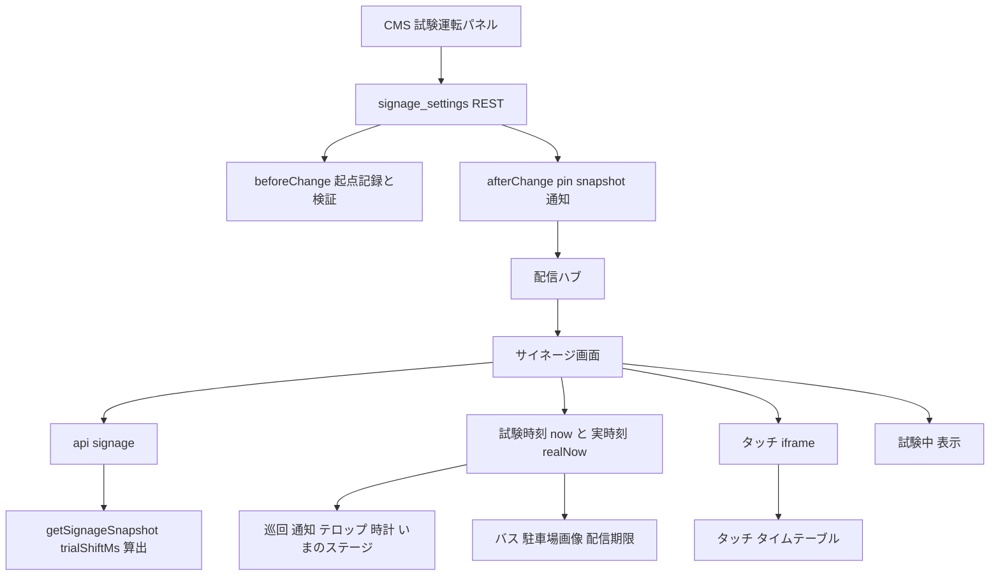
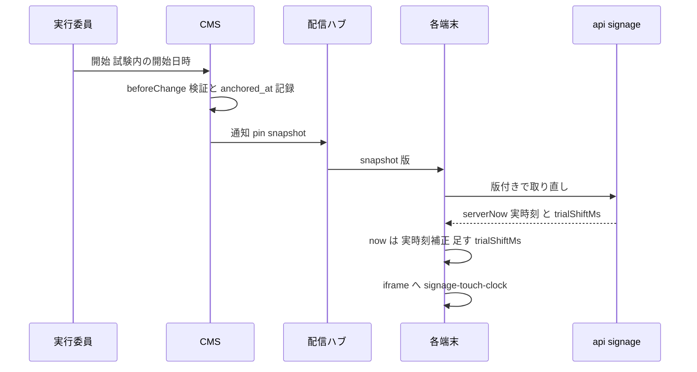

# Design Document: signage-trial-run

## Overview
**Purpose**: 開催日前に、本番のサイネージ端末と本番のデータで、当日の時刻に依存する表示(タイムテーブルスライド、ステージ出演枠の開始通知、テロップ、いまのステージ等)を複数台同期のまま確かめられるようにする。

**Users**: 実行委員が CMS のサイネージ スライド一覧画面から試験運転を開始・終了し、会場の端末で表示を確かめる。

**Impact**: スナップショット API が実時刻の `serverNow` に加えて試験のずれ量 `trialShiftMs` を返し、サイネージ画面は補正済み時刻を「試験時刻」と「実時刻」の2本に分けて配る。

### Goals
- CMS の操作だけで全端末が同じ試験時刻に切り替わり、終了で実時刻に戻る
- 端末どうしの同期精度は通常運転と変わらない
- 試験中であることが全画面で分かる

### Non-Goals
- 公式サイトの各ページの時刻判定
- バスの案内を試験時刻で動かすこと
- 実データ(駐車場・落とし物・緊急地震速報)の模擬、実データの鮮度判定を試験時刻で行うこと
- 試験時刻の一時停止・早送り、現実日時の予約による自動開始・終了
- 「試験中」表示の Figma 化

## Boundary Commitments

### This Spec Owns
- `signage_settings` の試験運転フィールド(`trial_run`)と、その起点時刻の記録・検証
- スナップショットの `trialShiftMs` の算出と契約
- サイネージ画面での試験時刻・実時刻の振り分け
- 親画面から iframe へのずれ量の受け渡し(`signage-touch-clock` メッセージ)
- 全画面の「試験中」表示
- CMS 一覧画面の試験運転パネル

### Out of Boundary
- 時刻補正の算出方法(`clockOffsetMs` / `useCorrectedNow`)そのもの
- 配信経路(ハブ・WebSocket)のメッセージ形式。既存の `snapshot` 版通知を使うだけで、ハブには手を入れない
- 地震速報の全面表示・訓練表示
- スライド固定の挙動

### Allowed Dependencies
- `signage_settings` global と Payload 標準 REST(`/api/globals/signage_settings`)
- `site_settings.event_days`(読み取りのみ)
- `signageNotifyGlobalHook`(既存の通知)
- `signage-touch-ready` メッセージ(既存の iframe 準備完了通知)

### Revalidation Triggers
- `SignageSnapshot` の形の変更(`trialShiftMs` の意味・単位)
- `signage_settings` のフィールド構成の変更(固定の保存と試験運転の保存が互いを消さない前提)
- `now` を受け取る新しいサイネージ部品の追加(試験時刻と実時刻のどちらを渡すかの判断が要る)

## Architecture

### Existing Architecture Analysis
- 端末は `/api/signage` の `serverNow` から `offsetMs` を求め、`useCorrectedNow(offsetMs)` の `now` 1本で全表示を決める。テロップだけ `offsetMs` を受けて毎フレーム `Date.now() + offsetMs` を計算する。
- CMS の変更は `signageNotifyGlobalHook` → ハブ → WebSocket で端末へ届く。`snapshot` 通知で端末は版付き(キャッシュ迂回)で取り直す。
- タッチ操作のサブページは同一オリジンの iframe で、端末時計の `useNow` で動く。

### Architecture Pattern & Boundary Map



- **Selected pattern**: ずれ量の配信。実時刻の補正は既存のまま、全端末に同じ `trialShiftMs` を配って足す。
- **Dependency direction**: `cms-types` → `lib/signage*.ts`(純関数) → フック → コンポーネント。CMS 側は `lib/signage-trial.ts`(純関数) → global 定義 / `components/signage-trial.ts`(REST) → `useSignageTrial` → `SignageTrialPanel`。
- **Steering compliance**: コンテンツモデル変更はマイグレーション経由。access は `policy.ts` の既存判定(update は実行委員のみ)をそのまま使う。

### Technology Stack

| Layer | Choice / Version | Role in Feature | Notes |
|-------|------------------|-----------------|-------|
| Frontend | Next.js(既存)/ React | 時計の振り分け、試験中表示、iframe へのずれ量送信 | 新規依存なし |
| Backend | Payload CMS(既存) | `trial_run` フィールド、hook、一覧画面パネル | 新規依存なし |
| Data | Postgres(既存) | `signage_settings` に2列追加 | マイグレーション1本 |
| Messaging | 既存の配信ハブ | `snapshot` 版通知 | 変更なし |

## File Structure Plan

### New Files
```
cms/src/
├── lib/signage-trial.ts                 # 起点を刻むか否か・開催日の検証(純関数)
├── lib/signage-trial.test.ts
├── components/signage-trial.ts          # GET/POST /api/globals/signage_settings の trial_run 読み書き
├── components/useSignageTrial.ts        # 試験運転の状態共有(useSignagePin と同じ作り)
├── components/useSignageTrial.test.ts
├── components/SignageTrialPanel.tsx     # 一覧画面のパネル
└── migrations/<YYYYMMDD_HHMMSS>_signage_trial_run.ts (+ .json)

frontend/src/
├── lib/signage-trial.ts                 # trialShiftMs 算出、iframe メッセージの型と判定
├── lib/signage-trial.test.ts
├── components/signage/signage-trial-overlay.tsx
└── lib/use-touch-clock-shift.ts         # iframe 内でずれ量を受け取るフック
```

### Modified Files
- `cms/src/globals/signage-settings.ts` — `trial_run` グループ、`beforeChange` hook、通知を `['pin', 'snapshot']` に
- `cms/src/globals/signage-settings.test.ts` — フィールド数の期待値と `trial_run` の検証
- `cms/src/collections/signage-slides.ts` — `beforeListTable` を `[SignageQuakePanel, SignagePinBanner, SignageTrialPanel, SignageGroupSwitches]` に
- `cms/src/migrations/index.ts`, `cms/src/payload-types.ts`, `frontend/src/cms-types.ts` — 生成物
- `cms/src/app/(payload)/admin/importMap.js` — `SignageTrialPanel` の登録(生成物。Zitadel/S3 のローカル差分は戻す)
- `frontend/src/lib/signage.ts` — `SignageSnapshot` に `trialShiftMs`
- `frontend/src/lib/signage-data.ts` — `trialShiftMs` の算出
- `frontend/src/components/signage/signage-screen.tsx` — `realNow` / `now` の振り分け、試験中表示、`SignageTouchLayer` へ `trialShiftMs`
- `frontend/src/components/signage/signage-main.tsx`, `slide-renderers.tsx`, `slides/parking-slide.tsx` — 駐車場スライドへ `realNow`
- `frontend/src/components/signage/signage-quake-overlay.tsx` — `SignageMain` へ `realNow` を中継
- `frontend/src/components/signage/signage-touch-layer.tsx` — `signage-touch-ready` 受信時とずれ量変化時に iframe へ `signage-touch-clock` を送る
- `frontend/src/components/signage/touch/touch-timetable.tsx` — `useNow` にずれ量を足す

## System Flows



- 通知が届かなかった端末は 120 秒ごとのポーリングで同じ値を得る(2.6)。
- 終了も同じ流れで `trialShiftMs: null` が届き、`now` が実時刻に戻る(2.5)。

## Requirements Traceability

| Requirement | Summary | Components | Interfaces | Flows |
|-------------|---------|------------|------------|-------|
| 1.1 | 一覧画面に固定と並べて表示 | SignageTrialPanel | beforeListTable | — |
| 1.2, 1.3 | 開催日選択・分単位の時刻・初期値は開場時刻 | SignageTrialPanel | useEventDays | — |
| 1.4 | 現実日時は選ばせない | SignageTrialPanel, TrialAnchorHook | — | 開始 |
| 1.5, 1.6 | 起点の記録・開始し直し | TrialAnchorHook | `decideTrialAnchor` | 開始 |
| 1.7 | 終了で設定を消し通知 | SignageTrialPanel, TrialAnchorHook | REST | 終了 |
| 1.8 | 試験中と現在の試験時刻を表示 | SignageTrialPanel | useSignageTrial | — |
| 1.9 | 固定と同じ権限 | 既存 access(policy.ts) | — | — |
| 1.10 | 開催日なしでは開始不可 | SignageTrialPanel, TrialAnchorHook | `validateTrialStart` | — |
| 1.11 | 開催日は開始不可・無効を表示 | SignageTrialPanel | — | — |
| 2.1 | ずれ量を返す | SignageSnapshotData | `SignageSnapshot.trialShiftMs` | 取り直し |
| 2.2, 2.3 | 時刻依存の表示を試験時刻で揃える | SignageScreenClocks | `now` / `realNow` | — |
| 2.4, 2.5 | 再読み込みなしで切替・復帰 | 既存 snapshot 通知 | — | 開始・終了 |
| 2.6 | ポーリングで反映 | 既存ポーリング | — | — |
| 2.7 | 開催日は試験時刻を返さない | SignageSnapshotData | `trialShiftMs` | — |
| 3.1 | タッチのタイムテーブルが試験時刻 | TouchClockBridge, TouchTimetable | `signage-touch-clock` | iframe |
| 3.2 | 戻っても試験時刻 | SignageScreenClocks | — | — |
| 4.1–4.4 | 全画面の試験中表示 | SignageTrialOverlay | — | — |

## Components and Interfaces

| Component | Domain/Layer | Intent | Req Coverage | Key Dependencies | Contracts |
|-----------|--------------|--------|--------------|------------------|-----------|
| TrialAnchorHook | CMS global | 起点の記録と検証 | 1.4–1.7, 1.10 | site_settings (P0) | Service |
| SignageTrialPanel | CMS 管理画面 | 試験運転の操作と表示 | 1.1–1.3, 1.7, 1.8, 1.10, 1.11 | useEventDays (P0), REST (P0) | State |
| SignageSnapshotData | frontend lib | `trialShiftMs` の算出 | 2.1, 2.7 | signage_settings (P0) | API |
| SignageScreenClocks | frontend 画面 | 試験時刻・実時刻の振り分け | 2.2–2.5, 3.2 | 既存時刻補正 (P0) | State |
| TouchClockBridge | frontend 画面 | iframe へのずれ量受け渡し | 3.1 | signage-touch-ready (P0) | Event |
| SignageTrialOverlay | frontend 画面 | 全画面の試験中表示 | 4.1–4.4 | — | — |

### CMS

#### TrialAnchorHook

| Field | Detail |
|-------|--------|
| Intent | `trial_run.start_at` の送信を見て `anchored_at` を刻み、開催日でない日付を拒む |
| Requirements | 1.4, 1.5, 1.6, 1.7, 1.10 |

**Responsibilities & Constraints**
- `signage_settings` の `beforeChange` で動く。Payload 3 の global 更新では `beforeChange` がフィールド補完より前に動き、送られなかった group は `{}` で届く。そのため「送られていない(`undefined`)」と「終了(`null`)」を区別する。
- その保存で `trial_run.start_at` が送られていない(固定の更新、`releasePinIfHidden` 等) → 検証も起点の記録もせず、前の `start_at` / `anchored_at` を保持する。
- `start_at` が非 null で送られた → 値が前回と同じでも、常に `anchored_at = サーバー現在時刻(秒未満を切り捨て)`。「開始し直す」で同じ日時からやり直せる。
- `start_at` が null で送られた → `start_at` / `anchored_at` とも null(終了)。
- 検証は `start_at` が非 null で送られた保存でだけ行う。JST 日付が `site_settings.event_days[].start_at` の JST 日付のいずれとも一致しない → `ValidationError`。開催日が0件ならすべて拒む。試験中に開催日程が編集されても、その後の固定の保存は検証に巻き込まれない。
- `anchored_at` の秒未満を切り捨てるのは、`trialShiftMs` を秒の整数倍にして、試験時刻と実時刻の秒の切り替わりを揃えるため。

**Contracts**: Service [x]

```typescript
interface TrialRunValue {
  readonly start_at: string | null;   // ISO。試験内の開始日時
  readonly anchored_at: string | null; // ISO。開始操作の現実日時
}

/**
 * nextStartAt: undefined = この保存で送られていない(前の値を保持)、null = 終了、string = 開始・開始し直し
 */
function decideTrialAnchor(
  previous: TrialRunValue | null,
  nextStartAt: string | null | undefined,
  nowIso: string,
): TrialRunValue;

type TrialStartValidation =
  | { readonly ok: true }
  | { readonly ok: false; readonly reason: 'no_event_days' | 'not_event_day' };

function validateTrialStart(
  startAt: string,
  eventDayStartAts: readonly string[],
): TrialStartValidation;
```
- Invariants: `start_at` と `anchored_at` は両方 null か両方非 null。

**Implementation Notes**
- `anchored_at` は管理画面で非表示・読み取り専用。
- 既存の `afterChange` を `signageNotifyGlobalHook(['pin', 'snapshot'])` に変える。固定の操作でも `snapshot` が飛ぶが、端末は版付きで1回取り直すだけ。

#### SignageTrialPanel

| Field | Detail |
|-------|--------|
| Intent | 一覧画面で試験運転の開始・選び直し・終了と、試験時刻の表示を行う |
| Requirements | 1.1, 1.2, 1.3, 1.7, 1.8, 1.10, 1.11 |

**表示と操作**
- 置き場所: `beforeListTable` の `SignagePinBanner` の直後。枠の見た目は `SignagePinBanner` と同じ。
- 見出し: 「試験運転」。
- 日付: `<select>`。選択肢は `event_days` の各日で、表示は `label`、空なら `start_at` の `M/D(曜)`。
- 時刻: `<input type="time" step="60">`。日付を選ぶたびに、その日の `start_at` の JST 時:分を入れ直す。
- 停止中: ボタン「開始」。
- 試験中: 「試験中 M/D HH:MM」(現在の試験時刻。`start_at + (Date.now() − anchored_at)` を操作 PC の時計で毎分更新)と、ボタン「開始し直す」「終了」。「開始し直す」は日時が同じでも押せ、押した瞬間から選んだ日時で進め直す。
- 開催日が0件: 「開催日程が未登録です」を出し、「開始」を無効にする。
- 現実の日付が開催日: 「開催日のため試験運転は無効です」を出し、「開始」「開始し直す」を無効にする(「終了」は押せる)。端末側は SignageSnapshotData の判定で既に実時刻に戻っている。
- 日時の組み立て: 選んだ開催日の JST 日付と時刻入力の `HH:MM` から `YYYY-MM-DDTHH:MM:00+09:00` を作って送る。操作 PC のタイムゾーンに依存させない。
- 保存失敗: 「保存できませんでした」を出し、状態は保存前のまま。

**Contracts**: State [x]

```typescript
interface SignageTrialState {
  readonly trial: TrialRunValue | null; // null = 読み込み中
  readonly saving: boolean;
  readonly failed: boolean;
  start(startAt: string): Promise<void>;
  stop(): Promise<void>;
}
```
- 保存は `POST /api/globals/signage_settings` に `{ trial_run: { start_at } }`(終了は `start_at: null`)だけを送る。`useSignagePin` と同じくモジュール単位で状態を共有し、二重保存を防ぐ。

### Frontend

#### SignageSnapshotData

| Field | Detail |
|-------|--------|
| Intent | スナップショットに試験のずれ量を載せる |
| Requirements | 2.1, 2.7 |

**Contracts**: API [x]

| Method | Endpoint | Response 追加分 |
|--------|----------|-----------------|
| GET | /api/signage | `trialShiftMs: number \| null` |

```typescript
interface SignageSnapshot {
  // 既存フィールドは変更しない。serverNow は常に実時刻
  readonly trialShiftMs: number | null; // start_at − anchored_at(ミリ秒)。試験中でなければ null
}

function trialShiftMs(
  trial: TrialRunValue | null | undefined,
  eventDayStartAts: readonly string[],
  realNowIso: string,
): number | null;
```
- `start_at` と `anchored_at` のどちらかが欠けていれば null。
- 実時刻の JST 日付が開催日(`event_days[].start_at` の JST 日付)のいずれかに当たる間は、設定が残っていても null。試験運転の消し忘れで開催当日の表示がずれないようにする。開催初日に2日目を試験することはできない。
- `event_days` は `getSignageSnapshot` が既に取得している `meta.event_days` を使う。

#### SignageScreenClocks

| Field | Detail |
|-------|--------|
| Intent | `signage-screen.tsx` で実時刻と試験時刻を作り、部品ごとに振り分ける |
| Requirements | 2.2, 2.3, 2.4, 2.5, 3.2 |

**State Management**
- `trialOffsetMs = offsetMs + (trialShiftMs ?? 0)`(`offsetMs` が null の間は null)。
- `realNow = useCorrectedNow(offsetMs, serverIso)`。
- `now = useCorrectedNow(trialOffsetMs, 初期スナップショットの serverNow + trialShiftMs)`。

**振り分け**

| 受け取る時刻 | 部品・処理 |
|--------------|-----------|
| `now`(試験時刻) | `buildPlaylist` / `pinnedEntries` / `slideAt` / `stageStartNotices` / `stageNow` / `SignageLeftColumn` / `SignagePortraitHeader` / `SignagePortraitInfo` / `SignageMain`(駐車場以外のスライドと開始通知) / `SignageTouchLayer` / `SignageQuakeOverlay` |
| `trialOffsetMs` | `SignageTelop`(親画面・タッチ層とも) |
| `realNow`(実時刻) | `departuresOn` / `nextBusDepartures`(バス)、`useSignageFeature`(配信の期限)、`ParkingSlide` の `isImageStale` |

- 試験中でなければ `now` と `realNow` は同じ値になり、通常運転の挙動は変わらない。

#### TouchClockBridge

| Field | Detail |
|-------|--------|
| Intent | 親画面のずれ量を iframe 内のサブページへ渡す |
| Requirements | 3.1 |

**Contracts**: Event [x]

```typescript
interface SignageTouchClockMessage {
  readonly type: 'signage-touch-clock';
  readonly trialShiftMs: number | null;
}
```
- Published: 親(`signage-touch-layer.tsx`)が iframe から `signage-touch-path` を受けた直後と、`trialShiftMs` が変わったときに `iframe.contentWindow.postMessage(message, location.origin)`。`signage-touch-path` は全サブページが layout の `TouchLocationReporter` で文書の読み込みごとに送るため、どのページでも届く(`signage-touch-ready` は地図ページしか送らないので使わない)。
- Subscribed: iframe 内の `useTouchClockShift()` が同一オリジン・`window.parent` からのメッセージだけを受け、最新の `trialShiftMs` を返す(初期値 null)。
- `touch-timetable.tsx` は `new Date(useNow(renderedAt).getTime() + (shift ?? 0))` を使う。
- `touch-timetable.tsx` の対象日はサーバーが実時刻で決めた `initialDayKey` で始まる。非 null のずれ量を最初に受け取った時点で、利用者がまだ日付を選んでいなければ `resolveInitialDayKey(days, ずらした now)` で対象日を決め直す。利用者が選んだ後は上書きしない。
- `touch-parking-list.tsx` は実データの鮮度判定なので変えない。
- サブページ内の時刻は従来どおり端末時計基準(サーバー補正なし)。ずれ量だけを足す。

#### SignageTrialOverlay

| Field | Detail |
|-------|--------|
| Intent | 試験中の全画面表示 |
| Requirements | 4.1, 4.2, 4.3, 4.4 |

- `signage-screen.tsx` のキャンバスの最後の子(`SignageQuakeOverlay` の後)に置き、`trialShiftMs !== null` のときだけ描く。
- `absolute inset-0 pointer-events-none flex items-center justify-center`、`aria-hidden="true"`。
- 文字「試験中」: `font-display font-bold text-text`、`text-[280px] leading-none`、`opacity-15`。横・縦キャンバスとも同じ値(縦 1080px 幅に 3 文字 840px が収まる)。
- タッチ層の iframe もキャンバス内にあるため同じ表示で覆われ、`pointer-events-none` でタップは下へ通る。

## Data Models

### Physical Data Model
`signage_settings`(単一レコード)に追加:

| 列 | 型 | NULL | 意味 |
|----|----|------|------|
| `trial_run_start_at` | timestamptz | 可 | 試験内の開始日時 |
| `trial_run_anchored_at` | timestamptz | 可 | 開始操作の現実日時(サーバー記録) |

- Payload の `group` フィールド `trial_run`(`start_at`: date、`anchored_at`: date・`admin.hidden`)。
- 列の追加のみで破壊的変更なし(`cms-schema-check` は検出しない想定)。

## Error Handling
- 開催日でない日付・開催日0件での開始: hook が `ValidationError`(400)。パネルは保存失敗として扱う。
- 実行委員以外の保存: 既存 access で 403。
- スナップショット取得失敗: 既存どおり直前の状態(ずれ量含む)で表示を続ける。
- 通知の不達: 120 秒ポーリングで反映。版なしの取得はキャッシュで最大 60 秒古い内容を返しうるため、通知が届かなかった端末では開始・終了の反映が最長約 3 分遅れる。許容する。
- 開始・終了の瞬間は、巡回の位置(`slideAt` は時刻 mod 周期)が途中から切り替わる。全端末で同じ位置に跳ぶため同期は崩れない。許容する。

## Testing Strategy
- Unit(CMS): `decideTrialAnchor`(送信なし=保持、同値の再送信=起点を刻み直す、別の値、null=終了、秒未満の切り捨て)、`validateTrialStart`(JST 日付一致・不一致・0件)、`signage-settings.test.ts`(`trial_run` の構成、通知対象)。
- Unit(frontend): `trialShiftMs`(開催日の実時刻では null)、`useTouchClockShift` のメッセージ判定(別オリジン・別 window を捨てる)、`touch-timetable` がずれ量を受けて対象日を決め直し、利用者の選択後は上書きしないこと、`signage-touch-layer` が `signage-touch-path` を受けてずれ量を送ること、`signage-screen` で試験中に `buildPlaylist` がタイムテーブルを含み、バスが実時刻のまま、試験中表示が出る/出ないこと。
- Integration(CMS, `*.int.test.ts`): 固定の保存と試験運転の保存を交互に行っても互いの値が消えず、固定の保存で `anchored_at` が変わらない。開催日外の日付が 400。試験中に開催日程を変えた後でも、スライドの無効化(固定の自動解除を伴う)が成功し試験も続く。`{ trial_run: { start_at: null } }` で終了できる。
- 実ブラウザ(ローカル): `make cms-worktree` + `make dev CMS=worktree` で、2つのウィンドウを開いた状態で CMS から試験運転を開始し、両方が同じ試験時刻で巡回・開始通知・テロップが揃って切り替わること、バスの案内が実時刻のままであること、タッチのタイムテーブルが試験日を表示すること、「試験中」表示越しにタップできること、終了で両方が実時刻に戻ることを確かめる。
