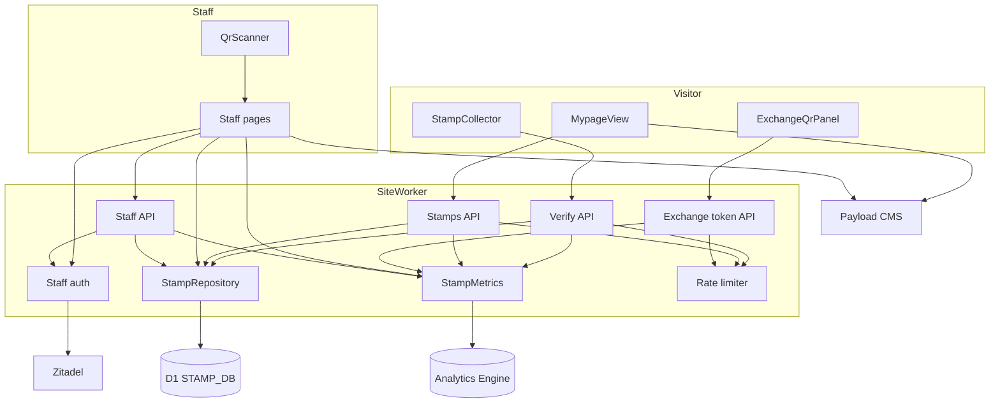
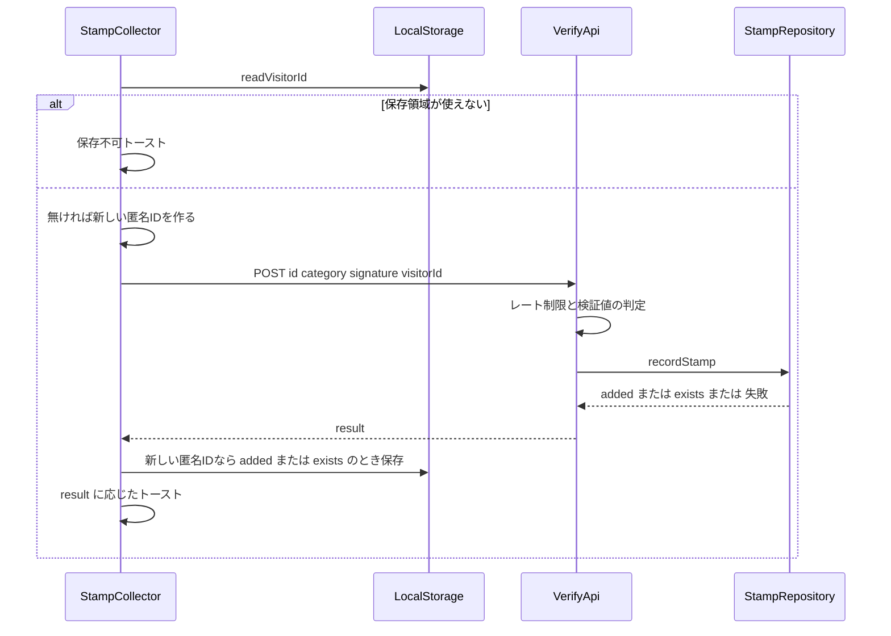
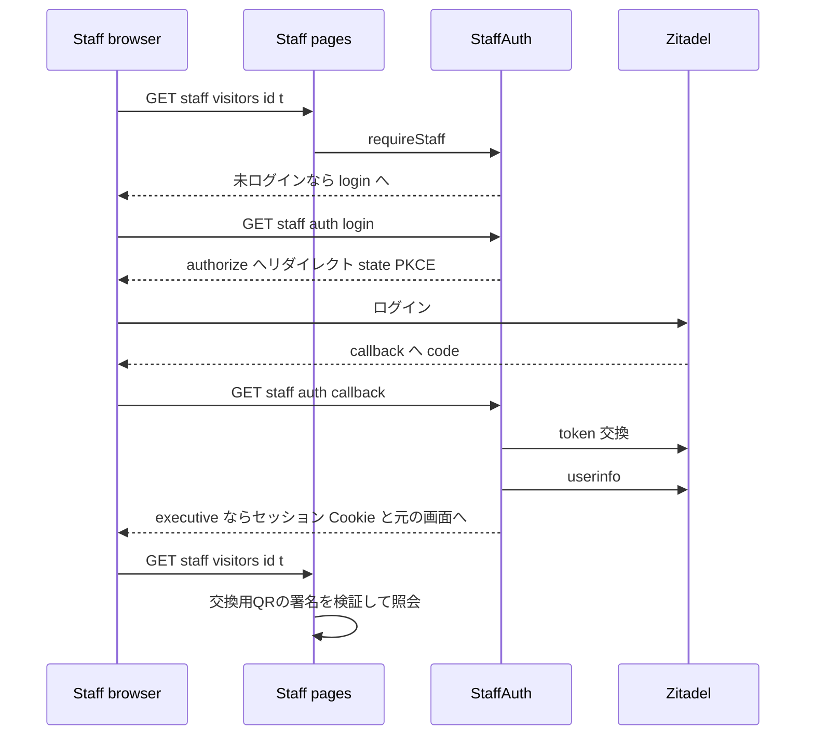
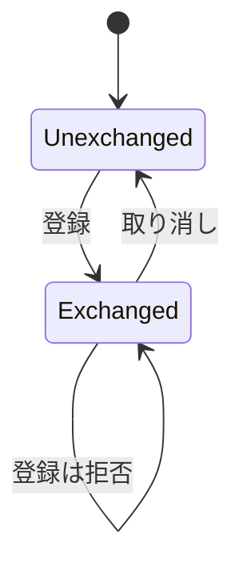

# Design Document

## Overview
**Purpose**: デジタルスタンプラリーのスタンプ取得を Cloudflare D1 に記録し、マイページ・交換窓口の表示をその記録に一本化する。端末内の記録を書き換えた水増しと二重交換を交換窓口で弾けるかを、2026-11-14〜15 の本番で検証する。あわせて、この仕組みが使う D1・Workers の資源量をエンドポイント別に実測する。

**Users**: 来場者はマイページでサーバー記録のスタンプと交換用QRを見る。交換窓口のスタッフ (実行委員) は管理者画面で交換用QRを読み取り、照会・交換済み登録・取り消しを行う。実行委員は管理者画面の集計で取得状況を見る。

**Impact**: 既存 spec `exhibition-qr-stamp-rally` の「スタンプは端末内にのみ保存」を置き換える。検証 API (`POST /api/stamps/verify`) は記録を伴い、応答の形が変わる。端末内の `lists.stamps` は読み書きしなくなる。

### Goals
- 検証値が正しい取得だけがサーバー記録に残り、マイページ・照会画面・集計が同じ記録から数を出す
- 交換済み登録は匿名IDごとに有効なものが常に 1 件以下
- 交換用QRは公開中の対象をすべて取得した来場者にだけ現れる (告知しないイースターエッグ)。条件はサーバーが判定する
- 管理者画面は Zitadel の `executive` ロールを持つ者だけが使える (PR プレビューを除く)
- 本番の開催期間について計測項目 (8.1) を日ごと・エンドポイント別に取り出せる
- D1 と Analytics Engine の使用量を、運用ダッシュボード (ops-dashboard) でプランの上限と対比して監視できる

### Non-Goals
- 企画QRの画像共有、複数端末での取得、交換用QRの有効期限内の画面共有の防止
- 交換条件と景品の告知、来場者のログイン
- 端末内に既にある `lists.stamps` のサーバーへの移行 (表示されなくなる)
- Cloudflare Access による保護 (使わない)

## Boundary Commitments

### This Spec Owns
- D1 データベース `STAMP_DB` のスキーマ (`stamps`, `exchanges`) とその読み書き
- 匿名ID の生成と端末内での保持 (`aramakisai_mypage` の `visitorId`)
- スタンプ検証 API の記録と応答 (`result`)、スタンプ取得 API、交換用QRの署名発行 API
- 交換用QRの署名形式 (`exchange:<visitorId>:<expiresAt>`)
- 管理者画面 (`/staff` 配下) と管理者 API (`/api/staff` 配下)、その OIDC ログインとセッション Cookie
- Analytics Engine データセット `STAMP_METRICS` への記録と、計測値の取り出しスクリプト
- CI での D1 マイグレーション適用と、PR プレビューの D1 差し替え
- 運用ダッシュボードの Cloudflare の利用枠への D1・Analytics Engine の項目追加 (`aramakisai-infra` の ops-dashboard collector)

### Out of Boundary
- 企画QRの検証値の算出規則 (`stamp-signature.ts` の `signStamp`/`verifyStamp`) — 変えない
- ブックマーク (`lists.bookmarks`) の挙動
- GA4 の `qr_stamp` イベントの送信条件とパラメータ (匿名IDは送らない)
- 既存の infra の Access アプリ (PR プレビューのホスト、`dev.aramakisai.com`) — 触らない
- 企画データ・エリア (CMS) — 読むだけ
- 運用ダッシュボードの画面構成・警告の割合・ポータルの認証 (既存 spec `aramakisai-infra/.kiro/specs/ops-dashboard`) — 項目を足すだけで変えない

### Allowed Dependencies
- CMS の `student_exhibitions` / `map_areas` を既存の `getExhibitionCatalog` 経由で読む
- `stamp-progress.ts` の `groupStampsByArea` (エリアの取得率の規則)
- Zitadel (discovery、authorize、token、userinfo)
- 秘密値 `STAMP_SIGNING_SECRET` (企画QR・交換用QR・セッション Cookie の署名で接頭辞を分けて共用)、`STAFF_OIDC_CLIENT_SECRET` (Zitadel アプリ `aramakisai-web-staff` の client secret。本番と dev で同じアプリを使うため Infisical の `prod` にだけ登録し、dev のデプロイもそこから読む。`make quake-dev` が `prod` から読むのと同じ扱い。PR プレビューは認証しないため渡さない)
- 依存方向: Types → Config (`cloudflare-env.ts`) → Repository (`stamp-db.ts`) / Crypto (`exchange-token.ts`, `staff-session.ts`) → Service (`stamp-aggregate.ts`) → Runtime (Route Handler / Server Component) → UI。左から右へのみ import する

### Revalidation Triggers
- `STAMP_SIGNING_SECRET` の変更 (企画QR・交換用QR・管理者セッションが同時に無効になる)
- `aramakisai_mypage` の保存形式の変更 (ブックマークと共有)
- `stamp-progress.ts` の取得率の規則の変更 (マイページと集計の両方に効く)
- Zitadel の role キー `executive` または `groups` クレームの変更
- `wrangler.toml` のバインディング名・`database_id` の変更 (CI の差し替えに効く)

## Architecture

### Existing Architecture Analysis
- `StampCollector` (クライアント) が URL フラグメントの検証値を検証 API に送り、成功時に `addStamp` で端末内に保存してトーストを出す。失敗は無表示
- マイページ (`(site)/mypage/page.tsx`) は ISR (`revalidate = 60`) でカタログから `MypageStampTarget` を作り、`MypageView` が端末内の `lists.stamps` を `groupStampsByArea` に渡す
- サイトの Worker は R2・DO・self service のバインディングを持ち、D1 は無い。`getCloudflareContext().env` の型定義は無く、検証 API が個別にキャストしている
- PR プレビューは本番 Worker のバージョン (`wrangler versions upload`) で、トップレベルのバインディングを共有する
- API は `Cache-Control: no-store` と `dynamic = 'force-dynamic'` を各ルートで書く

### Architecture Pattern & Boundary Map



**Architecture Integration**:
- Selected pattern: 既存のサイト Worker 内に Route Handler / Server Component を足し、D1 を直接使う。デプロイ単位を増やさない
- Domain/feature boundaries: 来場者向け (匿名、`/api/stamps` 配下) と管理者向け (`/staff`, `/api/staff` 配下、ログイン必須) をパスで分ける。D1 への SQL は `stamp-db.ts` だけが持つ
- Existing patterns preserved: `loadForIsr` によるカタログ取得、`aramakisai_` 接頭辞の端末内保存、`no-store` ヘッダー、`--secrets-file` による秘密値の注入、一時設定でのデプロイ (`deploy-with-cpu-limit-fallback.ts`)、noindex の `robots` メタデータ
- New components rationale: 記録の正本 (D1)、管理者の認証 (Zitadel)、エンドポイント別計測 (Analytics Engine)、匿名 API の書き込み上限 (Rate limiting) はいずれも既存に無い
- Steering compliance: Edge Runtime 制約 (Node 専用 API 不使用、WebCrypto のみ)、`.env` 不使用、`process.env` でなく Cloudflare の env から秘密値を読む

### Technology Stack

| Layer | Choice / Version | Role in Feature | Notes |
|-------|------------------|-----------------|-------|
| Frontend | Next.js 16.4.2 / React 19 (既存) | マイページ・管理者画面 | 変更なし |
| Frontend | `qrcode` ^1.5.4 (既存依存) | 交換用QRの描画 | `toString(url, {type: 'svg'})` を既存スクリプトと同じく使う |
| Frontend | `barcode-detector` 3.2.3 (新規) | 管理者画面の QR 読み取り | BarcodeDetector の ponyfill。zxing-wasm の `.wasm` は `public/` から配信 (`prepareZXingModule`) |
| Backend | `@opennextjs/cloudflare` 1.20.13 / wrangler 4.151.3 (既存) | Route Handler、バインディング | `getCloudflareContext().env` |
| Data | Cloudflare D1 (新規) | スタンプ・交換の記録 | 本番 `aramakisai-stamps`、dev `aramakisai-stamps-dev` |
| Observability | Workers Analytics Engine (新規) | エンドポイント別の計測 | データセット `aramakisai_stamp_metrics` |
| Infrastructure | Workers Rate Limiting binding (新規) | 匿名 API の IP 単位制限 | `[[ratelimits]]` |
| Auth | Zitadel OIDC (既存 IdP、新規アプリ) | 管理者ログイン | 認可コード + PKCE (S256) + `client_secret_basic` |

## File Structure Plan

### Directory Structure
```
frontend/
├── migrations/
│   └── 0001_stamp_rally.sql            # stamps / exchanges テーブル (wrangler d1 migrations の既定ディレクトリ)
├── public/vendor/zxing/                # barcode-detector が読む zxing-wasm の .wasm (ビルド時にコピー)
├── scripts/
│   ├── export-stamp-metrics.ts         # GraphQL (D1) と Analytics Engine SQL API から日別 CSV を出す
│   └── write-preview-wrangler-config.ts # PR プレビュー用に STAMP_DB の database_id を dev に差し替えた一時設定を書く
└── src/
    ├── lib/
    │   ├── cloudflare-env.ts           # バインディングと vars の型付き取得 (StampEnv)
    │   ├── visitor-id.ts               # 匿名ID の形式検証 (UUID v4)
    │   ├── stamp-db.ts                 # StampRepository: D1 への全 SQL
    │   ├── stamp-aggregate.ts          # 集計・照会の純粋関数 (カタログ + 記録 → 表示値)
    │   ├── stamp-targets.ts            # カタログ → MypageStampTarget (mypage/page.tsx から移す)
    │   ├── exchange-token.ts           # 交換用QRの署名の発行・検証
    │   ├── staff-session.ts            # 管理者セッション Cookie の発行・検証
    │   ├── staff-auth.ts               # OIDC の開始・コールバック処理、要求の認可 (requireStaff)
    │   ├── stamp-metrics.ts            # Analytics Engine への 1 リクエスト 1 点の記録
    │   └── rate-limit.ts               # IP 単位の制限 (匿名 API 共通)
    ├── app/
    │   ├── api/stamps/
    │   │   ├── verify/route.ts         # (変更) 記録して result を返す
    │   │   ├── route.ts                # GET: 匿名IDの記録一覧
    │   │   └── exchange-token/route.ts # POST: 交換用QRの署名発行
    │   ├── api/staff/
    │   │   ├── exchanges/route.ts                  # POST: 交換済み登録
    │   │   └── exchanges/[exchangeId]/cancel/route.ts # POST: 取り消し
    │   └── (staff)/staff/
    │       ├── layout.tsx              # noindex、画面間ナビ (認可はしない。各 page.tsx が requireStaff を呼ぶ)
    │       ├── page.tsx                # 集計 (入口)
    │       ├── scan/page.tsx           # 読み取り
    │       ├── visitors/[visitorId]/page.tsx # 照会画面
    │       ├── exchanges/page.tsx      # 交換済み一覧
    │       └── auth/
    │           ├── login/route.ts      # 認可リクエストへのリダイレクト
    │           └── callback/route.ts   # コード交換・userinfo・セッション発行
    └── components/
        ├── exchange-qr-panel.tsx       # マイページの交換用QR (自動更新)
        └── staff/
            ├── qr-scanner.tsx          # カメラ読み取り
            ├── exchange-actions.tsx    # 交換済み登録・取り消しボタン
            └── staff-nav.tsx           # 集計・読み取り・一覧の行き来
```

### Modified Files
- `frontend/wrangler.toml` — トップレベルと `[env.dev]` に `[[d1_databases]]` (`STAMP_DB`)、`[[analytics_engine_datasets]]` (`STAMP_METRICS`)、`[[ratelimits]]` (`STAMP_RATE_LIMITER`)、`[vars]` の `STAFF_OIDC_CLIENT_ID`・`STAFF_OIDC_ISSUER` を追加。`STAMP_ENV` は `wrangler.toml` に書かない (StampEnv 参照)
- `frontend/src/lib/mypage-storage.ts` — `MypageData` に `visitorId?: string` を追加し、`parseMypageData` が保持する。`ensureVisitorId` / `saveVisitorId` / `readVisitorId` を追加。`addStamp` と `lists.stamps` の読み書きを削除
- `frontend/src/components/stamp-collector.tsx` — 匿名IDを同送し、`result` に応じてトーストを出す (失敗・保存不可のトーストを追加)
- `frontend/src/components/mypage-view.tsx` — スタンプを `GET /api/stamps` から取得し `groupStampsByArea` に渡す。`ExchangeQrPanel` を置く
- `frontend/src/app/(site)/mypage/page.tsx` — ターゲット変換を `stamp-targets.ts` へ移す
- `frontend/src/lib/analytics.ts` — `qr_stamp` の `result` に `failed` を追加 (記録失敗)。匿名IDは含めない (上記の `/staff` 除外も同じファイル)
- `frontend/src/components/stamp-toast.tsx` — 失敗用の `kind` (`error`) を追加
- `.github/workflows/frontend-ci.yml` — 各デプロイ前の D1 マイグレーション適用、プレビュー用一時設定、`--secrets-file` の JSON に `STAMP_ENV` (3 環境) と、本番と dev には Infisical `prod` の `STAFF_OIDC_CLIENT_SECRET` を追加
- `frontend/scripts/deploy-with-cpu-limit-fallback.ts` — フォールバック設定の元を `wrangler.toml` 固定から、コマンドに `--config` があればそのファイルに変える。再実行時は元の `--config` を外して一時設定の `--config` だけを渡す (プレビューの D1 差し替えがフォールバックで失われないようにする)
- `frontend/src/lib/analytics.ts` — `isGaEnabled` の除外に `/staff` を追加 (照会画面の URL に匿名IDと署名が入るため、1.3)
- `scripts/dev.sh` — `STAMP_ENV=preview` を export
- `frontend/frontend-ci.workflow.test.ts` — プレビューが本番 DB を指さないこと、マイグレーション適用順を固定
- `aramakisai-infra/terraform/` — `cloudflare_d1_database` 2 つ
- `aramakisai-infra/ansible/roles/zitadel-bootstrap/vars/resources.yml` — `zitadel_oidc_apps` に `aramakisai-web-staff` を追加
- `aramakisai-infra/gitops/manifests/prod/ops-dashboard/collector/app/sources/billing_cloudflare.py` — D1 と Analytics Engine の使用量を取り、`_USAGE_QUOTAS` と同じ方式で `quota_item` を足す
- `aramakisai-infra/gitops/manifests/prod/ops-dashboard/collector/dashboard.toml` — `cloudflare_workers` の各プランの `limits` に D1・Analytics Engine の上限を追加
- `aramakisai-infra/gitops/manifests/prod/ops-dashboard/collector/app/render/labels.py` — 追加項目の表示名
- `aramakisai-infra/gitops/manifests/prod/ops-dashboard/collector/app/tests/test_billing.py` — 追加項目のテスト
- `.kiro/steering/tech.md` — D1・秘密値 `STAFF_OIDC_CLIENT_SECRET`・マイグレーションの記述を追加

## System Flows

### スタンプ取得

- 匿名IDは送信前に作るが、端末に保存するのは `added`/`exists` が返ったときだけ (1.1)
- `invalid` は無表示 (既存どおり)、`failed`・`unavailable`・通信失敗は失敗トースト (2.5)

### 管理者ログインと照会

- `STAMP_ENV = 'preview'` のとき `requireStaff` は常に通し、スタッフ名を `preview` とする (7.5)
- 署名の検証は照会画面を開いたときだけ行い、登録・取り消しの API は署名を求めない (4.7)

### 交換済み登録の状態

- 取り消した登録は行として残り、`cancelled_at` を持つ。次の登録は新しい行 (11.3, 11.4)

## Requirements Traceability

| Requirement | Summary | Components | Interfaces | Flows |
|-------------|---------|------------|------------|-------|
| 1.1–1.4 | 匿名ID | MypageStorage, StampCollector, VisitorId | `ensureVisitorId`, `saveVisitorId` | スタンプ取得 |
| 2.1–2.3 | 記録と重複 | VerifyApi, StampRepository | `recordStamp` | スタンプ取得 |
| 2.4–2.6 | 応答と通知 | VerifyApi, StampCollector, StampToast | `VerifyResponse` | スタンプ取得 |
| 2.7 | 判定規則 | VerifyApi (`verifyStamp` 既存) | — | — |
| 3.1–3.6 | マイページ表示 | StampsApi, MypageView, StampTargets | `GET /api/stamps` | — |
| 4.1–4.2, 4.5, 4.8 | 交換用QR表示 | ExchangeQrPanel, TokenApi | `POST /api/stamps/exchange-token` | — |
| 4.3–4.4, 4.6–4.7, 4.9–4.10 | 署名・発行条件・照会画面への遷移 | ExchangeToken, TokenApi, StampAggregate, StaffVisitorPage | `issueExchangeToken`, `verifyExchangeToken`, `isComplete` | 管理者ログインと照会 |
| 5.1–5.6 | 照会 | StaffVisitorPage, StampAggregate, StampRepository | `getVisitorRecord` | 管理者ログインと照会 |
| 6.1–6.4 | 交換済み登録 | StaffExchangeApi, StampRepository, StampAggregate | `registerExchange`, `isComplete` | 交換済み登録の状態 |
| 7.1–7.6 | 管理者画面の保護 | StaffAuth, StaffSession, StaffLayout | `requireStaff` | 管理者ログインと照会 |
| 8.1–8.3 | 計測 | StampMetrics, ExportStampMetrics | `recordRequest` | — |
| 8.4–8.5 | 運用ダッシュボードの監視 | OpsDashboardStampUsage | `dashboard.toml` の limits、`quota.*` 項目 | — |
| 9.1–9.7 | 集計 | StaffDashboardPage, StampAggregate | `aggregate` | — |
| 10.1–10.5 | 読み取り | QrScanner, StaffNav | `parseExchangeUrl` | — |
| 11.1–11.6 | 一覧と取り消し | StaffExchangesPage, StaffCancelApi, ExchangeActions | `listExchanges`, `cancelExchange` | 交換済み登録の状態 |

## Components and Interfaces

| Component | Domain/Layer | Intent | Req Coverage | Key Dependencies | Contracts |
|-----------|--------------|--------|--------------|------------------|-----------|
| StampEnv (`cloudflare-env.ts`) | Config | バインディングと vars の型付き取得 | 全体 | getCloudflareContext (P0) | Service |
| StampRepository (`stamp-db.ts`) | Repository | D1 への全 SQL | 2, 3, 5, 6, 9, 11 | D1 (P0) | Service |
| ExchangeToken (`exchange-token.ts`) | Crypto | 交換用QRの署名 | 4 | WebCrypto (P0) | Service |
| StaffSession / StaffAuth | Crypto / Runtime | 管理者ログインと認可 | 7 | Zitadel (P0) | Service, API |
| StampAggregate (`stamp-aggregate.ts`) | Service | 照会・集計の表示値 | 5, 9 | stamp-progress (P0) | Service |
| StampMetrics (`stamp-metrics.ts`) | Runtime | エンドポイント別計測 | 8 | Analytics Engine (P1) | Service |
| RateLimit (`rate-limit.ts`) | Runtime | 匿名 API の IP 制限 | 2, 3, 4 | Rate limiting binding (P1) | Service |
| VerifyApi / StampsApi / TokenApi | Runtime | 来場者向け API | 2, 3, 4 | Repository, Metrics, RateLimit | API |
| StaffExchangeApi / StaffCancelApi | Runtime | 管理者 API | 6, 11 | Repository, StaffAuth | API |
| MypageStorage (変更) | UI lib | 匿名IDの保持 | 1 | localStorage | State |
| StampCollector (変更) / StampToast (変更) | UI | 取得と通知 | 1, 2 | VerifyApi | — |
| MypageView (変更) / ExchangeQrPanel | UI | サーバー記録の表示と交換用QR | 3, 4 | StampsApi, TokenApi, qrcode | — |
| Staff pages / StaffNav / QrScanner / ExchangeActions | UI | 管理者画面 | 5, 7, 9, 10, 11 | StaffAuth, Repository, barcode-detector | — |
| ExportStampMetrics (`export-stamp-metrics.ts`) | Batch | 計測値の取り出し | 8 | Cloudflare GraphQL / AE SQL API (P0) | Batch |
| CI (`frontend-ci.yml`) | Infra | マイグレーションとプレビュー差し替え | 8.2 | wrangler (P0) | Batch |
| OpsDashboardStampUsage | Infra (ops-dashboard collector) | D1・Analytics Engine の利用枠を表示 | 8.4, 8.5 | Cloudflare GraphQL / AE SQL API (P0) | Batch |

### Config

#### StampEnv

| Field | Detail |
|-------|--------|
| Intent | `getCloudflareContext().env` を型付きで返す唯一の入口 |
| Requirements | 全体 |

**Contracts**: Service [x]

```typescript
type StampEnvName = 'prod' | 'dev' | 'preview';

interface StampEnv {
  readonly STAMP_DB: D1Database;
  readonly STAMP_METRICS: AnalyticsEngineDataset;
  readonly STAMP_RATE_LIMITER: RateLimit;
  readonly STAMP_SIGNING_SECRET: string;
  readonly STAMP_ENV: StampEnvName;
  readonly STAFF_OIDC_ISSUER: string;
  readonly STAFF_OIDC_CLIENT_ID: string;
  readonly STAFF_OIDC_CLIENT_SECRET: string;
}

type StampEnvResult =
  | { readonly ok: true; readonly env: StampEnv }
  | { readonly ok: false; readonly missing: readonly (keyof StampEnv)[] };

function readStampEnv(): Promise<StampEnvResult>;
```
- `STAMP_ENV` が `prod`/`dev`/`preview` 以外、または値が欠けていれば `ok: false`。呼び出し側は失敗として扱う (検証 API は `failed`、管理者画面はエラー表示)。`preview` を既定値にしない
- `STAMP_ENV` の注入: CI が環境ごとに作る `--secrets-file` の JSON に `STAMP_ENV` を入れる (本番 `prod`、dev `dev`、PR プレビュー `preview`)。ローカル開発は `scripts/dev.sh` が `STAMP_ENV=preview` を export し、既存の `CLOUDFLARE_INCLUDE_PROCESS_ENV=true` で渡す。`wrangler.toml` の `[vars]` とプロセス環境変数の優先順位は公式に記述が無いため、`[vars]` には置かない
- ローカル開発は miniflare の D1 を使う

### Repository

#### StampRepository

| Field | Detail |
|-------|--------|
| Intent | D1 のスキーマを知る唯一のモジュール |
| Requirements | 2.1, 2.2, 3.1, 5.1, 6.1–6.3, 9.1, 11.1–11.5 |

**Responsibilities & Constraints**
- すべての戻り値に、実行したクエリの `meta.rows_read`・`meta.rows_written`・`meta.duration` の合計 (`D1Usage`) を添える。計測は呼び出し側が記録する
- 例外を外に出さず、D1 の失敗は `{ ok: false }` で返す

**Contracts**: Service [x]

```typescript
interface D1Usage {
  readonly rowsRead: number;
  readonly rowsWritten: number;
  readonly durationMs: number;
}

type DbResult<T> =
  | { readonly ok: true; readonly value: T; readonly usage: D1Usage }
  | { readonly ok: false; readonly usage: D1Usage };

interface StampRecord {
  readonly exhibitionId: number;
  readonly category: StampCategory;
  readonly acquiredAt: string; // ISO 8601
}

interface ExchangeRecord {
  readonly exchangeId: number;
  readonly visitorId: string;
  readonly exchangedAt: string;
  readonly exchangedBy: string;
  readonly cancelledAt: string | null;
  readonly cancelledBy: string | null;
}

interface VisitorRecord {
  readonly stamps: readonly StampRecord[];
  readonly activeExchange: ExchangeRecord | null;
}

type RegisterExchangeOutcome =
  | { readonly kind: 'registered'; readonly exchange: ExchangeRecord }
  | { readonly kind: 'already'; readonly exchange: ExchangeRecord };

type CancelExchangeOutcome =
  | { readonly kind: 'cancelled'; readonly exchange: ExchangeRecord }
  | { readonly kind: 'already'; readonly exchange: ExchangeRecord }
  | { readonly kind: 'not_found' };

interface AllRecords {
  readonly stamps: readonly (StampRecord & { readonly visitorId: string })[];
  readonly activeExchangeCount: number;
}

interface StampRepository {
  recordStamp(visitorId: string, exhibitionId: number, category: StampCategory, now: Date): Promise<DbResult<'added' | 'exists'>>;
  listStamps(visitorId: string): Promise<DbResult<readonly StampRecord[]>>;
  getVisitorRecord(visitorId: string): Promise<DbResult<VisitorRecord>>;
  registerExchange(visitorId: string, staff: string, now: Date): Promise<DbResult<RegisterExchangeOutcome>>;
  cancelExchange(exchangeId: number, staff: string, now: Date): Promise<DbResult<CancelExchangeOutcome>>;
  listExchanges(): Promise<DbResult<readonly ExchangeRecord[]>>;
  loadAllRecords(): Promise<DbResult<AllRecords>>;
}
```
- `recordStamp`: `INSERT ... ON CONFLICT DO NOTHING`。`meta.changes = 1` で `added`、0 で `exists` (2.2, 2.6)
- `registerExchange`: 部分一意インデックスへの INSERT。一意制約違反なら有効な登録を読み直して `already` (6.2, 6.3)
- `cancelExchange`: `UPDATE ... WHERE exchange_id = ? AND cancelled_at IS NULL`。`changes = 0` なら行を読み直して `already` か `not_found` (11.5)
- `listExchanges`: `exchanged_at` の降順 (11.1)
- `loadAllRecords`: 集計用に `stamps` を全件読む

### Crypto

#### ExchangeToken

| Field | Detail |
|-------|--------|
| Intent | 交換用QRに入れる 300 秒有効の署名 |
| Requirements | 4.4, 4.6 |

**Contracts**: Service [x]

```typescript
interface ExchangeToken {
  readonly token: string;      // `<expiresAtEpochSec>.<base64url HMAC>`
  readonly expiresAt: string;  // ISO 8601
}

type ExchangeTokenCheck = 'valid' | 'expired' | 'invalid';

function issueExchangeToken(secret: string, visitorId: string, now: Date): Promise<ExchangeToken>;
function verifyExchangeToken(secret: string, visitorId: string, token: string, now: Date): Promise<ExchangeTokenCheck>;
```
- 署名対象 `exchange:<visitorId>:<expiresAtEpochSec>`、HMAC-SHA256、`crypto.subtle.verify` で比較してから期限を判定する
- 有効期限は発行から 300 秒 (`EXCHANGE_TOKEN_TTL_SECONDS = 300`)
- 照会画面の URL: `<origin>/staff/visitors/<visitorId>?t=<token>`

#### StaffSession

| Field | Detail |
|-------|--------|
| Intent | ログイン済みの実行委員を表す Cookie |
| Requirements | 7.1, 7.4 |

**Contracts**: Service [x]

```typescript
interface StaffIdentity {
  readonly subject: string; // Zitadel の sub
  readonly email: string;
}

function issueStaffSession(secret: string, identity: StaffIdentity, now: Date): Promise<string>;
function verifyStaffSession(secret: string, cookieValue: string, now: Date): Promise<StaffIdentity | null>;
```
- 値は `<base64url JSON {sub, email, exp}>.<base64url HMAC>`、署名対象に接頭辞 `staff-session:` を付ける
- Cookie 名 `aramakisai_staff`、`HttpOnly; Secure; SameSite=Lax; Path=/`、有効期間 12 時間
- 期限切れ・改ざん・形式不正は `null` (7.4)

#### StaffAuth

| Field | Detail |
|-------|--------|
| Intent | OIDC ログインと、管理者画面・API の認可 |
| Requirements | 7.1–7.5 |

**Contracts**: Service [x] / API [x]

```typescript
type StaffAuthResult =
  | { readonly kind: 'allowed'; readonly staff: string } // email、preview では 'preview'
  | { readonly kind: 'login_required'; readonly loginUrl: string }
  | { readonly kind: 'forbidden' };

function requireStaff(request: Request, env: StampEnv): Promise<StaffAuthResult>;
```

| Method | Endpoint | Request | Response | Errors |
|--------|----------|---------|----------|--------|
| GET | /staff/auth/login | `?returnTo=<path>` (`/staff` 配下のみ) | 302 → authorize。`state`・`code_verifier`・`returnTo` を短命 Cookie (`aramakisai_staff_oidc`、10 分) に保存 | — |
| GET | /staff/auth/callback | `?code&state` | 302 → `returnTo`、`aramakisai_staff` を発行 | state 不一致・token/userinfo 失敗 → ログイン失敗の画面、`groups` に `executive` 無し → 利用不可の画面 (7.3) |

- `requireStaff` は各 `page.tsx` と各 Route Handler の先頭で必ず呼び、Repository を呼ぶ前に結果を判定する。`layout.tsx` では呼ばない (レイアウトはナビゲーション時に再描画されず、ページの描画も止めないため。https://nextjs.org/docs/app/guides/authentication#layouts-and-auth-checks)
- 画面 (Server Component) は `login_required` で `/staff/auth/login?returnTo=` へリダイレクト (7.2)、`forbidden` で利用不可の表示 (7.3)
- API は `login_required` と `forbidden` をそれぞれ 401・403 で返す (7.4)
- scope は `openid email groups`。userinfo の `groups` (string 配列) に `executive` があることを条件とする
- `STAMP_ENV = 'preview'` のときだけ、Cookie を見ずに `allowed` (staff = `preview`) を返す (7.5)
- `returnTo` は `/staff` で始まるパスだけ受け付け、それ以外は `/staff` にする (オープンリダイレクト防止)。クエリ (`?t=`) を含めて保持する。初回ログインで 300 秒を超えた場合は照会画面が有効期限切れの案内になり、来場者に交換用QRを表示し直してもらう

### Service

#### StampAggregate

| Field | Detail |
|-------|--------|
| Intent | カタログとサーバー記録から照会・集計の表示値を作る純粋関数 |
| Requirements | 3.1, 5.1, 5.4, 5.5, 9.1, 9.3, 9.4 |

**Contracts**: Service [x]

```typescript
interface AreaCount {
  readonly areaId: number | null; // null は「エリア不明」
  readonly areaName: string;
  readonly collected: number;
}

interface VisitorSummary {
  readonly stampCount: number;
  readonly byArea: readonly AreaCount[];
}

interface TargetStat {
  readonly exhibitionId: number;
  readonly category: StampCategory;
  readonly displayName: string;
  readonly organizationName: string; // 企画別のキーワード絞り込み用 (9.6)
  readonly areaId: number | null; // MypageStampTarget の areaId。エリア別の集計と同じ値 (9.6)
  readonly visitorCount: number;
  readonly rate: number; // visitorCount / participantCount、参加 0 なら 0
}

interface AreaStat {
  readonly areaId: number | null;
  readonly areaName: string;
  readonly collected: number;
  readonly averagePercent: number | null; // エリア不明は null
}

interface Dashboard {
  readonly participantCount: number;
  readonly activeExchangeCount: number;
  readonly targets: readonly TargetStat[];
  readonly areas: readonly AreaStat[];
  readonly distribution: readonly { readonly stampCount: number; readonly visitorCount: number }[];
}

function summarizeVisitor(targets: readonly MypageStampTarget[], areas: readonly AreaOption[], stamps: readonly StampRecord[]): VisitorSummary;
function aggregate(targets: readonly MypageStampTarget[], areas: readonly AreaOption[], records: AllRecords): Dashboard;
function isComplete(targets: readonly MypageStampTarget[], stamps: readonly StampRecord[]): boolean;
```
- `isComplete`: `targets` (公開中・stage 以外の全組。areaId の有無を問わない) が 1 件以上あり、そのすべてが `stamps` に含まれるとき `true`。公開されていない企画のスタンプは判定に使わない (4.1, 4.10, 6.4)
- `targets` は署名発行・登録・マイページのいずれでも `stamp-targets.ts` で `getExhibitionCatalog` から作る。CMS への問い合わせは既存のエッジキャッシュ (TTL 60 秒) を通る
- エリアの取得率は参加端末ごとに `groupStampsByArea` で求め、その `percent` を平均する (9.3)
- カタログに無い企画・areaId が null の企画は `areaId: null` (「エリア不明」) に数える (5.5, 9.4)。スタンプ数には含める
- `MypageStampTarget` に `organizationName` を足し、`toStampTargets` でカードの `organizationName` を写す。`TargetStat` はその値と `areaId` を持つ (9.6)
- `distribution` は 1 から `targets.length` までのすべてのスタンプ数を持ち、該当端末が 0 のスタンプ数も `visitorCount: 0` で含める (9.7。グラフの横軸を詰めないため)

### Runtime

#### StampMetrics

| Field | Detail |
|-------|--------|
| Intent | 1 リクエストにつき Analytics Engine に 1 点書く |
| Requirements | 8.1–8.3 |

**Contracts**: Service [x]

```typescript
type MetricEndpoint =
  | 'verify' | 'stamps' | 'exchange_token'
  | 'staff_dashboard' | 'staff_visitor' | 'staff_exchanges'
  | 'staff_register' | 'staff_cancel';

interface RequestMeasure {
  readonly endpoint: MetricEndpoint;
  readonly outcome: string;        // 例 'added' | 'exists' | 'invalid' | 'failed' | 'rate_limited' | 'ok' | 'error'
  readonly status: number;
  readonly requestBytes: number;   // 本文のバイト数
  readonly responseBytes: number;  // 本文のバイト数
  readonly totalMs: number;        // ハンドラ開始から応答確定まで
  readonly usage: D1Usage | null;  // D1 を使わない場合 null
}

function recordRequest(env: StampEnv, measure: RequestMeasure): void;
```
- 点の構成: index = `endpoint`、blobs = [`STAMP_ENV`, `endpoint`, `outcome`, `status`]、doubles = [`requestBytes`, `responseBytes`, `totalMs`, `d1DurationMs`, `rowsRead`, `rowsWritten`, `d1Failed (0/1)`]
- 管理者画面のページ (`staff_dashboard`・`staff_visitor`・`staff_exchanges`) は Server Component で、点を書く時点では返す HTML の大きさが分からない。`requestBytes` は GET で本文が無いため 0、`responseBytes` は未計測を表す -1 を書く。この 3 つのレスポンスのバイト数は ExportStampMetrics が zone のアクセス解析から取る (8.1)
- `totalMs - d1DurationMs` を「記録を加える前の相当値」として比べる (8.3)。`Date.now()` は I/O で進むため D1 の待ちを含む全体時間が取れる
- 書き込みの失敗は握りつぶす (計測が本処理を落とさない)
- 本番とdevは `STAMP_ENV` の blob で区別する (8.2)。D1 の値は DB が別なので `databaseId` で区別する

#### RateLimit

| Field | Detail |
|-------|--------|
| Intent | 匿名 API の書き込みを IP 単位で抑える |
| Requirements | 2.1 (書き込み枠の保護) |

**Contracts**: Service [x]

```typescript
function allowAnonymousRequest(env: StampEnv, request: Request): Promise<boolean>;
```
- キーは `cf-connecting-ip`。検証・取得・署名発行の 3 API で共通の 1 バインディング
- 制限値は IP ごとに 60 秒あたり 120 回 (`[ratelimits.simple] limit = 120, period = 60`)。1 人の通常操作 (読み取り 1 回 1 件、マイページ表示 1 件、交換用QRの更新 4 分ごと 1 件) に対して、同じ IP を共有する数十人分の余裕を見た値。超過は 429 `{ result: 'rate_limited' }` とし、計測の `outcome` に残す

#### 来場者向け API

| Method | Endpoint | Request | Response | Errors |
|--------|----------|---------|----------|--------|
| POST | /api/stamps/verify | `{ id: number; category: string; signature: string; visitorId: string }` | `{ result: 'added' \| 'exists' \| 'invalid' \| 'failed' }` | 400 `{ error: 'invalid_json' }`、429 |
| GET | /api/stamps?visitorId= | — | `{ stamps: StampRecord[] }` | 400 (匿名ID形式不正)、429、503 `{ error: 'unavailable' }` |
| POST | /api/stamps/exchange-token | `{ visitorId: string }` | `{ url: string; expiresAt: string }` | 400、403 `{ error: 'not_eligible' }`、429、503 |

- verify: 既存の入力検証と `verifyStamp` の後、匿名IDが無い・形式不正なら `invalid` (2.4)、署名不正なら記録せず `invalid` (2.3)、D1 失敗・env 不備なら `failed` (2.5)
- 応答の形を `{valid}` から `{result}` に変える。古いクライアントは `valid` が無いので未取得として扱われ、2.4 と同じ結果になる
- exchange-token: カタログと `listStamps` で `isComplete` を判定し、`false` なら署名を発行せず 403 (4.9, 4.10)
- すべて `Cache-Control: no-store`、`dynamic = 'force-dynamic'`

#### 管理者 API

| Method | Endpoint | Request | Response | Errors |
|--------|----------|---------|----------|--------|
| POST | /api/staff/exchanges | `{ visitorId: string }` | `{ kind: 'registered' \| 'already'; exchange: ExchangeRecord }` \| `{ kind: 'not_eligible' }` (409) | 400、401、403、409、503 |
| POST | /api/staff/exchanges/{exchangeId}/cancel | — | `{ kind: 'cancelled' \| 'already'; exchange: ExchangeRecord }` | 401、403、404、503 |

- `exchangedBy` / `cancelledBy` は `requireStaff` の `staff` (email、preview では `preview`)
- 登録 API は登録の前に `isComplete` を判定し、`false` なら登録せず 409 `not_eligible` (6.4)
- 登録 API は交換用QRの署名を求めない。照会画面を開けた時点で署名は検証済み (4.7)。API 自体はログイン必須

### UI

UI コンポーネントは新しい境界を持たないため要約に留める。マイページの交換用QR・取得失敗と保存不可のトースト・管理者画面 (集計・読み取り・照会・交換済み一覧・ログイン失敗と利用不可) は、実装の前に Figma で画面を作り承認を得る。実装は Figma の node-id を指定して行い、下記の挙動は Figma に描かれた状態と一致させる。

Figma (ファイル `0kWDqHsLr6xE8b4FFgR1Zx`):
- マイページ (ページ `990:14`): 交換用QR (全対象取得時) `1531:684`、交換用QR表示失敗 `1531:710`、スタンプ取得失敗 `1531:825`、トースト「スタンプを記録できませんでした。(改行)もう一度読み取ってください」`1531:867`、トースト「この端末ではスタンプを集められません」`1531:985`
- 管理者画面 (ページ `1532:2`): 集計 `1532:3`、集計 — 企画別 絞り込み中 `1585:248`、集計 — 企画別 該当なし `1585:395`、集計 — 分布の値表示 `1585:542`、集計 — 取得失敗 `1532:99`、読み取り `1532:126`、読み取り — 交換用QR以外 `1532:161`、読み取り — カメラ使用不可 `1532:188`、照会 — 未交換 `1532:212`、照会 — 交換済み `1532:258`、照会 — 有効期限切れ `1532:305`、照会 — 読み取り直し `1532:329`、照会 — 条件未達 `1535:1097`、交換済み一覧 `1532:353`、ログイン失敗 `1532:405`、利用不可 `1532:413`
- コンポーネント (ページ `2:2`): `StaffNav` `1530:1080` (Selected=dashboard|exchanges|none|scan。scan は読み取り画面用で「QRを読み取る」ボタンを持たない)、`StaffActionButton` `1530:1025` (Kind=primary|secondary)、`icon/bar_chart` `1530:1013`、`icon/list_alt` `1530:1015`、`icon/qr_code_scanner` `1530:1017`、`icon/sync_problem` `1530:1019`

- **MypageStorage**: `MypageData = { version: 1; visitorId?: string; lists: { bookmarks } }`。`readVisitorId(): string | null | 'unavailable'`、`saveVisitorId(id): 'saved' | 'unavailable'`。既存の `stamps` 配列は読み込み時に捨てる
- **StampCollector**: 送信前に `readVisitorId`。`unavailable` なら送らず保存不可トースト (1.4)。無ければ `crypto.randomUUID()`。`added`/`exists` で新しい ID を保存し既存の 2 種のトースト、`failed`・通信失敗で失敗トースト (2.5)、`invalid` は無表示。GA4 の `result` は `added|exists|invalid|failed|network_error|unavailable`
- **MypageView**: 匿名IDが無ければ 0 件表示 (3.4)。あれば `GET /api/stamps` の結果を `groupStampsByArea` に渡す (`acquiredAt` を `savedAt` に写す)。取得失敗は取得状況を出さず再読み込みの案内 (3.5)。読み込み中は既存と同じく空表示を出さない
- **ExchangeQrPanel**: 匿名IDがあり、取得 API の結果とページの `targets` で `isComplete` が `true` のときだけ景品交換の節を描く。満たさなければ節も見出しも描かない (4.1, 4.2)。署名発行 API が 403 を返したときも節を描かない。表示中は `expiresAt` の 60 秒前に署名を取り直して QR を差し替える (4.5)。`document.visibilityState` が `visible` に戻ったときも期限を確かめて取り直す。発行失敗は QR を出さず案内 (4.8)
- **Staff layout / StaffNav**: `robots: { index: false, follow: false }` (7.6)。集計・読み取り・交換済み一覧への導線と、どの画面からも押せる「読み取り」ボタン (10.1)。サイトのヘッダー・フッターは出さない
- **QrScanner**: `barcode-detector` の `BarcodeDetector({ formats: ['qr_code'] })` と `getUserMedia({ video: { facingMode: 'environment' } })`、`<video playsinline muted>`。読み取った文字列が自サイトの `/staff/visitors/<visitorId>?t=` 形式なら遷移 (10.2)、それ以外は案内を出して読み取りを続ける (10.5)。`NotAllowedError`・`navigator.mediaDevices` 不在・検出器の初期化失敗は標準カメラでの読み取りを案内 (10.4)
- **Staff visitor page**: 登録時に 409 `not_eligible` が返ったとき、または照会時点で `isComplete` が `false` のときは、交換済み登録のボタンの代わりに「すべての企画のスタンプがそろっていません」を表示する (6.4)。`verifyExchangeToken` が `valid` でなければ照会せず表示し直しの案内 (4.6)。匿名IDの形式不正は読み取り直しの案内 (5.6)。`summarizeVisitor` の結果と有効な交換済み登録を表示し、`ExchangeActions` で登録・取り消し (6.1, 11.6)。登録・取り消しの後は API の応答で画面の表示を更新し、ページを再取得しない (再取得すると署名を再検証し、300 秒を過ぎていれば有効期限切れの表示に変わるため、4.7)
- **Staff exchanges page**: `listExchanges` を表示 (11.1)。匿名IDは先頭 8 文字で識別表示。取り消し済みでない行に取り消しボタン (11.2)
- **Staff dashboard page**: `aggregate` の結果。取得失敗は値を出さず案内 (9.5)
- **StaffTargetFilter** (企画別、9.6): 検索欄 (SearchField `2:212`)、カテゴリのチップ (FacetChip `2:111`、展示・出店・その他)、エリアのチップ (`dashboard.areas` のうち `areaId` が null でないもの)、件数「全 N 件」。チップの見た目と間隔は企画一覧と同じ。カテゴリとエリアはそれぞれ単一選択で、選択中のチップを押すと解除する。条件はページ内の状態として持ち、URL には載せない。キーワードは `normalizeText` で正規化して `displayName` と `organizationName` の部分一致を見る (企画一覧と同じ判定)。入力ごとに即時に絞り込む。一致 0 件なら件数と行の代わりに「条件に一致する企画はありません」
- **StampDistributionChart** (分布、9.7): 縦棒グラフ。チャートのライブラリは入れず、棒を flex で並べる。横軸は `distribution` の全スタンプ数、縦軸は端末数。目盛り線は 0・最大の半分・最大の 3 本で、左端に数値。横軸のラベルは 1 と 10 の倍数。軸の単位は「端末数 (台)」「スタンプ数 (個)」。棒の色は `accent-alt`。各棒は `aria-label="N個 M台"` のボタンで、押すとその棒を `primary` にし、グラフの上に「N個 M台」を出す。もう一度押すと解除する。初期状態は未選択で値の行を出さない

### Batch

#### ExportStampMetrics

| Field | Detail |
|-------|--------|
| Intent | 計測値を開催期間の日別 CSV に出す |
| Requirements | 8.1, 8.2 |

**Contracts**: Batch [x]
- Trigger: 手動。`infisical run --env=prod -- pnpm metrics:stamps --from 2026-11-14 --to 2026-11-15`
- Input: Cloudflare API トークン (Account Analytics Read、aramakisai.com の zone の Analytics Read)、アカウント ID、2 つの `databaseId`、aramakisai.com の zone ID (トークンで `GET /zones?name=aramakisai.com` から引く)
- Output: `d1_daily.csv` (date, env, rowsRead, rowsWritten, readQueries, writeQueries, queryBatchResponseBytes, databaseSizeBytes) と `endpoints_daily.csv` (date, env, endpoint, outcome, requests, requestBytes, responseBytes, totalMs の平均と P90, d1DurationMs の平均, rowsRead, rowsWritten, d1Failed)
- `staff_pages_daily.csv` (date, env, endpoint, requests, responseBytes): GraphQL の `httpRequestsAdaptiveGroups` を `clientRequestHTTPHost` と `clientRequestPath` で日別に集計する。env はホストで分ける (`aramakisai.com` = prod、`dev.aramakisai.com` = dev)。endpoint はパスで分ける (`/staff` = `staff_dashboard`、`/staff/exchanges` = `staff_exchanges`、`/staff/visitors/` で始まるもの = `staff_visitor`)。requests は `count`、responseBytes は `sum.edgeResponseBytes`。値はサンプリングからの推定値で、responseBytes はクライアントへの転送量 (圧縮後とみられる) のため、`endpoints_daily.csv` の本文のバイト数とは定義が違う
- 出力先は引数で受け、リポジトリには置かない
- D1 と zone のアクセス解析の GraphQL は保持 31 日、Analytics Engine は 3 か月。開催後 31 日以内 (2026-12-15 まで) に実行する
- CPU 時間は API で取らない。Workers Logs の Query Builder で `$workers.event.request.path` ごとに `$workers.cpuTimeMs` の平均と P99 を開催後 7 日以内 (2026-11-22 まで) に記録する。`head_sampling_rate = 0.1` のサンプル値である

#### OpsDashboardStampUsage

| Field | Detail |
|-------|--------|
| Intent | 既存の `billing.cloudflare` ソースに D1 と Analytics Engine の利用枠を足す |
| Requirements | 8.4, 8.5 |

**Contracts**: Batch [x]
- Trigger: 既存の `billing.cloudflare` の収集間隔 (1 時間)
- Input: 既存の `OPS_CLOUDFLARE_READ_TOKEN` (Account Analytics Read を持つ。2026-10-28 に D1 データセットのスキーマ照会が通ることを確認) と `TF_VAR_cloudflare_account_id`。新しい秘密値は無い
- 取得:
  - D1: GraphQL `d1AnalyticsAdaptiveGroups` の `sum { rowsRead rowsWritten }` (アカウント全体、`date_geq`/`date_leq`)、`d1StorageAdaptiveGroups` の `max { databaseSizeBytes }` を `databaseId` ごとの最新値で合計。フィールド名は 2026-10-28 に GraphQL スキーマで確認済み
  - Analytics Engine: SQL API `POST /accounts/{account}/analytics_engine/sql` で `SELECT SUM(_sample_interval) FROM aramakisai_stamp_metrics WHERE timestamp >= <範囲の開始>`。2026-10-28 時点でアカウントに Analytics Engine のデータセットは無く (同トークンの `SHOW TABLES` が 0 件)、本機能の 1 つだけになるため、これをアカウントの書き込み件数とみなす
- 項目と上限 (`dashboard.toml` の `cloudflare_workers` の `limits` に追加。範囲の起点は既存と同じく日次は UTC 0 時、月次はプランの `from`):

| 項目キー | limits のキー | Workers Paid | Workers Free | 単位 |
|---|---|---|---|---|
| `quota.d1_rows_written_month` / `_day` | `d1_rows_written_month` / `d1_rows_written_day` | 50,000,000 / 月 | 100,000 / 日 | rows |
| `quota.d1_rows_read_month` / `_day` | `d1_rows_read_month` / `d1_rows_read_day` | 25,000,000,000 / 月 | 5,000,000 / 日 | rows |
| `quota.d1_storage` | `d1_storage_gb` | 5 | 5 | GB |
| `quota.ae_writes_month` / `_day` | `ae_writes_month` / `ae_writes_day` | 10,000,000 / 月 | 100,000 / 日 | points |

- Output: 既存の `quota_item` と同じ形。警告の割合は既存の `thresholds.warn_ratio` をそのまま使う (8.5)
- 上限の出典: D1 は https://developers.cloudflare.com/d1/platform/pricing/ 、Analytics Engine は https://developers.cloudflare.com/analytics/analytics-engine/pricing/ (2026-10-27 時点)
- 既存の `_usage` の窓分割 (30 日) と同じ範囲の扱いにする

## Data Models

### Logical Data Model
- `stamps`: 匿名ID × 企画id × カテゴリが一意。取得日時を持つ
- `exchanges`: 交換済み登録の履歴。匿名IDごとに `cancelled_at IS NULL` の行は高々 1 件

### Physical Data Model

```sql
CREATE TABLE stamps (
  visitor_id    TEXT    NOT NULL,
  exhibition_id INTEGER NOT NULL,
  category      TEXT    NOT NULL CHECK (category IN ('exhibit', 'vendor', 'other')),
  acquired_at   TEXT    NOT NULL,
  PRIMARY KEY (visitor_id, exhibition_id, category)
) WITHOUT ROWID;

CREATE TABLE exchanges (
  exchange_id  INTEGER PRIMARY KEY,
  visitor_id   TEXT NOT NULL,
  exchanged_at TEXT NOT NULL,
  exchanged_by TEXT NOT NULL,
  cancelled_at TEXT,
  cancelled_by TEXT
);

CREATE UNIQUE INDEX exchanges_active_visitor
  ON exchanges (visitor_id) WHERE cancelled_at IS NULL;
```
- `stamps` は主キー以外のインデックスを持たない (書き込み行数を増やさない)。照会は主キーの先頭列 `visitor_id` で引く
- `exchanges` の一覧 (`ORDER BY exchanged_at DESC`) は件数が交換数に限られるため索引を張らない
- 日時は UTC の ISO 8601 文字列

### Data Contracts & Integration
- 匿名ID: UUID v4 の小文字表記 (`^[0-9a-f]{8}-[0-9a-f]{4}-4[0-9a-f]{3}-[89ab][0-9a-f]{3}-[0-9a-f]{12}$`)。すべての API で同じ検証を `visitor-id.ts` に置く
- 端末内保存の `visitorId` は匿名IDと同じ形式でなければ捨てる

## Error Handling

### Error Strategy
- D1・env の失敗は例外を外に出さず、来場者向けは `failed`/503、管理者向けは 503 とエラー表示。いずれも計測の `d1Failed` / `outcome` に残す (2.5)
- 来場者の入力不正 (匿名ID・JSON) は 400。署名不正は 200 `invalid` (既存どおり)
- 管理者の未ログインは画面ではリダイレクト、API では 401。ロール不足は 403 と利用不可の表示
- OIDC の失敗 (state 不一致、token・userinfo の失敗) はログイン失敗の画面を出し、再ログインの導線を置く

### Monitoring
- 計測 (StampMetrics) がエラー件数を兼ねる
- Workers Logs は既存の `head_sampling_rate` のまま

## Testing Strategy

- Unit
  - `exchange-token`: 発行直後 `valid`、300 秒後 `expired`、別匿名ID・改変で `invalid`、企画QRの署名を渡しても `invalid`
  - `staff-session`: 期限・改ざん・形式不正で `null`
  - `stamp-aggregate`: 取得率、エリア不明の扱い、参加 0 件、分布 (0 台のスタンプ数を含む)、`organizationName`・`areaId` の受け渡し。`isComplete` は全組取得で true、1 組欠けで false、対象 0 件で false、非公開企画のスタンプを数えない
  - `mypage-storage`: `visitorId` の保持、ブックマーク書き込みで `visitorId` が消えない、旧 `stamps` の破棄
  - `staff-auth`: `executive` の有無、`preview` での通過、`returnTo` の制限
- Integration (vitest、miniflare の D1)
  - verify: 正しい署名で `added`→再送で `exists`、署名不正・匿名ID欠落で記録されない、D1 失敗で `failed`
  - 交換: 同時 2 件の登録で 1 件だけ成立、取り消し後の再登録、取り消し済みの再取り消し
  - 管理者 API: 未ログイン 401、ロール不足 403、全対象未取得の登録は 409
  - 管理者画面: 未ログインで各 `page.tsx` の RSC 要求がログインへのリダイレクトになり、Repository が呼ばれない
  - `isGaEnabled`: `/staff` 配下で `false`
  - exchange-token: 全対象未取得の匿名IDに 403、全取得で発行
- CI ワークフロー (`frontend-ci.workflow.test.ts`)
  - プレビューの一時設定が `STAMP_DB` に dev の `database_id` を持ち、`--secrets-file` の `STAMP_ENV` が `preview`
  - `deploy-with-cpu-limit-fallback`: `--config` 付きのコマンドで 100328 が返ったとき、再実行の設定が渡された `--config` を元にしている (dev の `database_id` が残る)
  - 各デプロイの前に対象 DB へのマイグレーション適用がある
- 実ブラウザ・実機
  - dev で実行委員と出展団体のアカウントでログインし、通過と拒否を確認
  - iOS Safari と Android Chrome で管理者画面の読み取り、標準カメラでの照会画面遷移
  - マイページで交換用QRが 300 秒以内に差し替わる。端末内に書き足したスタンプが出ない

## Security Considerations
- 交換用QR・企画QR・管理者セッションは同じ秘密値を使うが、署名対象の接頭辞で区別する。企画QRの検証値は `<id>:<category>` 形式で、`exchange:` / `staff-session:` で始まらないため相互に流用できない
- 匿名IDは推測困難 (UUID v4) だが、それ自体は認証ではない。匿名IDを知る者はその記録を見られ、交換用QRを発行できる。交換は管理者のログインを要する
- 管理者 API は `SameSite=Lax` の Cookie と POST に加え、`Origin` が自サイトであることを確かめる (CSRF)
- `STAMP_ENV = 'preview'` で認証を外すため、本番・dev の設定が `preview` にならないことを CI のテストで固定する。値が欠けた場合も `preview` に落とさない
- 匿名IDは GA4 に送らない (1.3)。計測 (Analytics Engine) にも匿名IDを入れない

## Performance & Scalability
- 検証 API に D1 の INSERT が 1 回加わる。応答時間の増分は計測 (8.3) で確かめる
- 集計は `stamps` を全件読む。読み取り行数は「記録件数 × 集計を開いた回数」で増える
- D1 の無料枠を超えた場合の挙動 (Free なら当日中の書き込み停止) は計測の `d1Failed` に現れる

## Migration Strategy
- 本番 D1 と dev D1 を Terraform (`aramakisai-infra`) で作成し、`database_id` を `wrangler.toml` に書く
- CI: dev への push で `wrangler d1 migrations apply STAMP_DB --remote --env=dev`、PR プレビューでも dev DB に同じ適用、main への push で `--remote` (本番) を、それぞれデプロイの前に実行する
- 既存の端末内の `lists.stamps` は移行しない。切り替え後のマイページには表示されない

## Open Questions / Risks
- **開催前フェーズでの到達性**: `BUILD_PHASE = 'pre_event'` の間は `/staff`・`/api/stamps`・`/api/staff` が `/gated` に書き換えられる (`middleware.ts`、`lib/phase.ts`)。既存のスタンプ検証 API と同じ扱いで、本番での確認は live 切替の後になる。dev と PR プレビューは `NEXT_PUBLIC_ENABLE_PHASE_OVERRIDE` で確認する
- **レート制限の当たり方**: 大学の Wi-Fi など同じ IP の来場者が上限 (120 回/60 秒) に当たるかは、計測の `rate_limited` 件数で確かめる
- **Cloudflare API トークンの D1 権限 (解決済み)**: CI と infra の Terraform が使う `CLOUDFLARE_API_TOKEN` (Infisical の `prod` と `staging` で同じトークン、ダッシュボードで手作業管理) は D1 の権限を持たない。2026-10-29 に Account / D1 / Edit を追加済み (追加前は D1 の一覧 API が 401 (code 10000)、追加後は 200)
- **iOS Safari での読み取り**: `barcode-detector` の iOS Safari 動作実績が公式に無い。実機で確かめる。動かなくても標準カメラの経路 (4.3) は残る
- **INSERT の衝突時の書き込み行数**: 公式に記述が無い。本番の計測値で確かめる (実験の結果として扱う)
